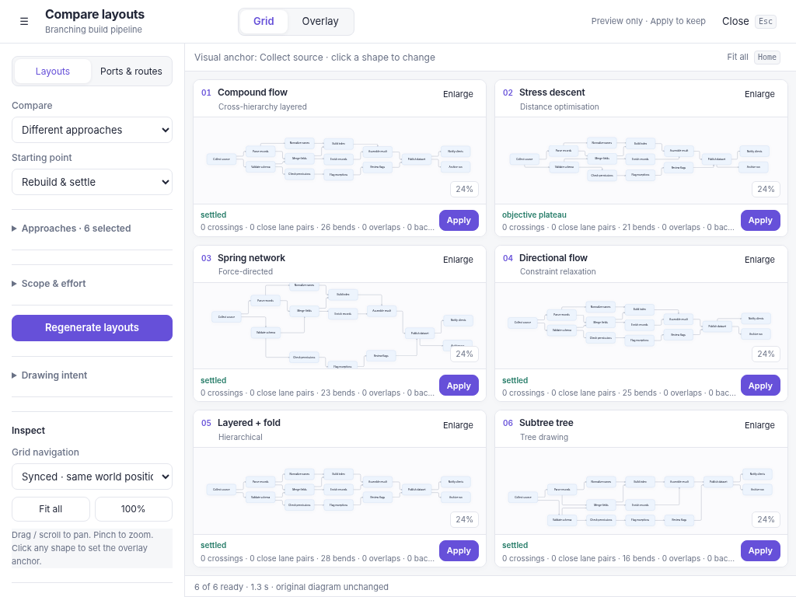
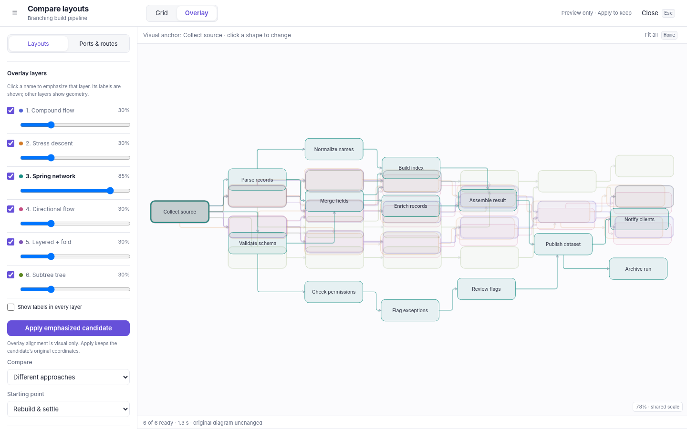
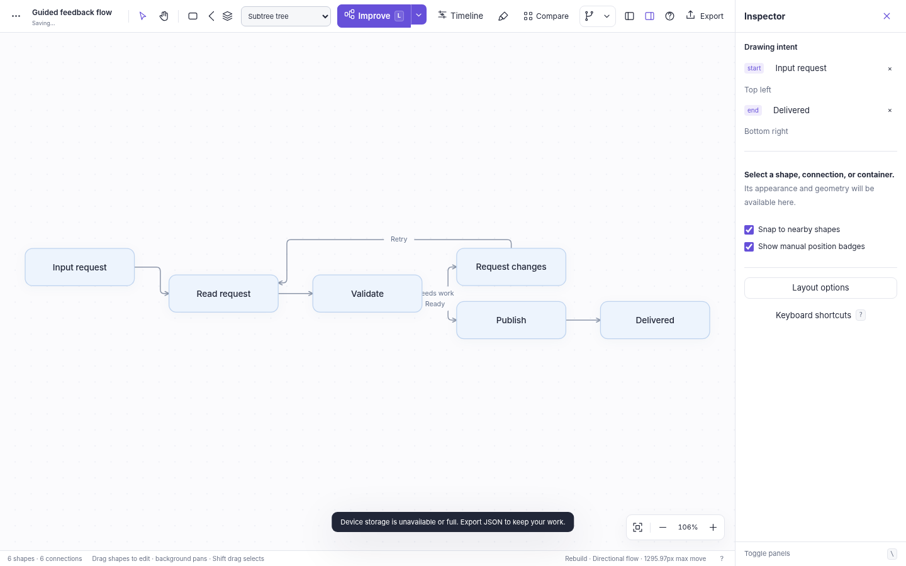
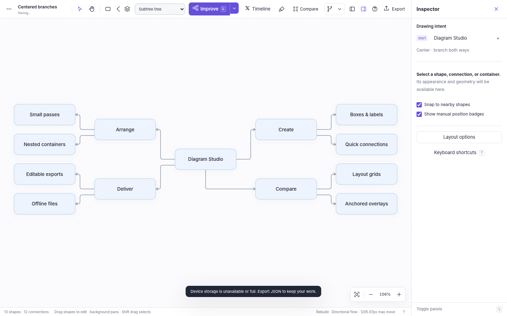

# Comparison and drawing intent
## Diagram Studio v6 · release notes and working guide

The editor is still one offline HTML file. This revision changes how alternative drawings are inspected and how a person can communicate the intended beginning, ending, and overall orientation of a diagram. It does not add saved views, a server, a new semantic taxonomy, or another layout algorithm selector.

## 1. More room for the actual diagrams

**Compare** or **Alt+E** opens a full-viewport workspace. Configuration occupies a left rail, approximately one fifth of the available width on a desktop. The rest is the comparison surface. The rail can be hidden from the top-left control.

Only the control rail scrolls. The grid, modal, and diagram region do not grow into a scrolling contact sheet. Candidate cards use flexible plots and compact headers/footers; the layout chooses a useful row/column arrangement for algorithm comparisons. A two-parameter grid preserves its actual parameter columns and rows. Six candidates were checked at 1024 × 768, 1440 × 900, and 1920 × 1080 without diagram scrolling.

Fitting all drawings simultaneously can still make labels small, especially for a very wide graph. That is a real tradeoff, not an excuse to hide the other drawings below the fold. Hide the rail, zoom the previews, use object-focused navigation, or enlarge one candidate for detailed inspection. Grid comparison is the whole-picture tool; Overlay is the relative-position tool.

## 2. Grid and Overlay are two presentations of the same experiment

The top switch does not run layout again. Both presentations use the same frozen source document, generated candidates, routes, and reports. Closing the workspace does not apply any result.

In **Grid**, the existing navigation choices remain: synchronized world coordinates and scale, focus on the corresponding clicked object with shared offsets, or independent cameras. Clicking a shape changes the visual anchor. Clicking does not assign layout intent or pin anything.

In **Overlay**, the drawings are stacked on one canvas. Every candidate is translated so the chosen node center coincides. Translation is the only alignment: there is no rotation, per-layer rescaling, fitting of multiple nodes, or modification of the candidate document. The scale is shared. Relative displacement, route differences, branch distribution, and occupied area remain comparable.

Click any visible shape to make it the new visual anchor. The corresponding shapes align immediately in all candidate layers. Enter or Space on an active-layer shape provides the keyboard equivalent. On a collapsed region, comparison can use the visible ancestor as its camera reference; it does not unfold or edit the original diagram.

Each layer has a visibility checkbox and an opacity slider from 5% to 100%. Clicking its name emphasizes that layer and brings it to the front. By default the emphasized layer is 85% opaque, the others are 30%, and only emphasized-layer labels are shown. A slider change is treated as deliberate and is retained across emphasis changes. “Show labels in every layer” is available when label comparison is useful. Dense overlays can be visually busy; hide irrelevant layers rather than treating six superimposed texts as the only way to compare.

**Apply emphasized candidate** uses that candidate's original positions and routes. The alignment translations are display-only and are never committed. One undo restores the editable starting document.

## 3. Visual anchor, layout intent, and pin are different

| Control | Meaning | Lifetime |
| --- | --- | --- |
| Clicked visual anchor | Align or inspect corresponding objects across previews. | Comparison session only; no geometry change. |
| Start/end with preferred area | Tell layout where the drawing should begin/end and approximately where that shape belongs. | Authored `layout.intent`, included in diagram JSON. |
| Pin | Keep the current world position during automatic layout. | Authored geometry protection until released. |

The same shape can be both the visual anchor and the authored start, but one does not imply the other. An authored start does not become pinned. A pinned shape can have a preferred area that cannot currently be attained; the pin takes priority.

## 4. Give the drawing a start and an end

Select a shape and open the inspector. **Start here** or **End here** records its role. Choose a preferred area. The operation is undoable and changes no positions; run Improve, a rebuild preview, or Compare when ready to arrange the drawing. Alt+S and Alt+End are also registered shortcuts. Physical Mac Option-key behavior has not been hardware-tested; the inspector controls are the primary discoverable path.

One start and one end are supported. They must be different shapes. Assigning the other role to the same shape clears its previous role. Deleting a role shape removes the dangling preference; undo restores it with the shape. Containers and connections cannot directly be start/end records in this slice.

Start defaults to **Top left**; end defaults to **Bottom right**. Other compass areas include Left center, Top center, Right center, and the other corners. Areas refer to diagram/container-relative geometry, not browser pixels. They do not place a shape at a permanent screen coordinate or move the camera.

In Compare, **Drawing intent** offers “Use clicked shape as start/end.” These are experiment settings. Generate to evaluate them. The editable source remains unchanged until a candidate is applied. The port/routing comparison keeps the baseline's existing intent and shape positions; it does not quietly apply an edited layout preference while claiming to test routing only.

## 5. Cycles stop deciding the start by accident

A feedback arrow can make every node in a process appear to have an input. Pure connectivity alone cannot reliably identify the start the author has in mind.

The local topology pass now considers the authored start first. Incoming directed arrows into that start, and outgoing arrows from the authored end, are treated as feedback relationships for forward ordering. Remaining cycles are broken deterministically for ranking. No relationship is removed, reversed, or rewritten; all arrows remain rendered with their original direction. Undirected connections remain undirected and do not impose forward order.

At a container boundary, the hinted descendant is mapped to its appropriate sibling-level owner for outer arrangement, then the hint also guides the actual child within its parent. This is not equivalent to pinning the outer container. Fixed frames, pins, scope boundaries, and a bounded pass's cumulative movement budget still take precedence.

The direction control continues to mean RIGHT or DOWN. A contrary area choice is a soft preference, not an automatic new flow direction. Set direction deliberately. Infeasible or competing preferences are reported as approximate rather than overridden with hidden node movement.

## 6. Centered branching without radial shells

Choose **Center · branch both ways** for a start to describe a mind-map-like structure. This adds a dimension-aware, two-sided spanning-tree target around the chosen start. Branches are balanced by their occupied subtree spans. RIGHT makes left/right branches; DOWN makes above/below branches. Directed forward pressure on each branch points outward rather than forcing the left-side branches back to the right.

The tree and rank-oriented families use that structural target directly; other connective solvers receive a bilateral starting structure and retain their own relaxation behavior. Non-tree links remain present. Dense merges, cycles, pins, and boundaries can produce less symmetrical results than a clean tree. Separate overlaps remains only a collision-repair operation and does not honor this as a structural layout instruction.

This is not the retired radial-shell algorithm. There is no radius or circumference-based expansion. The example **Centered branches** demonstrates a clean branching case; **Guided feedback flow** demonstrates an explicitly chosen start through a recycle loop. Both are editable JSON examples and are in the application's example menu.

## 7. Exports and migration seams

Save sheet exports the current presentation: a fitted grid sheet in Grid, or the visible aligned layers in Overlay, including opacity and a legend. Export is a static SVG; the diagram's own SVG export remains the editable-document export. Save experiment retains the baseline, generated settings, original candidate geometry/routes, presentation, visual anchor, and layer preferences. The ordinary File menu does not yet restore an entire experiment session; its individual candidate documents are normal diagram documents.

There are three new public helpers: `setIntent(role, id, placement)`, `comparisonView('grid' | 'overlay')`, and `anchorComparison(id)`. `setIntent(role, null)` clears that role. `explorerState()` also reports overlay state and the per-candidate anchor centers. These diagnostic structures are not a separate durable SDK contract.

The maintainable sources in `source/` rebuild the exact standalone HTML. The longer INTENT dump retains the product history and migration notes. PARAMETERS records the current controls and CODE-MAP identifies the relevant functions. No repository was modified in this revision.

## 8. What was actually checked

The release has 195 named engine assertions and 40 Chromium browser assertions. The broad sweep covers 55 layout/routing combinations. No node overlaps, blocked routes, or insufficient lane-gap pairs were detected in that sweep. Twelve combinations retained crossings; fourteen retained forward-order conflicts. Those counts describe the fixtures, not an optimality or universal quality guarantee.

Browser checks use the exact built HTML injected into Chromium because the environment blocks file and loopback navigation. Native local-file startup, file-origin persistence, browser download destinations, physical Mac gestures, Firefox/Safari, a complete accessibility audit, and performance at maximum import limits remain unverified. See the complete, per-check ledger in `verification/`.
