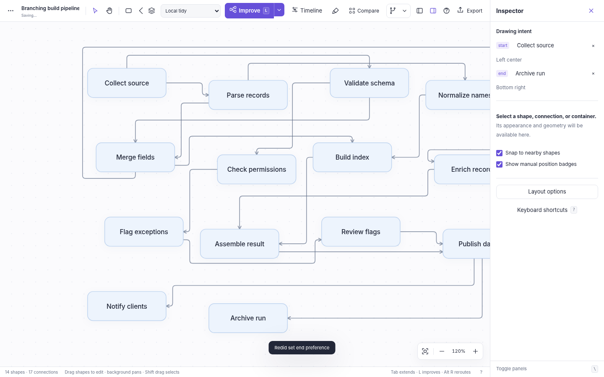
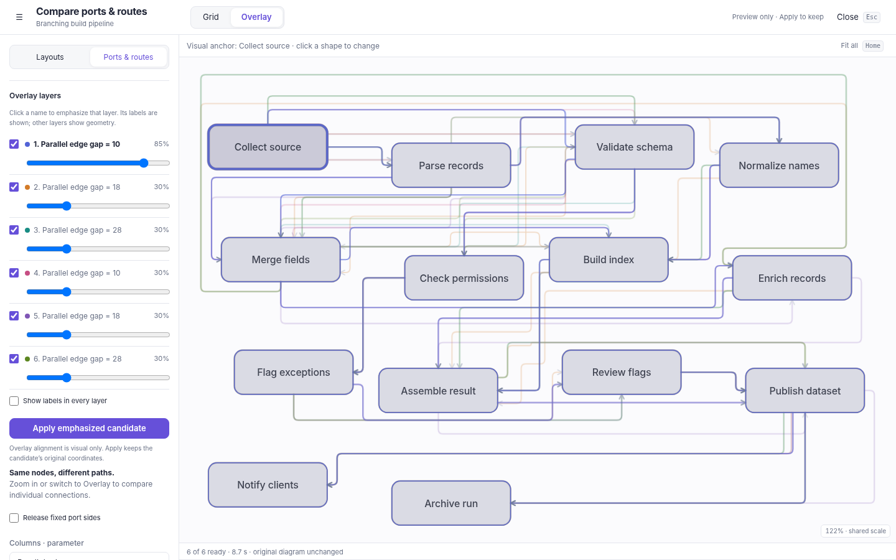
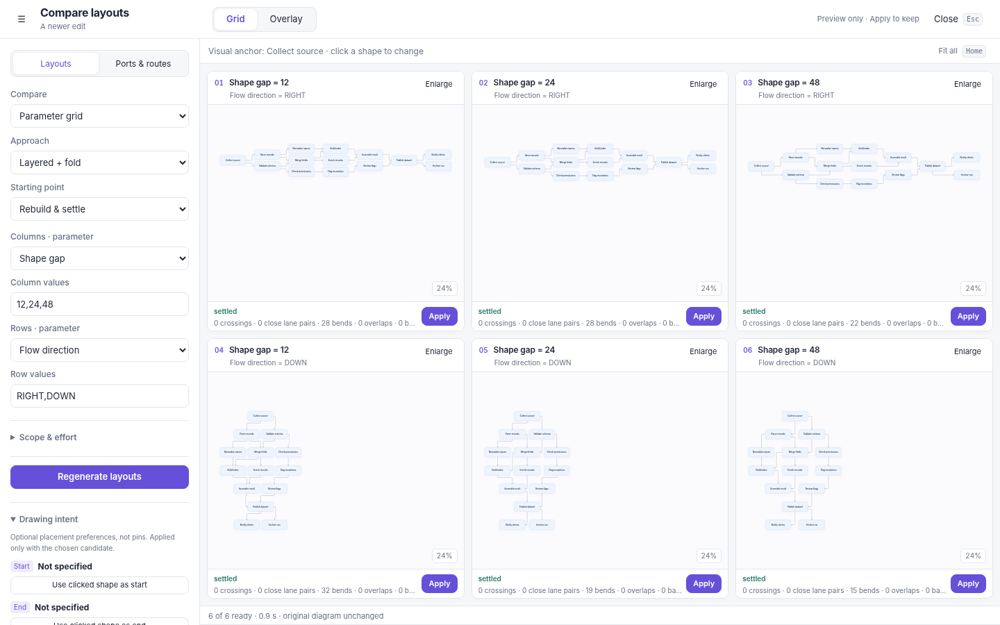

# INTENT dump
## Diagram Studio · product memory and engineering handoff

**Edition:** v7 standalone editor. The decision history is retained. The v7 section below adds recorded layout journeys and local spatial editing; earlier comparison and placement contracts remain unless explicitly superseded. **Audience:** the person bringing this prototype into a full web application, and the developers or agents working with them.

**The central intent:** make a good-looking diagram extremely quick to create, connect, rearrange, and refine. The useful result is the drawing—not a complete metadata record, not a gallery of controls, and not the number of algorithms in a menu.

This document preserves the product decisions behind the supplied code. It separates requirements from implementation choices and future migration proposals. It is not a claim that every desirable behavior is solved for every graph. The executable checks, current source, and qualified limitations are part of the handoff.

The authoritative editable artifact is `diagram-studio.html`. The `source/` directory contains the same implementation split into maintainable files; `source/build.py` reconstructs the standalone file. This document is also supplied as an offline HTML reading edition. This revision does not regenerate earlier PDF/Word editions. The current control ranges are in `PARAMETERS.md`; exact source symbols and locations are in `CODE-MAP.md`.

---

## v7 addendum · layout as a reversible conversation

### What the user asked for

The problem is no longer primarily “generate a decent diagram.” The current tool can already make useful global layouts and compare them. The new problem is that a full layout can destroy the part of a nearly finished drawing that a person has deliberately arranged. A result may be preferable across most of the diagram and undesirable in one small area. The person often discovers that area only after seeing the result; requiring a perfectly specified selection before running layout asks them to predict the problem in advance.

The requested interaction is therefore temporal as well as spatial: inspect the path from the current drawing to a computed endpoint, stop anywhere useful, identify when a region lost its intended form, retain improvements elsewhere, and locally rewind or refine without abandoning the whole result. A local human preference may increase the global layout objective. That is not automatically a failure; it can be evidence that the global objective is not an adequate description of the author's intent.

The user also asked for a cursor-centered influence area that can grow or shrink and fades at its edges. This is not a new permanent selection model. It should let a person act on what they are looking at without repeatedly preparing a precise selection and then wondering whether the selection was responsible for an unsatisfactory result.

### New product rules

A timeline starts at exact current geometry. Its stops are recorded solver checkpoints, not a straight endpoint interpolation disguised as optimization history. The endpoint is the computed finish of the configured method, with its actual stopping reason. A sampled checkpoint index is not a percentage of goodness or a percentage of solver convergence.

The default temporal preview is a nearby meaningful change. The future ghost seeks approximately 48 screen pixels of change for at least one object when such change remains. The endpoint can be selected explicitly as the ghost. This visual threshold is a new implementation choice, not a user-specified numerical requirement. It helps avoid making the only visible choice “this familiar diagram” versus “a completely different arrangement.”

The live document must not be repurposed as the preview buffer. Scrubbing and hovering cannot silently autosave candidate positions, dirty the undo stack, export the wrong drawing, or lose the baseline on cancellation. In v7 the renderer reads `S.sculptNodes`; the committed `D` remains unchanged until Keep. The camera is a separate exception: pan/zoom remains ordinary navigation. Fit path is explicit and fits all recorded positions with a single scale and center.

A bookmark records a coordinate source. It does not commit that frame or pin those shapes. After accepting a later checkpoint, Restore from bookmark uses that source only for matching shapes under a spatial brush. The rest of the later arrangement remains. This makes the desired “keep 90%, undo 10%” workflow concrete, while acknowledging that some old positions may now be occupied.

The brush is local assistance, not a hidden global layout invocation. Hover only previews. Holding or dragging applies bounded local dabs, and release groups the whole stroke into one undo entry. The influence is strongest over the rectangle and tapers smoothly to zero at the radius. Unaffected objects keep bit-identical positions. Frame geometry and hierarchy membership are not brush targets in this slice.

Restoration and other local policies do not have to improve the global objective. They do have to preserve geometric hard constraints. The implementation applies rectangle collision and containment guards, per-dab movement caps, and pin/ancestor protection. It may attenuate or refuse a requested local motion rather than force it through other objects. The user is never promised that every earlier local configuration remains reachable in a changed surrounding drawing.

### Local holds are not ordinary pins

A hold records the user's desire to preserve repaired geometry during a subsequent automatic pass. It is session state, shown separately in teal, and is not inserted into the exported graph or ordinary pin fields. Both the simple layout path and the comparison path supply local holds to the engine as temporary fixed IDs. The engine propagates that protection through relevant ancestor moves. Brush restoration can continue through its own local holds, but not through actual pins.

Hold and release strokes participate in undo/redo, including when no geometry changes. Hold state is cleared when switching diagrams and does not persist across reloads. This is a deliberate bounded scope for the prototype. For durable constraints the author uses existing pins. A full web application should decide explicitly whether local holds belong to a persisted work session; it should not accidentally turn them into semantic metadata simply because the prototype uses a Set.

### Temporal history remains separate from the source

The latest recorded path is kept in memory and saved to a separate browser-history key when it fits the size cap and storage is available. A new recording replaces the last saved one; this is not an unbounded project history system. Timeline JSON is an explicit export format containing the source baseline, frames, bookmarks, settings and report. It can be reopened through the file importer. Changing graph structure or pin/size constraints can invalidate a historical path; a stale recording must not overwrite newer source data.

Keeping a checkpoint is one transaction. Keeping a brush stroke is one transaction. A cancelled preview or interrupted stroke is no transaction. Reopening history and inspecting it is not a write. JSON/SVG/PNG diagram exports remain committed output; timeline JSON is a different, explicit artifact. SVG and timeline files can include all editable graph data and embedded images, so they must not be represented as sanitized screenshots.

### Implementation choices, not stronger promises

The v7 timeline warm-settles with the existing approach. It is not the exact same sequence as repeatedly invoking L because L retains a movement disc and positional stability. Recording samples internal progress, thins older checkpoints to bound memory, and retains the original and final geometry. Intermediate states can be less desirable than neighboring states. The controls and reports make that observable rather than assigning a universal quality score.

The brush uses original small spring/alignment, directed, rectangular separation, and restoration steps. It does not load new layout libraries. It targets visible leaf nodes, not container frames or collapsed content. The per-dab cap is not a total cap on a long stroke. A held pointer requests repeated dabs, so a deliberate long hold can produce more total movement than a click. Routing still runs independently after positional changes and can retain crossings or other residuals on constrained graphs.

The current release does not claim topology-preserving continuous animation, exact local/global constraint optimization, unlimited undo history, or production-scale fluidity. Those are separate commitments that would need separate tests and architecture. The central success criterion remains: make a promising change observable, cheaply reversible, and locally correctable.

### v7 acceptance additions

| ID | Required behavior | Implemented contract |
| --- | --- | --- |
| PATH-01 | Preview progress toward a finished arrangement. | Recorded checkpoints from exact baseline to computed final output; explicit stopping reason. |
| PATH-02 | Preview a useful amount of change without losing orientation. | Near-future ghost, optional final ghost, stable camera, explicit Fit path. |
| PATH-03 | Roll back to a specific useful point. | Scrub, hover-peek, bookmarks, Keep; one undo transaction. |
| PATH-04 | Retain a past source after keeping a later arrangement. | Restore bookmark, reopen latest recording, import/export timeline JSON. |
| LOCAL-01 | Act spatially without exact preselection. | Resizable cursor field with smooth falloff, hover preview, held or dragged strokes. |
| LOCAL-02 | Keep surrounding improvements while repairing a region. | Restore moves only influenced matching shapes; outside positions remain unchanged. |
| LOCAL-03 | Human local preference can differ from global optimum. | Local proposals are geometry-guarded, not globally energy-gated. |
| LOCAL-04 | Repaired areas survive another automated pass. | Optional transient holds passed to Improve, Timeline and Compare. |
| SAFE-07 | Preview, interrupted gesture and history are non-destructive. | Separate render buffer, stale checks, cancellation, one-command stroke undo/redo. |

The working guide is [CHANGES-v7](CHANGES-v7.html). Parameters and code seams are updated in the corresponding reference documents. Current evidence is in `verification/CHECKS.md`; prior assistant summaries are not evidence for this binary.

---

## v6 addendum · simultaneous comparison and authored orientation

**The v6 comparison request is implemented as three separate state concerns.** They must not be collapsed into a single ambiguous “anchor” feature during migration.

**Comparison presentation** is transient. Grid and Overlay share the same generated candidates. A full-viewport dialog gives configuration roughly 20% of horizontal space and diagrams the remainder. Only the left rail scrolls. Candidate counts still have a finite safety limit; the default is six. The grid is explicitly height-bounded. Algorithm comparison chooses an arrangement that improves fitted diagram scale; a parameter grid preserves the actual parameter axes. Controls can be hidden. This supersedes the previous scrollable contact sheet.

**Visual correspondence** is transient. Clicking a shape in a preview selects the shared visual anchor. In Overlay, candidate i receives the display translation `(-anchorCenter[i].x, -anchorCenter[i].y)` before the shared camera transform. Therefore exactly one corresponding node center coincides. There is no multi-node best-fit algorithm, rotation, or per-layer scale normalization. Translations are never written into a candidate or the editable document. Clicking the overlaid shape, or pressing Enter/Space on an active-layer shape, changes that reference without running the solver. Per-layer visibility, opacity, and emphasis are also presentation state. Active labels are shown by default; other layers use geometry only.

**Drawing intent** is authored. Optional `layout.intent.start` and `layout.intent.end` each contain a shape ID and a preferred area. There is at most one of each and they must identify different shapes. Assigning a new role to the other role's shape clears the old assignment; import rejects a malformed object that claims both. Setting a role is one undoable edit and does not immediately change coordinates or set a pin. Deletion removes dangling hints and undo restores them. Comparison-specific intent is cloned from the baseline and changes only generated candidates until Apply.

The input/start can be top left, left center, or center, among the finite compass positions. The default end is bottom right. Area coordinates are relative to the relevant drawing or container region; they are not browser coordinates. Pins preserve exact positions, whereas these preferences communicate desired ordering and broad placement. Hard geometry protections and action scope take precedence.

For cycle handling, the intended start is considered first. Incoming directed edges to it and outgoing directed edges from an intended end are feedback for the rank/forward-constraint graph. The original edge records, arrowheads, and displayed return paths are not removed or reversed. Remaining cycles are handled deterministically. This gives authors a way to resolve an ambiguity that connectivity alone cannot settle. It does not make a cyclic graph entirely monotone.

A center start enables a dimension-aware two-sided spanning-tree target. Branch spans, not an expanding radial circumference, determine the split. RIGHT means left/right branches; DOWN means above/below. Each branch has outward forward pressure. Cross-branch and non-tree edges remain; dense networks can still favor uneven or approximate placements. The retired radial-shell algorithm is not reinstated. Separate overlaps deliberately does not become a mind-map or flow-layout method.

Hints are projected onto sibling-level owners when nested containers are arranged, then down to their actual child. A leaf hint is not permission to resize a fixed frame, cross a scope boundary, move a pinned ancestor, or exceed the combined inherited-plus-local movement cap. Reports expose the role, area, error, pinned status, and whether the preference reached its local tolerance. Tolerance is `max(12, nodeGap)` world pixels; this is a diagnostic threshold, not a promise of exact placement.

Apply remains a single normal editor transaction. It commits the chosen candidate's original geometry, its generated routes, and its authored intent; it never commits the display alignment transform. A document-identity check refuses stale candidates. Closing, hiding layers, choosing another visual anchor, or moving a comparison camera remains non-destructive.

New examples are **Guided feedback flow** and **Centered branches**. The current working instructions are in [CHANGES-v6](CHANGES-v6.html), the new fields are in [PARAMETERS](PARAMETERS.html), and function-level seams are in [CODE-MAP](CODE-MAP.html). Current test results are in `verification/`, not inferred from earlier assistants' summaries.

### v6 acceptance additions

| ID | Requirement | Implementation / evidence |
| --- | --- | --- |
| EXP-10 | All six candidates visible at once without diagram scrolling. | Checked at 1024×768, 1440×900, and 1920×1080. Only controls scroll. |
| EXP-11 | Grid and Overlay switch without new solver work. | Candidate serialized state remains unchanged. |
| EXP-12 | Click a shape to align every overlaid candidate. | Pointer and keyboard checks; centers coincide within 0.01 screen pixel in the fixture. |
| EXP-13 | Per-layer opacity, visibility, and emphasis. | Exercised without changing the source or generated document. |
| INTENT-01 | One optional start and end with rough area preferences. | Inspector and comparison paths; validation, undo, deletion checked. |
| INTENT-02 | Human-selected start controls feedback interpretation. | Cyclic fixtures and original arrow preservation checked. |
| INTENT-03 | Centered branches without radial spreading. | Bilateral, dimension-aware targets; all connective families tested on the clean branch fixture. |
| INTENT-04 | Pins, frames, scope, and movement budget beat preferences. | Engine constraint checks include inherited motion and nested pins. |
| HANDOFF-03 | Complete rebuildable release in one actual ZIP. | `source/package.py` creates a checksum manifest and CRC-tests the archive. |

---

## 1. What this tool is for

The user repeatedly describes diagramming as drawing boxes, connecting them with arrows, and drawing boxes around related boxes. That simple description includes substantial difficulty: the connections need to be readable; the containers need to behave predictably; the diagram must remain useful as its content changes; and automatic layout must not destroy the work already done by hand.

A person should be able to start from an empty surface, type a sequence, introduce a branch, wrap part of it in a container, and get to a presentable drawing without a long detour through forms. The surface should look good before the person knows how its rendering system works. Attractive colors, sensible shape sizes, readable labels, tidy arrows, and useful whitespace are part of the core feature, not final decoration.

The initial material also discusses source-code visualization, identity boundaries, data transformations, before/after diagrams, screenshot annotation, and interactive architecture maps. Those are evidence for the kinds of drawings the tool should accommodate. They do not make static analysis, identity modeling, workflow execution, or repository indexing mandatory features of this standalone editor.

The current scope is deliberately narrower than the first brief: a fast, dependable editor with unusually useful arrangement and routing assistance. The user explicitly rejected much of the original semantic interface after trying it. The migration must not quietly restore that rejected interface merely because older code or the original brief contains it.

### 1.1 The practical success test

A successful session ends with a drawing that the person can understand at a glance and can still change. It should take little effort to add another step or relationship. Small manual adjustments should remain small. The person should be able to try another arrangement without gambling the existing drawing, and should be able to inspect why one configuration is better than another.

The v5 request made visual comparison a primary workflow. The v6 request makes simultaneous visibility and anchored overlays essential to that workflow. Choosing an algorithm is not enough: direction, gap, ordering, positional stability, port selection, and route spacing also materially change the result. The application should turn those settings into observable alternatives rather than force the user to remember a sequence of previous previews.

No measured tenfold speed claim is made. “Ten times fewer clicks” is a product ambition. It motivates continuous keyboard creation, good defaults, low-friction comparisons, and explicit undo boundaries. It is not a benchmark result.

### 1.2 What would count as failure

A graph editor can expose every requested command and still miss the intent. Examples include a canvas squeezed between permanent panels; a diagram made unreadable by a title overlay; a solver that keeps spreading nodes until labels become tiny; a default pan tool that prevents an expected node drag; or parallel connectors that are technically distinct but cannot be visually followed.

Another failure is an attractive comparison grid whose cells start from different documents or whose Apply action produces a different route from the one just inspected. The experiment itself must be trustworthy. Equal starting state, visible settings, honest stop conditions, and exact application matter as much as the thumbnails.

---

## 2. Evidence and decision precedence

There are four distinct kinds of statements in this handoff.

**User intent** comes from the supplied original brief, dated voice memos, and direct feedback in the iteration conversation. **Implemented behavior** comes from the supplied v6 source and the current check ledger. **Research context** explains established layout or routing concepts and names the primary source. **Migration proposals** describe an advisable next implementation structure; they are not features already shipped or decisions already made by the user.

The most recent explicit user decision takes precedence over an earlier speculative idea. Repeated needs are stronger evidence than an isolated suggestion. A visual complaint is a product requirement even when it is not expressed as a formal algorithmic constraint.

### 2.1 Original source material

`docs/evidence/original-brief-and-transcripts.txt` preserves the supplied brief and complete transcript material. Important sources include:

- **July 2, 2026 — “Diagrams, layout, and the pain of making visual structure explicit.”** Establishes boxes and arrows, nested boundaries, different internal versus external layouts, and the pain of losing manual work when layout changes.
- **July 3, 2026 — “Diagramming tools: rendering, views, and limits.”** Establishes the value of good routing, spacing, and progressively understandable structure. Its saved-view ideas were explored and later removed from this product interface.
- **July 16, 2026 — “Quick whiteboard-and-diagram tool requirements.”** Establishes instantaneous creation, useful image/icon nodes, good default typography, and pleasing default boxes and arrows.
- **July 17, 2026 — “Screenshot annotation tool as a diagramming and design-workbench.”** Establishes shape/label separation, leader lines, editable containers, automatic membership, fast agent-authored starting data, and durable exports.
- **August 21, 2026 — “Diagramming-focused public presence and portfolio strategy.”** Establishes the importance of rendered, inspected, distributable results and the combination of generated structure with manual refinement.

The broader application-visualization memos remain background domain evidence. They should not be used to smuggle source-path fields, code analysis, repository features, or new semantic categories back into the default inspector.

The prior repository reference was `byronwall/user-flow-workbench` at `9d582f1bfcab1572ce80133977945d51b3ad96a6`. Prior iterations inspected its graph types, camera tests, DOM-to-vector capture, workbench, canvas, styles, and product context. That project informed separation of graph meaning from layout, title-oriented canvas nodes, and dependable direct interaction. This turn did not change or re-inspect that repository. The new code is a standalone implementation, not a patch claimed to have landed upstream.

### 2.2 Decisions made through the iterations

| Stage | Decision that survives into the handoff |
| --- | --- |
| Initial brief | One standalone executable; good-looking fast diagram creation; nested groups; useful automatic layout; editable export and agent API. |
| Feedback after v1 | Remove permanent library/source/views clutter, semantic fields, repeated canvas title, legend, and command palette. Put common actions in the top toolbar; let the canvas dominate. |
| Feedback after v2 | Add genuinely different layout families and configuration. Prefer small iterative improvements over repeated total reconstruction. Keep deterministic rebuilding separately available. |
| Feedback after v3 | Improve automatic ports jointly with routes; support cross-container connections and compound arrangements; reduce creation steps and clicks. |
| v5 feedback | Restore Edit as default and Escape destination; enlarge side-panel text slightly; add layout and routing parameter grids; separate parallel edges; respect arrows; retire the unhelpful radial choice. |
| v6 feedback | Put comparison controls in a left rail and keep every diagram visible; add click-to-anchor, variable-opacity overlays; let an author specify a start/end and preferred area without pinning coordinates. |

The intermediate request for pan-first behavior is superseded by the latest explicit request for Edit-first behavior. Pan remains useful, including over objects when deliberately selected, but it is no longer the default tool. Similarly, old saved views are not being revived under another name. Comparison candidates are temporary experiments over a frozen document, not alternate persistent diagram identities.

### 2.3 Current quotations that should guide tradeoffs

The v5 feedback asks to “eyeball all six” options rather than repeatedly changing a parameter and invoking another preview. It asks for edges that are “nice and smooth,” without “odd bends,” and a minimum buffer between routes running in the same direction. It states the main goal as connecting nodes and being able to see the edges separately.

These statements mean that a purely mathematical shortest route is not automatically the preferred route. A few extra world pixels can be worthwhile when they produce a clear shared corridor with distinct lanes. Conversely, extra bends that achieve no meaningful clearance are a defect, not evidence of routing sophistication.

The user also says that existing diagram rendering and node sizes feel good. The UI typography adjustment should therefore target the inspectors and object outline, not enlarge every node or change the whole visual system.

---

## 3. Current product contract

The ordinary editor should have one active diagram and a clear current tool. The graph’s nodes, edges, and containers remain explicit. The scene has positions and presentation settings, but a person should not have to understand the schema to make a drawing.

**Editing takes priority.** A primary drag on a node in Edit moves that node or its selected group. Escape returns to Edit after cancelling a higher-priority operation. A background drag pans. Shift-background-drag selects a region. Trackpad scrolling pans; pinch-style input zooms at the pointer. These distinctions should remain stable across future renderer changes.

**Layout is requested, not continuously imposed.** Adding or dragging a node does not authorize an unannounced full rebuild. A bounded Improve action is the normal arrangement operation. A settled rebuild is a deliberate alternative, with preview or comparison before commitment.

**Pins are stronger than visual tidiness.** A pin protects a position from layout, including motion that would otherwise be inherited from an ancestor container. Manual placement is recorded but is not automatically a pin. Manual protection is an explicit setting.

**The route never changes the graph.** Automatic port selection and rerouting may alter attachment sides and route geometry. They do not reverse the edge’s meaning, invent a junction, merge two edges into a hidden bus, or move nodes to hide an infeasible route.

**Experiments are isolated.** Generating, inspecting, panning, enlarging, saving, or closing a comparison cannot change the live document. Apply is the only committing action, and it enters the same undo mechanism as other edits.

**Limits are visible.** A solver stops at a practical condition or effort limit. A difficult routing case may retain a crossing or insufficient lane gap. The interface reports those facts instead of pretending that completion means optimality.

### 3.1 Not in the current product

The standalone editor does not provide accounts, collaboration, a server-side project store, repository parsing, executable workflows, application-specific semantic taxonomies, or persistent shared views. It does not turn arbitrary SVG into editable graph structure. It does not contain ELK, libavoid, or a complete implementation of every paper discussed in earlier reading material.

The optional original-style metadata fields—details, tags, source path, source symbol, actor/process/handoff meanings—are deliberately absent from the default editor. This is a product simplification, not missing form work waiting to be restored.

---

## 4. Surface area and visual hierarchy

The main canvas should receive the most practical screen area. Both side panels begin closed. The left panel is an object outline with search; it is not a gallery of large creation cards. The right panel is a compact inspector for the current shape, edge, container, or selection. The bottom status strip stays thin. Zoom and Fit remain near the lower-right canvas edge.

The title belongs in the top title area. It is not repeated as a floating object on the diagram. The ordinary canvas has no semantic legend, sample story cards, saved-view bar, editable source panel, or command palette.

Common tools and layout actions live at the top: selection, pan, basic shapes, container, connection, undo/redo, quick list creation, Improve, comparison, reroute, panels, help, and exports. Less frequent operations belong in menus, the relevant inspector, or an expanded laboratory. This keeps the common path visible without requiring every configurable option to occupy the top row.

The side-panel controls retain the modestly larger v5 type. Actual shape labels and default node dimensions remain unchanged. Comparison now uses a compact title bar, a left configuration rail, and a bounded diagram surface. Enlarge remains available, but it is no longer a workaround for diagrams pushed below a tall form.

The comparison dialog occupies the full viewport. Only its control rail scrolls. Algorithm comparisons choose useful grid dimensions based on available space and drawing proportions; parameter comparisons preserve their row/column meanings. All candidate cards stay within the diagram surface rather than requiring contact-sheet scrolling. At very small widths the controls become a hideable drawer. Six candidates were checked at 1024 × 768, 1440 × 900, and 1920 × 1080.

### 4.1 Useful empty states

An empty diagram teaches the shortest useful path: press N, type a title, press Tab to keep going. The list builder is another direct route. It should not start with a project taxonomy or a request to fill metadata.

An empty inspector explains how to select something and exposes only a few globally relevant switches. A comparison with no graph still renders usable empty candidates instead of throwing a layout error. An invalid experiment reports the specific error and leaves the live graph intact.

### 4.2 What the rendering does and does not communicate

Node titles are the main on-canvas text. Shape, color, and icon can help distinguish objects, but those are presentation choices rather than required business semantics. Containers use a title near the upper-left boundary. Edge labels are separate from node titles. Detached label leaders are separate from real relationships.

Manual and Pinned badges have different meanings. Manual says the position was moved by hand. Pinned says automatic layout must protect it. In particular, moving a container should not make every child appear independently hand-positioned.

---

*Figure 1. The normal editor with both optional panels open. They remain closed by default.*

## 5. Interaction model and creation flow

### 5.1 Edit, Pan, Connect, and temporary states

`S.tool` stores the active tool; v6 starts it as `select`. The shell labels that tool Edit/select. H deliberately enters Pan. V explicitly returns to Edit. C enters sticky Connect. Creation tools include R for rectangle, D for diamond, O for ellipse, T for text, and G for container drawing.

Escape resolves the active interruption before clearing ordinary selection. It cancels an in-progress solver or preview, dismisses the relevant transient surface, or finishes the active modal cancellation. It then returns from Pan or Connect to Edit. Repeated Escape must settle into Edit rather than cycle through unrelated modes. Inline title editing handles Escape locally and returns focus to the canvas.

This is an ordered state interaction, not a requirement that every single Escape press both discards all work and changes tools. For example, a layout preview is discarded before an ordinary selection is cleared. The important invariant is that repeated Escape has a predictable resting state: editable diagram, no active connection source, no unintended pan mode.

### 5.2 Keyboard-first construction

N adds a default box and opens its title editor. Tab commits the title and creates the next connected box, already editing the new title. Shift+Tab creates a sibling branch in the quick-extension workflow. Alt+arrow requests a new connected object in that direction. Enter edits the selected title or edge label.

The list builder, opened by B, accepts multiple titles and can make a sequence, a fan-out, or separate nodes, optionally wrapped in a named container. It is useful when the person knows the rough graph before touching the canvas. The build is one undoable operation. Multiline paste is another entry into that builder rather than a demand to parse a complex DSL.

C can start from a selected node. Clicking an existing node completes a connection. Clicking empty space with a source armed creates a destination and connection together. Dragging a port into empty space supports the same intent. Connect remains active until cancelled; it should not bounce into another chooser after each edge.

A selected edge can receive an inserted step with Tab. This splits the relationship around a new node rather than making the person delete one edge and create two replacements manually. Stable identities and label behavior should be inspected when this operation is modified in the future.

The core acceleration is continuity: choose a direction, type meaningful names, and continue. The person should not have to repeatedly return to the toolbar between adjacent steps in a flow.

### 5.3 Selection and motion

Click selects or inspects a node, container, or edge. Shift modifies selection. Shift-drag on the background produces a marquee. A drag on one of several selected nodes moves the selected roots as a group. If a selected container already contains another selected object, the descendant must not move twice.

Dragging the background pans in Edit. Space-drag and the explicit Pan tool provide temporary or deliberate navigation over objects. Ordinary wheel deltas pan both axes; line- and page-unit wheel events are converted before use. A pinch-style wheel event uses its modifier signal to zoom at the pointer. Holding Cmd while moving the pointer vertically also zooms; modifier-drag is supported separately.

Two-pointer touch gestures are represented as a camera scale and midpoint transformation. Earlier revisions exercised parts of those paths with synthetic browser events; this revision did not repeat a full gesture audit. Physical trackpad and touch hardware remain separate testing work. Browser event handling and a real Mac gesture are related, not interchangeable evidence.

### 5.4 Focus, input fields, and shortcut safety

Global keyboard actions must not hijack normal text input. Typing C in a title does not enter Connect. Tab inside the intentional inline title workflow is a special case with explicit behavior. Composition events should not be interpreted as diagram commands.

Dialogs capture their own interaction. When the comparison dialog is open, editor copy/paste and keyboard dispatch are suppressed. Each comparison tile can receive focus for arrow-key panning, plus/minus zoom, and Home-to-fit. Closing the dialog returns focus to an appropriate live control and leaves the editor in Edit.

A future framework migration must preserve focus through rerenders. The current renderer explicitly tries to restore focus to a recreated selected entity. Replacing that code with reactive components is not sufficient unless pointer capture, keyboard focus, and inline edit lifetime remain correct.

---

## 6. Objects, containers, labels, and positions

### 6.1 Containers are first-class editable frames

A container is an explicit graph entity with its own identity, title, parent, geometry, style, padding, and optional internal direction. It can be selected through its header or empty interior. Dragging it moves the whole descendant subtree. Resizing it is different: its eight handles change the frame while its children retain their world coordinates.

That distinction directly addresses the complaint that a container which constantly shrink-wraps its contents is difficult to enlarge before adding something. The frame is a usable thing to edit, not merely a computed outline around children. Fit contents is an explicit action. Shrinking cannot silently clip existing children; the current implementation constrains the shrink to include content and padding.

Dragging an object into a container establishes membership; dragging it outside removes or changes membership. The smallest relevant containing frame is considered after excluding the dragged object and its descendants, so a group cannot become its own ancestor. Alt during dragging can preserve a parent relationship and allow growth rather than an unintended reparent.

Membership and motion must remain distinct. A route crossing a container does not make either endpoint a child of that container. Drawing a frame over something may intentionally group it, but arranging a graph must not invent membership based only on visual proximity.

### 6.2 World coordinates and inherited movement

Every shape and frame currently stores an absolute world rectangle: x, y, width, and height. Children do not store coordinates relative to their parent. Moving a parent therefore applies the same translation to all descendants. This is easy to inspect and export, but it means every motion path must account for descendants consistently.

A migration may choose relative geometry internally, but that is a proposed implementation change, not a user requirement. If introduced, import/export must remain deterministic and group motion, nested pinning, label offsets, and comparison snapshots must not subtly change behavior.

### 6.3 Manual is not pinned

The manual flag records that an object was moved by hand. It is useful visual feedback, not an automatic lock. The pinned flag protects the object during automatic layout. The “protect manual placement” setting can deliberately make manual flags act as layout constraints for a run.

If a descendant is pinned, moving an ancestor would move that descendant. The layout engine therefore treats the relevant ancestor branch as fixed for translation. Otherwise, a pin would be technically honored in the child’s own solve but violated by a later parent solve.

During a bounded pass, the displacement limit applies relative to the original world position at the beginning of the whole action. Moving a container by part of the budget does not grant each child another full independent budget. The quadratic displacement-disc calculation in `move` enforces that total-motion contract.

Pins protect against layout, not against deliberate human dragging. A person can drag a pinned object; the point is to protect the new placement from a subsequent solver, not create an uneditable object.

### 6.4 Labels and images

A node’s title remains semantic text. Label presentation is separate: centered, above, below, left, right, or detached, with offsets and a leader where appropriate. Moving the shape ordinarily carries the label relationship with it. Containers have their own header convention rather than the node label placement model.

Raster images can be embedded as node content. They travel with the document; the standalone file does not depend on a remote image URL remaining live. The icon set is a finite embedded set, not a network search service. Arbitrary SVG import is not a general scene-reconstruction mechanism.

These features survive from earlier work because they support making diagrams, but they should not dominate the ordinary inspector. The user’s current emphasis is boxes, arrows, nesting, fast editing, and good arrangement.

---

## 7. Direction is part of edge meaning

An edge has a source, a target, and a directed flag. The Arrow checkbox controls directionality. Omitted direction is normalized to directed; explicitly false is undirected. A dashed style does not by itself make an edge undirected. A thick or emphasized line does not define a different topology.

With Respect arrows enabled, ordinary layout approaches try to put sources before targets along the chosen reading axis: x for RIGHT, y for DOWN. The solver includes node extents and a desired rank gap rather than merely separating point centers by an arbitrarily small amount. Undirected edges can still affect attraction and adjacency, but they do not impose a one-way rank constraint.

This expectation applies across algorithm families. Selecting a spring or stress-based approach should not silently discard every arrow. In the current editor, the connective approaches share a direction objective and a feasible forward-inequality projection. “Separate overlaps” is the deliberate exception: its purpose is local collision repair without inventing a new flow layout.

### 7.1 Cycles cannot all be monotone

A directed cycle cannot have every target strictly to the right of its source in one finite arrangement. The implementation therefore finds a deterministic feedback set for ranking and excludes those directed inequalities while keeping the actual edges in the drawing. It does not reverse graph semantics or remove cycle edges.

The report names feedback edges separately from remaining forward-order conflicts. A feedback edge is not automatically a failure. A forward-order conflict after solving is also not automatically an implementation error: pins, fixed-size containers, nested direction choices, or an intentionally small movement budget may make the requested order infeasible in that action.

The feedback set is a stable heuristic from sorted graph traversal, not a minimum feedback-arc optimization. Different grouping projections can reveal cycles at different hierarchy levels. Developers should not treat the chosen set as an authoritative business interpretation of which links are “really” returns.

### 7.2 Direction inside a container versus across containers

A container can inherit the document direction or request RIGHT or DOWN internally. Children within that container use the effective inherited setting. A cross-boundary edge is governed at the lowest common container scope of its endpoints, not by an arbitrary inner direction that belongs to only one endpoint.

The direction report follows that lowest-common-container rule. This matters when an identity container runs downward but sends data to a storage container to its right. Calling that external edge backward merely because the source’s immediate parent is vertical would be misleading.

Hierarchy introduces real limitations. Keeping a frame at a fixed width can prevent its children from occupying a long horizontal rank sequence. Compound layouts improve the relationship between parent placement and connected descendants, but they do not magically make all constraints simultaneously satisfiable. Reporting the conflict is preferable to silently shrinking text, moving a pin, or discarding a parent relationship.

### 7.3 Folding is opt-in because it changes the reading story

The earlier compact arrangement often wrapped a sequence into an unsatisfying narrow or irregular form. The current default uses no sequence folding. With Respect arrows enabled, rank folding is suppressed so a forward chain is not deliberately sent back to the left on another row.

The old folding mechanism remains an experiment for a person who turns off that monotonic direction preference. Aspect ratio is a target or packing hint, not a command to violate arrows or container constraints. A long linear chain inherently needs length if every step must remain to the right of the previous one. The correct response is a different reading direction, deliberate folding, or a different presentation—not a claim that the chain can fit any rectangle with all semantics unchanged.

### 7.4 Radial shells are retired

The radial choice is removed from the active algorithm selectors. A legacy saved setting named `radial` is mapped to `tree` during normalization without automatically moving its existing geometry. The old positions remain editable.

The user’s complaint was consistent and concrete: radial arrangements spread nodes excessively and had not produced a useful result in this work. It would be a mistake to retain it just to advertise a larger algorithm count. The current editor exposes eleven active approaches, not twelve useful ones plus a hidden disappointment.

---

## 8. Layout as controlled improvement

### 8.1 Three execution intentions

A **bounded pass** starts from the current drawing and applies a maximum displacement per object. It is the default Improve behavior. The camera remains under the person’s control rather than resetting with each small pass.

A **current-position settled run** also starts from the drawing, but removes the small-pass movement cap and iterates until the practical stopping condition or effort limit. It is useful when the user wants the same starting structure to relax further without beginning from a canonical seed.

A **rebuild and settle** starts from a deterministic arrangement for the chosen algorithm, subject to protected positions and existing frames, then iterates. It is useful for comparing structural alternatives and for obtaining a reproducible final candidate. Deterministic does not mean optimal, independent of all constraints, or identical across arbitrary future implementation versions.

The comparison workspace makes those distinctions explicit. The ordinary keyboard path remains L for a small improvement and Shift+L for a deliberate rebuild preview. This preserves the earlier desire for safe iterative edits while making complete alternatives easy to inspect together.

### 8.2 Stopping honestly

The settled engine can report `settled`, `objective plateau`, or `iteration limit`. Stability means the observed update magnitude stayed small for a qualifying run of steps. Plateau means the internal objective stopped achieving accepted improvement over its observation window. The iteration cap is an explicit safety and responsiveness bound.

The thresholds are implementation choices: settled runs have a finite minimum observation period, a small movement tolerance, and a plateau window. They are not proof of global optimization. A result can be stable and still have a residual constrained overlap or a poor route. The displayed geometry metrics and constraint notes remain relevant after the solver stops.

Effort applies per solve, not necessarily to the entire document. A nested diagram can require several sibling solves, and compound approaches can repeat hierarchy sweeps. That distinction belongs in performance diagnostics and documentation; a user selecting 640 should not be told that exactly 640 total arithmetic steps occurred.

### 8.3 The active approaches

**Local tidy** favors small local spacing and alignment improvements without replacing the whole drawing’s organization. It is the default starting choice because it is intentionally conservative. Directional pressure still applies when enabled, so it is not simply a collision solver.

**Stress descent** uses desired graph-path distances as a guide for Euclidean separation. It can spread highly related structure differently from strict ranks. In this implementation it is an original local stress-style descent, not a full published stress-majorization package. It should be evaluated with its direction and stability terms, not assumed to behave like any named third-party library.

**Spring network** balances connected attraction, repulsion, and compaction. It is useful for an organic network arrangement, while Respect arrows introduces a forward reading bias. Its unconstrained geometric preference can conflict with a strong hierarchy, making the comparison grid especially useful.

**Directional flow** adds stronger forward separation and neighbor alignment without requiring every node to sit on an immutable rank grid. It is intended for flow drawings where left-to-right or top-to-bottom meaning matters but some local shape freedom is useful.

**Layered + fold** assigns stages, orders nodes within them, and positions ranks. Optional folding remains available only when the direction preference allows it. It is a strong baseline for a directed acyclic flow, but long chains remain long if the person requests strict continuous progression.

**Subtree tree** derives a forest, allocates space to branches, and centers parent positions with respect to their children. A selected root can influence this interpretation. A graph with many merges is not truly a tree; remaining links are still rendered rather than erased to fit the metaphor.

**Soft grid** provides an attraction toward useful nearby grid positions. It is not an instruction to snap every manual move into a permanent rigid matrix. Its behavior remains subject to the movement cap and to other active constraints.

**Separate overlaps** repairs collisions while leaving unrelated clean geometry alone. It does not rebuild a source-to-target flow. It is suitable after a local edit when the existing composition is already good.

**Compound flow** projects descendant connections onto sibling containers for parent-level placement, then refines internal arrangements using actual boundary relationships. Its global leaf ranks are ordering hints, not extra graph edges.

**Boundary alignment** pulls connected terminals toward compatible cross-boundary positions without treating a container’s geometric center as the only meaningful connection point. This directly addresses diagrams where the linked children sit far from their parent centers.

**Compound spring** transfers attraction from actual connected endpoints to the appropriate movable object or subtree. It is useful when nested groups have significant cross-links and rigid rank placement is not enough.

The three compound methods share inherited movement protections, frame constraints, and finite hierarchy sweeps. They are deliberately described as compound-layout heuristics, not as a bundled implementation of CoSE, ELK compound layout, or a formal topology-preserving method.

### 8.4 Scope and constraints

Whole-diagram layout considers the hierarchy recursively. A container scope arranges its contents rather than treating it as permission to reorganize unrelated top-level objects. Selection scope operates on selected siblings while keeping the rest of that scope fixed. A neighborhood scope exists in the engine for nearby affected work, but it is not a separate prominent comparison choice.

Containers have padding and header space. When growth is disabled, the solve works within the existing frame. When growth is allowed, the current implementation expands rightward and downward without relocating children just to resize the frame. It does not automatically shrink the frame at the end of every pass.

All constraints are evaluated against actual rectangles, not abstract points only. The engine keeps a best feasible state rather than blindly accepting every force update. The collision guard is especially important in iterative mode, where creating a new overlap merely to improve a different objective would feel like a regression.

---

## 9. Routing: legible individual relationships

The primary routing goal is that a person can follow each relationship. Two paths that run nearly on top of each other fail that goal even when their mathematical coordinates differ. A tiny sideways kink that provides no useful clearance also fails the goal.

The router takes the current rendered rectangles and graph edges. It does not move the rectangles. It treats automatic port choice, endpoint offsets, path candidates, crossing cost, and lane separation as related decisions. That is an improvement over first choosing a side by a simple center-to-center rule and then trying to rescue the route afterward.

### 9.1 Three different distances

**Shape clearance** is the buffer around obstacles. **Port spacing** is the preferred distance between attachments on a node side. **Parallel edge gap** is the preferred separation between neighboring route runs away from the node. These settings must not be conflated.

In the default v5 routing configuration, shape clearance is 10 world pixels, port spacing is 16, and parallel edge gap is 16. Those are world-space preferences, not screen pixels guaranteed at every zoom level. At 25 percent zoom, a 16-world-pixel gap occupies four screen pixels.

A node with many edges may not have enough side length to honor every preferred attachment gap. A narrow corridor may not have enough width for every requested parallel lane. The router can detour or use another side when permitted. Where fixed ports, obstacles, or authored waypoints prevent the preferred separation, the report records residual close-lane pairs.

### 9.2 Routing pipeline in this implementation

First, the visible graph is projected. Edges into a collapsed container use its visible proxy, while the underlying graph endpoints remain unchanged. Unrelated nodes and relevant container boundaries or headers become obstacles; the router does not treat every containing frame as a solid wall through which no child edge may pass.

Second, candidate source and target sides are generated. Fixed sides constrain that set. Automatic sides remain free. Distinct attachment offsets are allocated, including a straight aligned alternative when the facing spans allow it. This permits a near-aligned pair to use a genuinely straight segment rather than an arbitrary midpoint jog.

Third, the router considers simple orthogonal candidates and bounded obstacle-aware search. Candidate coordinates include useful obstacle boundaries and offsets from existing route lanes. Search cost includes length, bends, crossings, shared segments, near-parallel deficit, fan-out preference, and previous-side stability.

Fourth, simplification removes avoidable detours only when the replacement remains orthogonal, obstacle-safe, and compatible with endpoint normals. It must not introduce a crossing or a worse close-lane condition in exchange for a prettier-looking local segment. Authored waypoints are not simplified away.

Finally, conflict-repair passes revisit problematic routes and a nudging stage shifts complete internal segments into clearer lanes where feasible. Shifting an entire corridor segment is preferable to inventing a short new step simply to claim that two lines have different coordinates.

The rendered corner radius is a separate presentation setting. Rounded corners soften valid right-angle turns. Increasing radius does not fix a bad path and must not be used as a substitute for removing unnecessary geometry.

### 9.3 Cost and stability

Bend cost discourages gratuitous turns. Crossing cost allows additional travel when it avoids an intersection. Shared-path cost discourages exact overlap. Lane-separation cost discourages too-close parallel runs even when they are not exactly coincident. Previous-side stability reduces distracting automatic side switching when the drawing changes slightly, but does not lock the side forever.

Those costs are not universal quality scores. Their relative scale is specific to this implementation. A larger crossing cost can produce a longer outer route; a larger lane gap can push a path into a different corridor; a large stability preference can preserve a less compact side choice. The routing explorer exists precisely so the user can see these tradeoffs rather than guess them from a number.

### 9.4 Manual constraints and truthful residuals

Normal connections request automatic ports, even when the gesture begins on a port dot. Holding Alt makes the gesture an explicit side constraint. The inspector shows configured choices and resolved automatic sides separately. Alt+R reroutes without moving shapes or discarding manual constraints. Alt+Shift+R deliberately releases fixed sides for the selected relationship set.

Waypoints are authored geometry. The router attempts to respect them, even when that limits its ability to simplify. A failed or blocked route is visible and reported. It is not silently reinterpreted as a free automatic route. The user should be able to reset bends or release sides to remove the relevant constraint.

The current close-lane metric counts parallel segment pairs with overlapping runs shorter than the requested separation. It is not a count of unique edge pairs or an absolute proof of readability. Endpoints meeting at a common object are a distinct situation from long confusing shared runs. The metric is useful evidence, not the entire visual judgment.

---

*Figure 2. A reconstruction of the reported routing arrangement, not the original editable diagram. Rerouting preserves the authored positions.*

## 10. The layout and routing explorer

### 10.1 A temporary experiment workspace

Compare opens a full-screen workspace and immediately generates six selected layout approaches. Opening it freezes the current document, selection context, viewport information, and previous resolved port sides. Every candidate receives a fresh copy of the same frozen baseline. The order in which candidates finish does not alter what the next candidate starts from.

The comparison state lives in `EX`, outside the saved document. It includes the baseline identity, generation configuration, candidates, cameras, job ownership, progress, and the element to return focus to. It is not added to the document as a new array of saved views.

The person can instead choose a parameter grid. Columns vary one parameter; rows optionally vary another. Up to six values may be entered per axis, but the Cartesian product is limited to twelve candidates. A larger request is rejected explicitly, not silently truncated to a misleading subset.

The control list is filtered to the chosen approach and start mode. Pass-only controls are not offered as if they affect an unrestricted settled run. Some parameter interactions still need explanation: for example, Respect arrows disables sequence folding. Identical results can therefore be a meaningful consequence of a dominant constraint rather than a failure to read the input.

### 10.2 The routing experiment is different from a layout experiment

Switching to Ports & routes keeps node and frame positions identical across candidates. Only routing settings—and optionally explicitly released side constraints—change. This isolates the effect of port and route parameters. A routing grid that quietly rearranged nodes would make it impossible to tell why a path improved.

Each candidate uses the same previous-side snapshot. Otherwise, a high port-stability setting could appear better or worse merely because a different cell was computed first. Waypoints remain authored constraints. The release-fixed-sides checkbox is explicit and only affects candidate copies until Apply.

### 10.3 Settled does not mean limitless

The default comparison performs rebuild-and-settle runs. Warm settled runs and single bounded passes are also available. Every panel reports its stop condition, along with geometry and routing metrics. The grid does not claim that each drawing reached the globally best arrangement.

A candidate runs in an owned Blob worker when the browser permits it. The implementation computes candidates sequentially and publishes completed cells progressively. There is a per-candidate timeout and an overall comparison size guard. These are responsiveness safeguards, not evidence that diagrams up to the guard size are always fast or visually good.

A worker construction or startup failure falls back to the same local engine. It is not a different simplified algorithm that would invalidate the comparison. Main-thread fallback is less responsive; routing is synchronous within a candidate. A migration should preserve the cancellation contract while improving scheduling rather than hide that tradeoff.

### 10.4 Separate edited settings from generated settings

Changing a control does not automatically regenerate the whole grid. The person may type several values, switch a parameter, or inspect an old result before requesting Generate. The displayed experiment therefore retains a snapshot of the configuration that actually produced it.

Exports use that generated configuration, not the current unfinished form values. Switching from Layouts to Ports & routes without generating a new sheet does not relabel old layout cells as routing results. This seemingly small bookkeeping rule is essential for reproducibility and for trustworthy handoff to an agent.

### 10.5 Applying a result

Apply verifies that the live document still matches the frozen baseline, ignoring only camera differences. If another API action or external edit changed the graph after the snapshot, the candidate is refused rather than overwriting newer work.

A successful Apply normalizes the winning document, commits one undoable command, and seeds the main renderer with the exact compared route result. A geometry-and-settings fingerprint guards that seed. This avoids immediately recomputing a different set of routes using a different previous-route context.

Applying is followed by a deliberate fit of the selected drawing. Undo restores the pre-application document. Merely panning or zooming inside the grid does not create undo records. Closing the workspace never applies the last highlighted candidate by accident.

---

*Figure 3. One baseline, three shape gaps, and two directions. Synced mode intentionally uses the same world camera in every panel.*

## 11. Comparison navigation semantics

The user asked for three modes because different comparisons require different coordinate meaning. The modes are not cosmetic variants of one pan handler.

**Synced** gives every panel the same world center and scale. A drag translates all panels identically in world space. Pointer-centered zoom is computed from the initiating panel, then propagated as the shared camera. Fit uses the union of all candidate bounds and a common scale. This makes absolute size and relative movement comparable, but can leave a small or tall candidate away from the visual center of its panel.

**Focus on one object** gives each panel a camera centered on that object’s location in that candidate, plus a shared relative offset. The scale remains common. A pan explores the same neighborhood offset around the corresponding object in each result. Choosing a node jumps all panels to their version of that node. If the requested object is hidden by a collapsed ancestor, the camera follows the visible ancestor instead.

**On their own** gives each panel an independent center and scale. Panning, zooming, or using keyboard navigation in one cell leaves the others unchanged. Fit all then fits each drawing independently. This is often the best mode for comparing a horizontal arrangement with a vertical one at readable sizes, while the visible percentage makes the different magnifications explicit.

The shared mathematical camera is center-based: world center `(cx, cy)` and scale `k`. A panel’s pixel translation is derived from its current size. This prevents a resized dialog from confusing shared world position with a fixed number of screen pixels. It also makes the focus mode a small change in coordinate interpretation rather than a separate renderer.

Each panel supports drag, scrolling, pointer-centered zoom, synthetic two-pointer pinch, Cmd+pointer movement, and keyboard arrows/plus/minus/Home. Enlarge temporarily gives one cell more space without turning it into an editable diagram. Returning to the grid preserves its experiment identity and navigation state.

### 11.1 Export behavior is intentional

The SVG contact sheet contains complete drawings, not whichever crops happened to be visible after the person panned around. Every tile is independently fitted for export and labels its scale. This avoids an accidental cropped diagram in a distributable sheet. It also means the exported contact sheet is not a literal screenshot of the current synchronized cameras.

The experiment JSON contains the frozen baseline, actual generation configuration, candidate documents, solver reports, and route results. It is an interchange/debugging record, not a normal diagram file. The current File menu does not reconstruct an interactive explorer from that JSON. Candidate documents inside it can be extracted and opened as ordinary diagrams, and `generateComparison` can reproduce a configuration after setting the appropriate baseline.

---

## 12. Document model and persistence

### 12.1 Stable identities and separated concerns

The normalized document uses schema version 2. Its principal fields are `id`, `title`, `graph`, `layout`, `styles`, `collapsed`, `settings`, `camera`, and `theme`.

`graph.nodes` stores node identity, title, optional parent, and optional embedded raster image. `graph.groups` stores container identity, title, and optional parent. `graph.edges` stores stable edge identity, source and target node IDs, label, directedness, emphasis, and dashed presentation.

`layout.nodes` stores the rectangle and manual/pinned flags for both shapes and containers. `layout.edges` stores endpoint side constraints, optional waypoints, and edge-label offsets. `layout.labels` stores node-label placement. `layout.containers` stores internal direction, padding, and the frame-size preference carried through import. Optional `layout.intent` stores at most one start and one end, each referencing a shape ID and a preferred area. It is authored layout intent, not graph semantics, camera state, or a pin.

`styles` stores finite shape, palette, and icon choices by entity ID. The single editor camera is persisted for reopening the document. Comparison cameras are not persisted there. Automatic route points normally remain derived session data; exact authored waypoints are the durable exception. The comparison experiment export separately records derived route results for inspection.

### 12.2 Validation and normalization

`normalize` checks the incoming object before replacement. It rejects missing graph arrays, unsupported declared schema versions, duplicate or unsafe IDs, invalid parents, container cycles, nonexistent edge endpoints, invalid coordinates, unknown shapes/colors, and malformed waypoint lists. Embedded images are restricted to supported raster data URLs.

Current normalization limits are 500 shape nodes and 1,200 edges. The comparison workspace uses smaller guards of 160 shapes and 360 edges. These are safety limits, not performance guarantees. Deep or extremely numerous container hierarchies still warrant stronger dedicated limits and scale tests before a production migration.

Normalization also supplies missing defaults and materializes old auto-sized container frames. It maps retired settings without automatically rearranging the diagram. Unknown historical metadata is not preserved as a hidden active semantic model just because an old file contained it.

### 12.3 Local storage and recovery

The v6 editor deliberately retains the document key `diagram-studio-v5` and its UI key so the release does not abandon the existing working document. This key name is a compatibility detail, not the application version. Startup can read earlier v4, v3, or v2 document keys as fallbacks, without overwriting those original keys as part of migration. An old v1 document with views is converted from its selected view into a single current diagram; rejected view-management machinery is not restored.

An unreadable saved value is retained in a recovery key when storage permits. Storage failures are shown to the user. The application should never present “Saved” after a write failure. Browser-local storage is a convenience, not a substitute for explicit export or a future file/project save model.

Native local-file persistence was not verified in the restricted test environment. The actual executable HTML was exercised by browser injection after file navigation was blocked. That environment limitation belongs in the ledger, not hidden behind a generic claim that reload persistence passed.

### 12.4 Import and export promises

JSON is the complete editable diagram. SVG is both a rendered visual and an editable export through embedded `diagram-studio-data` metadata. Re-import requires that metadata; it does not infer nodes and edges from arbitrary vector paths. PNG is visual-only.

SVG therefore contains hidden editable source data, including embedded image content and graph records that might not be fully visible when containers are collapsed. A person should use PNG when sharing only the rendered appearance. The comparison experiment contains even more working data: the baseline and multiple candidate documents.

The download mechanism creates browser Blobs and delegates the destination to the browser. Tests can inspect returned strings, decode the SVG, and convert PNG bytes without proving that a particular browser saved a file into a particular folder. A full web application will need an explicit save contract rather than infer one from the download helper.

---

## 13. Source organization and critical code paths

The executable is intentionally self-contained, but the supplied source splits its concerns for the migration. No build-time dependency or package manager is needed merely to reconstruct this version: `python source/build.py` inlines the maintained files. The generated HTML is not the preferred place for hand-editing a large feature.

### 13.1 Source files

`source/shell.html` contains the page structure, fixed dialogs, toolbar, canvas layers, panels, and script placeholders. `source/styles.css` contains the light/dark visual tokens, scene styles, toolbar/panel rules, and the comparison grid.

`source/layout-engine.js` is the pure arrangement engine. It exposes `LayoutLab` in the browser and CommonJS for geometry checks. Its input and output are serializable document data. It does not query the page or write browser storage.

`source/routing-engine.js` is the pure port/routing engine. It consumes rectangles and graph edges and returns route polylines and diagnostics. It can be tested without a browser. Its geometry functions are useful seams for further property-based tests.

`source/explorer-engine.js` defines parameter metadata, value parsing, candidate specifications, visible-scene projection, and isolated candidate computation. It runs alongside the two pure engines in the candidate worker.

`source/studio-app.js` owns normalization, the single document, selection and transient state, editing commands, SVG rendering, direct manipulation, undo/redo, ordinary layout dispatch, storage, imports, and exports. It retains some older unused routing/layout helpers; extraction during a future refactor should follow actual call sites rather than assume every historical helper is an active pipeline stage.

`source/explorer-ui.js` owns the temporary experiment workspace, worker lifecycle, candidate rendering, camera modes, export, and Apply. It deliberately delegates layout and route computation to the pure engines.

### 13.2 From pointer down to saved move

The pointer handler distinguishes navigation, resize, connection, creation, object drag, edge interaction, and background interaction. `startDrag` captures a pre-edit snapshot, starting pointer position, camera, and operation-specific geometry. During motion, the model is updated in the active gesture and routes/rendered geometry are refreshed.

For an object drag, `selectionRoots` prevents double motion through overlapping selections. Descendants are translated with a dragged container. The final gesture determines membership and marks the deliberately moved root as manual. `remember` creates one meaningful undo step from the starting snapshot. The UI then persists the resulting diagram with a short debounce.

The command boundary must remain coherent during migration. Creating an undo entry for every pointermove would make undo unusable. Saving an intermediate drag as if it were a completed operation would make recovery confusing. Conversely, delaying all visual changes until pointerup would make the editor feel unresponsive.

### 13.3 From Improve to accepted geometry

`runLayout` captures the document revision, job identity, scope, settings, and selection. `computeInWorker` runs the pure layout engine in a Blob worker when possible. The engine clones its input, builds topology and hierarchy projections, solves the requested scopes, checks movement and collision constraints, and returns the resulting document plus a report.

The UI only accepts a response that still belongs to the current job and revision. Ordinary preview behavior is separate from committing the final document. Keep and Discard are explicit. The camera does not need to move during a small pass; Fit is not an automatic side effect of every improvement.

The current source uses a captured document snapshot for undo rather than an operation log. That is simple and adequate for this prototype, but it is not necessarily the final production storage strategy. Any replacement must preserve the visible transaction semantics before optimizing memory.

### 13.4 From graph to rendered scene

`visibleGraph` projects collapsed containers while keeping source data intact. Rectangle helpers establish actual geometry. `makeRoutes` consults the route cache or the pending exact comparison result, then invokes the routing engine when necessary. Label placement works from the resulting paths and scene obstacles.

The renderer draws groups behind edges and nodes, then interaction overlays. It uses SVG for the graph surface. Marker IDs are stable in the ordinary scene. A comparison candidate prefixes IDs so multiple copies of the same edge cannot accidentally reference one another’s arrow marker in a shared DOM.

Candidate capture deliberately reuses the same node, group, label, and edge rendering functions as the live editor. The current implementation temporarily binds `D` and `S` to the candidate during a strictly synchronous capture, with `try/finally` restoration and no storage or DOM writes. This avoids visual drift now, but it is a clear refactoring seam: a production renderer should accept an explicit immutable scene context instead of depending on mutable globals.

### 13.5 From candidate to exact Apply

A candidate consists of its specification, resulting document, layout report if applicable, and routing result. The UI materializes its SVG once and keeps camera transforms separate. Panning a panel therefore does not rerun the solver or router.

Apply checks the document identity, enters `change`, assigns the normalized winner, and installs `pendingRouteResult` with a fingerprint. When the live scene next asks for routes, it reuses those exact polylines if the graph, positions, styles, collapse state, and routing settings still match. Subsequent real edits invalidate the match naturally.

This mechanism is important because previous-side stability makes routing depend partly on session history. Recomputing at Apply with the wrong history would violate the person’s visual choice. Future code should either keep this exact-result handoff or make all relevant routing context explicit and identical.

---

## 14. Programmatic interface and reproducibility

`window.diagramStudio` is the small public integration surface. `get` returns a clone. `set` validates and installs a diagram through the normal command path. Selection, node/edge creation, pinning, quick building, extension, insertion, layout, preview acceptance/discard, reroute, fit, undo/redo, and imports/exports are exposed.

The retained comparison helpers are `compare`, `explorerState`, `generateComparison`, `applyCandidate`, `closeComparison`, `exportSheet`, and `getExperiment`. They exist to let tests and agents use the real implementation, not a mock renderer. The v6 helpers `setIntent`, `comparisonView`, and `anchorComparison` keep persistent placement preferences distinct from transient comparison alignment. `explorerState` is diagnostic/session information; it is not a durable schema promise comparable to the diagram document.

An agent can set a complete known document once, request a comparison, inspect candidate reports, and apply a selected index. That is usually faster and more reproducible than issuing hundreds of UI clicks. It should not bypass validation, pin semantics, or the stale-baseline guard.

The experiment record captures explicit configuration and baseline documents. To reproduce a result reliably, retain the exact source version too. Algorithm implementations, tie-breaking behavior, renderer geometry, and parameter defaults can change across releases. A JSON record without an implementation version or source checksum is helpful but not a permanent mathematical guarantee of identical output.

The ZIP therefore includes source, a deterministic build script, examples, executable checks, and a checksum manifest. The manifest is a packaging integrity aid; it is not a digital signature or security attestation.

### 14.1 Suggested agent workflow

Start with the complete graph, not a list of half-applied UI mutations. Use stable IDs that remain meaningful through a revision. Keep source direction explicit for arrows. Preserve the user’s geometry unless the request specifically asks for a rebuild. Run a bounded pass when improving an existing drawing.

When choosing between approaches, use the comparison workspace or the pure candidate engine with one shared baseline. Inspect rendered results as well as numeric reports. A zero-overlap graph can still have a poor aspect ratio, confusing return routes, or small labels at fit scale.

Record failures honestly. A failed candidate should remain a failed cell with a message, not disappear from the comparison or silently inherit a neighboring candidate’s image. Do not choose a result on algorithm reputation alone; use the actual drawing.

---

## 15. Verification, limitations, and quality gates

Historical checks are not silently counted as current evidence. The shipped v6 result files contain the current runs: 195 named engine assertions, 40 Chromium browser assertions, and a 55-case broad layout/routing sweep. The package contains two complementary check suites. The Node geometry suite exercises the pure engines without a browser. The Chromium suite uses the actual generated HTML and real pointer/keyboard paths where appropriate, plus exact model assertions. This revision does not claim a fresh physical or synthetic touch-device audit.

Current engine assertions cover input immutability, start/end validation, cycle direction handling, bounded cumulative movement, deterministic rebuilds under shuffled unpinned positions, nested pin/frame protection, centered branches, and candidate intent isolation. The broad sweep records geometry and routing metrics without pretending every result is crossing-free.

Current browser assertions cover Edit/Escape, title chaining, multi-object dragging versus panning, frame-only resize, intent controls and undo/delete behavior, invalid preference input, finite comparison grids at three viewport sizes, all three grid navigation modes, overlay clicking and keyboard anchoring, opacity/emphasis/visibility, SVG serialization, exact Apply and undo, routing-only position preservation, stale-result refusal, and a two-axis parameter grid. The scripts are the exact scope of the run; retained features outside those paths are not represented as newly re-audited.

The definitive counts and exact per-case outcomes are in `verification/CHECKS.md`, `geometry-results.json`, and `browser-results.json`. This document intentionally does not redefine “passed” to mean every drawing was crossing-free. A test can pass because a residual is correctly reported and the documented constraint is preserved.

### 15.1 What remains unverified

The environment blocked native file navigation. The suite then loaded the exact HTML bytes into a fresh Chromium page. This exercises the app, its workers, SVG, and input logic, but it does not prove native file-origin localStorage behavior, installation ergonomics, or a browser’s download destination.

Physical Mac trackpad gestures, physical touchscreen use, Firefox, Safari, and a full assistive-technology audit remain unverified. Earlier synthetic events checked transformation logic and event paths; they do not establish device-level feel or a new v6 device test. The next web-app phase should make those part of the real acceptance environment.

The default examples are modest-sized diagrams. Node/edge import limits are not evidence of good performance at their maxima. Search and force calculations, repeated routing, labels, and large compound hierarchies need representative scale benchmarks. The comparison workspace’s smaller guard reduces risk but does not replace that work.

### 15.2 Known implementation tradeoffs

The layout and route engines are bounded heuristics. Some nested cases retain forward-order conflicts, some graphs retain crossings, and a constrained lane may be narrower than the requested gap. The desired next improvement is better local resolution with visible constraints, not a blanket promise that all graphs become planar.

Comparison workers are computed sequentially, which limits simultaneous CPU contention and keeps the baseline deterministic. Cancellation can terminate a worker immediately, but a synchronous main-thread routing fallback cannot be interrupted in the middle of one computation. Worker failure therefore changes responsiveness, though it uses the same algorithm.

The source remains a prototype with global UI state and snapshot undo. It has useful pure-engine seams but is not already a modular SolidJS production architecture. The migration should make those seams explicit instead of assuming that putting the whole HTML into a component completes the work.

### 15.3 Release gates to preserve

Before another release, regenerate the executable from source and run both suites. Inspect at least a branching directed graph, a nested cross-boundary graph, a cycle, a nearly aligned route, close parallel paths, and a constrained or pinned case. Exercise ordinary editing after comparison closes. Export a candidate and verify that its rendered geometry matches the chosen panel.

Do not mark native storage or physical gesture checks passed merely because the functions exist. Do not carry forward historical counts after changing routing or cancellation code without rerunning the relevant checks. Keep the final ZIP as a concrete deliverable, not a promise that packaging is almost complete.

---

## 16. Migration into a full web application

This section is a proposal for implementation sequencing. The user has stated the intention to bring the tool into a full web app, but has not specified a backend, collaboration model, account system, deployment service, or multi-project file format. Those remain decisions to make, not hidden requirements.

### 16.1 Preserve behavior before expanding scope

First establish a fixture-based compatibility baseline. Import the supplied examples, run the same engine checks, and replay the high-value interaction scenarios in the target shell. The main acceptance target is that a person can continue their current diagrams without learning a different interaction grammar or losing geometry.

Do not combine framework migration with a wholesale algorithm replacement, document-schema redesign, and new persistent-view model. That would make every regression ambiguous. Extract the pure engines and maintain equivalent output first. Then improve one subsystem with its own evidence.

### 16.2 Proposed module boundaries

A **document package** should own types, normalization, validation, stable IDs, and explicit migrations. A **geometry/layout package** should own rectangles, constraints, topology projections, algorithms, and diagnostics. A **routing package** should own obstacles, ports, route search, simplification, nudging, and lane metrics.

A **scene package** should turn an explicit document plus optional derived route result into renderer-ready geometry. It should be reusable by the live canvas, comparison panels, export, and automated rendering. This is the natural replacement for the current temporary-global capture trick.

An **editor controller** should own tools, selection, gestures, inline editing, clipboard operations, and transaction boundaries. A **history store** should own undo/redo. An **experiment controller** should own baseline snapshots, parameter specifications, worker jobs, camera modes, and Apply. A **persistence adapter** should own saving, recovery, and future file/server interactions.

A SolidJS interface can sit over those controllers and stores, but the solver and router should not depend on Solid signals or DOM objects. Worker payloads should remain plain serializable structures. This also makes it possible to test geometry in Node or move expensive computation without rewriting the product rules.

### 16.3 Worker protocol and stale results

Make job identity, document revision, requested scope, settings, and cancellation explicit in the protocol. A worker response should identify the request it answers and contain either a typed result or a structured error. The main thread should not accept an older job merely because it happened to finish last.

For comparisons, distinguish the user’s edited form state from the configuration that produced the visible candidates. Keep the same baseline immutable throughout a generation. Include an implementation version in exported experiments. Decide whether candidate caching is valuable only after those identities are explicit.

Parallel candidate computation is a future performance option, not required behavior. If added, cap concurrency and avoid multiplying memory through many full documents and raster images. Faster total generation should not make ordinary input unresponsive or undermine cancellation.

### 16.4 State and undo

The first migration can keep snapshot undo to preserve behavior. If a command log or structural sharing is later introduced, test command grouping: a drag, list build, group resize, parameter change, or Apply should each have a predictable undo boundary. Inline title commits and quick extension should not become a confusing series of unrelated history records.

Derived state should stay derived. Route caches, selection, hover, worker progress, and comparison cameras should not pollute the semantic graph. Pins, manual placement, authored frame dimensions, and waypoint constraints do need durable representation because they express the person’s intent.

Saving a diagram while a candidate is merely being previewed must not commit the candidate accidentally. Multi-tab or collaborative editing will require a stronger conflict model than the prototype’s notification; no such model should be claimed as already solved.

### 16.5 Geometry and renderer extraction

Extract explicit functions for visible graph projection, object rectangles, label geometry, route inputs, route results, and scene serialization. Keep coordinate conventions documented. The canvas camera should be a transform over world coordinates, not a mutation of node geometry.

The comparison cameras already demonstrate why that separation matters: one drawing can be inspected at several scales or around several local anchors without changing it. A reactive renderer should update transforms cheaply instead of rebuilding solver input whenever someone pans.

Maintain unique SVG resource IDs across multiple scenes. Preserve proper endpoint arrow rendering and detached labels in export. Test reduced motion and focus restoration after keyed-node updates. The visual renderer should not be replaced with thumbnail-only approximations in comparisons.

### 16.6 Persistence and security work not to skip

Choose whether the production app saves files, browser documents, server records, or some combination. Define explicit dirty, saving, saved, conflicted, and failed states. Keep lossless user-controlled exports. Plan recovery and versioned migration before changing schema version 2.

Audit import size, container depth, embedded image size, XML parsing, source-text escaping, and object-key handling. The current safe-ID and raster-only checks are useful but not a complete security review. Bound computation on adversarial graphs and malformed structures. Do not mistake local-only operation for an absence of denial-of-service risks.

If remote images or arbitrary SVG are introduced, they create new origin, sanitization, privacy, and export-taint concerns. Those are new capabilities with their own requirements, not trivial extensions of the current embedded-raster support.

---

## 17. Requirement ledger and open questions

The following ledger captures the intended behavior in a form that can survive framework changes. “Implemented” means the supplied source provides the behavior; newly exercised paths are specifically identified in the v6 check ledger; it does not imply exhaustive verification across every browser and graph.

| ID | Current requirement | Status / qualification |
| --- | --- | --- |
| EDIT-01 | Edit is the startup and repeated-Escape resting tool. | Implemented; browser interaction checked. |
| EDIT-02 | Dragging a node moves it without panning. | Implemented; explicit Pan and modifier navigation remain. |
| EDIT-03 | Background and trackpad scrolling pan. | Implemented; physical hardware remains unverified. |
| EDIT-04 | Connection mode stays active after completing an edge. | Implemented. |
| EDIT-05 | Continuous creation needs few mode changes. | N/Tab, sibling extension, insertion, empty-target connection, and list build implemented. |
| UI-01 | Canvas dominates; panels are optional. | Implemented; no permanent views/source/library clutter. |
| UI-02 | Title is in the header, not repeated over the diagram. | Implemented. |
| UI-03 | Side-panel text is slightly larger without resizing diagram labels. | Implemented. |
| GROUP-01 | Containers can be selected and moved as entities. | Implemented. |
| GROUP-02 | Frame resize does not translate its children. | Implemented; shrink constrained by contents. |
| GROUP-03 | Child membership can change by dragging. | Retained implementation; regression path included in source and future acceptance. |
| GROUP-04 | Nested layouts can use different internal directions. | Implemented; conflicting cross-boundary constraints may remain. |
| LAYOUT-01 | Default layout improves current geometry in bounded passes. | Implemented with a whole-action displacement budget. |
| LAYOUT-02 | Deterministic rebuild is separately available. | Implemented; same input/settings/code/constraints, not a global optimum. |
| LAYOUT-03 | Manual and pinned states are distinguishable. | Implemented; manual protection is optional. |
| LAYOUT-04 | Directed arrows affect all connective approaches. | Implemented with cycle exclusions and constraints. |
| LAYOUT-05 | Radial shells stop being an active poor default/choice. | Retired; old setting maps to tree without automatic movement. |
| ROUTE-01 | Port selection considers crossings and route quality jointly. | Implemented. |
| ROUTE-02 | Nearly aligned routes stay straight where feasible. | Implemented and fixture-tested. |
| ROUTE-03 | Avoidable tiny detours are simplified safely. | Implemented; waypoints and obstacles can require bends. |
| ROUTE-04 | Parallel runs have a configurable preferred buffer. | Implemented; residual deficits are reported. |
| ROUTE-05 | Rerouting does not move shapes or silently remove constraints. | Implemented. |
| EXP-01 | Generate six algorithm alternatives from one starting document. | Implemented; up to twelve candidates supported. |
| EXP-02 | Sweep one or two actual layout parameters. | Implemented with applicable control filtering. |
| EXP-03 | Sweep routing/port parameters with positions fixed. | Implemented. |
| EXP-04 | Compare settled results with explicit stop reasons. | Implemented; bounded/warm alternatives also available. |
| EXP-05 | Synced cameras share world coordinates and scale. | Implemented and exercised. |
| EXP-06 | Focus cameras center the corresponding object in every result. | Implemented, including collapsed ancestor fallback. |
| EXP-07 | Independent cameras affect one panel only. | Implemented and exercised. |
| EXP-08 | Apply yields the exact chosen geometry/routes, with one undo. | Implemented and checked against candidate data. |
| EXP-09 | Cancellation and stale-source checks protect live edits. | Implemented; main-thread fallback responsiveness remains limited. |
| DATA-01 | Source model stays explicit and inspectable by agents. | Implemented through JSON and public API, not a source-editor panel. |
| DATA-02 | Invalid input does not replace the last valid diagram. | Implemented. |
| DATA-03 | Editable JSON/SVG and visual PNG exports remain available. | Implemented; native download destination not verified. |
| HANDOFF-01 | Source, intent, parameter docs, examples, and checks ship together. | Included in the verified v6 ZIP. |
| HANDOFF-02 | Every final asset is available in one ZIP. | Packaging integrity verified before delivery. |

### 17.1 Questions that remain genuinely open

How should a full web app name, save, duplicate, and organize multiple diagrams? The current single-document local storage is not a product decision that excludes projects forever. It is also not evidence that recursive projects, collaboration, or a cloud service are requested now.

Should the experiment workspace support re-opening exported experiments, persisting favorite parameter sets, or comparing results after graph edits? Those are plausible extensions, but they must not recreate the rejected persistent-view interface or silently couple candidate state to the live graph.

How strict should lane spacing become when the graph is crowded? The present preference-plus-warning model respects manual constraints. A future “enforce gap” mode might need permission to change routes much more aggressively, enlarge corridors, or move nodes. That would require a clear separate action because reroute-only currently promises unchanged positions.

How should production scale be defined? A diagram with many tiny nodes is a different workload from one with large images, nested containers, and many parallel returns. The relevant performance targets should come from real workflows, not the maximum accepted JSON counts.

Which additional algorithms earn a place in the selector? The radial experience demonstrates that adding a family is not enough. Any new choice should produce useful differences on representative graphs, have understandable parameters, preserve constraints, and be easy to compare without making the editing path more complex.

---

## 18. Research context and final handoff rule

The separation between shape clearance and edge-to-edge nudging is informed by primary libavoid documentation, which describes shape buffers, ideal nudging distance, and routing/nudging behavior as distinct concerns. ELK’s layered documentation describes a directed layered approach and separate spacing categories. Those sources support the conceptual vocabulary; they do not certify this local implementation.

Primary references used for the v5 routing/direction work:

1. Adaptagrams/libavoid, router options and routing parameters: https://www.adaptagrams.org/documentation/namespaceAvoid.html
2. Adaptagrams/libavoid, router interface and spacing parameters: https://www.adaptagrams.org/documentation/router_8h.html
3. Adaptagrams/libavoid overview: https://www.adaptagrams.org/documentation/libavoid.html
4. Eclipse Layout Kernel, layered algorithm: https://eclipse.dev/elk/reference/algorithms/org-eclipse-elk-layered.html
5. Eclipse Layout Kernel, spacing documentation: https://eclipse.dev/elk/documentation/tooldevelopers/graphdatastructure/spacingdocumentation.html
6. Eclipse Layout Kernel, edge-edge spacing between layers: https://eclipse.dev/elk/reference/options/org-eclipse-elk-layered-spacing-edgeEdgeBetweenLayers.html

Earlier field guides are historical reading, not the current interaction specification. This release keeps the long product memory and current parameter reference together; it does not duplicate earlier book editions or claim a missing archive directory.

The final handoff rule is simple: preserve the narrow editing experience while making the difficult geometry easier to understand and control. The code may change substantially in a full application. The user should not have to trade away the fast canvas, their manual work, readable separate arrows, or confidence in comparison results to obtain that more substantial architecture.
