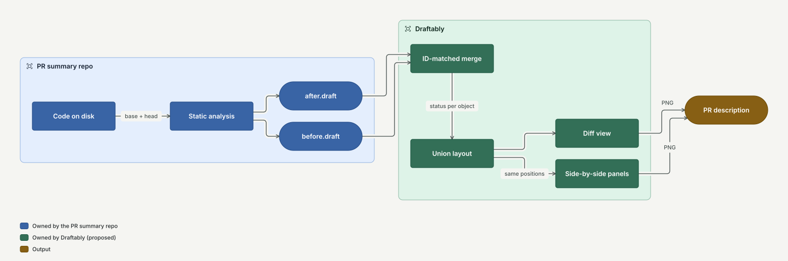

# Gap analysis: side-by-side and diff diagrams for PR summaries

## Summary

An automated PR summary tool (planned for another repository) will generate diagrams from code
and show what a pull request changed. Byron's transcripts say the diagram is useful only if
unchanged parts **stay in the same place** between the before and after states. The
`diagram-led-technical-brief` skill asks for the same thing: one image, two aligned panels, one
shared legend, and a title and subtitle inside the image.

draftably can't do this today. It draws one diagram per file, has no visible title, and has no
way to mark content as added, removed or changed. Its strengths fit the problem well, though:
layout is deterministic, it already holds positions steady across theme changes and edits, and
it owns its layout engine, so alignment does not have to fight a black box the way Graphviz
rank constraints do.

The recommendation is one mechanism that serves both requests:

> **Lay out the union of both versions once, then project it.** A diff view draws the union with
> status styles. A side-by-side view draws two panels from the same union geometry, each showing
> only its own version. Unchanged nodes align by construction, not by constraint.

The source material is in [research.md](research.md).



This picture comes from [pipeline.draft](pipeline.draft) via `draftably inspect --svg`. Note that
the `diagram "PR diagrams: who owns what"` title does not appear in it: that is gap N5.

## What the PR summary tool needs from draftably

draftably's part is the drawing contract. Static analysis, choosing a lens (route, component,
call stack), finding islands of change, and posting to GitHub stay in the other repository.

| ID  | Need                                                                                                      | Source                             |
| --- | --------------------------------------------------------------------------------------------------------- | ---------------------------------- |
| N1  | Two versions of a diagram drawn side by side, unchanged nodes at the same position in both panels.        | Transcript T5, skill contract      |
| N2  | One merged diagram with added, removed and changed content shown by style.                                | Transcript T6                      |
| N3  | A deterministic diff of two `.draft` files, matched by ID, so the other repo only writes two plain files. | Transcript "deterministic" benefit |
| N4  | Quiet "context" nodes: unchanged neighbors shown for reference, visually behind the change.               | Transcript T4                      |
| N5  | A visible title, subtitle and panel labels in exported images, so a pasted PNG stands alone.              | Skill detach test                  |
| N6  | A legend that explains status styles, not only color families.                                            | Skill legend rule                  |
| N7  | PNG and SVG output from the command line, sized for a PR description.                                     | Skill artifact contract, PR use    |
| N8  | Summary nodes for large fan-out ("+42 consumers") instead of every node.                                  | Transcript T10, 30-object limit    |
| N9  | A way to carry a source path or URL on a node, so the other repo can link blocks to code.                 | Transcript T1                      |

## Capability matrix

| Need             | draftably today                                                                                                                                                                     | Rating                  |
| ---------------- | ----------------------------------------------------------------------------------------------------------------------------------------------------------------------------------- | ----------------------- |
| N1 side-by-side  | One diagram per file; `view` is a parse error (`src/dsl/syntax.ts:674`). Viewer **Compare** shows layout candidates for one document, not two versions (`src/state/comparison.ts`). | Missing                 |
| N1 alignment     | `align x\|y` works only for siblings in one scope. `stay` and `pin` hold positions inside one file. No cross-diagram shared coordinates.                                            | Partial (pieces exist)  |
| N2 diff styles   | No status attribute. Edge `emphasis` exists in the model (`src/model/types.ts:33`) but the DSL can't set it. Edges have only solid or `kind=async` dashed.                          | Missing                 |
| N3 diff of files | `movedOutsideEdit` (`src/dsl/translate.ts:593`) compares two scenes to list moved objects. No ID-level model diff, no CLI command.                                                  | Missing (helper exists) |
| N4 context nodes | Shades 50–300 give quiet fills, so an author can fake it with `color=slate shade=100`. No semantic "context" role.                                                                  | Partial                 |
| N5 framing       | `diagram "title"` goes only into the SVG `<title>` element (`src/cli/svg.ts:47`); nothing visible. No subtitle, no panel labels. Margin plus legend only.                           | Missing                 |
| N6 legend        | `legend family "meaning"` draws color swatches. It can't show a border, dash or strike style.                                                                                       | Partial                 |
| N7 output        | `inspect --svg` embeds fonts and the legend. The viewer exports PNG; the CLI does not. `pnpm shoot` renders PNG but is a dev script.                                                | Partial                 |
| N8 fan-out       | Nothing. Meld had group collapse with aggregated edges (`reference/meld/original/DSL.md:95`).                                                                                       | Missing                 |
| N9 code links    | No `href`, `url` or `src` attribute.                                                                                                                                                | Missing                 |

What the skill needs beyond the PR case, for draftably to replace Graphviz in the brief skill:

| Skill rule                                                        | draftably today                                                  | Rating               |
| ----------------------------------------------------------------- | ---------------------------------------------------------------- | -------------------- |
| Embedded title and subtitle                                       | No visible title                                                 | Missing (same as N5) |
| Legend for color, border, line style, shape                       | Color only                                                       | Partial (N6)         |
| Portrait or landscape canvas size (`size="7.0,9.2!"`)             | Fixed canvas 1100×720 drives folding; no page-size target        | Partial              |
| 180 DPI PNG                                                       | Viewer PNG export, no CLI PNG                                    | Partial (N7)         |
| Annotation and risk nodes                                         | `shape=text` nodes work as notes; no attached callout            | Partial              |
| Feedback edges that don't bend the hierarchy (`constraint=false`) | `flow` keeps loops in the reading direction; no per-edge opt-out | Partial              |
| Diamond decision nodes, note shapes                               | `diamond` yes; no note or document shape                         | Partial              |
| Before/after on one aligned canvas                                | Missing                                                          | Missing (N1)         |

The skill's other rules (reading direction, grouping, color as encoding, five-second test) are
already draftably's own rules in [FEEL.md](../diagram-quality/FEEL.md) and the audit
[RUBRIC.md](../diagram-quality/RUBRIC.md).

## Gap 1: side-by-side panels with alignment

### Options

| Option                            | How it works                                                                                                                                            | Alignment quality                                                                                                    | Cost                                             |
| --------------------------------- | ------------------------------------------------------------------------------------------------------------------------------------------------------- | -------------------------------------------------------------------------------------------------------------------- | ------------------------------------------------ |
| A. Constrain two layouts          | Lay out each version on its own, then add cross-panel `align` constraints. This is what the skill's Graphviz asset does with `newrank` and `rank=same`. | Weak. Rows align at best; a node added above shifts everything below. The asset itself warns it destabilizes layout. | Medium, and it fights the engine.                |
| B. Seed the second from the first | Lay out _before_, then lay out _after_ with soft `stay` anchors at the _before_ positions of shared nodes.                                              | Good for small changes. Large changes break anchors, and the result depends on which side went first.                | Low. `stay` already exists.                      |
| **C. Union layout, then project** | Merge both versions into one model. Lay out the union once. Each panel draws only its own nodes at the union positions.                                 | Exact. Shared nodes have one position by definition.                                                                 | Medium. Needs a merge step and a panel renderer. |

**Recommendation: C, with B as an optional compaction pass later.**

C has one weakness: each panel has holes where the other version's nodes sit. For a small PR
that is a feature, since the hole shows where something was removed or will be added. For a large
refactor the holes waste space. A later pass can compact each panel with soft `stay` anchors at
the union positions (option B's mechanism), so shared nodes move only when they must.

C also gives N2 for free: the diff view is the union drawn in one panel.

### Proposed shape

Two ways in, one engine:

```bash
# The other repo writes two plain files. draftably merges, lays out and draws.
draftably compare before.draft after.draft --mode=side-by-side --png out.png
draftably compare before.draft after.draft --mode=diff --svg out.svg
draftably compare before.draft after.draft --write merged.draft   # inspect or hand-edit
```

The merged file is an ordinary `.draft` with a status on each object, so the viewer can open it,
an author can refine it with `near`, `stay` and `pin`, and the refinements apply to both panels:

```text
diagram "Checkout: add refund flow" version=1
subtitle "Adds a refund path; payments now emits an event"
compare mode=side-by-side before="main" after="PR 123"

node api "API gateway" status=same
node orders "Orders" status=same
node payments "Payments" status=changed
node refunds "Refunds" status=added
node legacy "Legacy webhook" status=removed

edge pay orders -> payments "charge" status=same
edge refund orders -> refunds "refund" status=added
edge hook payments -> legacy "notify" status=removed
```

Syntax is a sketch for discussion. Names (`status`, `compare`, `same`) are open questions below.

### Panel rules

- Both panels share one scale, one theme and one legend.
- A panel label sits above each panel (`before=` and `after=` text).
- The _before_ panel shows `same`, `changed` and `removed`. The _after_ panel shows `same`,
  `changed` and `added`. Edges follow the same rule.
- Panels go left and right for `direction=down` diagrams and top and bottom for
  `direction=right` diagrams, so each panel keeps its reading direction and the panels stay
  comparable at a glance.
- Edge routing runs per panel, because a removed node frees space that the _before_ router must
  still avoid and the _after_ router may use. Node positions are shared; routes are not.

## Gap 2: diff-style styling

### Status vocabulary

| Status    | Meaning                                                       | Proposed treatment                                          | Legend text |
| --------- | ------------------------------------------------------------- | ----------------------------------------------------------- | ----------- |
| `added`   | Only in _after_                                               | Green family, solid 2px border, normal fill                 | Added       |
| `removed` | Only in _before_                                              | Red family, dashed border, faded fill, label struck through | Removed     |
| `changed` | In both; label, shape, color, container or connections differ | Amber family, 2px border, small change marker               | Changed     |
| `same`    | In both, unchanged                                            | Theme's neutral surface                                     | — (no row)  |
| `context` | Unchanged and shown only for reference                        | Lighter than `same`: pale fill, muted text                  | Context     |

Rules that follow from [FEEL.md](../diagram-quality/FEEL.md) and the skill:

- Color is never the only carrier. Each status pairs a hue with a border weight, dash or strike,
  so the diff reads in grayscale and for common color-vision deficiencies.
- Status colors come from the theme's `green`, `red` and `amber` families, so every theme draws
  a diff in its own palette. A status overrides the node's own `color=` for the border only; the
  fill keeps the author's color family where one is set, so group identity survives.
- Edges get the same statuses: green solid, red dashed and faded, amber for a changed label or
  endpoint side.
- A group's status is `changed` when any member changed. Its border shows it; its fill does not,
  so a nested diff doesn't become a wall of amber.
- The legend adds a row per status used, drawn with the real border style, not only a swatch.
  This extends `legend` beyond color families (N6).

### Modes

1. **Diff** (one panel): the union with every status. Best for small PRs and for the PR body.
2. **Side by side** (two panels): best when connectivity changed, because each panel is a
   clean, valid diagram.
3. **After with ghosts** (one panel, optional): the _after_ state, with removed content as faint
   dashed outlines. Lowest priority; it is mode 1 with a different `removed` style.

## Gap 3: computing the diff

draftably should own the `.draft`-to-`.draft` diff, because it is about diagram files, not code.
The other repository then needs only to write two ordinary files.

- Match nodes, groups and edges by ID. IDs are already unique and stable in the DSL.
- `changed` when the label, shape, color, shade, `in=` parent or edge endpoints differ.
  Record what changed, so the viewer can show "label: Payments → Payments service" on hover.
- Refinements (`near`, `stay`, `pin`, `size`, `order`, `align`) merge with _after_ winning, then
  apply to the union.
- Renamed IDs look like a removal plus an addition. That is correct for a deterministic tool; the
  generator in the other repo is responsible for stable IDs.
- `movedOutsideEdit` in `src/dsl/translate.ts` is the nearest existing code to reuse.

## Gap 4: standalone framing

Needed by both the PR case and the brief skill, and useful on its own:

- Draw the `diagram` title visibly at the top of exports, and add a one-line `subtitle`.
- Panel labels for side-by-side mode.
- Legend at the bottom (already true for `inspect --svg`), extended for status styles.
- `draftably inspect --png` (or `render`) with a `--scale` for document-ready resolution, so the
  other repo does not need Playwright.
- Optional canvas target (`page=portrait|landscape` or `width=`/`height=`) so folding fits a
  PR body or a document page, like the skill's `size` attribute.

## Gap 5: smaller needs

- **Fan-out summary (N8).** A `summary` node or a collapsed group that stands for N hidden
  consumers, with aggregated edges. Meld's collapse rules are a starting point. Medium priority:
  the transcript's "text component used in 6,000 places" case needs it, most PRs don't.
- **Code links (N9).** A pass-through `href=` on nodes and groups, emitted as an SVG link and shown
  in the viewer inspector. Small and independent.
- **Context role (N4).** Covered by `status=context` above.

## Out of scope for draftably

These belong to the PR summary repository:

- Static analysis and data-flow tracing (`tsx-data-flow`).
- Choosing the lens: route, component usage, call stack, lifecycle.
- Mapping changed files and hunks to diagram IDs.
- Finding islands of change and suggesting PR splits.
- Posting images to GitHub.

## Suggested order of work

Each step is one reviewable PR and is useful alone:

1. **Visible title and subtitle in exports.** Smallest change, and it unblocks the skill's detach
   test right away.
2. **`status=` on nodes, groups and edges, with legend rows.** Hand-written diffs become possible.
3. **`draftably compare --mode=diff`.** The ID-matched merge plus the single-panel union drawing.
4. **Side-by-side panels** from the same union geometry, with panel labels and per-panel routing.
5. **CLI PNG output** with a scale option.
6. **Panel compaction** with soft anchors, once real PRs show how much the holes cost.
7. **Fan-out summary nodes** and `href=`, as the PR tool asks for them.

Every step that changes the DSL must update `skills/draftably/SKILL.md` and `docs/DSL.md` in the
same PR, as `AGENTS.md` requires.

## How to check it

Add a version pair to the audit corpus for each mode: a small PR (one node added, one changed),
a connectivity change (an edge moves), and a large refactor (half the nodes replaced). For each:

- Every `same` node has the same position in both panels (exact, by construction).
- The diff view passes the existing rubric checks (crossings, label clearance, reading order).
- The image passes the skill's detach test: title, subtitle and legend explain it alone.
- A grayscale render still separates added, removed and changed.

## Open questions

1. **Names.** `status=same` or `status=unchanged`? `compare` as a statement, or only a CLI flag
   that writes `status=` attributes?
2. **Where the merged file lives.** Is the merged `.draft` an artifact the other repo keeps, or a
   temporary file? Keeping it lets an author refine the layout once and reuse it per PR.
3. **Base diagram reuse.** Transcript T1 wants a stable product diagram that each PR lights up.
   Should the _before_ file's existing `stay` and `pin` lines carry into the union, so the PR
   diagram looks like the product diagram people already know?
4. **Panel direction.** Always left/right (the skill's default), or perpendicular to the reading
   direction as proposed?
5. **Multiple lenses.** Transcript T9 imagines several route planes aligned on shared
   components. Is that N panels of the same union (a natural extension of step 4), or out of scope?
