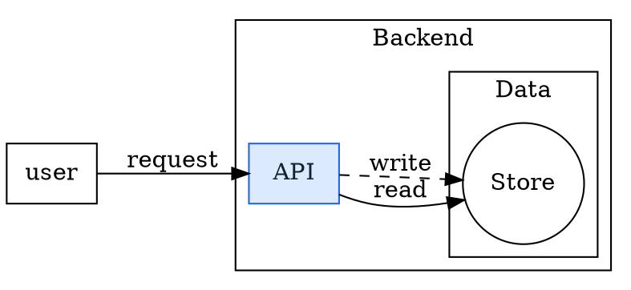
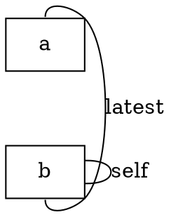
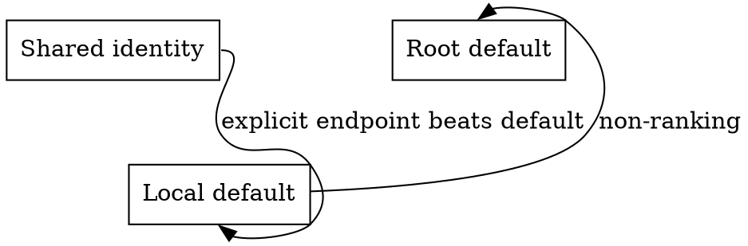
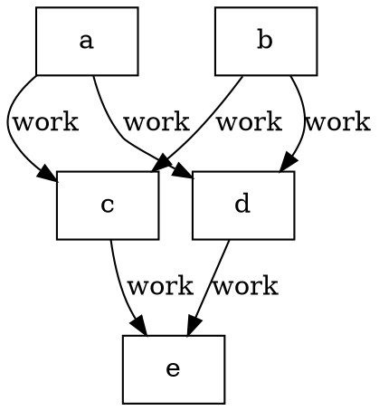
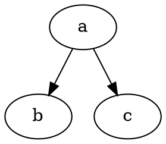
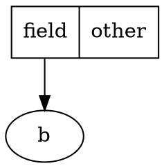

# Feature mapping and checked fixtures

**Baseline:** [draftably dd2ababcbe3b9ac011bc23e652309c10cf31cd02](https://github.com/byronwall/draftably/tree/dd2ababcbe3b9ac011bc23e652309c10cf31cd02).  
**Direction:** read foreign text once, create native source, edit/save native only.  
**Date:** 2026-10-31 UTC.

This document distinguishes what the supplied code does from later scope. All examples marked **checked** come from executed adapters and checked-in fixture results. Proposed sequence examples are explicitly separate. The companion `fixtures.json` contains every input and complete expected result, including native source, graph facts, ID mappings, diagnostic messages and prerequisites. The ZIP also includes individual `.dot` / `.mmd` / `.d2` inputs, successful `.draft` outputs and `.expected.json` files.

## Reading the coverage tables

| Mark | Meaning |
|---|---|
| **Exact** | The stated identity/relationship/text fact is preserved within the supported profile. This never promises foreign pixel/layout equivalence. |
| **Review** | A concrete approximation or omission is reported; source is returned as `needs-review`. |
| **Blocked** | Fatal diagnostic; neither native source nor applicable facts are returned. |
| **Native prerequisite** | Requires IMP-02 (`directed=false`) before opening in an editable source session. |
| **Planned** | Not implemented by the delivered adapter. |

A warning can be accepted. An error cannot be bypassed with `--accept-lossy`. Unsupported families are not successful partial imports.

## 1. Native destination contract

These are inspected native facts, not inferred requirements from another diagram tool. Sources: [types.ts](https://github.com/byronwall/draftably/blob/dd2ababcbe3b9ac011bc23e652309c10cf31cd02/src/model/types.ts), [syntax.ts](https://github.com/byronwall/draftably/blob/dd2ababcbe3b9ac011bc23e652309c10cf31cd02/src/dsl/syntax.ts), [project.ts](https://github.com/byronwall/draftably/blob/dd2ababcbe3b9ac011bc23e652309c10cf31cd02/src/dsl/project.ts), [translate.ts](https://github.com/byronwall/draftably/blob/dd2ababcbe3b9ac011bc23e652309c10cf31cd02/src/dsl/translate.ts), and [DSL](https://github.com/byronwall/draftably/blob/dd2ababcbe3b9ac011bc23e652309c10cf31cd02/docs/DSL.md).

| Foreign concept | Actual native representation | Import invariant |
|---|---|---|
| Diagram | `diagram "Title" version=1` → compiled Scene → `Diagram` | Native source is authoritative and limited to 300,000 source characters. Title follows the defined source/title policy. |
| Stable identity | Native ID; labels are independent JSON strings | Preserve valid IDs where possible; deterministic remap with collision suffixes otherwise. |
| Container | `group id "Label"`; child `in=id` → `parentId` | Exactly one parent; no cycles, maximum 12 levels. |
| Leaf | `node id "Label"` | Total nodes+groups <=500. |
| Edge occurrence | `edge id a -> b "Label"` | Unique ID per occurrence; parallel edges/self-loops remain distinct; <=1,200 edges. |
| Undirected relation | Proposed `directed=false` → `DiagramEdge.directed=false` | One relationship, not two arrows; baseline compiler rejects the new attribute. |
| Dashed line | `kind=async` → `dashed=true` | Appearance mapping only; no invented execution semantics. |
| Endpoint side | `from=left|right|top|bottom`, `to=…` | Side hint is not a named field/record port. |
| Non-ranking edge | `constraint=false` | Independent of directed/undirected; cannot replace direction. |
| Shape | Writable box/pill/circle/diamond/text; cells-only marker | Images/icons in the in-memory model are not writable through the current translator. |
| Explicit colors | `theme-color family shade=500 fill="#…" stroke="#…" ink="#…"`; `color=family shade=500` | Use only supported literal colors; no CSS execution or external palette fetch. |
| Layout | `layout scope flow direction=right|down` | Regenerate native geometry; reverse foreign orientation is a reported approximation. |
| Sequence | Ordered nodes/edges and `layout root sequence`; groups/phase bands in supported cases | No faithful alt/loop/par/lifetime/activation representation yet. |
| Fields | `group` + `layout group cells` + child nodes | Cells groups contain leaf nodes only, without nested groups; they are not automatically a typed ER/UML model. |
| Cardinality | No general endpoint-cardinality field | `count` is a stacked node count, never a substitute for ER multiplicity. |

The native validator also forbids a group-to-descendant edge and edges on soft/none group frames. Every adapter must enforce source capability, not merely call model `normalize`.

## 2. Mermaid mapping

**Implemented family:** flowchart only, using Mermaid 12.2.0. Other headers are detected so users receive a family error.  
**Relevant recommendations:** IMP-02, IMP-06, IMP-12, IMP-13.

| Mermaid construct | Native mapping | Delivered status |
|---|---|---|
| Explicit/implicit vertex ID | Deterministic native node ID; separate plain label | **Exact** in supported DB snapshot. |
| Labels, punctuation, Unicode, line breaks/entities | JSON-quoted native label; inert HTML text conversion | Plain text **Exact**; HTML formatting **Review**; Markdown markers remain literal with **Review**. |
| Subgraphs, including nested group references | Native groups and immediate `parentId` | **Exact** containment if tree-compatible; merge parser shadow vertices with group identity. |
| One object in conflicting parents | None | **Blocked** `MERMAID_MULTIPLE_PARENTS`. |
| Edges to a subgraph | Native edge to boxed group | **Exact** when native endpoint rules allow it; ancestor-group edges **Blocked**. |
| Chain / node-set syntax | Official parser’s expanded occurrence sequence | **Exact** endpoints and multiplicity; capped before opening. |
| Explicit edge ID | Preserved if valid; collision-safe map otherwise | **Exact** identity intent. Parser-generated IDs are not treated as stable source IDs. |
| Parallel edges / self-loops | Distinct native edge IDs | **Exact**. |
| Ordinary terminal arrow | Directed native edge | **Exact**. |
| Arrowless `---` | Native undirected edge | **Native prerequisite IMP-02**. |
| Double/circle/cross terminals | No faithful boolean-direction mapping | **Blocked** `MERMAID_ARROW_UNSUPPORTED`. |
| Invisible link | No visible native relationship substituted | **Blocked** `MERMAID_INVISIBLE_EDGE`. |
| Dotted stroke | Native `kind=async` | **Exact** dashed flag, info `MERMAID_DASH_STYLE`; exact dash pattern is not promised. |
| Thick/animated/custom edge stroke | Ordinary supported line plus report | **Review**; no unsavable `emphasis` field injected. |
| Rectangle/stadium/circle/diamond/text | box/pill/circle/diamond/text | **Exact** supported shape kind. |
| Rounded rectangle, double circle, cylinder, etc. | Documented fallback shape | **Review** `MERMAID_SHAPE_APPROXIMATION`. |
| Class/default/inline hex fill, stroke, color | Native custom color family | **Exact** selected property values; arbitrary CSS/color expressions **Review**. |
| LR, TB/TD | right/down native layout | **Exact** direction preference; geometry regenerated. |
| RL/BT | right/down without changing edge endpoints | **Review** `MERMAID_REVERSED_LAYOUT`. |
| Explicit subgraph direction | Explicit native group flow direction | **Review** `MERMAID_SUBGRAPH_LAYOUT`, because Mermaid may ignore it with external links. |
| Missing subgraph direction | Nearest declared/root direction as explicit native flow | **Review** `MERMAID_INHERITED_LAYOUT`; deliberate normalization, not a claim about Mermaid engine inheritance. |
| Icons/images/click/URLs | No active native resource or callback | **Review**; resource remains absent from native source. |
| Frontmatter / initialization directives | Not applied | **Blocked** `MERMAID_CONFIGURATION_UNSUPPORTED`. |
| Sequence/class/ER/state/chart/etc. | Separate adapter needed | **Blocked** `MERMAID_FAMILY_UNSUPPORTED`. |

Primary API evidence: [flow DB](https://github.com/mermaid-js/mermaid/blob/mermaid%4012.2.0/packages/mermaid/src/diagrams/flowchart/flowDb.ts), [flow types](https://github.com/mermaid-js/mermaid/blob/mermaid%4012.2.0/packages/mermaid/src/diagrams/flowchart/types.ts), [Dagre group-direction extraction](https://github.com/mermaid-js/mermaid/blob/mermaid%4012.2.0/packages/mermaid/src/rendering-util/layout-algorithms/dagre/mermaid-graphlib.js), [Mermaid flowchart syntax](https://mermaid.js.org/syntax/flowchart.html). The companion’s error spans are original-source only when available; transformed parser positions are labeled relative.

### F-MERMAID-01 — Nested groups, styles, implicit/group endpoints and repeated edges

**Checked result:** `needs-review`.

Input:

```text
flowchart LR
subgraph system[System]
  direction TB
  A[API]
  subgraph workers[Workers]
    B{Ready?}
    C[Store]
  end
end
X --> system
A -->|send| B --> C
B -. retry .-> A
A --> B
classDef ok fill:#dbeafe,stroke:#123456,color:#000
class A ok
```

Expected native output:

```draft
diagram "Mermaid nested" version=1
theme-color import_1 shade=500 fill="#dbeafe" stroke="#123456" ink="#000000"
group workers "Workers" in=system
group system "System"
node A "API" in=system color=import_1 shade=500
node B "Ready?" in=workers shape=diamond
node C "Store" in=workers
node X "X"
edge edge_1 X -> system ""
edge edge_2 A -> B "send"
edge edge_3 B -> C ""
edge edge_4 B -> A "retry" kind=async
edge edge_5 A -> B ""
layout root flow direction=right
layout workers flow direction=down
layout system flow direction=down
```

Expected graph facts: **4 nodes, 2 groups, 5 edges**.

| Native ID | Kind | Label | Parent |
|---|---|---|---|
| `workers` | group | Workers | `system` |
| `system` | group | System | root |
| `A` | node | API | `system` |
| `B` | node | Ready? | `workers` |
| `C` | node | Store | `workers` |
| `X` | node | X | root |

| Edge ID | From | To | Label | Directed | Dashed |
|---|---|---|---|---|---|
| `edge_1` | `X` | `system` |  | true | false |
| `edge_2` | `A` | `B` | send | true | false |
| `edge_3` | `B` | `C` |  | true | false |
| `edge_4` | `B` | `A` | retry | true | true |
| `edge_5` | `A` | `B` |  | true | false |

Diagnostics: `MERMAID_INHERITED_LAYOUT` (warning), `MERMAID_SUBGRAPH_LAYOUT` (warning), `MERMAID_DASH_STYLE` (info).


### F-MERMAID-02 — Explicit identity and one undirected relationship

**Checked result:** `needs-review`. **Prerequisite:** `IMP-02-native-undirected`.

Input:

```text
flowchart RL
A request@--> B
B --- C
```

Expected native output:

```draft
diagram "Mermaid explicitUndirected" version=1
node A "A"
node B "B"
node C "C"
edge request A -> B ""
edge edge_2 B -> C "" directed=false
layout root flow direction=right
```

Expected graph facts: **3 nodes, 0 groups, 2 edges**.

| Native ID | Kind | Label | Parent |
|---|---|---|---|
| `A` | node | A | root |
| `B` | node | B | root |
| `C` | node | C | root |

| Edge ID | From | To | Label | Directed | Dashed |
|---|---|---|---|---|---|
| `request` | `A` | `B` |  | true | false |
| `edge_2` | `B` | `C` |  | false | false |

Diagnostics: `MERMAID_REVERSED_LAYOUT` (warning).


### F-MERMAID-03 — Rich labels, shape loss and inert resources

**Checked result:** `needs-review`.

Input:

```text
flowchart BT
A["<b>API</b><br/>#9829;"] --> B[(Store)]
B --> D(Complete)
click A "https://import.invalid/private"
style A fill:#abc,stroke:#def,color:#123,font-size:20px
C@{ img: "https://import.invalid/logo.svg", label: "Asset" }
```

Expected native output:

```draft
diagram "Mermaid richLabels" version=1
theme-color import_1 shade=500 fill="#aabbcc" stroke="#ddeeff" ink="#112233"
node A "API\n♥" color=import_1 shade=500
node B "Store"
node D "Complete" shape=pill
node C "Asset"
edge edge_1 A -> B ""
edge edge_2 B -> D ""
layout root flow direction=down
```

Expected graph facts: **4 nodes, 0 groups, 2 edges**.

| Native ID | Kind | Label | Parent |
|---|---|---|---|
| `A` | node | API<br>♥ | root |
| `B` | node | Store | root |
| `D` | node | Complete | root |
| `C` | node | Asset | root |

| Edge ID | From | To | Label | Directed | Dashed |
|---|---|---|---|---|---|
| `edge_1` | `A` | `B` |  | true | false |
| `edge_2` | `B` | `D` |  | true | false |

Diagnostics: `MERMAID_INTERACTION_IGNORED` (warning), `MERMAID_HTML_LABEL` (warning), `MERMAID_SHAPE_APPROXIMATION` (warning), `MERMAID_MARKDOWN_LABEL` (warning), `MERMAID_REVERSED_LAYOUT` (warning), `MERMAID_STYLE_PROPERTY` (warning), `MERMAID_LINK_OMITTED` (warning), `MERMAID_ASSET_OMITTED` (warning).


## 3. DOT mapping

**Implemented family/profile:** ordinary graphs/digraphs using `@ts-graphviz/ast@3.0.10`; explicitly **DOT core**, not the full Graphviz grammar.  
**Relevant recommendations:** IMP-02, IMP-05, IMP-20.

| DOT construct | Native mapping | Delivered status |
|---|---|---|
| Quoted/unquoted/numeric IDs | Global node identity; deterministic safe native IDs | **Exact** identity; reserve native special IDs. |
| Repeated node declarations | Update same node’s explicit attributes | **Exact**. |
| `node` / `edge` defaults | Snapshot defaults when each object is first created | **Exact** within supported syntax; later defaults do not restyle old objects. |
| Subgraph scope/reopening | Inherited snapshot and local changes | **Exact** supported scoping; ordinary subgraphs do not become frames. |
| Nested `cluster*` subgraphs | Native groups/parents | **Exact** containment within one-parent native rules. |
| Non-prefix/anonymous `cluster=true` | No silent flattening | **Blocked** `DOT_CLUSTER_ATTRIBUTE`. |
| Overlapping incomparable clusters | None | **Blocked**; do not duplicate or reparent the node silently. |
| Unlabeled cluster | Empty native group label | **Exact**; do not synthesize the cluster ID as a visible title. |
| Plain label escapes `\N \G \T \H \E` and line breaks | Contextual native text | Supported named contexts **Exact**; left/right line alignment **Review**; graph-name escape in an anonymous graph **Blocked** (`DOT_ANONYMOUS_GRAPH_NAME`). |
| Entity-bearing labels / implicit escaped-ID labels | None in this profile | **Blocked**; future text decoder must be tested, not guessed. |
| HTML/record labels and field ports | Dedicated field-aware mapping needed | **Blocked** `DOT_HTML_LABEL` / `DOT_RECORD` / `DOT_NAMED_PORT`. |
| Non-strict repeated edges | One native ID per statement/expanded occurrence | **Exact** multiplicity. |
| Strict directed duplicates | Merge by ordered tail/head pair; later explicit patch | **Exact**. |
| Strict undirected reverse duplicates | Merge by unordered pair; correct endpoint-side updates | **Exact**, plus **Native prerequisite**. |
| Brace endpoint sets / chains | Deduplicate each set; capped Cartesian expansion per adjacent pair | **Exact**. `{a a}->{b b}` means one edge. |
| Direct ports `a:e -> b:w` | right/left native attachment hints | **Exact** supported sides. Member declarations inside brace sets do not supply edge ports. |
| Endpoint/default/explicit-attribute precedence | Defaults, then endpoint refs, then explicit declaration attrs | **Exact**, including strict updates. |
| Diagonal/center compass ports | Automatic attachment | **Review** `DOT_COMPASS`. |
| Digraph ordinary arrow / graph ordinary edge | Directed / undirected native relation | **Exact** relationship; graph requires IMP-02. |
| `dir=back`, `dir=both`, directed arrow suppression, specialized head/tail | No exact current native mapping | **Blocked**. DOT tail/head is not rewritten based only on arrow decoration. |
| `headlabel` / `taillabel` / compound `lhead`/`ltail` | None | **Blocked**; label and endpoint meaning cannot disappear. |
| `constraint=false` / `0` | Native `constraint=false` | **Exact** flag; unsupported boolean spelling fails. |
| Box/circle/diamond/plaintext | Native box/circle/diamond/text | **Exact** supported shape; default ellipse→pill and other shapes **Review**. |
| Literal supported hex fill/stroke/fontcolor | Native custom color family | Selected values **Exact**; named/palette/gradient values **Review**. |
| Dashed/dotted edge style | Native dashed flag | **Exact** flag; bold/custom per-edge style **Review**. |
| `rankdir=LR/TB` | root and cluster flow right/down | **Exact** direction preference; native cluster-layout info. |
| `rankdir=RL/BT`, `rank=same`, coordinates/splines | Native layout / explicit omission report | **Review**; never reverse arrows or claim coordinate preservation. |
| Image, URL, fonts/shapefile paths | Omit, no loading | **Review** `DOT_RESOURCE_OMITTED` / attribute diagnostic. |
| Repeated attribute lists, quoted string concatenation, some subgraph grammar | Not accepted by pinned parser | **Blocked** `DOT_PARSE_REJECTED`, with dialect explanation. |
| Full subgraph as edge operand | Guard parser’s possible misparse | **Blocked** `DOT_PARSER_DIALECT`. |
| Multiple top-level graphs | No implicit first-graph selection | **Blocked**; pinned parser may reject before adapter-level graph-count checking. |

A DOT node reference with the same text as a cluster name is still a **node reference**; it does not automatically mean a cluster endpoint. Native group-edge capability does not justify inventing DOT compound-edge semantics.

Normative references: [DOT language](https://graphviz.org/doc/info/lang/), [labels](https://graphviz.org/docs/attrs/label/), [escString](https://graphviz.org/docs/attr-types/escString/), [ports](https://graphviz.org/docs/attrs/headport/), [dir](https://graphviz.org/docs/attrs/dir/), [constraint](https://graphviz.org/docs/attrs/constraint/), [shapes](https://graphviz.org/doc/info/shapes.html). Parser contract: [AST types](https://github.com/ts-graphviz/ts-graphviz/blob/6b90db1e687f5b7d76dd8e16c2374f686c0cff5c/packages/ast/src/types.ts) and [grammar](https://github.com/ts-graphviz/ts-graphviz/blob/6b90db1e687f5b7d76dd8e16c2374f686c0cff5c/packages/ast/src/dot-shim/parser/dot.peggy).

### F-DOT-01 — Nested clusters, explicit palette and parallel relationships

**Checked result:** `ready`.

Input:



Expected native output:

```draft
diagram "Pipeline" version=1
theme-color import_1 shade=500 fill="#dbeafe" stroke="#2563eb" ink="#172033"
group cluster_backend "Backend"
group cluster_data "Data" in=cluster_backend
node api "API" in=cluster_backend color=import_1 shade=500
node db "Store" in=cluster_data shape=circle
node user "user"
edge edge_1 user -> api "request"
edge edge_2 api -> db "read"
edge edge_3 api -> db "write" kind=async
layout root flow direction=right
layout cluster_backend flow direction=right
layout cluster_data flow direction=right
```

Expected graph facts: **3 nodes, 2 groups, 3 edges**.

| Native ID | Kind | Label | Parent |
|---|---|---|---|
| `cluster_backend` | group | Backend | root |
| `cluster_data` | group | Data | `cluster_backend` |
| `api` | node | API | `cluster_backend` |
| `db` | node | Store | `cluster_data` |
| `user` | node | user | root |

| Edge ID | From | To | Label | Directed | Dashed |
|---|---|---|---|---|---|
| `edge_1` | `user` | `api` | request | true | false |
| `edge_2` | `api` | `db` | read | true | false |
| `edge_3` | `api` | `db` | write | true | true |

Diagnostics: `DOT_CLUSTER_LAYOUT` (info), `IMPORT_NATIVE_LAYOUT` (info).


### F-DOT-02 — Strict undirected duplicate update and self-loop

**Checked result:** `ready`. **Prerequisite:** `IMP-02-native-undirected`.

Input:



Expected native output:

```draft
diagram "Relationships" version=1
node a "a"
node b "b"
edge edge_1 a -> b "latest" directed=false from=top to=bottom
edge edge_2 b -> b "self" directed=false
layout root flow direction=down
```

Expected graph facts: **2 nodes, 0 groups, 2 edges**.

| Native ID | Kind | Label | Parent |
|---|---|---|---|
| `a` | node | a | root |
| `b` | node | b | root |

| Edge ID | From | To | Label | Directed | Dashed |
|---|---|---|---|---|---|
| `edge_1` | `a` | `b` | latest | false | false |
| `edge_2` | `b` | `b` | self | false | false |

Diagnostics: `IMPORT_NATIVE_LAYOUT` (info).


### F-DOT-03 — Scoped defaults and port precedence

**Checked result:** `ready`.

Input:



Expected native output:

```draft
diagram "Scopes" version=1
node a "Shared identity"
node b "Local default"
node c "Root default"
edge edge_1 a -> b "explicit endpoint beats default" from=right to=bottom
edge edge_2 b -> c "non-ranking" constraint=false to=top
layout root flow direction=down
```

Expected graph facts: **3 nodes, 0 groups, 2 edges**.

| Native ID | Kind | Label | Parent |
|---|---|---|---|
| `a` | node | Shared identity | root |
| `b` | node | Local default | root |
| `c` | node | Root default | root |

| Edge ID | From | To | Label | Directed | Dashed |
|---|---|---|---|---|---|
| `edge_1` | `a` | `b` | explicit endpoint beats default | true | false |
| `edge_2` | `b` | `c` | non-ranking | true | false |

Diagnostics: `IMPORT_NATIVE_LAYOUT` (info).


### F-DOT-04 — Unique endpoint sets, chains and ignored member ports

**Checked result:** `ready`.

Input:



Expected native output:

```draft
diagram "Sets" version=1
node a "a"
node b "b"
node c "c"
node d "d"
node e "e"
edge edge_1 a -> c "work"
edge edge_2 a -> d "work"
edge edge_3 b -> c "work"
edge edge_4 b -> d "work"
edge edge_5 c -> e "work"
edge edge_6 d -> e "work"
layout root flow direction=down
```

Expected graph facts: **5 nodes, 0 groups, 6 edges**.

| Native ID | Kind | Label | Parent |
|---|---|---|---|
| `a` | node | a | root |
| `b` | node | b | root |
| `c` | node | c | root |
| `d` | node | d | root |
| `e` | node | e | root |

| Edge ID | From | To | Label | Directed | Dashed |
|---|---|---|---|---|---|
| `edge_1` | `a` | `c` | work | true | false |
| `edge_2` | `a` | `d` | work | true | false |
| `edge_3` | `b` | `c` | work | true | false |
| `edge_4` | `b` | `d` | work | true | false |
| `edge_5` | `c` | `e` | work | true | false |
| `edge_6` | `d` | `e` | work | true | false |

Diagnostics: `IMPORT_NATIVE_LAYOUT` (info).


## 4. D2 mapping

**Implemented profile:** compiled ordinary single-board object/connection graph using `@d2lang/d2@0.1.34` / engine v0.9.0. Runtime integration remains experimental; production hard execution limits are not implemented.  
**Relevant recommendations:** IMP-02, IMP-09, IMP-10, IMP-11, IMP-13.

| D2 construct | Native mapping | Delivered status |
|---|---|---|
| Bare/quoted/canonical ID | Collision-safe native ID plus original canonical ID map | **Exact** identity; do not split quoted periods. |
| Nested keys/objects | Native parent tree from canonical IDs plus levels | **Exact** checked exporter profile; unexpected parent/API data **Blocked**. |
| Bare node and container labels | Native plain label | **Exact** plain content; markup/transformed labels get **Review**. |
| Repeated declarations/indexed edge styling | Official compiler’s resolved objects and occurrences | **Exact** current snapshot; no source-program editing. |
| Variables/classes/globs/substitutions/null overrides | Concrete graph values resolved by compiler | **Review** `D2_PROGRAM_SNAPSHOT`; future edits do not rerun those rules. |
| `a -> b` | One directed edge a→b | **Exact** semantic flags. |
| `a <- b` | One directed edge b→a | **Exact**; differs from DOT’s decoration-only `dir=back`. |
| `a -- b` | One undirected native edge | **Native prerequisite IMP-02**. |
| `a <-> b` | None | **Blocked** `D2_TWO_ENDED_ARROW_UNSUPPORTED`; do not manufacture two edges. |
| Hidden rendered arrowhead on logical arrow | Keep semantic direction, native marker visible | **Review** `D2_ARROW_APPEARANCE_CHANGED`. |
| Parallel indexed connections | Distinct native IDs, labels/endpoints | **Exact** multiplicity. |
| Endpoint labels/specialized markers | Dedicated endpoint model needed | **Blocked**. |
| Rectangle/circle/diamond/text | Native box/circle/diamond/text | **Exact** selected kind; square aspect and other shapes **Review**. |
| Explicit D2 styles / theme tokens | Native default styling | **Review** `D2_STYLE_DROPPED`; selected literal-color mapping is future work. |
| Dashed connection | Native `kind=async` / dashed flag | **Exact** flag; custom dash geometry not promised. |
| right/down root or group direction | Explicit native root/group flow | **Exact** direction preference. |
| left/up | right/down without changing logical endpoints | **Review**. |
| near/grid/position/spacing/configuration/data | Native layout and reported omissions | **Review**; compiler target coordinates are discarded. |
| Image/icon/URL/link/tooltip | No active native field/resource | **Review**; no fetch/render. |
| Markdown/code/LaTeX | Literal content with diagnostic | **Review**; not rendered or executed. |
| Layers/scenarios/steps | Future explicit board picker | **Blocked** `D2_BOARD_SELECTION_REQUIRED`. |
| Sequence shape | Separate ordered sequence mapping needed | **Blocked** `D2_SEQUENCE_UNSUPPORTED`. |
| SQL tables/classes | Dedicated field/member/relationship mapping needed | **Blocked** `D2_COMPARTMENTS_UNSUPPORTED`. |
| Imports not supplied in virtual FS | No host/network resolution | **Blocked** compile error. |
| Unknown future semantic attributes/API layout | No silent ignore | **Blocked** guarded schema/attribute diagnostic. |

Primary sources: [JS API](https://github.com/d2lang/d2/blob/6a7b4837838a3907604a1d9eec57ee98b6f3cd01/d2js/js/index.d.ts), [graph serialization fields](https://github.com/d2lang/d2/blob/6a7b4837838a3907604a1d9eec57ee98b6f3cd01/d2graph/d2graph.go), [exporter order](https://github.com/d2lang/d2/blob/6a7b4837838a3907604a1d9eec57ee98b6f3cd01/d2exporter/export.go), [compiler](https://github.com/d2lang/d2/blob/6a7b4837838a3907604a1d9eec57ee98b6f3cd01/d2compiler/compile.go). The kit’s D2 notes explain the guarded metadata/target join and the separate SerializeGraph API.

### F-D2-01 — Hierarchy and two distinct API/cache relationships

**Checked result:** `needs-review`.

Input:

```d2
direction: right
service: Service {
  api: API
  cache: Cache {shape: cylinder}
  api -> cache: lookup
}
client: Client
client -> service.api: request
service.api -> client: response
service.api -> service.cache: refresh
```

Expected native output:

```draft
diagram "D2 nested" version=1
group service "Service"
node service.api "API" in=service
node service.cache "Cache" in=service
node client "Client"
edge d2_edge_1 service.api -> service.cache "lookup"
edge d2_edge_2 client -> service.api "request"
edge d2_edge_3 service.api -> client "response"
edge d2_edge_4 service.api -> service.cache "refresh"
layout root flow direction=right
layout service flow direction=right
```

Expected graph facts: **3 nodes, 1 groups, 4 edges**.

| Native ID | Kind | Label | Parent |
|---|---|---|---|
| `service` | group | Service | root |
| `service.api` | node | API | `service` |
| `service.cache` | node | Cache | `service` |
| `client` | node | Client | root |

| Edge ID | From | To | Label | Directed | Dashed |
|---|---|---|---|---|---|
| `d2_edge_1` | `service.api` | `service.cache` | lookup | true | false |
| `d2_edge_2` | `client` | `service.api` | request | true | false |
| `d2_edge_3` | `service.api` | `client` | response | true | false |
| `d2_edge_4` | `service.api` | `service.cache` | refresh | true | false |

Diagnostics: `D2_SHAPE_APPROXIMATED` (warning), `D2_SNAPSHOT_MODE` (info), `D2_LAYOUT_RECOMPUTED` (info).


### F-D2-02 — Quoted periods are identity, not hierarchy separators

**Checked result:** `ready`.

Input:

```d2
a: A
"a.b": Dotted {
  "x.y": Leaf
  inner: {z}
}
a -> "a.b"."x.y"
"a.b".inner.z -> "a.b"."x.y"
```

Expected native output:

```draft
diagram "D2 quoted" version=1
node a "A"
group _u22_a.b_u22_ "Dotted"
node _u22_a.b_u22_._u22_x.y_u22_ "Leaf" in=_u22_a.b_u22_
group _u22_a.b_u22_.inner "inner" in=_u22_a.b_u22_
node _u22_a.b_u22_.inner.z "z" in=_u22_a.b_u22_.inner
edge d2_edge_1 a -> _u22_a.b_u22_._u22_x.y_u22_ ""
edge d2_edge_2 _u22_a.b_u22_.inner.z -> _u22_a.b_u22_._u22_x.y_u22_ ""
layout root flow direction=down
layout _u22_a.b_u22_ flow direction=down
layout _u22_a.b_u22_.inner flow direction=down
```

Expected graph facts: **3 nodes, 2 groups, 2 edges**.

| Native ID | Kind | Label | Parent |
|---|---|---|---|
| `a` | node | A | root |
| `_u22_a.b_u22_` | group | Dotted | root |
| `_u22_a.b_u22_._u22_x.y_u22_` | node | Leaf | `_u22_a.b_u22_` |
| `_u22_a.b_u22_.inner` | group | inner | `_u22_a.b_u22_` |
| `_u22_a.b_u22_.inner.z` | node | z | `_u22_a.b_u22_.inner` |

| Edge ID | From | To | Label | Directed | Dashed |
|---|---|---|---|---|---|
| `d2_edge_1` | `a` | `_u22_a.b_u22_._u22_x.y_u22_` |  | true | false |
| `d2_edge_2` | `_u22_a.b_u22_.inner.z` | `_u22_a.b_u22_._u22_x.y_u22_` |  | true | false |

Diagnostics: `D2_SNAPSHOT_MODE` (info), `D2_LAYOUT_RECOMPUTED` (info).


### F-D2-03 — Scoped variables, classes and a generated relationship

**Checked result:** `needs-review`.

Input:

```d2
vars: {name: Outer}
classes: {service: {shape: diamond; style.fill: "#ffeecc"}}
cluster: Cluster {
  vars: {name: Inner}
  a: ${name}
  b: B
  *.class: service
  a -> *: call
}
outside: ${name}
```

Expected native output:

```draft
diagram "D2 generative" version=1
group cluster "Cluster"
node cluster.a "Inner" in=cluster shape=diamond
node cluster.b "B" in=cluster shape=diamond
node outside "Outer"
edge d2_edge_1 cluster.a -> cluster.b "call"
layout root flow direction=down
layout cluster flow direction=down
```

Expected graph facts: **3 nodes, 1 groups, 1 edges**.

| Native ID | Kind | Label | Parent |
|---|---|---|---|
| `cluster` | group | Cluster | root |
| `cluster.a` | node | Inner | `cluster` |
| `cluster.b` | node | B | `cluster` |
| `outside` | node | Outer | root |

| Edge ID | From | To | Label | Directed | Dashed |
|---|---|---|---|---|---|
| `d2_edge_1` | `cluster.a` | `cluster.b` | call | true | false |

Diagnostics: `D2_PROGRAM_SNAPSHOT` (warning), `D2_STYLE_DROPPED` (warning), `D2_SNAPSHOT_MODE` (info), `D2_LAYOUT_RECOMPUTED` (info).


### F-D2-04 — Forward, backward, plain and parallel relationships

**Checked result:** `ready`. **Prerequisite:** `IMP-02-native-undirected`.

Input:

```d2
a -> b: forward
a <- b: backward
a -- b: neither
a -> b: parallel
```

Expected native output:

```draft
diagram "D2 arrowSubset" version=1
node a "a"
node b "b"
edge d2_edge_1 a -> b "forward"
edge d2_edge_2 b -> a "backward"
edge d2_edge_3 a -> b "neither" directed=false
edge d2_edge_4 a -> b "parallel"
layout root flow direction=down
```

Expected graph facts: **2 nodes, 0 groups, 4 edges**.

| Native ID | Kind | Label | Parent |
|---|---|---|---|
| `a` | node | a | root |
| `b` | node | b | root |

| Edge ID | From | To | Label | Directed | Dashed |
|---|---|---|---|---|---|
| `d2_edge_1` | `a` | `b` | forward | true | false |
| `d2_edge_2` | `b` | `a` | backward | true | false |
| `d2_edge_3` | `a` | `b` | neither | false | false |
| `d2_edge_4` | `a` | `b` | parallel | true | false |

Diagnostics: `D2_SNAPSHOT_MODE` (info), `D2_LAYOUT_RECOMPUTED` (info).


### F-D2-05 — Hidden rendered arrowhead retains logical direction

**Checked result:** `needs-review`.

Input:

```d2
a -> b: {target-arrowhead.shape: none}
```

Expected native output:

```draft
diagram "D2 hiddenDirection" version=1
node a "a"
node b "b"
edge d2_edge_1 a -> b ""
layout root flow direction=down
```

Expected graph facts: **2 nodes, 0 groups, 1 edges**.

| Native ID | Kind | Label | Parent |
|---|---|---|---|
| `a` | node | a | root |
| `b` | node | b | root |

| Edge ID | From | To | Label | Directed | Dashed |
|---|---|---|---|---|---|
| `d2_edge_1` | `a` | `b` |  | true | false |

Diagnostics: `D2_ARROW_APPEARANCE_CHANGED` (warning), `D2_SNAPSHOT_MODE` (info), `D2_LAYOUT_RECOMPUTED` (info).


## 5. Negative and loss fixture expectations

These are **checked failures**, not proposed behavior. Exact parser wording may change only when the pinned dependency is intentionally updated; stable importer codes and atomicity are the product-facing assertions.

### F-ERROR-MERMAID — Malformed source and unsupported family

**Checked result:** `failed`.

Input:

```text
flowchart LR
A[Missing
```

**Expected native output: absent.** No graph is opened and no destination is created.

Diagnostics: `MERMAID_PARSE_ERROR` (error).


**Checked result:** `failed`.

Input:

```text
sequenceDiagram
participant A as Alice
participant B as Bob
A->>B: Hello
```

**Expected native output: absent.** No graph is opened and no destination is created.

Diagnostics: `MERMAID_FAMILY_UNSUPPORTED` (error).


### F-ERROR-DOT — Valid foreign syntax outside the supported semantic/parser profile

**Checked result:** `failed`.

Input:



**Expected native output: absent.** No graph is opened and no destination is created.

Diagnostics: `DOT_PARSER_DIALECT` (error).


**Checked result:** `failed`.

Input:



**Expected native output: absent.** No graph is opened and no destination is created.

Diagnostics: `DOT_RECORD` (error), `DOT_SHAPE` (warning), `DOT_NAMED_PORT` (error), `IMPORT_NATIVE_LAYOUT` (info).


### F-ERROR-D2 — Unavailable include and multi-board input

**Checked result:** `failed`.

Input:

```d2
a: @missing
```

**Expected native output: absent.** No graph is opened and no destination is created.

Diagnostics: `D2_PARSE_OR_COMPILE_ERROR` (error).


**Checked result:** `failed`.

Input:

```d2
a -> b
layers: {alternative: {c -> d}}
scenarios: {x: {a -> c}}
steps: {first: {b -> c}; second: {c -> d}}
```

**Expected native output: absent.** No graph is opened and no destination is created.

Diagnostics: `D2_BOARD_SELECTION_REQUIRED` (error).


### Other required behavior, covered by unit contracts

| Input/condition | Expected behavior |
|---|---|
| DOT `a [label="A"] [shape=box]` or `label="A"+"B"` | `DOT_PARSE_REJECTED`; explain dialect limitation; no native output. |
| Two DOT top-level graphs | Failure; no implicit selection. The AST parser may fail before `DOT_ONE_GRAPH` can be produced. |
| DOT `{a a}->{b b}` | Exactly one edge, not four. |
| DOT `edge[headport=n]; a->b:s` | `toSide=bottom`. Endpoint reference beats inherited default. |
| Strict DOT later edge statement without ports | Previous explicit ports remain; changed defaults do not restyle the existing edge. |
| Native group enclosing the other endpoint | `IMPORT_ANCESTOR_EDGE`; no source returned. |
| Mermaid configuration directive | `MERMAID_CONFIGURATION_UNSUPPORTED` before import. |
| Mermaid 1 ms Node worker deadline | `IMPORT_TIMEOUT` with actual worker termination. |
| Browser Mermaid hard deadline | **Not implemented**; do not assert a passing runtime limit. |
| D2 compile/bootstrap hard deadline | **Not implemented** in experimental entry point. |
| 501 objects / >1,200 expanded edges / >12 nesting | Fatal graph/expansion/hierarchy diagnostic; no accepted candidate. |
| Aggregate labels beyond 1 MiB; native source beyond 1 MiB or 300,000 characters | Fatal output/label/native-source limit before native opening. |
| Existing output, including symlink/hardlink to input | `EEXIST` from exclusive create; foreign bytes unchanged. |
| Warning without explicit CLI acceptance | Review-required failure, no output. |
| Fatal error with `--accept-lossy` | Still failed; no output. |

## 6. Full checked fixture inventory

Counts are native **leaf nodes / groups / edge occurrences**. A failed fixture has no native graph; zero below means absent facts, not a successfully imported empty graph. “Prerequisite” means the baseline deliberately skips that output and the patched compiler validates it.

| Fixture | Status | N / G / E | Prerequisite | Main diagnostic codes |
|---|---|---:|---|---|
| `d2/arrowSubset` | ready | 2 / 0 / 4 | IMP-02 | informational only |
| `d2/arrows` | failed | 0 / 0 / 0 | — | `D2_TWO_ENDED_ARROW_UNSUPPORTED` |
| `d2/boards` | failed | 0 / 0 / 0 | — | `D2_BOARD_SELECTION_REQUIRED` |
| `d2/configuration` | needs-review | 2 / 0 / 1 | — | `D2_PROGRAM_SNAPSHOT`, `D2_CONFIG_IGNORED`, `D2_CONFIG_DATA_DROPPED` |
| `d2/generative` | needs-review | 3 / 1 / 1 | — | `D2_PROGRAM_SNAPSHOT`, `D2_STYLE_DROPPED` |
| `d2/hiddenDirection` | needs-review | 2 / 0 / 1 | — | `D2_ARROW_APPEARANCE_CHANGED` |
| `d2/image` | needs-review | 1 / 0 / 0 | — | `D2_SHAPE_APPROXIMATED`, `D2_ACTIVE_RESOURCE_DROPPED` |
| `d2/literalRules` | ready | 1 / 0 / 0 | — | informational only |
| `d2/malformed` | failed | 0 / 0 / 0 | — | `D2_PARSE_OR_COMPILE_ERROR` |
| `d2/markdownImage` | needs-review | 1 / 0 / 0 | — | `D2_LABEL_MARKUP_LITERAL` |
| `d2/missingImport` | failed | 0 / 0 / 0 | — | `D2_PARSE_OR_COMPILE_ERROR` |
| `d2/nested` | needs-review | 3 / 1 / 4 | — | `D2_SHAPE_APPROXIMATED` |
| `d2/nullOverride` | needs-review | 1 / 0 / 0 | — | `D2_PROGRAM_SNAPSHOT` |
| `d2/quoted` | ready | 3 / 2 / 2 | — | informational only |
| `d2/sequence` | failed | 0 / 0 / 0 | — | `D2_SEQUENCE_UNSUPPORTED` |
| `d2/styles` | needs-review | 2 / 0 / 1 | — | `D2_PROGRAM_SNAPSHOT`, `D2_STYLE_DROPPED` |
| `d2/table` | failed | 0 / 0 / 0 | — | `D2_COMPARTMENTS_UNSUPPORTED` |
| `dot/anonymousRank` | needs-review | 2 / 0 / 1 | — | `DOT_RANK_CONSTRAINT` |
| `dot/compassApproximation` | needs-review | 2 / 0 / 1 | — | `DOT_COMPASS` |
| `dot/directionAndStyle` | needs-review | 2 / 0 / 1 | — | `DOT_SHAPE`, `DOT_RESOURCE_OMITTED`, `DOT_EDGE_STYLE`, `DOT_ATTRIBUTE_OMITTED`, `DOT_LAYOUT_DIRECTION` |
| `dot/entityLabel` | failed | 0 / 0 / 0 | — | `DOT_LABEL_ENTITY` |
| `dot/htmlLabel` | failed | 0 / 0 / 0 | — | `DOT_HTML_LABEL`, `DOT_SHAPE` |
| `dot/malformed` | failed | 0 / 0 / 0 | — | `DOT_PARSE_REJECTED` |
| `dot/nested` | ready | 3 / 2 / 3 | — | informational only |
| `dot/nonPrefixCluster` | failed | 0 / 0 / 0 | — | `DOT_CLUSTER_ATTRIBUTE` |
| `dot/parserSubgraphOperand` | failed | 0 / 0 / 0 | — | `DOT_PARSER_DIALECT` |
| `dot/recordPorts` | failed | 0 / 0 / 0 | — | `DOT_RECORD`, `DOT_SHAPE`, `DOT_NAMED_PORT` |
| `dot/safeIdsAndLabels` | ready | 7 / 2 / 3 | — | informational only |
| `dot/scopedDefaults` | ready | 3 / 0 / 2 | — | informational only |
| `dot/strictUndirected` | ready | 2 / 0 / 2 | IMP-02 | informational only |
| `dot/uniqueSets` | ready | 5 / 0 / 6 | — | informational only |
| `dot/unsupportedArrow` | failed | 0 / 0 / 0 | IMP-02 | `DOT_ARROW_ENDS` |
| `mermaid/explicitUndirected` | needs-review | 3 / 0 / 2 | IMP-02 | `MERMAID_REVERSED_LAYOUT` |
| `mermaid/malformed` | failed | 0 / 0 / 0 | — | `MERMAID_PARSE_ERROR` |
| `mermaid/nested` | needs-review | 4 / 2 / 5 | — | `MERMAID_INHERITED_LAYOUT`, `MERMAID_SUBGRAPH_LAYOUT` |
| `mermaid/richLabels` | needs-review | 4 / 0 / 2 | — | `MERMAID_INTERACTION_IGNORED`, `MERMAID_HTML_LABEL`, `MERMAID_SHAPE_APPROXIMATION`, `MERMAID_MARKDOWN_LABEL`, `MERMAID_REVERSED_LAYOUT`, `MERMAID_STYLE_PROPERTY`, `MERMAID_LINK_OMITTED`, `MERMAID_ASSET_OMITTED` |
| `mermaid/unsupportedArrow` | failed | 0 / 0 / 0 | — | `MERMAID_ARROW_UNSUPPORTED` |
| `mermaid/unsupportedFamily` | failed | 0 / 0 / 0 | — | `MERMAID_FAMILY_UNSUPPORTED` |


**Total: 38 fixtures — 8 ready, 14 requiring review, 16 failed.** There are 22 emitted native documents; three require IMP-02.

Successful expected JSON contains exact emitted source and complete native fact arrays. Failed expected JSON intentionally lacks them; the harness also rejects a stale `.draft` file next to a failed fixture. The fixture generator merely regenerates snapshots from controlled inputs. Independent unit tests assert required facts so an implementation bug cannot be blessed just by rerunning the generator.

## 7. Proposed next-family fixtures — not delivered parser support

### P-SEQUENCE-01 — Basic Mermaid sequence candidate

**Classification:** Build IMP-12. **Status:** proposed mapping only; current Mermaid companion returns `MERMAID_FAMILY_UNSUPPORTED`.

Input:

```text
sequenceDiagram
participant U as User
participant A as API
U->>A: request
A->>A: validate
A-->>U: result
```

Proposed native candidate:

```draft
diagram "Imported sequence" version=1
node U "User"
node A "API"
edge message_1 U -> A "request"
edge message_2 A -> A "validate"
edge message_3 A -> U "result" kind=async
layout root sequence
```

Expected facts: two participants in U/A order, three ordered messages, one self-message, dashed final message. The basic profile must explicitly document any terminal-shape approximation; it does not claim UML execution semantics from the native async attribute.

Before implementing, add negative fixtures for `alt/else`, `loop`, `par`, `opt`, `critical`, activations, notes, create/destroy and unsupported marker kinds. A native phase band is not a substitute for a control fragment.

### P-DBML-01 — Field-aware schema candidate

**Classification:** Explore IMP-15/13. **Status:** design example, no supplied DBML adapter.

Input:

```text
Table users {
  id int [pk]
}
Table orders {
  id int [pk]
  user_id int [ref: > users.id]
}
```

A future adapter may create native cells groups for users/orders and one node per field. The reference should connect the actual `orders.user_id` and `users.id` identities, not merely two table labels. PK/type/nullability may be retained in field labels with a report. The `>` relationship cardinality requires endpoint metadata or a deliberate visible qualifier; do not encode it as native `count` and call it exact. Composite references, optionality and unknown constraints need separate tests.

### P-NOMNOML-01 — Compartment and relationship candidate

**Classification:** Build IMP-14 after first importers. **Status:** parser feasibility established from source, adapter not supplied.

A basic `[Service|run()] -> [Store|read()]` case can become two labeled groups/compartments or a defined simple-node approximation. Before calling it supported, decide how member identity and association labels survive native edits. Block `#import` and reject unsupported UML endpoints; never call `compileFile` or `processImports` on an arbitrary source string.

## 8. Reproduction and completion boundary

```bash
cd adapter-kit
pnpm install --frozen-lockfile --ignore-scripts
pnpm build
pnpm test

# Pure native replay: no foreign parser or resource loading.
DRAFTABLY_ROOT=/absolute/path/to/exact-baseline \
DRAFTABLY_FULL_LAYOUT=1 pnpm test:native

DRAFTABLY_ROOT=/absolute/path/to/patched-copy \
DRAFTABLY_APPLIED_REQUIREMENTS=IMP-02-native-undirected \
DRAFTABLY_FULL_LAYOUT=1 pnpm test:native
```

The native replay compares IDs, labels, kinds, parents, shapes, edge occurrences, endpoints, direction, dashed flags, selected colors and layout declarations. It does not assert foreign pixel equivalence. Additional DOT integration checks verified port/constraint persistence through an unrelated native label edit and reload.

**Complete in this research:** executable partial adapters, exact controlled fixtures, pure/native validation harnesses and the native undirected prerequisite patch. **Partial:** Mermaid browser execution and D2 production supervision. **Proposed:** product UI/session/CLI integration and all later families. See the report’s evidence ledger and the ordered implementation plan for current upstream sources and release gates.

