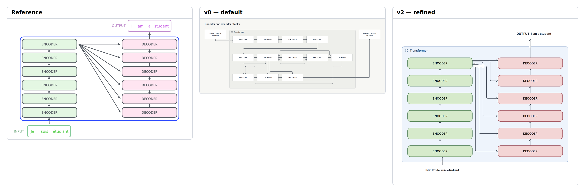

# E11 — Transformer encoder and decoder stacks

**Result:** v2 is a useful publication candidate for the architecture with clear repeat counts; fidelity remains below the reference because of fanout geometry, taller proportions, title treatment and text styling. No pixel registration/error claim is made.

Reference: [Jay Alammar / Jay Alammar](https://jalammar.github.io/illustrated-transformer/); exact original, license observations and preview provenance are in [source.md](source.md). The preserved original is identified by SHA-256 `bdc0fd6444dd03385e53f0789b370c3ffab9045d221949a180d5a0a317f44708`.

## Comparison



**v0 readability: worse.** The default folds twelve repeated blocks into a snake. The two towers and upward reading path are no longer apparent, although every connection remains traceable.

Ratings: 1 = misleading/unreadable; 3 = useful but visibly compromised; 5 = publication ready. Fidelity and semantic completeness are judged separately from standalone communication quality. These are visual judgments, not image-difference metrics.

| Stage | Communication quality | Fidelity | Semantic completeness |
|---|---:|---:|---:|
| v0 | 3/5 | 2/5 | 5/5 |
| v1 | 3/5 | 3/5 | 5/5 |
| v2 | 4/5 | 4/5 | 5/5 |

## Independent dimensions

### Content and semantic connections

All six encoders, all six decoders, both input/output strings, ten within-stack steps and all six encoder-to-decoder links remain present. v1 introduced explicit stack subgroups to obtain columns; v2 removes those extra visible boundaries to return to the single transformer container. No stage or attention relationship was dropped.

### Composition, reading path and containment

v0 folds the stages across three rows. v1 restores two vertical columns through native groups/order, but nests two large frames and routes several fanout lines around the outside. v2 pins equal-height blocks into two open columns and restores input below left and output above right. The native version remains taller and gives the title band more space than the reference.

### Typography and labels

The bundled sans face is clear and deterministic. Uppercase labels and equal stage size are retained; the reference input/output word spacing and colored text outline boxes are not reproduced. Final check reports twelve requested-size text-overflow warnings. Direct inspection shows the short ENCODER/DECODER labels fully visible; the diagnostic reflects the renderer’s preferred padding envelope rather than observed clipped glyphs.

### Routes, arrowheads and annotations

Explicit right-to-left sides keep six fanout lines in the central corridor. Orthogonal elbows and separated endpoint ports replace the original diagonal fan from one shared point. White crossing bridges near the encoder source visibly interrupt the bundle. Endpoint sides help, but native source cannot serialize arbitrary waypoints or a single shared branch trunk.

### Color and finish

Custom native swatches recover pale green encoders, pale pink decoders and a quiet blue frame. The original brighter border and thin dark strokes remain different. The faint frame fill is an intentional native approximation, not an imported background.

## Effort and source quality

Moderate to high: the final source is still recognizable as two repeated stacks, but fifteen pins, fourteen sizes and thirty-two endpoint-side assignments make the composition largely manual.

| Stage | Non-comment lines | Declarations | Layout/refinement lines | Pins | Nudges | Sizes | Styling lines | Endpoint side attributes |
|---|---:|---:|---:|---:|---:|---:|---:|---:|
| v0 | 36 | 33 | 2 | 0 | 0 | 0 | 0 | 0 |
| v1 | 45 | 35 | 8 | 0 | 0 | 0 | 16 | 0 |
| v2 | 68 | 33 | 31 | 15 | 0 | 14 | 17 | 32 |

Declarations count node/group/edge statements. Layout/refinement counts layout, near/order/align, pins, sizes and other geometric instructions; styling counts theme/theme-color or declaration lines with color/shade. Endpoint attributes are counted separately because small-looking edge statements can carry substantial manual route work. All counts are measured from final stage source. Authoring time was not measured; elapsed command durations are in validation logs and are not a proxy for illustration time.

Representative native source:

```draft
pin enc6 x=0 y=0
pin dec6 x=390 y=0
size enc6 width=280 height=48
edge attention1 enc6 -> dec1 from=right to=left
```

Predicted, not separately tested: changing one stage label can overflow its fixed height or width; a new stage requires edits to both pinned columns and their fanout links.

## Trial evidence and stopping decision

3 refinement cycles after the frozen v0. **Stopping reason: diminishing returns.** All three retained stages actually completed check, JSON/metrics inspection, SVG export and PNG capture with exit 0; [v0.validation.json](v0.validation.json), [v1.validation.json](v1.validation.json) and [v2.validation.json](v2.validation.json) identify exact source hashes, command arguments, elapsed times and log paths. Warnings are retained, not reclassified as successful visual design. The native baseline and bundled renderer/fonts were not changed.

The prior cycle-2 source, validation and any produced SVG/PNG/comparison are retained under `trials/v2-cycle2/`; its reason note describes the final correction. Failed command logs remain under `logs/`.

Residual differences:

- Orthogonal fanout replaces shared diagonal origin.
- Native group header/icon and taller proportions.
- Twelve padding-related text-overflow diagnostics remain despite visible text.

Provisional gap links: `C-G01`, `C-G02`, `C-G05`. These map to the combined gap audit; authoring mistakes listed above are not counted as tool gaps.

Detail crop coordinates are recorded in `detail-selection.json`; the full comparison retains complete content and original aspect ratios. Crops are diagnostic views, not pixel-registration inputs.
