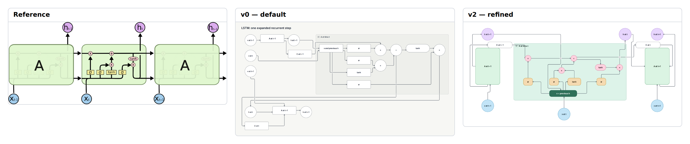

# E12 — Expanded LSTM cell with recurrent context

**Result:** The result explains the functional gate network, but the reference remains substantially more compact and mathematically elegant. v2 is not a finished replacement: the concat shorthand, header crossing and collapsed context internals remain explicit shortcomings. The three-cycle budget ends further edits.

Reference: [Christopher Olah / Christopher Olah](https://colah.github.io/posts/2015-08-Understanding-LSTMs/); exact original, license observations and preview provenance are in [source.md](source.md). The preserved original is identified by SHA-256 `9ef0aeb8ba4e3c55e5def82755276bcdd345f716dbb52b8eb437d8bbfd4b2e63`.

## Comparison



**v0 readability: worse.** Default flow puts recurrent time steps on different rows and disperses the input/gate relationships. The reference’s cell-state conveyor is much easier to recognize.

Ratings: 1 = misleading/unreadable; 3 = useful but visibly compromised; 5 = publication ready. Fidelity and semantic completeness are judged separately from standalone communication quality. These are visual judgments, not image-difference metrics.

| Stage | Communication quality | Fidelity | Semantic completeness |
|---|---:|---:|---:|
| v0 | 3/5 | 2/5 | 4/5 |
| v1 | 3/5 | 2/5 | 4/5 |
| v2 | 3/5 | 3/5 | 4/5 |

## Independent dimensions

### Content and semantic connections

The current cell preserves forget/input/output sigmoid gates, tanh candidate, both pointwise products, sum, output product, state passage and x/h recurrence. Previous/next cells are represented as A blocks rather than repeating their faded internals. The visible concat block is an approximation of the reference’s joined lines. In v2 its author-created label “x + previous h” is mathematically ambiguous: it should be read as the input bundle, not an assertion of pointwise addition. This is an authoring residual and lowers confidence in complete mathematical notation; it is not credited as a tool gap.

### Composition, reading path and containment

v0 folds recurrence into a large graph. v1 makes a wide left-to-right graph with the central cell but puts its gates vertically. v2 brings the four gates below the horizontal state path and restores left/center/right recurrence. The central cell is still too wide and the previous/next interiors are blank. A third-cycle correction moved x(t) below the cell because the first pinned version overlapped its computed extent.

### Typography and labels

Greek σ and ×/+ characters render natively, but subscripts are replaced with plain phrases such as “h at t−1”. Gate and context labels share the same type profile, unlike the large neighboring A symbols and compact equation-like notation of the reference. No custom mathematical text renderer was introduced.

### Routes, arrowheads and annotations

The state line, multiplication branches and current-input connections are all real edges. Explicit sides make the top conveyor legible, but separate boxes for C states and concatenation add bends that the reference avoids through junctions and continuous paths. Final check retains an edge-through-title warning where C(t−1) enters the cell header; the crossing is visible and remains part of the result.

### Color and finish

Native pastel input/output, gate, operation and context colors preserve most roles. The faded repeated cells and stroke/opacity hierarchy are missing. The diagnostic suggesting fewer accent families is an informational style recommendation, not a rendering failure.

## Effort and source quality

High: the gate topology remains readable in source, but nearly every visible object is pinned and sized, with nine edges receiving explicit endpoint sides. One final correction was spent repairing a pin overlap.

| Stage | Non-comment lines | Declarations | Layout/refinement lines | Pins | Nudges | Sizes | Styling lines | Endpoint side attributes |
|---|---:|---:|---:|---:|---:|---:|---:|---:|
| v0 | 48 | 45 | 2 | 0 | 0 | 0 | 0 | 0 |
| v1 | 55 | 45 | 8 | 0 | 0 | 0 | 19 | 0 |
| v2 | 89 | 45 | 43 | 21 | 0 | 20 | 19 | 18 |

Declarations count node/group/edge statements. Layout/refinement counts layout, near/order/align, pins, sizes and other geometric instructions; styling counts theme/theme-color or declaration lines with color/shade. Endpoint attributes are counted separately because small-looking edge statements can carry substantial manual route work. All counts are measured from final stage source. Authoring time was not measured; elapsed command durations are in validation logs and are not a proxy for illustration time.

Representative native source:

```draft
node concat "x + previous h" in=cell shape=box
pin forget x=50 y=30
size f width=60 height=48
size forget width=40 height=40
edge e4 cp -> forget from=right to=left
```

Predicted: fixed gate sizes tolerate short symbols, but longer formulas or a changed time label require resizing and related pin changes.

## Trial evidence and stopping decision

3 refinement cycles after the frozen v0. **Stopping reason: effort limit.** All three retained stages actually completed check, JSON/metrics inspection, SVG export and PNG capture with exit 0; [v0.validation.json](v0.validation.json), [v1.validation.json](v1.validation.json) and [v2.validation.json](v2.validation.json) identify exact source hashes, command arguments, elapsed times and log paths. Warnings are retained, not reclassified as successful visual design. The native baseline and bundled renderer/fonts were not changed.

The prior cycle-2 source, validation and any produced SVG/PNG/comparison are retained under `trials/v2-cycle2/`; its reason note describes the final correction. Failed command logs remain under `logs/`.

Residual differences:

- Ambiguous x + previous h author shorthand for concatenation.
- No subscript/math typesetting or faded neighboring gate diagrams.
- One state edge crosses the cell header.
- Extra state/concat nodes and orthogonal paths enlarge the diagram.

Provisional gap links: `C-G01`, `C-G02`, `C-G05`, `C-S01`. These map to the combined gap audit; authoring mistakes listed above are not counted as tool gaps.

Detail crop coordinates are recorded in `detail-selection.json`; the full comparison retains complete content and original aspect ratios. Crops are diagnostic views, not pixel-registration inputs.
