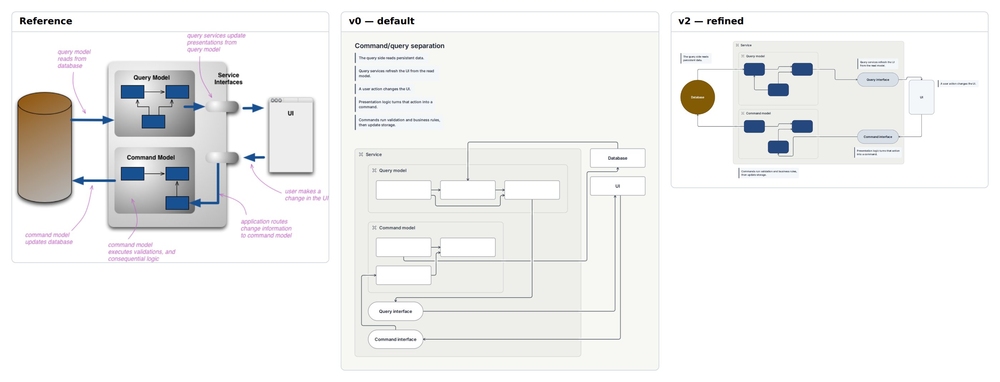

# E13 — CQRS: separate query and command models

**Result:** The final graph communicates the separation well and passes check without warnings. It is a clean explanatory variant, but not a faithful visual reproduction of the soft shaded service and handwritten callouts. The main remaining improvements would require typography, annotation and shape controls rather than more node nudging.

Reference: [Martin Fowler / Martin Fowler](https://martinfowler.com/bliki/CQRS.html); exact original, license observations and preview provenance are in [source.md](source.md). The preserved original is identified by SHA-256 `38a9da39997f4508f0ef57eef8187f881ee597cbefff41749cf9920203f401c5`.

## Comparison



**v0 readability: worse.** Default flow places the database and UI on one side and separates notes from their subjects, obscuring the compact read-top/write-bottom circuit.

Ratings: 1 = misleading/unreadable; 3 = useful but visibly compromised; 5 = publication ready. Fidelity and semantic completeness are judged separately from standalone communication quality. These are visual judgments, not image-difference metrics.

| Stage | Communication quality | Fidelity | Semantic completeness |
|---|---:|---:|---:|
| v0 | 3/5 | 2/5 | 5/5 |
| v1 | 4/5 | 3/5 | 5/5 |
| v2 | 4/5 | 3/5 | 5/5 |

## Independent dimensions

### Content and semantic connections

Database, UI, separate query/command models, their six anonymous internal components, two interfaces and all eleven component/service relations are retained. Five paraphrased notes preserve the six original explanatory assertions by combining command validation/business logic and storage update. Anonymous component rectangles remain anonymous rather than gaining invented names.

### Composition, reading path and containment

v0 stretches the service vertically with remote database/UI and heading notes. v1 makes the intended left-to-right lanes more apparent. v2 pins two compact internal triangles, one above the other, with database left and UI right. The native service frame is larger and lighter than the source, and its nested headers add structure absent from the original.

### Typography and labels

Native text is consistently readable and has strong contrast, but loses the source’s italic purple annotation voice, hand placed line breaks and distinct callout scale. Native notes have their own quiet panel treatment rather than free leader text. Interface sizes were enlarged in the final corrective cycle to remove requested-size overflow.

### Routes, arrowheads and annotations

Explicit sides preserve top read and bottom write directions and reduce detours inside both models. Ordinary thin open-arrow edges replace thick blue process arrows and gradient interface pills. Notes remain anchored by proximity; the source’s curved leaders cannot be authored as note leaders in the native language. The UI note was moved to the right after a real note-overlap warning.

### Color and finish

Dark blue internal components and a gold database retain role color. The native pill database becomes an oval at equal width/height, visibly different from the reference cylinder. Gradients, shadows and the browser-window chrome are not reproduced. These are appearance/native primitive differences, not missing data flow.

## Effort and source quality

Moderate: thirteen pins, ten exact sizes and explicit sides on eight relations recover the U-shaped story. Five notes remain ordinary native notes; there is no hidden custom drawing.

| Stage | Non-comment lines | Declarations | Layout/refinement lines | Pins | Nudges | Sizes | Styling lines | Endpoint side attributes |
|---|---:|---:|---:|---:|---:|---:|---:|---:|
| v0 | 34 | 24 | 4 | 0 | 0 | 0 | 0 | 0 |
| v1 | 40 | 24 | 9 | 0 | 0 | 0 | 11 | 0 |
| v2 | 57 | 24 | 27 | 13 | 0 | 10 | 11 | 16 |

Declarations count node/group/edge statements. Layout/refinement counts layout, near/order/align, pins, sizes and other geometric instructions; styling counts theme/theme-color or declaration lines with color/shade. Endpoint attributes are counted separately because small-looking edge statements can carry substantial manual route work. All counts are measured from final stage source. Authoring time was not measured; elapsed command durations are in validation logs and are not a proxy for illustration time.

Representative native source:

```draft
note "Query services refresh the UI from the read model." near=qi side=above width=200
pin qi x=520 y=90
size ci width=180 height=60
edge e10 ci -> command3 from=left to=bottom
```

Predicted: note text rewraps automatically, but exact interface dimensions and pinned frame layout would need checking after longer labels.

## Trial evidence and stopping decision

3 refinement cycles after the frozen v0. **Stopping reason: diminishing returns.** All three retained stages actually completed check, JSON/metrics inspection, SVG export and PNG capture with exit 0; [v0.validation.json](v0.validation.json), [v1.validation.json](v1.validation.json) and [v2.validation.json](v2.validation.json) identify exact source hashes, command arguments, elapsed times and log paths. Warnings are retained, not reclassified as successful visual design. The native baseline and bundled renderer/fonts were not changed.

The prior cycle-2 source, validation and any produced SVG/PNG/comparison are retained under `trials/v2-cycle2/`; its reason note describes the final correction. Failed command logs remain under `logs/`.

Residual differences:

- Cylinder, gradients and browser chrome replaced by simple native shapes.
- No curved note leaders or italic annotation hierarchy.
- Larger nested frames and thin process arrows.

Provisional gap links: `C-G01`, `C-G02`, `C-G03`, `C-G05`, `C-S01`. These map to the combined gap audit; authoring mistakes listed above are not counted as tool gaps.

Detail crop coordinates are recorded in `detail-selection.json`; the full comparison retains complete content and original aspect ratios. Crops are diagnostic views, not pixel-registration inputs.
