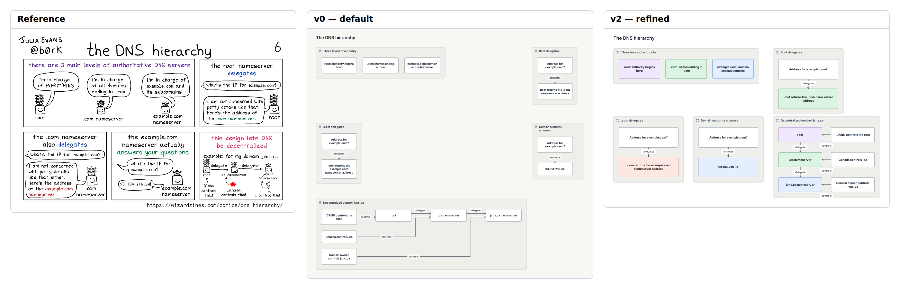

# E14 — The DNS hierarchy comic

**Result:** v2 is a useful structured explanation with complete factual content. It cannot substitute for the reference’s warmth or comic pacing. Adding more pins would not recover the main missing visual vocabulary; stop on the native illustration/inline-typography boundary.

Reference: [Wizard Zines / Julia Evans](https://wizardzines.com/comics/dns-hierarchy/); exact original, license observations and preview provenance are in [source.md](source.md). The preserved original is identified by SHA-256 `930c220fff84a093a8158a96e6ec3b7302ac4d9be4e71e469d6ac7c195bd3db7`.

## Comparison



**v0 readability: worse.** Default grid leaves large empty areas and expands governance into a horizontal flow, weakening the comic’s five-panel reading order.

Ratings: 1 = misleading/unreadable; 3 = useful but visibly compromised; 5 = publication ready. Fidelity and semantic completeness are judged separately from standalone communication quality. These are visual judgments, not image-difference metrics.

| Stage | Communication quality | Fidelity | Semantic completeness |
|---|---:|---:|---:|
| v0 | 3/5 | 2/5 | 5/5 |
| v1 | 3/5 | 2/5 | 5/5 |
| v2 | 4/5 | 3/5 | 5/5 |

## Independent dimensions

### Content and semantic connections

All three authority levels, repeated address questions, both delegation steps, the example.com answer, and the ICANN/Canada/domain-owner governance example remain present. Dialogue is paraphrased into explicit assertions. Plant characters, speech tails and playful voice are omitted visual content and are openly outside this native reconstruction.

### Composition, reading path and containment

v0’s general grid gives the small panels excessive separation. v1 adds proximity controls but leaves unequal rows and a large control graph. v2 reconstructs a top overview/root row and lower .com/domain/governance row. Governance is vertical rather than the original small horizontal chain, which keeps its three ownership arrows legible but changes the lower-right rhythm.

### Typography and labels

The original’s hand lettering, colorful inline emphasis and conversational hierarchy are replaced by uniform native text. Larger fixed-width boxes make long authority descriptions legible; they also consume more area and make the piece feel like documentation rather than a comic.

### Routes, arrowheads and annotations

Domain and delegation questions use explicit arrows between compact assertions. Control arrows identify ownership independently from authority delegation. They are semantically clear, but edge labels sit near the short arrows with less precise typography than the original handwritten labels. No speech bubbles, character illustration or decorative icons were simulated with raster assets.

### Color and finish

Pastel role colors distinguish root, TLD and domain authorities. The original highlights particular phrases rather than whole boxes, so color meaning is only approximately matched. Neutral panel fills and header icons are default native container treatment.

## Effort and source quality

High for such a short explanation: twenty pins and fifteen sizes are needed to obtain the chosen two-row panel composition. The declarations remain simple and explicit.

| Stage | Non-comment lines | Declarations | Layout/refinement lines | Pins | Nudges | Sizes | Styling lines | Endpoint side attributes |
|---|---:|---:|---:|---:|---:|---:|---:|---:|
| v0 | 35 | 28 | 6 | 0 | 0 | 0 | 0 | 0 |
| v1 | 40 | 28 | 10 | 0 | 0 | 0 | 10 | 0 |
| v2 | 71 | 28 | 41 | 20 | 0 | 15 | 10 | 0 |

Declarations count node/group/edge statements. Layout/refinement counts layout, near/order/align, pins, sizes and other geometric instructions; styling counts theme/theme-color or declaration lines with color/shade. Endpoint attributes are counted separately because small-looking edge statements can carry substantial manual route work. All counts are measured from final stage source. Authoring time was not measured; elapsed command durations are in validation logs and are not a proxy for illustration time.

Representative native source:

```draft
pin overview x=0 y=0
pin control x=700 y=300
size owner width=190 height=64
```

Predicted: longer dialogue would need new heights or panel positions because the final panel grid is explicitly pinned.

## Trial evidence and stopping decision

2 refinement cycles after the frozen v0. **Stopping reason: unsupported primitive.** All three retained stages actually completed check, JSON/metrics inspection, SVG export and PNG capture with exit 0; [v0.validation.json](v0.validation.json), [v1.validation.json](v1.validation.json) and [v2.validation.json](v2.validation.json) identify exact source hashes, command arguments, elapsed times and log paths. Warnings are retained, not reclassified as successful visual design. The native baseline and bundled renderer/fonts were not changed.

Before the first successful v0 render, the author used reserved ID `root`. The invalid source, first freeze and failed validation are retained under `trials/preflight-v0*`. A name-only correction to `root_ns` produced the first rendered v0, which was then frozen. This is a preflight authoring mistake, not a tool defect or a refinement win.

Residual differences:

- Characters, speech balloons and handwritten/inline emphasis absent.
- Governance becomes a vertical graph.
- Uniform panel headers and fills replace thin comic frames.

Provisional gap links: `C-G01`, `C-G05`, `C-S01`. These map to the combined gap audit; authoring mistakes listed above are not counted as tool gaps.

Detail crop coordinates are recorded in `detail-selection.json`; the full comparison retains complete content and original aspect ratios. Crops are diagnostic views, not pixel-registration inputs.
