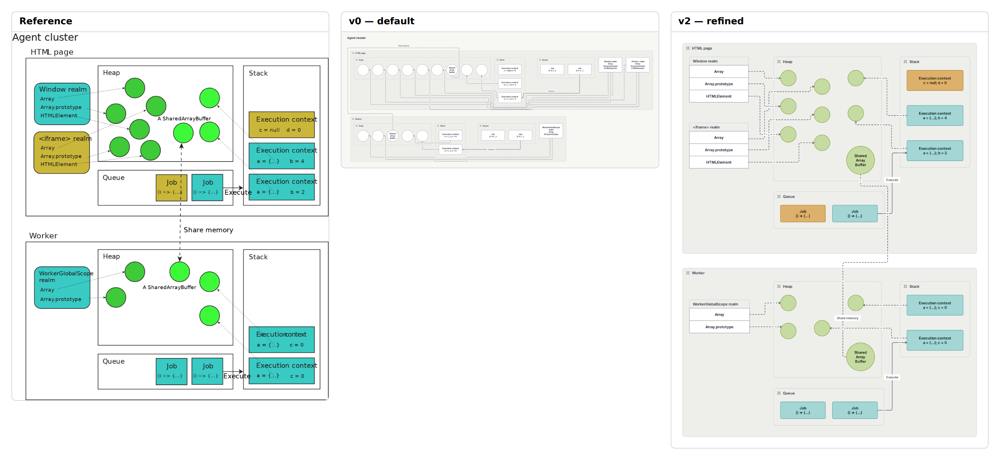

# E15 — JavaScript agent cluster execution model

**Result:** The final result is semantically much stronger than v0 and readable at native size, but not publication ready at the reference’s compact display scale. It demonstrates that correct topology and successful validation do not establish editorial equivalence. Several dense details and large composition costs remain visible.

Reference: [MDN Web Docs / MDN contributors](https://developer.mozilla.org/en-US/docs/Web/JavaScript/Reference/Execution_model); exact original, license observations and preview provenance are in [source.md](source.md). The preserved original is identified by SHA-256 `595738edfb94e7606825a8032a07c1cc9c0b635fb7b6a36f5516e1527aa9dc50`.

## Comparison



**v0 readability: worse.** Default layout turns each heap into a long row, moves realms to the far right, and makes shared memory a large outer loop; the original’s mirrored agent structure is much clearer.

Ratings: 1 = misleading/unreadable; 3 = useful but visibly compromised; 5 = publication ready. Fidelity and semantic completeness are judged separately from standalone communication quality. These are visual judgments, not image-difference metrics.

| Stage | Communication quality | Fidelity | Semantic completeness |
|---|---:|---:|---:|
| v0 | 2/5 | 1/5 | 4/5 |
| v1 | 2/5 | 2/5 | 5/5 |
| v2 | 3/5 | 3/5 | 5/5 |

## Independent dimensions

### Content and semantic connections

Both agents, their heaps/stacks/queues, nine page heap objects, five worker heap objects, five execution contexts, four jobs, realm fields, twelve object references and one shared-memory relation are retained. v0 aggregated fields into realm-node labels, making the source of each individual pointer imprecise. v1 and v2 promote every realm field to an addressable cell, preserving those mappings. kind=async is used only as the baseline’s dashed-line visual vocabulary for references; the diagram does not claim that pointers are asynchronous messages.

### Composition, reading path and containment

v1 improves field identity but still yields broad row heaps and separated stacks. v2 mirrors both agents: realms left, heap center, stack right, queue below. Every object is deliberately located and the two shared-buffer nodes align in their heaps. The actual shared-memory route still detours around the page queue and passes through the worker panel rather than reproducing the short central vertical reference. Native frames, headers and padding make the result substantially taller.

### Typography and labels

The reference SVG uses Arial, Menlo and Myriad Pro families. Its raster preview uses the supplied browser and may substitute unavailable fonts; original SVG bytes are preserved. The first preview had viewport side whitespace because the SVG has no intrinsic width/height; the final preview matches its 568.03×661.07 viewBox. Native labels use bundled fonts, with smaller code-like descriptions and wrapped SharedArrayBuffer text rather than the original free labels.

### Routes, arrowheads and annotations

Realm fields now have distinct dashed pointers, but orthogonal turns and border crossing marks add noise. Reference lines are largely diagonal and very light. No arbitrary route waypoints or label offsets are serialized in the native language. Source labels/contexts remain readable, but long shared-memory routing is a material compromise.

### Color and finish

Teal/yellow execution contexts and jobs preserve role distinctions, and a quieter green colors heap objects. The reference’s matching realm fills and two bright/dark heap color groups are not fully reproduced: realm records are white in these attempts. This is an incomplete author styling pass retained at the effort limit, not proof that custom colors are unavailable.

## Effort and source quality

Very high: 136 non-comment lines, thirty-four pins and thirty-one exact sizes. The manual coordinates dominate the native semantic model, and a corrective cycle was required because group headers/padding made the queues overlap heaps.

| Stage | Non-comment lines | Declarations | Layout/refinement lines | Pins | Nudges | Sizes | Styling lines | Endpoint side attributes |
|---|---:|---:|---:|---:|---:|---:|---:|---:|
| v0 | 59 | 49 | 9 | 0 | 0 | 0 | 0 | 0 |
| v1 | 73 | 57 | 14 | 0 | 0 | 0 | 24 | 0 |
| v2 | 136 | 57 | 77 | 34 | 0 | 31 | 25 | 0 |

Declarations count node/group/edge statements. Layout/refinement counts layout, near/order/align, pins, sizes and other geometric instructions; styling counts theme/theme-color or declaration lines with color/shade. Endpoint attributes are counted separately because small-looking edge statements can carry substantial manual route work. All counts are measured from final stage source. Authoring time was not measured; elapsed command durations are in validation logs and are not a proxy for illustration time.

Representative native source:

```draft
pin po7 x=235 y=270
pin pqueue x=300 y=480
size window_2 width=210 height=44
edge ref2 window_2 -> po2 kind=async
```

Predicted: a longer stack label can overflow a fixed frame; adding a heap object or queue job requires manual coordinate and spacing edits. No resilience trial was run.

## Trial evidence and stopping decision

3 refinement cycles after the frozen v0. **Stopping reason: effort limit.** All three retained stages actually completed check, JSON/metrics inspection, SVG export and PNG capture with exit 0; [v0.validation.json](v0.validation.json), [v1.validation.json](v1.validation.json) and [v2.validation.json](v2.validation.json) identify exact source hashes, command arguments, elapsed times and log paths. Warnings are retained, not reclassified as successful visual design. The native baseline and bundled renderer/fonts were not changed.

The prior cycle-2 source, validation and any produced SVG/PNG/comparison are retained under `trials/v2-cycle2/`; its reason note describes the final correction. Failed command logs remain under `logs/`.

Residual differences:

- Shared-memory route detours around queue and through lower panel.
- Reference realm/color correspondence only partly restored.
- Native padding and headers enlarge the dense two-agent figure.
- Reference preview font substitution limits precise fidelity judgment.

Provisional gap links: `C-G01`, `C-G02`, `C-G05`. These map to the combined gap audit; authoring mistakes listed above are not counted as tool gaps.

Detail crop coordinates are recorded in `detail-selection.json`; the full comparison retains complete content and original aspect ratios. Crops are diagnostic views, not pixel-registration inputs.
