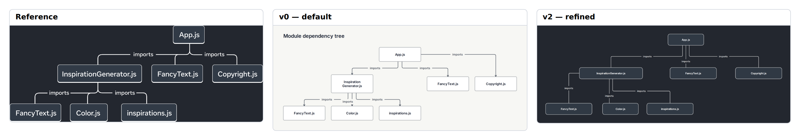

# E16 — React module dependency tree — dark illustration

**Result:** v0 is a first-render success for hierarchy and communication. v2 is an attractive native diagram with good fidelity short of exact trunk/label/typography matching. This case is reserved for future confirmation: no numerical engine/routing tuning values were selected from it.

Reference: [React / React documentation team](https://react.dev/learn/understanding-your-ui-as-a-tree); exact original, license observations and preview provenance are in [source.md](source.md). The preserved original is identified by SHA-256 `6bb088e7aa77a2724d1da1b43fbb4329edbfedd91f8c1ed64216ede1f7c7f816`.

## Comparison



**v0 readability: comparable.** The default tree correctly shows both import generations and every module. A long identifier wraps and separate branches are noisier, but the hierarchy remains readable without manual placement.

Ratings: 1 = misleading/unreadable; 3 = useful but visibly compromised; 5 = publication ready. Fidelity and semantic completeness are judged separately from standalone communication quality. These are visual judgments, not image-difference metrics.

| Stage | Communication quality | Fidelity | Semantic completeness |
|---|---:|---:|---:|
| v0 | 4/5 | 3/5 | 5/5 |
| v1 | 2/5 | 2/5 | 4/5 |
| v2 | 4/5 | 4/5 | 4/5 |

## Independent dimensions

### Content and semantic connections

All seven module occurrences and six imports are preserved, including the two separate FancyText.js occurrences under different parents. The reference’s undirected drawn branches mean import hierarchy, not a symmetric dependency. v1 removes arrowheads with directed=false while leaving the same edge source/target declarations; the tree engine then lays them in a row. This failed refinement is retained and is not counted as an improvement. The documentation explicitly states that directed=false creates an undirected relation, not merely an invisible arrowhead. Consequently v1/v2 weaken the native logical direction of imports, even though the final vertical hierarchy communicates parent/child direction visually; their semantic ratings are 4/5. This is an authoring tradeoff exposing the lack of independent arrowhead-visibility control, not proof that the documented undirected behavior is defective.

### Composition, reading path and containment

v0 gets the rooted tree and asymmetric subtree mostly right with one recipe. v1 loses depth after the arrowless styling choice. v2 pins the three levels and enlarges InspirationGenerator.js to one line, closely recovering the broad visual organization. Branch offsets still differ and the left subtree is slightly more spacious.

### Typography and labels

The dark reference’s legible module names are closely approached by native sans text and fixed widths. The node text is bolder and slightly smaller relative to its boxes. No per-object font-size or text-weight control is used because the baseline’s native language does not expose one.

### Routes, arrowheads and annotations

Unarrowed native edges match the absence of arrowheads, but remain six separately routed links with six repeated “imports” labels. The reference uses shared rounded trunks and just two labels per sibling span. Native source cannot express that shared trunk semantics as one bus; deleting labels would remove repeated content only cosmetically and is not claimed as routing support.

### Color and finish

A native blueprint theme with explicit dark canvas, module fill and white ink/strokes recreates the basic dark palette successfully. There are no notes in this case, so it provides no evidence for the separate dark-note issue observed elsewhere.

## Effort and source quality

Moderate: seven pins and seven sizes recover a very simple asymmetric tree after the unarrowed-edge refinement removed automatic depth. The final source remains easy to read, but its geometry is less resilient than v0.

| Stage | Non-comment lines | Declarations | Layout/refinement lines | Pins | Nudges | Sizes | Styling lines | Endpoint side attributes |
|---|---:|---:|---:|---:|---:|---:|---:|---:|
| v0 | 15 | 13 | 1 | 0 | 0 | 0 | 0 | 0 |
| v1 | 18 | 13 | 2 | 0 | 0 | 0 | 9 | 0 |
| v2 | 30 | 13 | 15 | 7 | 0 | 7 | 9 | 0 |

Declarations count node/group/edge statements. Layout/refinement counts layout, near/order/align, pins, sizes and other geometric instructions; styling counts theme/theme-color or declaration lines with color/shade. Endpoint attributes are counted separately because small-looking edge statements can carry substantial manual route work. All counts are measured from final stage source. Authoring time was not measured; elapsed command durations are in validation logs and are not a proxy for illustration time.

Representative native source:

```draft
edge imports1 app -> generator "imports" directed=false
pin generator x=160 y=160
size generator width=300 height=54
```

Predicted: v0 adapts labels more naturally; v2 fixes widths/heights and coordinates, so module renames can require intervention.

## Trial evidence and stopping decision

2 refinement cycles after the frozen v0. **Stopping reason: diminishing returns.** All three retained stages actually completed check, JSON/metrics inspection, SVG export and PNG capture with exit 0; [v0.validation.json](v0.validation.json), [v1.validation.json](v1.validation.json) and [v2.validation.json](v2.validation.json) identify exact source hashes, command arguments, elapsed times and log paths. Warnings are retained, not reclassified as successful visual design. The native baseline and bundled renderer/fonts were not changed.

**Reserved confirmation case:** audited now, excluded from selection of numerical tuning values for proposed future changes.

Residual differences:

- Shared trunk and sparse branch labels remain separate repeated edges.
- v1 undirected hierarchy collapse is preserved.
- Slightly bolder/smaller type and different spacing.

Provisional gap links: `C-G01`, `C-G02`, `C-S03`. These map to the combined gap audit; authoring mistakes listed above are not counted as tool gaps.

Detail crop coordinates are recorded in `detail-selection.json`; the full comparison retains complete content and original aspect ratios. Crops are diagnostic views, not pixel-registration inputs.
