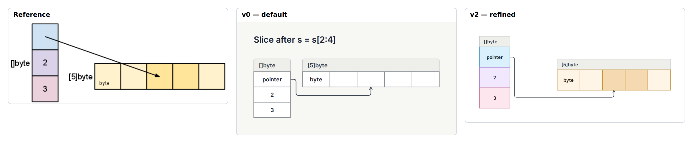

# E17 — Go slice descriptor and backing array after reslicing

**Result:** This is a strong compact native use case: first-render quality is high and the final source stays manageable. v2 is suitable for explaining slices, though not an exact image replacement. A special diagonal pointer mode and external record caption are optional fidelity improvements, not blockers to communication.

Reference: [The Go Blog / Andrew Gerrand](https://go.dev/blog/slices-intro); exact original, license observations and preview provenance are in [source.md](source.md). The preserved original is identified by SHA-256 `c0008f5a935182449cf759305bfcb4a11fc6f722a89878fda7c13d77c6bfb235`.

## Comparison



**v0 readability: comparable.** Native cells immediately preserve the three descriptor fields and five adjacent array slots, with an unmistakable pointer to the correct third slot. Default loses range color but adds a helpful pointer label.

Ratings: 1 = misleading/unreadable; 3 = useful but visibly compromised; 5 = publication ready. Fidelity and semantic completeness are judged separately from standalone communication quality. These are visual judgments, not image-difference metrics.

| Stage | Communication quality | Fidelity | Semantic completeness |
|---|---:|---:|---:|
| v0 | 4/5 | 3/5 | 5/5 |
| v1 | 4/5 | 3/5 | 5/5 |
| v2 | 4/5 | 4/5 | 5/5 |

## Independent dimensions

### Content and semantic connections

The slice’s pointer, length 2, capacity 3 and five-byte backing array remain complete. The pointer targets b2, the third array cell; the two active cells b2/b3 regain their stronger fill in v1/v2. The additional word “pointer” makes an unlabeled source field explicit without changing its meaning.

### Composition, reading path and containment

The perpendicular descriptor/array layout is already successful in v0. v1 adds role/range color and shifts the array right. v2 fixes individual cell proportions and moves the array slightly below the descriptor pointer, approaching the original balance. Native title bands sit above both records, whereas the reference places []byte and [5]byte beside them.

### Typography and labels

Default native type is highly legible and the numeric fields remain prominent. The source’s lighter body labels and external record captions are not exactly matched. The added word pointer is a useful communication choice but a fidelity difference.

### Routes, arrowheads and annotations

Native routing ends precisely on the exterior of the third cell, which is a meaningful success for addressable cells. It travels below the array and enters upward instead of following the original diagonal into the cell interior. There is no arbitrary straight diagonal/waypoint route control in the native serialization. Explicitly forcing an interior/top side could cross the title band, so the honest safe route was retained.

### Color and finish

Soft blue/purple/pink descriptor fields and stronger yellow active cells preserve the reference’s main visual encoding. Native shades differ and borders are finer; contrast remains good.

## Effort and source quality

Low to moderate: two pins and eight exact cell sizes. Cells avoid having to pin each field, so the source is concise and the underlying memory order remains obvious.

| Stage | Non-comment lines | Declarations | Layout/refinement lines | Pins | Nudges | Sizes | Styling lines | Endpoint side attributes |
|---|---:|---:|---:|---:|---:|---:|---:|---:|
| v0 | 15 | 11 | 3 | 0 | 0 | 0 | 0 | 0 |
| v1 | 17 | 11 | 4 | 0 | 0 | 0 | 9 | 0 |
| v2 | 25 | 11 | 13 | 2 | 0 | 8 | 9 | 0 |

Declarations count node/group/edge statements. Layout/refinement counts layout, near/order/align, pins, sizes and other geometric instructions; styling counts theme/theme-color or declaration lines with color/shade. Endpoint attributes are counted separately because small-looking edge statements can carry substantial manual route work. All counts are measured from final stage source. Authoring time was not measured; elapsed command durations are in validation logs and are not a proxy for illustration time.

Representative native source:

```draft
layout slice cells direction=down
layout array cells
edge ptr_array ptr -> b2
size b2 width=64 height=58
```

Predicted: cell ordering survives label edits and resizing; fixed widths may wrap a longer descriptor label, but only two group pins need maintenance.

## Trial evidence and stopping decision

2 refinement cycles after the frozen v0. **Stopping reason: diminishing returns.** All three retained stages actually completed check, JSON/metrics inspection, SVG export and PNG capture with exit 0; [v0.validation.json](v0.validation.json), [v1.validation.json](v1.validation.json) and [v2.validation.json](v2.validation.json) identify exact source hashes, command arguments, elapsed times and log paths. Warnings are retained, not reclassified as successful visual design. The native baseline and bundled renderer/fonts were not changed.

Residual differences:

- External record labels become title bands.
- Pointer arrives at outer cell boundary through orthogonal route.
- Added pointer label and different stroke weights.

Provisional gap links: `C-G01`, `C-G02`. These map to the combined gap audit; authoring mistakes listed above are not counted as tool gaps.

Detail crop coordinates are recorded in `detail-selection.json`; the full comparison retains complete content and original aspect ratios. Crops are diagnostic views, not pixel-registration inputs.
