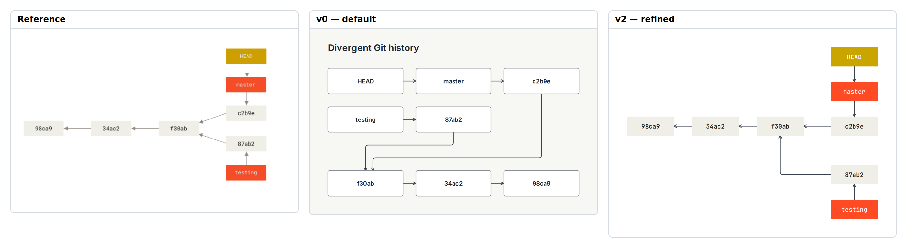

# E18 — Git divergent history and branch pointers

**Result:** The final output communicates the divergence effectively with no validation warnings. It is a good native result rather than a pixel match. The v1 source should also be considered when authoring similar diagrams, because its near/order constraints achieve almost the same communication with fewer hard coordinates.

Reference: [Pro Git / Scott Chacon and Ben Straub](https://git-scm.com/book/en/v2/Git-Branching-Branches-in-a-Nutshell); exact original, license observations and preview provenance are in [source.md](source.md). The preserved original is identified by SHA-256 `fd98bcb7253b9baa6b5fa14899d9ab31c99a3b3286ad0539c1da08a56c10cba9`.

## Comparison



**v0 readability: worse.** The default orders by arrow direction and folds the parent chain, reversing the intended chronological reading path and mixing branch-pointer roles with commits.

Ratings: 1 = misleading/unreadable; 3 = useful but visibly compromised; 5 = publication ready. Fidelity and semantic completeness are judged separately from standalone communication quality. These are visual judgments, not image-difference metrics.

| Stage | Communication quality | Fidelity | Semantic completeness |
|---|---:|---:|---:|
| v0 | 3/5 | 2/5 | 5/5 |
| v1 | 4/5 | 4/5 | 5/5 |
| v2 | 4/5 | 4/5 | 5/5 |

## Independent dimensions

### Content and semantic connections

All five commit IDs, both branch names, HEAD and all seven parent/ownership pointers are preserved. Parent arrows point to earlier commits while time reads left to right. v1 correctly marks pointers constraint=false so they no longer determine chronology; this is documented author control, not a graph-semantic change.

### Composition, reading path and containment

v0’s folded pointer graph is valid but poor as a history illustration. v1 restores chronological order and separates vertical branch labels. v2 tightens the individual node widths and positions for a compact result. The branching commit is still collinear with master’s tip instead of splitting symmetrically on a common centerline.

### Typography and labels

Monospaced native labels suit hash IDs and branch names. The reference uses smaller and lighter text; native text remains clear at reduced scale and no identifier wraps.

### Routes, arrowheads and annotations

The parent chain is direct and clean. The testing branch returns through an elbow rather than a diagonal, and open arrowheads replace the source’s small filled ones. Seven endpoint relationships are unambiguous; further route matching is not necessary for quality.

### Color and finish

Quiet commit fills, orange branch labels and a gold HEAD recover the role palette using three native custom swatches. No legend is required because labels themselves state the roles.

## Effort and source quality

Moderate: the graph itself is tiny, but eight pins and eight sizes make chronological position explicit. The v1 order/near solution is actually more resilient and already communicates well.

| Stage | Non-comment lines | Declarations | Layout/refinement lines | Pins | Nudges | Sizes | Styling lines | Endpoint side attributes |
|---|---:|---:|---:|---:|---:|---:|---:|---:|
| v0 | 17 | 15 | 1 | 0 | 0 | 0 | 0 | 0 |
| v1 | 26 | 15 | 6 | 0 | 0 | 0 | 12 | 0 |
| v2 | 36 | 15 | 17 | 8 | 0 | 8 | 12 | 0 |

Declarations count node/group/edge statements. Layout/refinement counts layout, near/order/align, pins, sizes and other geometric instructions; styling counts theme/theme-color or declaration lines with color/shade. Endpoint attributes are counted separately because small-looking edge statements can carry substantial manual route work. All counts are measured from final stage source. Authoring time was not measured; elapsed command durations are in validation logs and are not a proxy for illustration time.

Representative native source:

```draft
edge e1 c2 -> c1 constraint=false
pin c3 x=280 y=150
pin testing_commit x=440 y=255
theme-color branch fill="#FF4B23" stroke="#FF4B23" ink="#FFFFFF"
```

Predicted: short hash/name changes are safe within the fixed widths; adding commits requires manual pins. v1 soft placement is preferable for evolving histories.

## Trial evidence and stopping decision

2 refinement cycles after the frozen v0. **Stopping reason: good enough.** All three retained stages actually completed check, JSON/metrics inspection, SVG export and PNG capture with exit 0; [v0.validation.json](v0.validation.json), [v1.validation.json](v1.validation.json) and [v2.validation.json](v2.validation.json) identify exact source hashes, command arguments, elapsed times and log paths. Warnings are retained, not reclassified as successful visual design. The native baseline and bundled renderer/fonts were not changed.

Residual differences:

- Testing branch bends orthogonally instead of diagonally.
- Commit junction geometry differs.
- Native text/strokes slightly heavier.

Provisional gap links: `C-G02`, `C-G05`. These map to the combined gap audit; authoring mistakes listed above are not counted as tool gaps.

Detail crop coordinates are recorded in `detail-selection.json`; the full comparison retains complete content and original aspect ratios. Crops are diagnostic views, not pixel-registration inputs.
