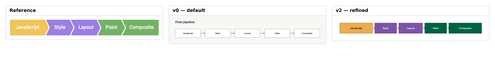

# E19 — The browser pixel pipeline

**Result:** The final output is clear and compact, with clean validation. Its largest mismatch is a specific shape/adjacency pattern, not a general pipeline failure. A chevron primitive should be evaluated as a focused extension only if other accepted examples justify it.

Reference: [web.dev / Paul Lewis](https://web.dev/articles/rendering-performance); exact original, license observations and preview provenance are in [source.md](source.md). The preserved original is identified by SHA-256 `c60f4da9baa4ed4a7ae4f38e77344db7fe57fc25cc2a4d9deaf02a82d4bb39b4`.

## Comparison



**v0 readability: comparable.** The default five-stage row has clear order, high-contrast labels and no overlaps. It loses the contiguous ribbon and process grouping colors, but the basic explanation remains immediately readable.

Ratings: 1 = misleading/unreadable; 3 = useful but visibly compromised; 5 = publication ready. Fidelity and semantic completeness are judged separately from standalone communication quality. These are visual judgments, not image-difference metrics.

| Stage | Communication quality | Fidelity | Semantic completeness |
|---|---:|---:|---:|
| v0 | 4/5 | 3/5 | 5/5 |
| v1 | 4/5 | 3/5 | 5/5 |
| v2 | 4/5 | 3/5 | 5/5 |

## Independent dimensions

### Content and semantic connections

All five rendering stages and their order are preserved: JavaScript, Style, Layout, Paint, Composite. Native edges express transition order. The figure is deliberately small in the corpus because it isolates continuous-stage composition rather than stressing object count.

### Composition, reading path and containment

The default row already works. v1 reduces spacing and adds color groups. v2 sizes the longer JavaScript/Composite stages more broadly and creates a tight ribbon-like row, but boxes remain separate rather than sharing angled chevron boundaries. Cells were not substituted because contiguous record fields would change the native structural interpretation of a process.

### Typography and labels

Native text is smaller relative to each stage and heavier than the reference at the comparison-sheet scale. All labels fit on one line. Native title/annotation type roles do not expose the reference’s very large white stage labels as per-object typography.

### Routes, arrowheads and annotations

Small open-arrow links sit in the narrow gaps. The reference encodes direction in the joined chevron geometry and needs no separate arrows. The baseline native shape list has no chevron or polygon stage, so an exact continuous ribbon cannot be authored without a new native primitive.

### Color and finish

Three color families preserve the script/layout/pixel grouping. The final JavaScript stage uses dark text for stronger contrast and the green stages are darker than the reference. This readability choice is not a fidelity win; it is a quality tradeoff.

## Effort and source quality

Low: five exact sizes and one row gap are the only geometric refinements. No pins are needed, and the source remains a straightforward five-stage pipeline.

| Stage | Non-comment lines | Declarations | Layout/refinement lines | Pins | Nudges | Sizes | Styling lines | Endpoint side attributes |
|---|---:|---:|---:|---:|---:|---:|---:|---:|
| v0 | 11 | 9 | 1 | 0 | 0 | 0 | 0 | 0 |
| v1 | 12 | 9 | 1 | 0 | 0 | 0 | 6 | 0 |
| v2 | 16 | 9 | 6 | 0 | 0 | 5 | 6 | 0 |

Declarations count node/group/edge statements. Layout/refinement counts layout, near/order/align, pins, sizes and other geometric instructions; styling counts theme/theme-color or declaration lines with color/shade. Endpoint attributes are counted separately because small-looking edge statements can carry substantial manual route work. All counts are measured from final stage source. Authoring time was not measured; elapsed command durations are in validation logs and are not a proxy for illustration time.

Representative native source:

```draft
layout root row gap=8
size js width=180 height=58
size composite width=180 height=58
```

Predicted: row layout adapts to stage changes; the five fixed widths may need editing for much longer labels, but there are no pinned coordinates.

## Trial evidence and stopping decision

2 refinement cycles after the frozen v0. **Stopping reason: unsupported primitive.** All three retained stages actually completed check, JSON/metrics inspection, SVG export and PNG capture with exit 0; [v0.validation.json](v0.validation.json), [v1.validation.json](v1.validation.json) and [v2.validation.json](v2.validation.json) identify exact source hashes, command arguments, elapsed times and log paths. Warnings are retained, not reclassified as successful visual design. The native baseline and bundled renderer/fonts were not changed.

Residual differences:

- No contiguous chevron stage shape.
- Separate arrow links remain.
- Per-stage text scale and exact palette differ.

Provisional gap links: `C-G01`, `C-S02`. These map to the combined gap audit; authoring mistakes listed above are not counted as tool gaps.

Detail crop coordinates are recorded in `detail-selection.json`; the full comparison retains complete content and original aspect ratios. Crops are diagnostic views, not pixel-registration inputs.
