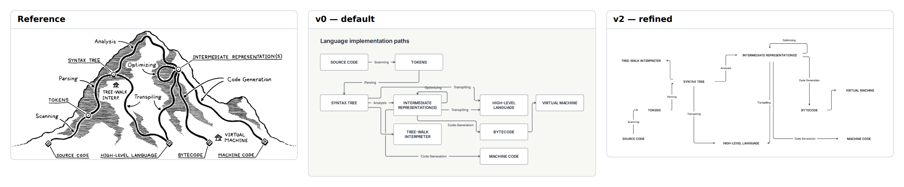

# E20 — Compiler routes across a conceptual mountain

**Result:** v1 is useful as a conventional compiler-route explanation. v2 remains only a partial native reconstruction and should not be substituted for the reference in an editorial context. This confirmation case is audited now but reserved from numerical future-engine tuning.

Reference: [Crafting Interpreters / Robert Nystrom](https://craftinginterpreters.com/a-map-of-the-territory.html); exact original, license observations and preview provenance are in [source.md](source.md). The preserved original is identified by SHA-256 `ddec81e3b0cc3890ba1150356149525aaf4a5b7cf8ec626d384ae78ccbab68ed`.

## Comparison



**v0 readability: worse.** The default preserves compiler-path relations but turns the mountain metaphor into a folded box graph. It loses the terrain’s compact explanation of abstraction and branching.

Ratings: 1 = misleading/unreadable; 3 = useful but visibly compromised; 5 = publication ready. Fidelity and semantic completeness are judged separately from standalone communication quality. These are visual judgments, not image-difference metrics.

| Stage | Communication quality | Fidelity | Semantic completeness |
|---|---:|---:|---:|
| v0 | 3/5 | 1/5 | 4/5 |
| v1 | 4/5 | 1/5 | 4/5 |
| v2 | 3/5 | 2/5 | 4/5 |

## Independent dimensions

### Content and semantic connections

Source, tokens, syntax tree, intermediate representation, high-level language, bytecode, machine code, tree-walk interpreter and virtual machine are present with scanning, parsing, analysis, optimization, transpilation and code-generation paths. The source’s geographic metaphor is itself explanatory content: abstraction is altitude and implementation choices are mountain routes. That content is absent, so semantic completeness is not rated perfect even though the functional graph is retained.

### Composition, reading path and containment

v0 folds the dependency graph and compresses several labels. v1 is a very readable left-to-right text graph; its quality is higher than its fidelity. v2 restores approximate ascending and descending landmark locations, but the empty terrain creates large white gaps and the routes look like a sparse technical chart. This is an explicit example where a closer spatial match does not improve communication quality.

### Typography and labels

The source uses hand lettering, underlined artifact captions, small descriptive labels and drawn destination buildings. Native text nodes use one bundled sans role with ordinary edge labels. Fixed widths avoid line wrapping but cannot reproduce the layered editorial hierarchy.

### Routes, arrowheads and annotations

Every process is represented as an actual native edge, including optimization’s self-loop. Orthogonal edges replace trails, arrow-like descents and annotation leaders. The labels remain readable but no longer sit naturally on or beside terrain. The text-only route map is not presented as a traced or equivalent illustration.

### Color and finish

Both are monochrome, so native ink color is an easy match. Hatching, mountain contour weight, path texture and the small buildings are missing primitives/illustration, not missing color configuration.

## Effort and source quality

Moderate source cost for an inherently partial reconstruction: nine pins and nine sizes create the ascent/descent landmarks, but cannot recover illustrated terrain or hand-lettered route labels.

| Stage | Non-comment lines | Declarations | Layout/refinement lines | Pins | Nudges | Sizes | Styling lines | Endpoint side attributes |
|---|---:|---:|---:|---:|---:|---:|---:|---:|
| v0 | 21 | 19 | 1 | 0 | 0 | 0 | 0 | 0 |
| v1 | 22 | 19 | 1 | 0 | 0 | 0 | 1 | 0 |
| v2 | 39 | 19 | 19 | 9 | 0 | 9 | 1 | 0 |

Declarations count node/group/edge statements. Layout/refinement counts layout, near/order/align, pins, sizes and other geometric instructions; styling counts theme/theme-color or declaration lines with color/shade. Endpoint attributes are counted separately because small-looking edge statements can carry substantial manual route work. All counts are measured from final stage source. Authoring time was not measured; elapsed command durations are in validation logs and are not a proxy for illustration time.

Representative native source:

```draft
node ir "INTERMEDIATE REPRESENTATION(S)" shape=text
edge optimize ir -> ir "Optimizing" constraint=false
pin syntax x=260 y=130
pin ir x=550 y=0
```

Predicted: artifact wording fits existing fixed sizes, but changes to route labels or added compiler paths would need manual repositioning; no label-edit test was run.

## Trial evidence and stopping decision

2 refinement cycles after the frozen v0. **Stopping reason: unsupported primitive.** All three retained stages actually completed check, JSON/metrics inspection, SVG export and PNG capture with exit 0; [v0.validation.json](v0.validation.json), [v1.validation.json](v1.validation.json) and [v2.validation.json](v2.validation.json) identify exact source hashes, command arguments, elapsed times and log paths. Warnings are retained, not reclassified as successful visual design. The native baseline and bundled renderer/fonts were not changed.

**Reserved confirmation case:** audited now, excluded from selection of numerical tuning values for proposed future changes.

Residual differences:

- Terrain/altitude metaphor, hatching and destination buildings absent.
- No underlined mixed-scale hand-lettered captions.
- Approximate spatial matching creates excessive empty area.

Provisional gap links: `C-G01`, `C-G02`, `C-G03`, `C-S01`. These map to the combined gap audit; authoring mistakes listed above are not counted as tool gaps.

Detail crop coordinates are recorded in `detail-selection.json`; the full comparison retains complete content and original aspect ratios. Crops are diagnostic views, not pixel-registration inputs.
