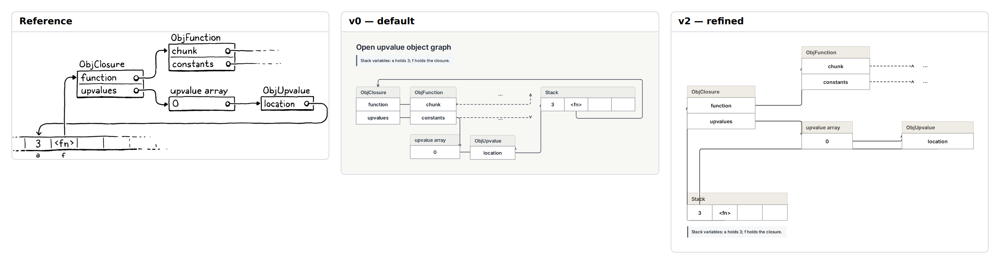

# E21 — Open upvalue and closure object graph

**Result:** All object/field relationships remain inspectable, but the pointer drawing is still only useful with care. A successful check exit with one warning is not equivalent to a finished visual result. The remaining issue is endpoint/routing behavior plus missing source-dot/caption control, not an inability to represent records.

Reference: [Crafting Interpreters / Robert Nystrom](https://craftinginterpreters.com/closures.html); exact original, license observations and preview provenance are in [source.md](source.md). The preserved original is identified by SHA-256 `a4d278565b2493558ad2bd35f4f0478633d7159f5dd6292e1c028f05bfa12297`.

## Comparison



**v0 readability: worse.** Default cells preserve field structure but pointer routing overlaps and obscures object boundaries; the original’s pointer circles and compact return path make aliasing easier to follow.

Ratings: 1 = misleading/unreadable; 3 = useful but visibly compromised; 5 = publication ready. Fidelity and semantic completeness are judged separately from standalone communication quality. These are visual judgments, not image-difference metrics.

| Stage | Communication quality | Fidelity | Semantic completeness |
|---|---:|---:|---:|
| v0 | 2/5 | 2/5 | 5/5 |
| v1 | 2/5 | 2/5 | 5/5 |
| v2 | 3/5 | 3/5 | 5/5 |

## Independent dimensions

### Content and semantic connections

Stack values 3 and <fn>, closure fields function/upvalues, function fields chunk/constants, array element 0, upvalue location and all seven pointers/continuations remain present. Stack variables a/f move into an explicit note. Repeated empty stack continuation cells are kept. No object pointer was silently retargeted to a convenient field just to improve a line.

### Composition, reading path and containment

v0 and v1 keep records readable but route through or around the wrong faces. v2 restores closure left, function above center, upvalue array/right record centrally and stack below. The result is much taller and emptier than the compact hand drawing. Native title bands replace external handwritten object names and shift the field geometry.

### Typography and labels

Native ink text is clear but large and uniform. Source pointer-source circles, external names, small a/f variable annotations and irregular handwriting are missing. The extra stack note is readable but less direct than labels at the physical slots.

### Routes, arrowheads and annotations

Cycle-2 automatic endpoints chose far sides of cells containers and crossed the location/array fields; those actual source/render/check results are retained in trials/v2-cycle2. Cycle 3 uses documented from/to hints while keeping exact group targets. This removes the two field-through warnings, but the final return pointer still crosses the Stack title band, touches record boundaries, and has ambiguous arrow endings near object borders. Explicit hints therefore help but do not make it editorially finished.

### Color and finish

Monochrome native ink matches the basic intent. The original’s thin irregular borders and dotted continuation strokes are replaced by regular cells, title fills and dashed native async-style continuations. The dashed property is a visual encoding here, not an asynchronous runtime claim.

## Effort and source quality

High relative to sixteen principal objects: seven object pins, twelve sizes and fourteen explicit endpoint-side assignments are needed. The source is understandable as records plus pointers, but manual route repair is disproportionately large.

| Stage | Non-comment lines | Declarations | Layout/refinement lines | Pins | Nudges | Sizes | Styling lines | Endpoint side attributes |
|---|---:|---:|---:|---:|---:|---:|---:|---:|
| v0 | 32 | 24 | 6 | 0 | 0 | 0 | 0 | 0 |
| v1 | 39 | 24 | 12 | 0 | 0 | 0 | 1 | 0 |
| v2 | 51 | 24 | 25 | 7 | 0 | 12 | 1 | 14 |

Declarations count node/group/edge statements. Layout/refinement counts layout, near/order/align, pins, sizes and other geometric instructions; styling counts theme/theme-color or declaration lines with color/shade. Endpoint attributes are counted separately because small-looking edge statements can carry substantial manual route work. All counts are measured from final stage source. Authoring time was not measured; elapsed command durations are in validation logs and are not a proxy for illustration time.

Representative native source:

```draft
edge closure_fn fn -> function constraint=false from=right to=left
edge upvalue_stack location -> a constraint=false from=bottom to=bottom
pin stack x=0 y=410
size location width=200 height=44
```

Predicted: cell widths/order remain meaningful, but a title-width change stretches a record and can alter pins/routes. The fragile returning pointer must be rechecked.

## Trial evidence and stopping decision

3 refinement cycles after the frozen v0. **Stopping reason: effort limit.** All three retained stages actually completed check, JSON/metrics inspection, SVG export and PNG capture with exit 0; [v0.validation.json](v0.validation.json), [v1.validation.json](v1.validation.json) and [v2.validation.json](v2.validation.json) identify exact source hashes, command arguments, elapsed times and log paths. Warnings are retained, not reclassified as successful visual design. The native baseline and bundled renderer/fonts were not changed.

The prior cycle-2 source, validation and any produced SVG/PNG/comparison are retained under `trials/v2-cycle2/`; its reason note describes the final correction. Failed command logs remain under `logs/`.

Residual differences:

- Return pointer crosses Stack title and blends with record edges.
- Source pointer circles and external labels absent.
- Taller spatial composition than original.
- Far-side default attachments required explicit correction.

Provisional gap links: `C-G01`, `C-G02`, `C-G03`, `C-G04`, `C-G05`. These map to the combined gap audit; authoring mistakes listed above are not counted as tool gaps.

Detail crop coordinates are recorded in `detail-selection.json`; the full comparison retains complete content and original aspect ratios. Crops are diagnostic views, not pixel-registration inputs.
