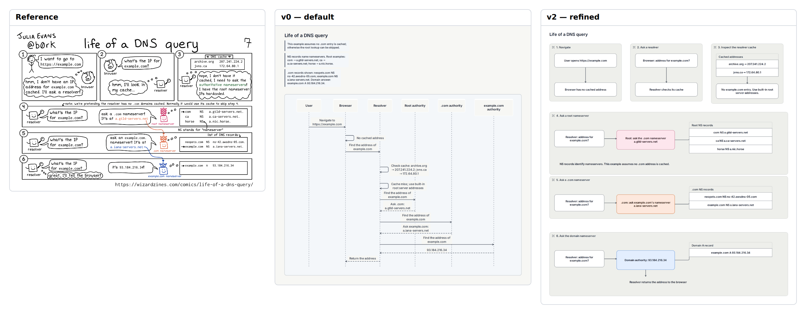

# E22 — Life of a DNS query comic

**Result:** The v1 sequence is a strong technical rendition; v2 is closer to the editorial page structure and keeps all data nearby. Neither reproduces the reference’s conversational accessibility or visual density. The result is a useful native explanation with a high manual composition cost.

Reference: [Wizard Zines / Julia Evans](https://wizardzines.com/comics/life-of-a-dns-query/); exact original, license observations and preview provenance are in [source.md](source.md). The preserved original is identified by SHA-256 `3add07e49d794a207ebe334a61506a446ac296661f304b107bfb66af3404c395`.

## Comparison



**v0 readability: worse.** The default sequence is orderly, but its tall lifelines and detached record notes make the original’s short numbered story harder to scan at publication scale.

Ratings: 1 = misleading/unreadable; 3 = useful but visibly compromised; 5 = publication ready. Fidelity and semantic completeness are judged separately from standalone communication quality. These are visual judgments, not image-difference metrics.

| Stage | Communication quality | Fidelity | Semantic completeness |
|---|---:|---:|---:|
| v0 | 3/5 | 2/5 | 5/5 |
| v1 | 4/5 | 2/5 | 5/5 |
| v2 | 4/5 | 3/5 | 5/5 |

## Independent dimensions

### Content and semantic connections

All user/browser/resolver roles, cache miss assumptions, built-in root addresses, three authority exchanges, both cache records, three root NS records, two .com NS records and the final A record remain present. v2 repeats roles by panel instead of using one participant node per actor, but every lookup and named record is visible. The browser return is explicitly shown. Dialogue is paraphrased without inventing missing DNS data.

### Composition, reading path and containment

v0 turns the narrative into a standard sequence. v1 adds six phase bands, improving temporal segmentation while retaining a tall technical format. v2 reconstructs the original top three panels and three wide lower exchanges using native groups and cells. The reference’s horizontal rhythm, compact balloons and drawn participants are still absent, and native headers/padding make the result taller.

### Typography and labels

The reference mixes hand lettering, precise DNS record tables and colored identity phrases. Native text is consistently readable but cannot mix inline color/font roles within one sentence. Long nameserver strings are kept complete in 400-pixel record rows rather than abbreviated.

### Routes, arrowheads and annotations

Sequence messages are real native sequence relations in v0/v1, including self-messages for cache inspection. v2 has panel-local arrows and associations. Cycle-2 group endpoints traversed record fields; explicit from/to sides in cycle 3 repair those attachments while retaining whole-record group targets. No fourth refinement was made. Character speech tails and cross-panel colored identity paths remain unsupported visual details.

### Color and finish

Root/.com/domain responses use quiet rose/orange/blue fills. This retains actor distinctions but shifts emphasis from small colored characters/phrases to full assertion boxes. Record tables and neutral panels maintain contrast.

## Effort and source quality

High for matching panel composition: v2 has 98 non-comment lines, twenty-three pins and twenty-one sizes. The sequence representation is much shorter; the panel representation trades concise semantics for closer editorial structure.

| Stage | Non-comment lines | Declarations | Layout/refinement lines | Pins | Nudges | Sizes | Styling lines | Endpoint side attributes |
|---|---:|---:|---:|---:|---:|---:|---:|---:|
| v0 | 23 | 18 | 1 | 0 | 0 | 0 | 0 | 0 |
| v1 | 30 | 18 | 1 | 0 | 0 | 0 | 5 | 0 |
| v2 | 98 | 41 | 55 | 23 | 0 | 21 | 4 | 8 |

Declarations count node/group/edge statements. Layout/refinement counts layout, near/order/align, pins, sizes and other geometric instructions; styling counts theme/theme-color or declaration lines with color/shade. Endpoint attributes are counted separately because small-looking edge statements can carry substantial manual route work. All counts are measured from final stage source. Authoring time was not measured; elapsed command durations are in validation logs and are not a proxy for illustration time.

Representative native source:

```draft
group p4 "4. Ask a root nameserver"
pin root_a x=300 y=40
size com_record width=400 height=40
edge root_records root_a -> roots directed=false from=right to=left
```

Predicted: nameserver-record edits may fit within fixed widths, but longer sentences require resizing panels and adjusting pinned row positions; the v1 sequence is more resilient.

## Trial evidence and stopping decision

3 refinement cycles after the frozen v0. **Stopping reason: effort limit.** All three retained stages actually completed check, JSON/metrics inspection, SVG export and PNG capture with exit 0; [v0.validation.json](v0.validation.json), [v1.validation.json](v1.validation.json) and [v2.validation.json](v2.validation.json) identify exact source hashes, command arguments, elapsed times and log paths. Warnings are retained, not reclassified as successful visual design. The native baseline and bundled renderer/fonts were not changed.

The prior cycle-2 source, validation and any produced SVG/PNG/comparison are retained under `trials/v2-cycle2/`; its reason note describes the final correction. Failed command logs remain under `logs/`.

Before the first successful v0 render, the author used reserved ID `root`. The invalid source, first freeze and failed validation are retained under `trials/preflight-v0*`. A name-only correction to `root_ns` produced the first rendered v0, which was then frozen. This is a preflight authoring mistake, not a tool defect or a refinement win.

Residual differences:

- Characters, speech balloons and colored cross-panel identity paths absent.
- Native headers/padding produce a taller page.
- Panel-local duplicates cost substantially more source than sequence recipe.

Provisional gap links: `C-G01`, `C-G04`, `C-G05`, `C-S01`. These map to the combined gap audit; authoring mistakes listed above are not counted as tool gaps.

Detail crop coordinates are recorded in `detail-selection.json`; the full comparison retains complete content and original aspect ratios. Crops are diagnostic views, not pixel-registration inputs.
