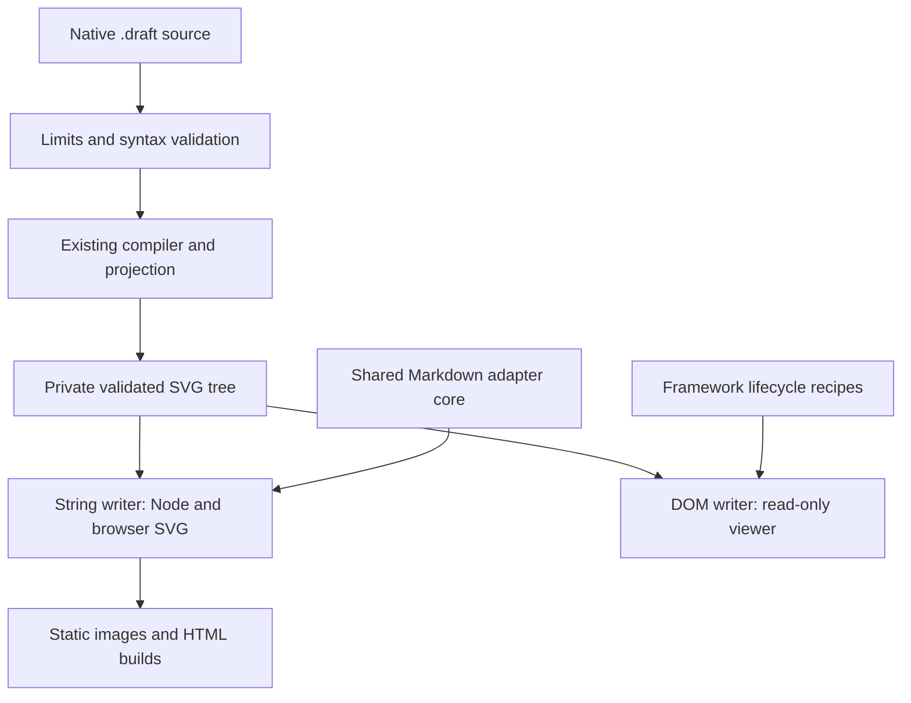

# Draftably embedding and distribution: design report

**Decision:** ship a small, framework-independent native runtime, build-time Markdown integration, and a separately loaded read-only viewer. Keep the existing CLI and editor intact. Make static images the distribution bridge to hosts that do not recognize `draft` fences.

**Mode:** Design; no product implementation, dependency installation, project-code execution, repository commit, push, or PR was performed. **Repository baseline:** `ed4eff3181ded0c501c35ae18ef6aed9c62de8c5` on `main`, as recorded by the supplied source packet. **Research date:** November 3, 2026, America/Indianapolis. Package names, signatures, fence options, and integration examples labeled proposed below are design contracts, not published capabilities.

## Executive decision

Build three distribution units, only two of them new:

- **Existing `draftably`:** retain the CLI, bundled application, foreign-format imports, and current executable. Do not make its users migrate to a new command.
- **Proposed `@draftably/runtime`:** native `.draft` source to SVG in Node and browsers; a `/viewer` entry for mounting independent read-only viewers; explicit font, CSS, browser, and worker assets. No React, Solid, CodeMirror, Mermaid, D2, jsdom, or application store in the native import graph.
- **Proposed `@draftably/markdown`:** shared fence processing with thin `/remark` and `/markdown-it` adapters. Publish the remark adapter first. Keep framework support as maintained recipes before creating framework packages.

The scope `@draftably` is a proposed publishing name; ownership was not verified. Resolve it before release, with `draftably-runtime` and `draftably-markdown` as a mechanically equivalent fallback. This naming check must not delay the source design.

The first installable milestone is deliberately useful by itself: `await renderSvg(source)` produces a self-contained SVG without Chrome, a Vite loader, a DOM shim, or an editor. It includes safe link defaults, explicit source retention, deterministic geometry, types, diagnostics, and a real packed-package proof. A Markdown author can use its output on GitHub immediately, even before a Markdown plugin ships.

The main decisions are:

| Decision | Reason | Consequence |
| --- | --- | --- |
| Separate native runtime from existing CLI | The snapshot CLI package has mandatory Mermaid, D2, and jsdom dependencies. Subpath exports alone do not remove installation dependencies. | A native consumer installs only the native runtime. |
| One runtime with subpaths, rather than a package per layer | Compiler, SVG writer, fonts, and viewer need coordinated behavior; one maintainer should not operate a large release graph. | Keep compiler and scene types private; split entry graphs and assets inside the runtime. |
| Asynchronous rendering only | `checkSource()` explicitly skips engine layouts; `compile()` also handles `fit=` variants. | No misleading `renderSvgSync()`; synchronous Markdown engines need preparation before rendering. |
| Static Markdown output first | Static artifacts work without JavaScript and travel through hosts the project cannot modify. | Default to an emitted SVG image, with an inline SVG option for controlled HTML pipelines. |
| Standalone read-only viewer | Application stores, persistence, keyboard bindings, and editing are not a reusable viewer API. | Mount/update/destroy belongs to each instance; the editor remains a separate destination. |
| Recipes before framework wrappers | React, Solid, Vue, and Svelte can all own an imperative DOM island. | Maintain lifecycle examples first; create a wrapper only when it removes repeated, tested integration work. |

**Five adoption bets, in order:** portable exports and README recipes; the small native runtime; unified/MDX then markdown-it integration; an optional viewer with framework and no-bundler examples; editor-preview and upstream integration work backed by a stable runtime. These are ways to make adoption possible, not evidence that adoption has happened.

## Evidence, access, and terminology

The ZIP extracted to 357 files: all 355 paths in `SOURCE-INVENTORY.md`, plus the inventory and research prompt. All 46 explicitly named files in the prompt's minimum reading route are present, as are representative `.draft` examples. The packet is sufficient for this design. Its SHA-256 is `06d932f4e759bc1475813ac04ae9d04b9463379afc23c6f20adf2f50f3078920`. The recorded commit was checked against the packet metadata; the archive is not a Git object database, so this does not independently authenticate every byte against a remote commit.

Some references inside the available documents are absent from the packet: `docs/intent/diagram-quality/{FEEL,RUBRIC}.md`, `.changeset/config.json`, `scripts/add-changeset.ts`, `scripts/check-changeset.ts`, and the referenced `.github/workflows/{release,check}.yml`. Their contents were not reviewed. They are checkout-time interaction/release checks, not missing inputs needed to choose the runtime architecture. The source register distinguishes fully read required files, additional targeted reads, and these unavailable references.

Throughout the report:

- **Observed** means read in the supplied source or a retrieved primary source. Existing test assertions describe intended coverage; they are not newly executed test results.
- **Inference** means a conclusion drawn from those facts, such as why install-time dependency isolation requires another package.
- **Proposed** means a new API, policy, integration, acceptance criterion, or release sequence that Codex must implement and verify.
- **Static image** means an external SVG/PNG loaded through an image element or Markdown image. **Inline SVG** means SVG nodes inside the page document. **Viewer** adds navigation and inspection. **Editor** changes the diagram source or document.

Repository evidence is cited by path and symbol and indexed as R01–R15 in `embedding-sources.md`. External references use S identifiers, with URLs and retrieval context in that file. The companion implementation plan and recommendation ledger are part of this design.

## 1. What makes Mermaid available, and what can Draftably control?

### 1.1 Mermaid's distribution is several different capabilities

Mermaid provides an installable rendering library, ESM browser entry points, a page-scanning convenience API, a CLI, and integration guidance. Its current usage documentation identifies 12.3.0 and shows the `mermaid@12` CDN family. `mermaid.run()` is the modern page-scanning route; `mermaid.render(id, source)` is the explicit asynchronous integration route, returning SVG and optional event binding. The older `init` route is deprecated. A new Draftably API should copy the low ceremony and explicit lifecycle, while avoiding global page configuration as its primary contract. [S01], [S02]

Those library capabilities are different from a host deciding to recognize a `mermaid` fence. GitHub's documentation lists four native diagram syntaxes and tells users to inspect the Mermaid version deployed by GitHub. GitLab separately documents its own Mermaid support. Neither fact gives an arbitrary package permission to run in those hosts' Markdown documents. [S04], [S05]

The Mermaid CLI turns source into SVG, PNG, or PDF and can replace diagrams in Markdown with images. Its browser-backed route and Puppeteer configuration are a useful comparison: Draftably already has a native, browser-free SVG path and should preserve that advantage. Its existing PNG path still needs a browser. Do not describe browser-free SVG as browser-free rasterization. [S03], [S03A]; repository `src/cli/png.ts`, `src/cli/main.ts`, `src/cli/svg.ts`.

The reusable lesson is to provide:

1. A small first successful call and an equally small HTML example.
2. A stable artifact format that survives outside the originating application.
3. Well-defined adapters for environments where maintainers control the Markdown pipeline.
4. Documentation that distinguishes an installed plugin from native host support.
5. Compatibility fixtures that let third parties integrate without reverse-engineering the editor.

### 1.2 Platform-support matrix

This matrix describes documented control boundaries, not a claim that the proposed Draftably integrations already exist.

| Surface | Current boundary and who controls it | Useful `.draft` route |
| --- | --- | --- |
| GitHub repository Markdown, issues, PRs, discussions, wikis | GitHub chooses recognized diagram languages and sanitizes rendered content. A repository dependency, language grammar, or GitHub Action does not install a browser renderer for readers. [S04], [S04A] | Commit or publish SVG/PNG and link the `.draft` source. A CI drift check can keep generated images current. Native fences need GitHub approval and implementation. |
| GitHub Pages or another site built from the repository | The site owner controls its build and deployed JavaScript; this is distinct from GitHub's repository README viewer. | Use the proposed build-time adapter; optionally load the viewer. |
| GitLab.com Markdown | GitLab controls the Markdown renderer; current documentation names Mermaid version 12. [S05] | Images and source links now. A custom fenced language requires a GitLab integration change. |
| GitLab Self-Managed / Dedicated | Administrators can enable documented Kroki integration; supported backend languages and deployment still matter. GitLab warns about access-control differences at the rendering service. [S05A] | Static images first. A future Draftably Kroki backend could help consenting administrators; it would not automatically enable GitLab.com. |
| npm package README | npm documents README processing through GitHub-flavored Markdown, not parity with every github.com diagram feature. [S06] | Use absolute, stable image URLs plus source and live-demo links. Native `.draft` rendering is unverified and should not be advertised. |
| Other registries and marketplace listings | A Markdown-looking description is not proof of custom diagram or script support. No universal support claim is justified. | Ship a PNG fallback and an ordinary URL; verify the exact target when publishing. |
| Slack | Slack uses its own `mrkdwn`; documented image blocks list raster formats rather than SVG. [S07], [S07A] | PNG and a link to source or an optional viewer page. A bot or unfurl service is a separate product and permission surface. |
| Other chat tools, including AI chat interfaces | Fence display, attachment handling, and interactive embeds are controlled by each host. This research found no general extension contract that makes `.draft` native everywhere. | An image attachment or supported image URL and a normal link; show source as code where useful. Do not promise script execution. |
| A website with a configurable Markdown build | The owner can select remark/rehype, markdown-it, or another adapter. | Build-time images or inline SVG; explicitly opt into client enhancement. |
| VS Code Markdown preview | An installed extension can extend markdown-it and load preview scripts. Experimental code-block editors are not the stable foundation. [S34] | An optional preview extension using the same runtime, with workspace trust and local resource handling. |
| Obsidian | Plugins can register a Markdown code-block processor, but each user must install/enable the plugin. [S35] | A contributor-maintained `draft` processor and lifecycle bridge after the runtime stabilizes. |
| Generic CommonMark reader | A fence's language/info string is metadata; the core specification does not confer rendering semantics. [S08] | Readable source remains; pre-generated Markdown images provide visual fallback. |

A useful README should work without privileged support:

```markdown


[Diagram source](docs/diagrams/checkout.draft) · [Interactive example](https://draftably.dev/play)
```

The image path above is a repository-relative GitHub example. For a registry listing, publish a stable absolute image URL under project control. The interactive link shown is the existing playground destination; it does not claim a published iframe protocol or that a specific source has been uploaded. Keep source-to-image generation in the project's build; do not replace the user's README or commit images automatically without a deliberate workflow.

### 1.3 Relevant alternatives and what to borrow

| Approach | What its primary material demonstrates | Draftably decision |
| --- | --- | --- |
| Mermaid | Explicit browser API, DOM scanning convenience, CDN delivery, CLI, accessibility metadata, and an ecosystem of adapters. [S01], [S02], [S03], [S09] | Borrow integration ergonomics and examples. Do not assume its native host agreements are transferable. |
| D2 JavaScript | A native language exposed through browser/Node interfaces, worker/WASM lifecycle, compile/render, and disposal. [S10] | Good evidence that a language runtime can be separate from its application. Draftably need not add WASM or inherit D2 imports to do this. |
| Graphviz / Viz.js | An initialized Graphviz WASM instance, structured results, SVG-string rendering, and a browser element helper. [S11] | Borrow explicit initialization/resource ownership where needed and structured diagnostics. Preserve Draftably's existing deterministic TypeScript geometry. |
| Kroki | An HTTP diagram-rendering service with supported backends and self-hosting. Source travels to that service. [S12], [S13] | A later distribution bridge, not a prerequisite. Adding a backend and gaining host enablement are separate tasks. |
| nomnoml | A diagram library with SVG output and browser drawing, separate from its web application. [S14] | A useful small-library precedent for the first milestone. Avoid shipping a full editor just to display a diagram. |
| bpmn-js | Separately consumable Viewer and Modeler surfaces. [S15] | Borrow the product boundary between display and editing; do not adopt its BPMN model or another layout stack. |

Framework graph/editor libraries are adjacent rather than substitutes for a source-language runtime. Their data models, interaction systems, and framework ownership would add another rendering/editing stack. This mission has a working compiler and renderer; replacing them would widen scope without solving host adoption.

### 1.4 Adoption order and maintenance commitments

**Bet 1 — Portable diagrams.** Publish a reliable export recipe, an image/source pairing convention, and a CI drift-check recipe. GitHub and registry readers get a useful result immediately. Existing `draftably inspect diagram.draft --svg --no-source` is enough for an initial documented workflow; runtime rendering later makes it cheaper to integrate into arbitrary builds.

**Bet 2 — The native runtime.** Give application builders one install, one source string, and one result. Include Node, plain browser, and two-independent-diagram examples. The primary success measure is an external consumer importing the packed artifact without source aliases or app dependencies.

**Bet 3 — Markdown at build time.** Start with unified/remark/MDX, then markdown-it with a correct async preparation layer. Publish versioned recipes for Astro/Starlight and Docusaurus, then VitePress after its bridge is proved. These cover several hosts through two maintained adapter families.

**Bet 4 — Read-only interaction.** Add the independent viewer, framework lifecycle recipes, keyboard access, and a pinned no-bundler distribution. Progressive enhancement must leave the static result intact when JavaScript or a worker is unavailable.

**Bet 5 — Preview and upstream reach.** Prototype one VS Code preview integration once adapters are stable; publish it only if the bounded preview proof succeeds and its maintenance fits the project. Invite a maintainer for Obsidian and non-JS bridges. Prepare concrete integration proposals upstream with a functioning runtime, output policy, fixtures, and a maintenance contact. Opening an issue, accepting a plugin, and deploying host-native support are different adoption events; this design does not send those proposals.

For one developer, maintain the runtime, two adapter families, and their tested recipes. Avoid a package for every site generator, every JavaScript framework, and every editor. Track example usage and reported integration failures without requiring telemetry or a demand study before implementation.

## 2. What public runtime and package design should be built?

### 2.1 The actual extraction seam

The existing `site/draw.ts::draw()` already composes `compile(source)` → `projectScene(scene)` → `renderSvg(doc)`. This is the foundation. It also exposes the internal `Scene`, derives errors through message parsing, and lives beside site-specific URL helpers. Lift the composition into a deliberate public facade; do not re-export that module unchanged.

The native compiler's `RENDER_CONTEXT` is fixed at 1100 × 720. `src/model/fonts.ts` measures text from `font-metrics.json`; geometry does not wait for DOM font measurement. Keep both properties. Container resize should change presentation/camera only. Engine layouts and `fit=` belong to the same compile path used for final output. `checkSource()` is a validator with a cheaper layout path, not a synchronous replacement for `compile()`. [R03], [R04]

Two misleading repository statements must be corrected during implementation:

- `scripts/build-cli.ts` and `docs/CHECKS.md` still describe an absence of runtime package dependencies, while `packages/cli/package.json` declares `@d2lang/d2`, `mermaid`, and `jsdom`.
- README prose suggests theme changes preserve placement, while `tests/themes.test.ts` explicitly asserts different node sizes under different themes. Font, padding, and heading changes can move geometry. Paint-only shade changes and emphasis changes are the appropriate invariant.

### 2.2 Architecture alternatives

| Alternative | Strength and cost | Disposition |
| --- | --- | --- |
| Add all library exports to existing `draftably` | One name and release; bundle graphs can be separated, but consumers still install its mandatory import dependencies and receive the application assets. | Do not choose for the native runtime. Reconsider only if the existing CLI is deliberately repackaged in a separate migration. |
| Separate compiler, renderer, fonts, viewer, and every adapter into packages | Maximum independently selectable units; many compatibility edges, release steps, and support surfaces. | Too much initial maintenance. Keep compiler/renderer internals together. |
| New runtime package with subpaths, plus one Markdown package | Small native install graph; DOM and Markdown code stay out of static rendering; manageable coordinated releases. | Recommended. |
| Framework-first React or Solid component | Easy for one audience; makes other frameworks, SSR/build scripts, and no-bundler use secondary. | Recipes first; optional thin wrappers later. |
| Web component | Standard host interface and potential Shadow DOM isolation; requires property/event conventions, upgrade timing, SSR fallback, and custom-element registration policy. | Explore after the imperative viewer is stable. It should call that viewer, not become a second engine. |
| Hosted or self-hosted iframe | Strong document/style separation and little host code; restrictive Markdown hosts still reject frames; messaging, hosting, privacy, and accessibility remain. | Later optional surface, never the only integration. |

Subpath exports define the supported import surface; they do not themselves alter the package's dependency installation rules. Likewise, `optionalDependencies` are not an effective promise of a native-only install: normal installations still attempt them. Use real package and import-graph boundaries. [S18], [S19]



This is a proposed internal factoring, not a new public scene graph. It reuses current layout and geometry. The shared SVG tree has fixed renderer-owned element/attribute names and escaped text/validated links; it has no raw-HTML node. It allows browser mounting with `createElementNS` and `textContent`, avoiding an implicit dependency on `innerHTML` or a globally installed Trusted Types policy.

### 2.3 Package and layer ownership

| Unit | Owns | Must not own |
| --- | --- | --- |
| Compiler, private inside runtime | Parsing, model validation, deterministic measurement/layout, geometry diagnostics, source locations | DOM, network, file resolution, editor stores, URL navigation |
| Renderer, private internals with public `renderSvg` | Drawing semantics, namespaces, accessible SVG, link policy, font output, source-retention policy | CLI argument parsing, downloads, analytics, editor serialization |
| Viewer subpath | Instance lifecycle, camera, navigation, events, scoped keyboard behavior, worker ownership, emphasis display | File editing, undo/redo, browser storage, global shortcuts, shared active document |
| Existing editor | Source editing and application workflows | An accidental public library contract through `window.diagramStudio` |
| Existing CLI | Filesystem/stdio, raster/PDF workflow, local server, imports, app launch | Mandatory dependencies of the native runtime |
| Markdown package | Fence normalization, source-file resolution at build time, diagnostics mapping, cache/artifact emission, AST/token replacement | A second compiler, framework state, automatic remote rendering |

**Proposed imports:**

```ts
import { renderSvg, validate, runtimeVersion } from '@draftably/runtime';
import type { RenderOptions, RenderResult, DiagramSummary } from '@draftably/runtime';
import { mountViewer } from '@draftably/runtime/viewer';
import type { ViewerHandle, ViewerOptions } from '@draftably/runtime/viewer';
import '@draftably/runtime/viewer.css';
import '@draftably/runtime/fonts.css'; // required when choosing host font mode

import remarkDraft from '@draftably/markdown/remark';
import { createMarkdownItDraft } from '@draftably/markdown/markdown-it';
```

`viewer.css` styles viewer controls; `fonts.css` exposes the exact bundled faces and versioned family names. Neither CSS import should be pulled in by the runtime's root entry. The viewer uses root-scoped classes and SVG presentation attributes. Export a dedicated shadow-root stylesheet only if a later web-component wrapper is built.

Use ESM and generated `.d.ts` declarations. Keep the existing Node 22.21 floor for the first package release rather than adding an unproved support matrix. Browser support must be stated from the compatibility proof, not copied from Mermaid's current target. Do not add CJS, UMD, or a framework peer dependency to the first runtime merely for hypothetical reach.

An illustrative eventual export map is:

```json
{
  "name": "@draftably/runtime",
  "type": "module",
  "files": ["dist", "LICENSE", "THIRD_PARTY_NOTICES", "README.md"],
  "sideEffects": ["**/*.css"],
  "exports": {
    ".": {"types": "./dist/index.d.ts", "import": "./dist/index.js"},
    "./viewer": {"types": "./dist/viewer.d.ts", "import": "./dist/viewer.js"},
    "./viewer.css": "./dist/viewer.css",
    "./fonts.css": "./dist/fonts.css",
    "./render.worker.js": "./dist/render.worker.js",
    "./package.json": "./package.json"
  }
}
```

This shows the desired surface, not a complete publication manifest. Export only implemented entries: the first release has no placeholder `/viewer`, viewer CSS, or worker export. CSS refers to private relative font assets; a broad `assets/*` import API would unnecessarily freeze filenames. The release must also provide metadata, scripts, notices, and a verified exact asset layout. Use a dedicated library build based on the repository's Vite 6 tooling; current Vite documentation has evolved, so do not paste newer build-option names into the pinned toolchain. `vite.config.ts` remains an application build, while a new `vite.runtime.config.ts` and a declaration build own this output. [S19], [S20]

### 2.4 Proposed public rendering contract

The following is the proposed first stable contract. Names in it are intentional; implementation should avoid adding undocumented overloads that accept internal editor objects.

```ts
export type Severity = 'error' | 'warning' | 'info';

export interface SourceLocation {
  sourceId?: string;       // host label; never written into SVG automatically
  line: number;           // 1-based
  column?: number;        // 1-based UTF-16 code units; omit when unknown
  endLine?: number;
  endColumn?: number;
}

export interface Diagnostic {
  code: string;           // documented DRAFT_* categories are stable
  severity: Severity;
  message: string;        // human-readable; do not parse as an API
  location?: SourceLocation;
  itemIds: readonly string[];
  related?: readonly { message: string; location: SourceLocation }[];
  nativeCode?: string;    // informative compiler detail; not a stable enum
}

export interface CompileLimits {
  maxSourceChars: number;
  maxSourceBytes: number;
  maxObjects: number;
  maxEdges: number;
  maxDepth: number;
}

export interface RenderLimits extends CompileLimits {
  maxOutputBytes: number;
}

export interface LinkRequest {
  itemId: string;
  href: string;           // untrusted source value
}

export type LinkPolicy =
  | { mode: 'none' }
  | {
      mode: 'safe';
      baseUrl?: string;   // host-supplied absolute HTTP(S) URL
      target?: '_self' | '_blank';
      resolve?: (request: LinkRequest) => string | null;
      cacheKey?: string;  // required for persistent caching with resolve()
    };

export interface CommonRenderOptions {
  title?: string;         // accessible title; source title otherwise
  description?: string;  // text only
  state?: string | null;  // named emphasis state; null means base view
  includeSource?: boolean;
  links?: LinkPolicy;
  styleNonce?: string;    // host-owned nonce for generated style, if needed
  sourceId?: string;
  signal?: AbortSignal;
  limits?: Partial<RenderLimits>;
}

export type RenderOptions = CommonRenderOptions & (
  | { target?: 'image'; idPrefix?: never; fonts?: 'embed' }
  | { target: 'inline'; idPrefix: string; fonts?: 'embed' | 'host' }
);

export interface ItemSummary {
  id: string;
  kind: 'node' | 'group' | 'edge';
  label: string;
  line?: number;
  from?: string;
  to?: string;
}

export interface DiagramSummary {
  title: string;
  description?: string;
  width: number;
  height: number;
  viewBox: readonly [number, number, number, number];
  items: readonly ItemSummary[];
  states: readonly { id: string; label: string }[];
  activeState: string | null;
}

export interface RenderedDiagram extends DiagramSummary {
  svg: string;
  provenance: {
    runtimeVersion: string;
    dslVersion: 1;
    fontMetricsVersion: string;
    renderContextVersion: string;
  };
}

export type RenderFailure = {
  ok: false;
  reason: 'input' | 'limit' | 'aborted' | 'environment' | 'internal';
  diagnostics: readonly Diagnostic[];
};

export type RenderResult =
  | { ok: true; value: RenderedDiagram; diagnostics: readonly Diagnostic[] }
  | RenderFailure;

export interface ValidateOptions {
  sourceId?: string;
  signal?: AbortSignal;
  limits?: Partial<CompileLimits>;
}

export type ValidationResult =
  | { ok: true; diagnostics: readonly Diagnostic[] }
  | RenderFailure;

export declare const runtimeVersion: string;
export declare function renderSvg(
  source: string,
  options?: RenderOptions,
): Promise<RenderResult>;
export declare function validate(
  source: string,
  options?: ValidateOptions,
): Promise<ValidationResult>;
```

**Result semantics:**

- Syntax/semantic errors, unknown emphasis states, resource-policy failures, blocked environments, and cancellation are structured outcomes. A render with an error does not return a partial SVG. Warnings can coexist with a successful SVG.
- Stable diagnostic categories initially include `DRAFT_PARSE`, `DRAFT_COMPILE`, `DRAFT_TEXT_INVALID`, `DRAFT_LIMIT`, `DRAFT_STATE_UNKNOWN`, `DRAFT_LINK_BLOCKED`, `DRAFT_FONT_GLYPH`, `DRAFT_ABORTED`, `DRAFT_ENVIRONMENT`, and `DRAFT_INTERNAL`. Translate existing native codes through the facade; do not promise that every internal layout warning name is permanent.
- Read `DslError.line` and its available column directly. `site/draw.ts` currently extracts only a `Line N:` message prefix and can miss the `Line N, column M:` form. Preserve location data rather than parsing rendered messages.
- `validate()` runs the native asynchronous compilation path for parity of compilation diagnostics, including native-layout failures. It does not emit SVG or promise output-size, link-policy, or host-title diagnostics. A separate future parse-only API would need a name and contract that state its narrower scope.
- `AbortSignal` means stop work at cooperative boundaries and suppress publication. It is not a hard CPU deadline for work running on the current thread. `reason: 'internal'` reports an unexpected implementation failure without serializing stacks or private source into HTML. A development build may expose details through a host logging hook later.
- Wrong host argument types, such as a non-string passed by untyped JavaScript, throw `TypeError`; invalid limit ranges throw `RangeError`. A throwing host resolver rejects the call as a host integration error; it is not reported as malformed diagram syntax. Examples catch unexpected promise rejection. Expected malformed diagram content uses the result contract.
- Results are detached plain data that consumers must treat as read-only; no deep-freeze guarantee is made. They are not a stable serialized compiled-scene format, an input to a future editor, or a guarantee that arbitrary SVG strings are safe. `Scene`, `Diagram`, maps, routing results, and editor settings remain internal.

**Default policy and exact choices:**

| Option | Proposed default | Contract |
| --- | --- | --- |
| `target` | `image` | Self-contained external SVG. Its deterministic document-local IDs may be derived from render inputs. For inline insertion, select `inline` and supply a page-unique prefix. |
| `idPrefix` | Required for `inline` | Validate against `[A-Za-z][A-Za-z0-9_-]{0,63}`. Prefix every generated ID and matching reference. Repeated source does not make a unique inline prefix. |
| `fonts` | `embed` | Include only used bundled faces in the SVG. `host` omits font data and requires exact published fonts through host CSS; do not use host mode for a supposedly portable image. |
| `includeSource` | `false` | No raw source/comments metadata by default. `true` opts into recoverable source and its privacy consequences. Visible labels and IDs still appear. |
| `links` | `{mode: 'none'}` | Emit non-navigable drawing. `safe` permits only parsed HTTP(S) destinations after host resolution; relative links need a host base. Its target defaults to `_self`; `_blank` adds `noopener noreferrer`. No source-controlled widening. |
| `state` | `null` | Draw the base view. Unknown explicit state is an error. Emphasis uses existing source semantics and preserves geometry. |
| Title / description | Source title / absent | Text-only SVG metadata. Complex diagrams also need a meaningful description in the surrounding document. |
| Limits | Existing parser ceilings plus output/byte ceilings | Existing 300,000 UTF-16 characters, 500 objects, 1,200 edges, 12 containment levels remain ceilings. Proposed defaults add 1 MiB UTF-8 source and 8 MiB output limits. Overrides may tighten these values; raising native parser ceilings is outside this contract. |

The new byte/output values are proposed policy limits, not measured capacity. Under the existing 300,000-code-unit cap, the 1 MiB UTF-8 ceiling does not further restrict valid source by default; it is useful as a separately tighten-able transport policy. Objects means nodes plus groups; depth counts the object chain and excludes synthetic root. Output bytes include all final UTF-8 SVG, fonts, styles, and opted-in metadata. Count output while writing rather than allocating unlimited output and checking only afterward. This does not bound all compiler/tree memory or prove that the largest permitted graph renders quickly. Browser and server isolation handle enforceable deadlines.

All configured limits must be finite positive safe integers within the documented ceilings. Reject NaN, Infinity, negative, zero, unknown, and loosening values from untyped callers; do not let option merging disable the limits. `validate()` accepts only compilation limits. `fonts: 'host'` is invalid for `target: 'image'` in both TypeScript and runtime validation. Reject XML-forbidden controls and unpaired surrogates with `DRAFT_TEXT_INVALID`, checking both source text and decoded text fields; the quoted-token parser can turn an escape into a forbidden character. Apply the same rule to host titles/descriptions and opted-in metadata before serialization. Escaping markup delimiters alone is insufficient. An `ok` SVG result means successful validated serialization, not proof that a later browser's CSP will permit its fonts or that its pixels have been inspected.

For inline source metadata, prefix the metadata ID and identify its semantic role with a stable data attribute. Update `readSvgSource()` to accept the new form and the existing `id="draftably-source"` form. Standalone legacy exports must continue to reopen. Source embedding must not pull the CLI package's JSON/version file into the runtime; supply runtime provenance from the library build.

### 2.5 Node/build-time SVG and ordinary static use

**Proposed consumer run sheet; these packages and APIs are not published by this mission.** This is the complete first-milestone experience, using a valid source form already represented in the snapshot README and tests.

```bash
# Run in a new consumer directory after the proposed runtime is released.
pnpm init
pnpm add @draftably/runtime

cat > render.mjs <<'JS'
import { writeFile } from 'node:fs/promises';
import { renderSvg } from '@draftably/runtime';

const source = `diagram "Checkout" version=1
node web "Web app" color=blue
node api "API" color=teal
node db "Postgres" shape=pill
edge request web -> api "HTTPS"
edge persist api -> db "store order"
layout root flow direction=right
`;

const result = await renderSvg(source, {
  description: 'The web app calls the API, which stores orders in Postgres.',
});
if (!result.ok) {
  console.error('Draftably render failed', result.reason, result.diagnostics);
  process.exitCode = 1;
} else {
  await writeFile('checkout.svg', result.value.svg);
  console.log('Wrote checkout.svg', {
    width: result.value.width,
    height: result.value.height,
    warnings: result.diagnostics.length,
  });
}
JS

node render.mjs
```

A static app or server template can then use ordinary HTML:

```html
<figure>
  
  <figcaption>Checkout request path.</figcaption>
</figure>
```

Use the returned width/height in generated HTML to reserve the correct aspect ratio. The example does not invent those dimensions. No viewer script is necessary. An SVG used as an image has a different browser execution/resource context from inline SVG or an iframe; image-mode restrictions should not be treated as a general sanitizer for the same file opened directly. Per-object links are not an image interaction contract. [S41]

For browser rendering from a string without inline HTML insertion, call the same async function and set an image to a Blob URL. Own the URL lifecycle:

```ts
import { renderSvg } from '@draftably/runtime';

export function bindStaticDiagram(image: HTMLImageElement) {
  let revision = 0;
  let currentUrl: string | undefined;
  let destroyed = false;

  return {
    async update(source: string) {
      if (destroyed) return;
      const mine = ++revision;
      const result = await renderSvg(source);
      if (destroyed || mine !== revision) return;
      if (!result.ok) {
        console.error('Static diagram failed', result.diagnostics);
        return;
      }
      const nextUrl = URL.createObjectURL(
        new Blob([result.value.svg], { type: 'image/svg+xml' }),
      );
      const previous = currentUrl;
      currentUrl = nextUrl;
      image.alt = result.value.description ?? result.value.title;
      image.width = result.value.width;
      image.height = result.value.height;
      image.src = nextUrl;
      if (previous) URL.revokeObjectURL(previous);
    },
    destroy() {
      if (destroyed) return;
      destroyed = true;
      revision++;
      image.removeAttribute('src');
      if (currentUrl) URL.revokeObjectURL(currentUrl);
      currentUrl = undefined;
    },
  };
}
```

This recipe intentionally provides only image display. Catch unexpected rejections at its caller. A host that disallows `blob:` images should serve a built asset or use the DOM viewer route; the library must not alter CSP for it.

### 2.6 Fonts, assets, workers, and no-bundler delivery

`src/lib/font-data.ts` imports four `woff2?inline` assets and has a module-global `registerFonts()` that adds `FontFace` objects to `document.fonts`, returns no readiness promise, and swallows load failures. Those are application conveniences, not the public package contract. [R05]

The runtime build should generate a portable data module from the checked-in fonts and export an ordinary CSS/WOFF2 asset set. The final JavaScript must contain no unresolved `?inline`, `import.meta.env`, root alias, repository-relative JSON import, or Solid JSX. Dynamic import of the font-data chunk is acceptable for `fonts: 'embed'`; it must resolve from the package's own published assets. Native rendering does not fetch arbitrary fonts or images.

Version font family names by the font/metrics identity, so two runtime releases can share a page without silently substituting different metrics. Font-mode changes affect payload and loading, not measurement. Include the fonts' license notices. Do not add arbitrary custom fonts in the first release; an unmatched font invalidates the geometry promise. Unsupported glyphs deserve a diagnostic because deterministic fallback widths are not evidence that every script or shaping case will draw faithfully.

Publish an explicit browser ESM artifact with relative chunk/asset imports and no bare dependencies. A proposed CDN URL pattern is `https://cdn.jsdelivr.net/npm/@draftably/runtime@<exact-version>/dist/browser/index.js`; replace the placeholder with a released version in documentation. The complete `dist/browser/` directory must contain every needed chunk, CSS file, font, and later worker artifact; copying that directory to a nested self-hosted URL is a release proof. This closed directory is distinct from package export paths, which serve bundlers/Node. Never use `@latest` in reproducibility examples. A one-script no-bundler static example can use `renderSvg` plus the image recipe above.

The viewer's worker is a **native render worker**, not `engine.worker.ts` with all editor task variants exposed. It loads no importer or editor code. A caller can supply a worker factory for a bundler, CSP, or host asset layout. A CDN module does not automatically make a CDN-hosted worker legal: the initial worker script normally needs the document's origin, while its module imports have their own CORS/CSP constraints. Document a same-origin worker asset or explicitly selected main-thread mode for small trusted examples. Do not silently create Blob workers. [S43]

The default factory resolves `./render.worker.js` relative to the **published viewer entry** and creates a module worker: `dist/viewer.js` resolves `dist/render.worker.js`, and `dist/browser/viewer.js` resolves `dist/browser/render.worker.js`. Keep this entry-owned URL calculation intact through chunking; do not accidentally resolve from a differently located shared chunk. The packed/no-bundler proofs verify both layouts. A host factory overrides construction when its bundler, origin, CSP, or Trusted Types policy needs another URL; it still returns a fresh worker owned by the handle.

Server imports must be inert: no `window`, `document`, `navigator`, font registration, worker creation, or storage access at module evaluation. `/viewer` may be imported on a server for types/build traversal, but calling `mountViewer()` requires a DOM. Static SSR can render once per build/cache entry. Source-driven client enhancement may compile again and must use the same fixed render context; this design does not promise a public compiled-scene hydration format or zero duplicate compilation.

A complete proposed no-bundler static page can use the self-hosted browser directory. After M1 is implemented, copy the published `dist/browser/` directory to `runtime/` beside this page and serve both over HTTP(S). The example is source in the design document, not an already built distribution:

```html
<!doctype html>
<html lang="en">
  <meta charset="utf-8">
  <meta name="viewport" content="width=device-width, initial-scale=1">
  <title>Draftably static example</title>
  <main>
    <h1>Checkout</h1>
    <figure>
      
      <figcaption>The web app sends a request to the API.</figcaption>
    </figure>
    <p id="status" role="status"></p>
  </main>
  <script type="module">
    import { renderSvg } from './runtime/index.js';

    const image = document.querySelector('#diagram');
    const status = document.querySelector('#status');
    let objectUrl;
    let disposed = false;

    async function showDiagram() {
      const result = await renderSvg(`diagram "Checkout" version=1
node web "Web app"
node api "API"
edge request web -> api "HTTPS"
`);
      if (disposed) return;
      if (!result.ok) {
        status.textContent = 'The diagram could not be rendered.';
        console.error('Draftably render:', result.diagnostics);
        return;
      }
      objectUrl = URL.createObjectURL(
        new Blob([result.value.svg], { type: 'image/svg+xml' }),
      );
      image.alt = 'The web app sends an HTTPS request to the API.';
      image.width = Math.ceil(result.value.width);
      image.height = Math.ceil(result.value.height);
      image.src = objectUrl;
      console.log('Draftably SVG generated', result.value.provenance);
    }

    void showDiagram().catch(error => {
      status.textContent = 'The diagram could not be loaded.';
      console.error('Draftably environment:', error);
    });
    window.addEventListener('pagehide', event => {
      if (event.persisted) return;
      disposed = true;
      if (objectUrl) URL.revokeObjectURL(objectUrl);
    });
  </script>
</html>
```

For a strict CSP, move the module into a permitted external file or apply the host's nonce, and permit the chosen image URL policy. A build-time asset needs neither the client compiler nor a Blob URL. The example demonstrates static delivery; a no-bundler viewer additionally needs the published CSS/fonts and a same-origin worker entry, or an explicitly configured worker factory. The library does not relax the host's policy.

## 3. How should Markdown integrations work?

### 3.1 One fenced form, one options vocabulary

The extension is `.draft`; the canonical fenced language identifier is **`draft`**, without a leading dot. Bare `draft` remains the shortest form. Optional attributes use one brace group with quoted values. This is a proposed public metadata grammar; the diagram body below is valid baseline syntax.

````markdown
```draft {id="checkout" alt="The web app calls an API that stores orders in Postgres." caption="Checkout request path"}
diagram "Checkout" version=1
node web "Web app" color=blue
node api "API" color=teal
node db "Postgres" shape=pill
edge request web -> api "HTTPS"
edge persist api -> db "store order"
layout root flow direction=right
```
````

An external file uses the same grammar and an empty body:

````markdown
```draft {src="./diagrams/checkout.draft" alt="Checkout request path"}
```
````

An interactive example can select a source-defined state:

````markdown
```draft {id="paths" mode="interactive" state="write" alt="Write and read paths through the API"}
diagram "API paths" version=1
theme fieldnotes
node web "Web app"
node api "API"
node db "Postgres" shape=pill
node cache "Cache" shape=pill
edge request web -> api "request"
edge persist api -> db "write"
edge lookup api -> cache "read"
state write "Write path" web api db request persist
state read "Read path" web api cache request lookup
```
````

| Attribute | Meaning | Validation |
| --- | --- | --- |
| `id` | Stable figure identity within the document | Optional; ASCII token, unique per page. Internal SVG IDs are derived from document identity plus occurrence, not copied blindly from this value. |
| `alt` | Concise image alternative / accessible diagram label | Text only; falls back to the DSL diagram title. Warn about an empty or generic fallback. |
| `caption` | Visible plain-text caption | No embedded HTML, JSX, or executable Markdown. |
| `mode` | `static` by default; `interactive` opts into enhancement | Interactive requires configured loader support. It includes source in the page when the browser recompiles the diagram. |
| `src` | Local `.draft` file, relative to the containing Markdown file | Mutually exclusive with a non-whitespace body; subject to the host's content root. |
| `state` | One declared emphasis state | Unknown state is an error; omitted means the base view. |

Reject duplicate/unknown keys, unmatched braces/quotes, literal newlines in values, and trailing tokens. Support escaped quotes and backslashes in quoted values. Do not accept a remote renderer URL, JavaScript callback, CSS, arbitrary HTML attribute, link-policy override, or editor option in a fence. Put `theme`, layout, and other semantic declarations in the portable `.draft` body. The site-only `draft themes` gallery macro stays private; it is not a public syntax precedent. [R08]

Transform only parser-recognized fenced code nodes whose complete language token is exactly `draft`. Never scan a non-Draft code block's contents for more fences. A four-backtick `markdown` listing that contains a three-backtick Draftably example stays literal; real tilde fences and fences inside lists/quotes use the host parser's rules. Do not copy the site's broader `/^draft\b/` match as the public matcher. [S08]

Braces improve compatibility with SuperFences and current Pandoc fenced attributes, but do not turn metadata into a CommonMark standard. JS adapters tokenize the metadata; hosts that already parse attributes pass normalized values to the same semantic validator. A Pandoc bridge must reconcile its dedicated identifier field with an `id` key-value attribute and reject disagreement. Test the exact reader/extensions; a canonical form is a contract implemented by adapters, not proof that every parser preserves raw metadata identically. [S08], [S31], [S33]

### 3.2 Support order across the requested pipelines

| Pipeline | First supported route | Maintenance decision |
| --- | --- | --- |
| unified / remark / rehype | Async remark transform before highlighting; default emitted image nodes. Structured HAST for optional inline output. | First adapter. Promise-returning transformers fit the native compiler. [S21], [S22] |
| MDX | Same transform producing ordinary image nodes; an explicit trusted HAST bridge for inline output if needed. | Prove compilation without inserting a raw JSX string or enabling arbitrary HTML. MDX itself remains executable content. [S23], [S23A] |
| Docusaurus | Configure the shared remark adapter in docs/blog MDX options and use public asset URLs. | A recipe, not a second renderer; do not reuse the Mermaid-only switch. [S27], [S28] |
| Astro / Starlight | Current Astro: explicitly select its Unified processor and configure the same adapter. Older v5 has a different config location. | Version-qualified recipes. Current Astro v7 defaults to Sätteri, so remark support requires a deliberate processor choice; a Sätteri-native adapter can wait. [S29], [S29A], [S29B], [S30] |
| markdown-it | Parse once → await preparation → render the same tokens synchronously. | Second adapter family. Expose the await in the consumer API. [S24], [S24A] |
| VitePress | Generated images immediately; a bounded, exact-version bridge for fenced authoring. | Explore the bridge before claiming support. Current inspected alpha uses `MarkdownItAsync`, not promise-valued ordinary fence rules. [S25], [S25A], [S25B], [S25C] |
| MkDocs / Python Markdown | Generated assets first; later SuperFences or `on_page_markdown` bridge calling the pinned JS runtime through a small process protocol. | Contributor bridge after the common contract. No Python reimplementation of layout. [S31], [S32] |
| Pandoc | Generated SVG images; later CodeBlock filter with normalized attributes and a pinned renderer process. | Keep the same semantics. Choose image output appropriate to the final writer; HTML/SVG support does not prove every PDF engine accepts SVG. [S33], [S33A] |
| Editor previews | VS Code installed preview extension, then contributor-owned Obsidian. | Stable extension hooks; separate release responsibility and clear opt-in. [S34], [S35] |

### 3.3 Shared adapter logic and output stages

Keep the following in `packages/markdown/src/core/`, independent of a particular AST library:

1. **Fence metadata:** parse/normalize the documented options and attach an include-site location.
2. **Source resolution:** resolve only explicitly requested local files; record content and watch dependencies.
3. **Preparation:** call the async runtime, apply build policy, cache results, and create an internal prepared-artifact record.
4. **Emission:** ask the host to emit an asset, or convert successful runtime SVG output to structured HAST through one audited, SVG-aware bridge.
5. **Diagnostics:** preserve runtime codes and map source locations to original Markdown/include files.
6. **Optional enhancement:** emit inert, escaped viewer initialization data and request a client module only when interactive mode is enabled.

The host adapter only identifies code nodes/tokens, provides file identity and asset/dependency hooks, and replaces output. Never duplicate compiler options, URL policy, escaping, cache keys, or file containment per framework. An adapter for a new host should be mostly lifecycle and AST translation.

**Static asset output is the default.** The async preparation stage emits a content-addressed SVG and creates an ordinary image node, accessible text, and optional caption. Ordinary image nodes are the intended common output for HTML and MDX; caption/figure and ID handling still need actual pipeline fixtures. This route keeps compiler code out of readers' bundles.

**Inline output is an explicit option.** The runtime's SVG tree stays private to that package. The separate Markdown package converts only a successful `renderSvg()` string into structured HAST; it does not import private runtime modules. A candidate is `hast-util-from-html` in fragment mode, followed by a constrained SVG-root/attribute bridge and round-trip fixtures. This parser is not a sanitizer. Prove foreign SVG attribute casing, namespaced links if emitted, style/text handling, and serialization; do not assume an HTML parser preserves every XML form automatically. If that bridge fails the bounded proof, retain asset mode and defer inline Markdown rather than exposing a public scene graph. Never parse arbitrary author HTML through this trusted path or concatenate source into an MDX expression. A host sanitizer may remove SVG by default; use the image route, a narrowly specified schema, or a trusted-generated-artifact insertion stage after untrusted author HTML is sanitized. Never disable sanitization for the entire page to make diagrams work. [S22], [S48], [S54]

**Interactive output is progressive.** Emit the static figure first, then an optional client initializer. The initial implementation may recompile the source in the browser for the viewer. In that mode the source is reader-visible, regardless of `includeSource: false` on the fallback SVG. Escape JSON text containing `<`, `</script>`, and line separators before inserting inert data; prefer a static JSON asset or framework-safe serialization over hand-built script strings. Do not put source into executable inline scripts. The host owns module loading, CSP, and asset URLs.

The client creates a separate owned mount region, retains the static figure until a successful viewer commit, then hides the fallback without duplicate screen-reader announcements. A failed module/worker/font load leaves the original figure useful. A later artifact-only pan/zoom mode could avoid sending source and loading the compiler; it is explicitly deferred until the prepared-artifact compatibility contract earns that cost.

### 3.4 Source paths and diagnostics

An include resolver should follow these rules:

- Start from the **containing Markdown file**, not process cwd or the application route. A virtual document needs an explicit base and content root.
- Accept regular UTF-8 `.draft` files only. Reject absolute paths, URL schemes, drive/UNC paths, NUL, non-file targets, and unsupported extensions. `../` is allowed only when the final canonical path stays within the configured root.
- Canonicalize the content root and candidate with filesystem real paths, then check containment by path segments. A string-prefix check is insufficient; symlink escape must fail. Apply size limits before and during reading.
- Record the dependency under the original page, including failed/missing includes so creation can trigger a rebuild. For a missing target, validate lexical containment and its nearest existing canonical ancestor, watch that ancestor, then repeat full realpath/regular-file containment when it appears. A missing file cannot itself be realpathed. Host recipes must prove watch invalidation and HMR rather than merely producing one successful production build.
- Hash actual included bytes. Do not trust mtime or filename alone. Do not make network includes available from untrusted fence metadata.
- Build diagnostics can name local paths; emitted HTML/cache manifests published to readers must use site-safe identity and never expose absolute workstation paths.

For a top-level fence opening on Markdown line 20, DSL line 3 maps to Markdown line 23. For lists, blockquotes, indentation stripping, and source includes, maintain an actual line/column map from the host parser. Do not apply a single guessed offset to all contexts. A parse error in an external `.draft` file should report that file and line, with the Markdown include site as a related location.

Node/token start and end positions are not automatically a complete stripped-content map. Preserve or construct extraction provenance across tabs, container prefixes, and line-ending normalization; omit unknown columns rather than fabricating them. If the host expands Markdown partials before this adapter runs, it must supply each fence's original containing file and positions. Otherwise reject that unsupported include combination or process the original files first; never resolve `src` from an unrelated outer page.

Production defaults to **fail on errors**. An explicit `errors: 'placeholder'` mode emits a text-only unavailable figure, without raw source or exception stacks. A live preview may retain its last successful drawing only with a stale indicator and diagnostics for the latest source. Job supersession is control flow, not an author error.

### 3.5 Cache keys, namespaces, theme, and deterministic builds

Use two levels rather than one process-global source cache:

- **Compilation/render cache:** raw source identity, runtime/renderer contract version, font/metrics digest, all source layout/theme content, chosen emphasis state, accessibility text affecting SVG, font mode, source-retention setting, and effective link policy/base/resolver identity.
- **Embedding/representation cache:** output kind, page identity and occurrence namespace for inline output, public asset URL strategy, caption/figure metadata, and interactive initialization policy.

A custom resolver function needs an explicit cache identity; otherwise disable persistent caching for that path. Include content hashes for external dependencies. Keep memory caches bounded by entry count and bytes, prune build caches, and separate tenants/build contexts. Compilation can be shared across two identical fences; their inline IDs cannot be shared. External SVG assets can be content-deduplicated because each image has its own SVG document.

Derive inline prefixes from a canonical site-relative page key plus explicit figure ID or occurrence number. Use a stable cryptographic digest, never the machine's absolute path. Framework hydration of retained static inline markup preserves its server-chosen prefix. The proposed viewer mounts a new DOM tree and does not adopt that markup: if an inline fallback remains in the document, the viewer needs a different namespace even while one tree is hidden. The default external-image fallback avoids that same-document collision. Mounted source viewers generate a per-instance namespace stable across updates and collision-safe across multiple runtime copies.

Build geometry must never depend on host width, wall-clock time, locale, browser font-loading order, or the operating system's dark-mode preference. The source `theme` is authoritative. A changed theme or typography recompiles; a changed shade or emphasis state may reuse geometry where existing semantics permit. Do not apply a CSS filter or swap fonts to manufacture an automatic dark diagram. A host may choose an explicit alternate source/theme build, with separate cache keys and dimensions.

### 3.6 VitePress and non-JavaScript bridges: bounded work, honest support

The current VitePress source inspected at `v2.0.0-alpha.21` has asynchronous Markdown setup and calls `await md.renderAsync(...)`. Its `markdown-it-async` dependency implements asynchronous highlighting through placeholders; ordinary fence renderer callbacks remain synchronous. No general `markdown.preprocess` option was found in the reviewed public configuration/source. [S25A], [S25B], [S25C]

Prototype one exact-version bridge. Preferred candidates are a pre-render preparation/manifest stage that sees original file positions, or a narrowly scoped wrapper around the supported async rendering boundary. Avoid promising that `md.use(plugin)` alone solves it. Prove interaction with code wrappers, highlighting, includes, Vue output, public-base paths, concurrent page builds, dev watch, and client navigation. If that takes more than a small bounded implementation, ship the generated-image recipe and keep the bridge experimental; do not fork VitePress.

MkDocs and Pandoc should reuse a long-lived or batched renderer process using structured stdin JSON and explicit arguments, not spawn one browser per fence or interpolate source into a shell command. A future small adapter command can provide NDJSON requests `{id, source, options}` and matching `{id, result}` replies, with stdout reserved for the protocol and diagnostics on stderr. This is a proposed adapter protocol, not an existing CLI option. Start with generated files and document the existing CLI dependency/browser requirements for PNG.

### 3.7 Proposed adapter declarations and asset contract

Export common types from `@draftably/markdown`; parser adapters live at `/remark` and `/markdown-it`. Asset output is the default. It intentionally requires a host-owned emitter: a generic remark plugin cannot infer a framework's public directory, base URL, cache or output lifecycle.

```ts
import type { Diagnostic, RenderOptions } from '@draftably/runtime';

export interface DraftDocument {
  path?: string; // VFile.path or env.draftably.documentPath; never emitted
}

export interface DraftAsset {
  fileName: string; // exactly draft-<64 lowercase SHA-256 hex digits>.svg
  mediaType: 'image/svg+xml';
  bytes: Uint8Array; // final UTF-8 SVG bytes; do not mutate
}

export interface AssetReference {
  fileName: string;
  url: string; // public URL with the site's base path already applied
}

export type EmitAsset = (
  asset: DraftAsset,
  context: { document: DraftDocument; fenceIndex: number },
) => Promise<{ url: string }>;

export interface DraftDocumentResult {
  version: 1;
  assets: readonly AssetReference[];
  clientModules: readonly string[]; // empty for static output; host loads once
  dependencies: readonly string[]; // build-only paths; never HTML metadata
  diagnostics: readonly Diagnostic[];
}

type RenderPolicy = Pick<
  RenderOptions,
  'includeSource' | 'links' | 'limits' | 'signal'
>;

interface CommonMarkdownOptions {
  errors?: 'fail' | 'placeholder'; // default fail; placeholder excludes source
  onDiagnostic?: (diagnostic: Diagnostic) => void;
  interactive?: MarkdownInteractiveBridge; // later M4 capability, defined in §3.12
  sources?: {
    rootDir: string; // absolute allowed root; omitted means src is disabled
    onDependency?: (dependency: {
      documentPath: string;
      dependencyPath: string;
      missing: boolean;
    }) => void;
  };
}

export type DraftMarkdownOptions = CommonMarkdownOptions & (
  | {
      output?: 'asset';
      emitAsset: EmitAsset;
      render?: RenderPolicy;
    }
  | {
      output: 'inline';
      documentKey: (document: DraftDocument) => string;
      emitAsset?: never;
      render?: RenderPolicy & Pick<RenderOptions, 'fonts' | 'styleNonce'>;
    }
);
```

The adapter owns the following mapping, so metadata cannot widen host policy:

- **Asset:** call `renderSvg(source, { ...policy, target: 'image', fonts: 'embed', sourceId, state })`. `includeSource` defaults to `false`, links default to `{ mode: 'none' }`, and `state` comes from validated metadata. No `idPrefix` is passed in image mode.
- **Inline:** call `renderSvg` with `target: 'inline'` and a deterministic valid prefix derived from `documentKey` plus the fence's explicit ID or occurrence. The document key is a canonical project-relative or route key, not an absolute checkout path. Do not derive the prefix solely from source content. Preserve the runtime's exact prefix validation.
- **Accessible output:** metadata `alt` becomes the image's alternative text; otherwise use the returned diagram title. Caption is escaped plain text. Use returned dimensions for width/height. A captioned result is a structured figure, image and caption; plain image-node output is sufficient when no caption/wrapper ID is requested.
- **Failures:** runtime content failures become positioned build diagnostics; `errors: 'fail'` rejects the transform/preparation with those diagnostics. `placeholder` emits a text-only unavailable figure, without raw DSL or exception stacks. Unexpected host callback rejection remains a build failure.
- **Privacy:** do not add source data attributes, source JSON, copy controls or download links in static mode. `render.includeSource: true` is a host opt-in to recoverable SVG source only; it does not silently enable source UI.

The async transformer returns `DraftDocumentResult` through `file.data.draftably`, and markdown-it preparation returns the same result. This is a small build manifest, not the editor Scene and not a serialized compiled runtime. Store asset references and dependencies with a host's compiled-page cache; cache hits must restore or replay asset publication.

`emitAsset` resolves only after bytes are durable or registered with a real build emitter. Equal bytes produce the same filename; publication must tolerate concurrent duplicate requests. It returns a public URL, never a filesystem path. Validate the returned URL and serialize it through AST/token facilities. The host owns its URL policy, base path, publication, cleanup and any CDN upload. The adapter makes no remote upload itself.

The production emitter must have a persistent content-addressed store or equivalent bundler ownership. **A fresh temporary directory and post-build copying alone are insufficient:** a host may reuse cached Markdown output without invoking remark again. A missing cached asset must invalidate/rebuild the corresponding page, never produce a successful broken-image build.

### 3.8 A complete small file emitter for a controlled Node build

This consumer helper writes into a build output directory that the caller owns. It is a complete minimal emitter for the following standalone examples, not a substitute for a framework's cache/publication integration. The filename invariant is enforced at the boundary.

```js
// file-emitter.mjs — consumer example, not a new package export
import { mkdir, writeFile } from 'node:fs/promises';
import { join } from 'node:path';

export function createFileEmitter(directory, publicPrefix) {
  const writes = new Map(); // build lifetime; one Promise per unique artifact
  return async ({ fileName, bytes, mediaType }) => {
    if (!/^draft-[0-9a-f]{64}\.svg$/.test(fileName)) {
      throw new TypeError('Invalid Draftably asset filename');
    }
    if (mediaType !== 'image/svg+xml') throw new TypeError('Expected SVG');
    let pending = writes.get(fileName);
    if (!pending) {
      pending = mkdir(directory, { recursive: true })
        .then(() => writeFile(join(directory, fileName), bytes));
      writes.set(fileName, pending);
    }
    await pending;
    return { url: `${publicPrefix}${fileName}` };
  };
}
```

The caller supplies a trailing slash in `publicPrefix`, completes generation before serving the output, and applies total-job limits. The helper does not write source, logs or manifests into public output. For a long-running dev server, add atomic writes, cache eviction, and cleanup ownership rather than retaining this build-scoped Map forever.

### 3.9 Worked unified `.process()` example

The proposed signature is `remarkDraft: Plugin<[DraftMarkdownOptions], MdastRoot>` (the mdast `Root` type). It returns an async transformer and emits ordinary image nodes plus structured figure data compatible with `remark-rehype`; it does not generate executable MDX strings or require `allowDangerousHtml`. unified supports Promise-returning transformers. [Official unified API](https://github.com/unifiedjs/unified#transformer)

```js
// build-doc.mjs
import { readFile, mkdir, writeFile } from 'node:fs/promises';
import { resolve } from 'node:path';
import { unified } from 'unified';
import remarkParse from 'remark-parse';
import remarkRehype from 'remark-rehype';
import rehypeStringify from 'rehype-stringify';
import remarkDraft from '@draftably/markdown/remark';
import { createFileEmitter } from './file-emitter.mjs';

try {
  const path = resolve('docs/checkout.md');
  const output = await unified()
    .use(remarkParse)
    .use(remarkDraft, {
      emitAsset: createFileEmitter(resolve('dist/diagrams'), '/diagrams/'),
      render: { includeSource: false, links: { mode: 'none' } },
    })
    .use(remarkRehype)
    .use(rehypeStringify)
    .process({ path, value: await readFile(path, 'utf8') });
  await mkdir('dist', { recursive: true });
  await writeFile('dist/checkout.html', String(output));
  console.log('Draftably assets:', output.data.draftably.assets.length);
} catch (error) {
  console.error('Markdown build failed:', error);
  process.exitCode = 1;
}
```

Source is read at build time and not emitted in successful static output. The standard `.process()` call awaits compilation and asset writes. Do not use `.processSync()` with this plugin. Put the diagram transform before syntax-highlighting transforms that consume code nodes. An inline-SVG recipe must separately prove SVG attribute conversion, namespaces and the host sanitizer policy; it must not turn off sanitization for the rest of the document.

### 3.10 Worked markdown-it example: prepare the same tokens once

Use the report's chosen factory name. Its proposed subpath declaration is:

```ts
import type MarkdownIt from 'markdown-it';
import type { DraftMarkdownOptions, DraftDocumentResult } from '@draftably/markdown';

export interface DraftMarkdownItEnvironment {
  draftably?: { documentPath?: string };
  [key: string]: unknown;
}

export declare function createMarkdownItDraft(options: DraftMarkdownOptions): {
  plugin(md: MarkdownIt): void;
  prepare(
    tokens: ReturnType<MarkdownIt['parse']>,
    env: DraftMarkdownItEnvironment,
  ): Promise<DraftDocumentResult>;
};
```

```js
import { readFile } from 'node:fs/promises';
import { resolve } from 'node:path';
import MarkdownIt from 'markdown-it';
import { createMarkdownItDraft } from '@draftably/markdown/markdown-it';
import { createFileEmitter } from './file-emitter.mjs';

const path = resolve('docs/checkout.md');
const draft = createMarkdownItDraft({
  emitAsset: createFileEmitter(resolve('dist/diagrams'), '/diagrams/'),
});
const md = new MarkdownIt().use(draft.plugin);
const env = { draftably: { documentPath: path } };
const tokens = md.parse(await readFile(path, 'utf8'), env);

try {
  const result = await draft.prepare(tokens, env);
  const html = md.renderer.render(tokens, md.options, env);
  console.log('Prepared assets / HTML characters:', result.assets.length, html.length);
} catch (error) {
  console.error('Draft fence preparation failed:', error);
  process.exitCode = 1;
}
```

Preparation stores completed output against this token tree/document environment. No process-global “current document.” Rendering unprepared Draftably tokens reports a preparation error. It does not return a Promise or fall back to a different compiler. Keep the same tokens and env; calling `md.render(markdown, env)` afterward would parse a new tree and lose that guarantee. Non-Draft fences delegate to the previously installed fence renderer. Markdown-it's own guidance identifies this async-work separation. [Official development guide](https://github.com/markdown-it/markdown-it/blob/master/docs/development.md#i-need-async-rule-how-to-do-it)

### 3.11 Current host configuration excerpts and required asset glue

The examples below import one **host-owned implementation** from `./draft-assets.mjs`, with this explicit interface. This is a seam Codex must implement and test for the selected host, not an existing Draftably helper or an unspecified magic function:

```ts
interface HostDraftAssets {
  emitAsset: EmitAsset;
  // Publish all references used by this build, including cached page results.
  publish(clientOutputDirectory: string): Promise<void>;
  // Existing host-specific development asset serving / dependency invalidation.
  attachDevServer(server: unknown): void;
}
// Consumer module exports a configured instance, including the site's base path.
export declare const draftAssets: HostDraftAssets;
```

The first implementation can adapt a persistent filesystem store; a bundler emitter may replace it later. Its cached-page manifest and dev dependency integration are concrete acceptance gates. `attachDevServer` is a consumer abstraction, **not an Astro/Docusaurus API**. For `src`, the host also wires `sources.onDependency` into its watcher; the examples deliberately use inline fences until that wiring exists.

#### Astro v7, explicitly selecting Unified

Current Astro documentation says v7 defaults to Sätteri and Unified must be installed separately. This recipe deliberately selects Unified. It does not imply a remark plugin works unchanged in Sätteri. A site keeping Sätteri can use generated images now; a Sätteri adapter/preprocessing bridge is later work. [Markdown guide](https://docs.astro.build/en/guides/markdown-content/) · [Unified reference](https://docs.astro.build/en/reference/markdown-processors/unified/)

```bash
# Proposed packages must exist before running this consumer recipe.
# Add exact reviewed versions to the consumer's lockfile.
pnpm add @astrojs/markdown-remark @draftably/markdown @draftably/runtime
```

```js
// astro.config.mjs — merge with the site's existing integrations/configuration
import { fileURLToPath } from 'node:url';
import { defineConfig } from 'astro/config';
import { unified } from '@astrojs/markdown-remark';
import remarkDraft from '@draftably/markdown/remark';
import { draftAssets } from './draft-assets.mjs';

export default defineConfig({
  output: 'static',
  markdown: {
    processor: unified({
      remarkPlugins: [[remarkDraft, { emitAsset: draftAssets.emitAsset }]],
    }),
  },
  integrations: [{
    name: 'draft-assets',
    hooks: {
      'astro:server:setup': ({ server }) => draftAssets.attachDevServer(server),
      'astro:build:done': async ({ dir, logger }) => {
        await draftAssets.publish(fileURLToPath(dir));
        logger.info('Draftably static assets published');
      },
    },
  }],
});
```

These hook names are real: `astro:server:setup` exposes the Vite dev server and `astro:build:done` exposes the final client output directory. The latter is suitable for copying generated assets; it is not the Markdown transform stage. The `unified` export and `outputDirectories.client` handoff were also checked in pinned official Astro source. A host's current Node requirement can exceed the proposed runtime's Node 22.21 floor; publish the tested host floor separately. [S49], [S56], [S56A], [S56B], [S56C]

Astro v5 has a different documented configuration, directly under `markdown.remarkPlugins`; keep that as a separate versioned recipe. Starlight inherits the chosen Astro processor and asset integration; test its actual installed Astro/MDX/processor combination before claiming coverage.

#### Docusaurus 3.10.2 documentation shape

The official docs provide `remarkPlugins` on the docs/blog/page content plugins and support async remark transformers. The recipe uses public asset URLs **after** default image transforms, so the emitter must apply `baseUrl` exactly once. Do not add `markdown.mermaid` for Draftably. [MDX plugins](https://docusaurus.io/docs/markdown-features/plugins)

```js
// docusaurus.config.js — merge into an existing ESM site configuration
import remarkDraft from '@draftably/markdown/remark';
import { draftAssets } from './draft-assets.mjs';

const draftPlugin = [remarkDraft, { emitAsset: draftAssets.emitAsset }];

export default {
  title: 'Project docs',
  url: 'https://docs.example.com',
  baseUrl: '/', // configure draftAssets with this same effective base
  presets: [['@docusaurus/preset-classic', {
    docs: { remarkPlugins: [draftPlugin] },
    blog: { remarkPlugins: [draftPlugin] },
  }]],
  plugins: [function draftAssetPublication() {
    return {
      name: 'draft-asset-publication',
      async postBuild({ outDir }) {
        await draftAssets.publish(outDir);
        console.log('Draftably static assets published');
      },
    };
  }],
};
```

`postBuild` is a production hook. A usable dev recipe must also serve the sink's generated asset directory, for example via the host's `staticDirectories`/dev-server configuration, and wire include invalidation. Do not claim this production excerpt supplies that dev wiring. If asset generation instead relies on Docusaurus's image-to-import transform, register before defaults with `beforeDefaultRemarkPlugins` and prove the resulting dependency/import behavior. These are different output strategies, not interchangeable placements. [Lifecycle API](https://docusaurus.io/docs/api/plugin-methods/lifecycle-apis) · [Static assets](https://docusaurus.io/docs/static-assets) · [Configuration](https://docusaurus.io/docs/api/docusaurus-config#staticdirectories)

The emitter must use the effective locale/base path for each output, including localized Docusaurus builds. The configurations above are integration excerpts, not a claim that the unimplemented `draft-assets.mjs` module already works. Codex must supply that host module and the cold/warm/dev proofs before these become advertised runnable recipes. [S50], [S52], [S53]

### 3.12 The staged interactive Markdown bridge

M2 is static-only. It reports `DRAFT_CAPABILITY` for `mode="interactive"` until M3's viewer and M4's enhancement bridge exist. Do not silently ignore the mode or turn it into a source dump. The later adapter adds this explicit host capability; it does not change the fence grammar:

```ts
export interface DraftViewerInitV1 {
  version: 1;
  key: string;       // generated figure identity, not arbitrary selector text
  source: string;    // deliberately published in interactive mode
  state: string | null;
  label: string;
  policyId: string;  // selected by host configuration, never fence metadata
}

export interface MarkdownInteractiveBridge {
  clientModuleUrl: string; // host entry that invokes enhancement after hydration
  policyId: string;
  emitInit(data: DraftViewerInitV1): Promise<{ fileName: string; url: string }>;
}
```

`emitInit` writes/owns a content-addressed JSON asset and obeys the same durability, concurrent publication, and cache-replay requirements as `emitAsset`. Its reference appears in `DraftDocumentResult.assets`; the host entry URL appears once in `clientModules`. The SVG-only emitter is not misused to write JSON. The output is a static figure, an empty measurable viewer region, and an escaped initialization-URL marker. Source does not appear in an executable inline script. Source confidentiality is incompatible with this source-based enhancement; choose static-only output when source should not be delivered.

The optional proposed `@draftably/markdown/client` entry is published only at this milestone. It provides:

```ts
import type { Diagnostic } from '@draftably/runtime';
import type { ViewerOptions } from '@draftably/runtime/viewer';

export declare function enhanceDrafts(
  root: HTMLElement,
  options: {
    policies: ReadonlyMap<string, ViewerOptions>;
    onDiagnostic?: (diagnostic: Diagnostic) => void;
  },
): { destroy(): void };
```

This is an explicit root operation, with no scan on module import. It discovers only generated figure markers under that root and mounts each once. Duplicate ownership of the same root is rejected; destroy is idempotent. The host owns its call after hydration, client-module loading from the manifest, and disposal on navigation/unmount. Keep it in the existing Markdown package as a small optional entry, with no new renderer or framework dependency.

The enhancer accepts only same-origin initialization assets in its first version, applies response-byte/source limits, validates the versioned JSON shape and `policyId`, and treats source as untrusted input to the runtime. Actual URL resolvers and worker factories come from the host's `ViewerOptions` map, never JSON. The first generic enhancer uses ordinary policy-approved link navigation; applications needing item/link-event routing use the explicit viewer recipe and its handle. A later cross-origin asset facility requires an explicit host policy and is not implied by the first shape. The bridge returns public URLs already adjusted for the base/locale path and validates them before writing attributes.

For each live figure it calls `mountViewer(emptyRegion, { ...hostOptions, label: hostOptions.label ?? init.label })` then `viewer.update(init.source, { state: init.state, camera: 'fit' })`. Only a committed, font-ready result hides the static fallback. Keep the region measurable while preparing, or fit when revealed; a `display: none` viewport cannot produce a meaningful initial camera. Module/fetch/worker/font failures keep the image and accessible description. Disposing the enhancement invalidates pending fetch/import continuations, aborts owned requests, destroys all handles, prevents late commits, and restores fallback visibility/ARIA attributes that the enhancer changed. A retained root must remain useful after teardown or failed re-enhancement.

A minimal host entry, after implementation, is:

```js
import { enhanceDrafts } from '@draftably/markdown/client';
import '@draftably/runtime/viewer.css';
import '@draftably/runtime/fonts.css';

export function attachDraftDiagrams(mainElement) {
  const enhancement = enhanceDrafts(mainElement, {
    policies: new Map([['docs', {
      render: { fonts: 'host', links: { mode: 'none' } },
    }]]),
    onDiagnostic: diagnostic => {
      console.warn('Draft diagram enhancement:', diagnostic.code, diagnostic.message);
    },
  });
  return () => enhancement.destroy(); // call from the host's route/unmount cleanup
}
```

This entry must be wired through the site's actual navigation lifecycle; importing it alone intentionally does nothing. Its host policy ID must match the build bridge. Generic static/MDX output still works without loading it.

## 4. How should applications embed static diagrams and a viewer?

### 4.1 One imperative viewer, independent instances

The browser API is an optional module over the native pipeline. It does not mount `App`, `LiveEditor`, `Playground`, or `StaticScene` as an SDK component. `StaticScene` is visually passive but transitively reaches application state through `NodeView`/`parts.tsx` and `LinkMark`; its name is not proof of dependency isolation. `window.diagramStudio` remains a debug surface. [R09], [R10]

**Proposed viewer types:**

```ts
import type {
  CommonRenderOptions, DiagramSummary, Diagnostic, RenderFailure,
} from '@draftably/runtime';

export interface Camera {
  centerX: number;  // world coordinates, independent of SVG viewBox origin
  centerY: number;
  zoom: number;    // finite positive scale
}

export type ViewerExecution =
  | { mode: 'worker'; createWorker?: () => Worker; timeoutMs?: number }
  | { mode: 'main' };

export interface ViewerOptions {
  label?: string;
  toolbar?: boolean;
  render?: Omit<CommonRenderOptions, 'signal' | 'state'> & {
    fonts?: 'host' | 'embed';
  };
  execution?: ViewerExecution;
}

export interface UpdateOptions {
  camera?: 'preserve' | 'fit';
  state?: string | null;
  signal?: AbortSignal;
}

export type UpdateResult =
  | { status: 'committed'; revision: number; value: DiagramSummary;
      diagnostics: readonly Diagnostic[] }
  | { status: 'error'; revision: number; error: RenderFailure }
  | { status: 'superseded' | 'destroyed' | 'aborted'; revision: number };

export interface ViewerEvents {
  render: { revision: number; value: DiagramSummary };
  diagnostics: { revision: number; diagnostics: readonly Diagnostic[]; stale: boolean };
  camera: { camera: Camera; reason: 'user' | 'resize' | 'fit' | 'api' };
  itemactivate: { id: string; kind: 'node' | 'group' | 'edge';
    input: 'pointer' | 'keyboard'; revision: number };
  link: { itemId: string; href: string; target: '_self' | '_blank';
    preventDefault(): void };
  emphasis: { state: string | null; revision: number };
}

export interface ViewerHandle {
  update(source: string, options?: UpdateOptions): Promise<UpdateResult>;
  on<K extends keyof ViewerEvents>(
    type: K, listener: (event: ViewerEvents[K]) => void,
  ): () => void;
  getCamera(): Camera;
  setCamera(camera: Camera): void;
  fit(): void;
  focusItem(id: string): boolean;
  setEmphasis(state: string | null): boolean;
  getEmphasis(): string | null;
  destroy(): void;
}

export declare function mountViewer(
  host: HTMLElement,
  options?: ViewerOptions,
): ViewerHandle;
```

There is no `source` constructor argument and no constructor promise. The synchronous handle establishes resource ownership before any asynchronous update. `mountViewer` requires an empty, exclusively owned host; attempting to mount twice on the same host fails before modifying it. Frameworks must not also reconcile children inside that region. Use `host.ownerDocument` and its window for DOM, observer, focus, and font operations, so portals or same-origin iframe documents do not accidentally use the wrong global document.

**Lifecycle semantics are part of the public product:**

- **Mount:** allocate a root/controls and register instance-local resources. Default toolbar is enabled; viewer fonts default to `host`, requiring the published font CSS, independently of static `renderSvg`'s embedded-font default. No global page scan, keyboard handler, storage write, URL/history change, editor root, or analytics starts on import or mount.
- **Update:** increment revision immediately when called, before debounce or dispatch. Snapshot immutable configuration, keep at most the current work and one latest queued source, and check revision/disposal immediately before DOM commit and event publication. All calls settle once.
- **Success:** atomically commit the new drawing and accessible outline; publish `render` only for that committed revision. Source-defined emphasis can reuse geometry. Host-font mode verifies expected published faces through the owning document's font facilities; missing/blocked fonts produce an explicit environment diagnostic, not silent fidelity success.
- **Invalid input:** preserve the last good visual with a visible stale indicator and diagnostics, or show an initial error region if none has rendered. Do not show an unmarked old diagram beneath new source.
- **Cancellation:** an explicitly aborted current update resolves `aborted`; a newer update resolves older work `superseded`. These do not emit author-error announcements. An isolated worker may be terminated; cancellation on the main thread is only cooperative.
- **Destroy:** invalidate revision first, terminate owned workers, disconnect observers, release pointer capture/listeners/animation frames, remove owned DOM, and clear retained source/results. Idempotent repeated calls do nothing. Later `update` resolves `destroyed` and never recreates resources. No pending request may fire a success event afterward.

Define race precedence: if already destroyed at settlement, use `destroyed`; otherwise a newer revision yields `superseded`; otherwise an explicit abort yields `aborted`. Only the current live revision can commit. Observers may receive a transient loading state, but never a stale success.

That precedence applies to work that has not committed. Record a successful commit as terminal before calling consumer listeners, so a listener that synchronously requests another update does not retroactively relabel an already displayed result. Listener exceptions must not roll back a commit or interrupt cleanup. After destroy, `on` returns a no-op unsubscribe without retaining the listener; `fit`/`setCamera` do nothing; `focusItem`/`setEmphasis` return false; `getCamera` returns the last detached camera snapshot and `getEmphasis` returns null.

`execution` defaults to a dedicated native render worker, started lazily on update. A supplied factory must create a fresh worker that this handle owns. A proposed default hard deadline is five seconds per job; this is a responsiveness policy to validate, not an observed render time. On worker creation/CSP failure, return an environment error and preserve a host's static fallback. Do not silently run untrusted large work on the main thread. `{mode: 'main'}` is an explicit host choice for known small content and has no hard deadline guarantee.

The viewer applies output limits to the equivalent SVG serialization before DOM commit, even when it does not return an SVG string. The worker wire format is private and serializable. Never `postMessage` the public options object: it can contain a resolver function and an `AbortSignal`. Send source, scalar policy/limits, job IDs, and the necessary native render inputs. Keep URL resolver callbacks and navigation on the host side, apply the same final URL validator there, and communicate cancellation by job/revision IDs. A worker is an execution boundary, not an authority to trust source-generated links.

### 4.2 Camera, resizing, emphasis, and event behavior

Use world-center coordinates in the public camera, not a transform string tied to one SVG viewBox. Fit the first successful drawing. While the camera remains in untouched auto-fit mode, a resize may refit. After a user pan/zoom or `setCamera`, preserve the world center/scale through source updates and container resize. `fit()` explicitly returns to auto-fit behavior; `update(..., {camera: 'fit'})` requests a new fit. Pure resize never recompiles source. Handle zero-size/hidden containers by deferring fit until a nonzero viewport exists.

Keep diagram appearance in source and viewer chrome separate. The first chrome is light by default. A host can style documented control tokens; it cannot change font metrics, line routing, or source theme by overriding arbitrary diagram CSS and still claim equivalent output. Source update preserves camera by default even when content changes substantially; a host changing to a different document should explicitly request fit.

`setEmphasis()` selects only a state in the currently displayed diagram and returns false for an unknown ID or no current diagram. It does not mutate source. A new source commit preserves that state if still present; otherwise clear it and emit a warning. State changes during a pending compile update desired presentation; the eventual commit must apply the latest valid state rather than restoring a captured older selection. An explicit `UpdateOptions.state` is validated against that update's source and takes precedence for that requested revision.

`focusItem()` is a navigation/inspection operation and returns false for a missing item. It can center the relevant object and focus its accessible outline entry; it is not selection/edit history. `itemactivate` reports source IDs without exposing mutable internal scene objects. `link` contains only a policy-approved destination; a synchronous listener can prevent navigation and route within a single-page app. `_blank` navigation adds both `noopener` and `noreferrer`. A callback cannot use the emitter to bypass the URL allowlist.

Scope wheel/pointer handlers to the viewer. Default wheel behavior should preserve ordinary page scrolling; zoom through explicit controls or a documented modifier/pinch gesture. Only a focused canvas handles its own navigation keys, and it ignores input/editable descendants and unrelated modifiers. Include named zoom-in/zoom-out/fit controls, visible focus, reduced-motion behavior, and an accessible outline with links/state labels. Avoid a blanket `role="application"` or hundreds of tab stops. Use a titled region and a meaningful diagram description. [S46]

### 4.3 Copyable proposed vanilla JavaScript example

This is framework-free JavaScript using a bundler that handles CSS imports; it runs against the proposed package after implementation. The closed browser distribution supplies the no-bundler route described in §2.6. `source` is a `.draft` string such as the earlier Checkout example.

```js
import { mountViewer } from '@draftably/runtime/viewer';
import '@draftably/runtime/viewer.css';
import '@draftably/runtime/fonts.css';

export function attachDiagram(host, source) {
  const viewer = mountViewer(host, {
    label: 'Checkout architecture',
    render: { fonts: 'host', links: { mode: 'none' } },
  });
  const stop = viewer.on('itemactivate', event => {
    console.log('Diagram item activated', event.id, event.revision);
  });

  function update(nextSource) {
    return viewer.update(nextSource).then(result => {
      if (result.status === 'error') {
        console.error('Diagram update failed', result.error.diagnostics);
      }
      return result;
    });
  }

  void update(source).catch(error => console.error('Viewer failure', error));
  return {
    update,
    fit: () => viewer.fit(),
    destroy() {
      stop();
      viewer.destroy();
    },
  };
}

// Example owner: call destroy during route/component teardown.
const host = document.querySelector('#diagram');
if (!host) throw new Error('Missing #diagram host');
const diagram = attachDiagram(host, 'diagram "Example" version=1\nnode api "API"\n');
// diagram.update(nextSource); // calls can overlap; latest request wins
// diagram.destroy();          // call when this UI is removed
```

Give `#diagram` a visible size through the host stylesheet, for example a 24rem block size. The runtime observes resize. Two calls with two different host elements produce unrelated handles, cameras, update revisions, and IDs.

### 4.4 Copyable proposed React example

The component's mount effect owns the handle. A separate effect feeds source changes; it does not reconstruct the viewer for every keystroke. React's development Strict Mode setup/cleanup cycle is a required proof of this contract. [S36], [S36A]

```tsx
'use client';

import { useEffect, useRef } from 'react';
import { mountViewer, type ViewerHandle } from '@draftably/runtime/viewer';
import '@draftably/runtime/viewer.css';
import '@draftably/runtime/fonts.css';

export function DraftViewer({ source }: { source: string }) {
  const host = useRef<HTMLDivElement>(null);
  const current = useRef<ViewerHandle | null>(null);

  useEffect(() => {
    if (!host.current) return;
    const viewer = mountViewer(host.current, {
      render: { fonts: 'host' },
    });
    current.current = viewer;
    const stop = viewer.on('itemactivate', event => {
      console.log('React diagram item', event.id);
    });
    return () => {
      stop();
      viewer.destroy();
      if (current.current === viewer) current.current = null;
    };
  }, []);

  useEffect(() => {
    const viewer = current.current;
    if (!viewer) return;
    let active = true;
    void viewer.update(source).then(result => {
      if (active && result.status === 'error') {
        console.error('React diagram update', result.error.diagnostics);
      }
    }).catch(error => {
      if (active) console.error('React viewer failure', error);
    });
    return () => { active = false; };
  }, [source]);

  return <div ref={host} className="diagram-host" />;
}
```

The host application supplies `.diagram-host` sizing in its stylesheet. If callback props are added, subscribe them with a separate effect or a current-callback mechanism; do not include an unstable callback object in the mount effect and accidentally reset the camera. Constructor-level policy changes can deliberately remount. Ordinary source changes use `update`.

### 4.5 Copyable proposed Solid example

Register lifecycle ownership synchronously. Keep `props.source` reactive rather than destructuring it. The mount-created effect is owned by the component, so its updates cease on cleanup. [S37], [S38]

```tsx
import { createEffect, onCleanup, onMount } from 'solid-js';
import { mountViewer, type ViewerHandle } from '@draftably/runtime/viewer';
import '@draftably/runtime/viewer.css';
import '@draftably/runtime/fonts.css';

export function DraftViewer(props: { source: string }) {
  let host!: HTMLDivElement;
  let viewer: ViewerHandle | undefined;
  let disposed = false;

  onCleanup(() => {
    disposed = true;
    viewer?.destroy();
    viewer = undefined;
  });

  onMount(() => {
    const instance = mountViewer(host, { render: { fonts: 'host' } });
    viewer = instance;
    instance.on('itemactivate', event => {
      console.log('Solid diagram item', event.id);
    });
    createEffect(() => {
      const source = props.source;
      void instance.update(source).then(result => {
        if (!disposed && result.status === 'error') {
          console.error('Solid diagram update', result.error.diagnostics);
        }
      }).catch(error => {
        if (!disposed) console.error('Solid viewer failure', error);
      });
    });
  });

  return <div ref={host} class="diagram-host" />;
}
```

The handle owns event subscriptions and removes them on destroy; retaining an unsubscribe is optional when it has the same lifetime. If lazy-loading the viewer, register cleanup and a disposed flag before awaiting the import. Do not call `onCleanup` after the await and assume a reactive owner remains.

### 4.6 Vue, Svelte, SSR, and wrapper policy

Vue can register `onMounted`, a source `watch`, and `onUnmounted` synchronously in setup. Svelte can mount in a synchronous `onMount` callback and return teardown, with a reactive source effect/action for updates. An async `onMount` callback returns a Promise rather than the cleanup function Svelte expects. Both frameworks use the same runtime; neither needs another compiler package. [S39], [S40]

Static SSR is simpler than client mounting. Render to an asset in the server/build layer and use an ordinary image component in React, Solid, Vue, or Svelte. To add interaction, render that static image as a sibling fallback and an empty mount region. Hydrate the framework first, mount afterward, and hide the image only after a successful viewer commit. Keep its description available and avoid duplicate accessibility announcements. If the viewer fails, the image stays visible.

For a controlled inline SSR route, the server owns the prefix and markup and the host must preserve an opaque DOM boundary. Do not let the framework and imperative viewer both reconcile the SVG children. Do not recompile during framework render, generate a new namespace before hydration, or suppress hydration warnings to hide mismatches. Source-driven viewer mounting is enhancement, not hydration of the Solid editor.

Publish recipes for vanilla, React, and Solid alongside the viewer. Add Vue/Svelte recipes using the same contract. A future wrapper package should own only host lifecycle, prop/event translation, refs, loading/error/fallback presentation, and framework SSR conventions. It must not own layout, parsing, links, ID generation, fonts, or a second cancellation policy. Add a wrapper when repeated integration failures or duplicated host-specific logic justify testing its framework compatibility; no separate demand study is required.

### 4.7 In-process, iframe, web component, and editor roadmap

| Surface | Useful properties | Limits and decision |
| --- | --- | --- |
| In-process runtime/viewer | Direct state/events, local source processing, shared assets, normal app layout | Primary path. Scope outgoing CSS and generated IDs; hostile host CSS can still affect inline descendants. |
| Static image | Small host integration, no framework lifecycle, useful without JavaScript, stronger style separation | Default for static docs and fixed Markdown hosts. No per-node interaction. |
| Self-hosted iframe viewer | Separate document/style context; one URL for hosts that allow embeds | Later thin shell over the same viewer. Requires sizing, focus, origin, and messaging contracts. |
| Public hosted iframe | Convenient for permitted embeds | Extra availability/privacy dependency; cannot bypass hosts that strip frames. Optional only. |
| Web component | Declarative integration for many frameworks; optional Shadow DOM | Explore after viewer lifecycle stabilizes. Define property/event upgrade, SSR fallback, and registration/version conflicts deliberately. |
| Embedded editor | Full authoring | Defer. Current stores, persistence, shortcuts, clipboard, source writeback, and file routing require a separate isolation design. |

A future iframe should use a versioned `postMessage` handshake with exact origin and source-window validation, a per-instance channel ID, message size limits, and a ready/update/result/error/resize vocabulary. Pass source after the verified handshake; do not default to source in query parameters. Sending source in a fragment avoids its inclusion in the HTTP request URL but does not hide it from the child page, browser history, or page scripts. Sending through messaging still discloses it to the child origin. [S45]

Use a dedicated embed page with no application analytics, storage, or editing privileges. Choose sandbox permissions deliberately; do not assume `allow-scripts` plus `allow-same-origin` on same-origin content creates an effective security sandbox. A separate origin is the stronger isolation route when that is the goal. A no-same-origin sandbox has an opaque origin, which complicates messaging; it needs a carefully designed channel rather than casually accepting `origin: 'null'`. This uncertainty belongs to the bounded iframe prototype, not the first release. [S51]

## 5. What must be true before outsiders can safely depend on it?

### 5.1 The actual trust boundary

The input boundary is an arbitrary JavaScript string or an explicitly resolved local `.draft` file. It becomes parsed objects, layout work, drawing primitives, SVG text/DOM, and possibly navigable links. The author controls labels, source IDs, topology, source-defined themes, and link strings. A host controls execution policy, output kind, resource ceilings, source retention, URL resolution, file roots, CSP, and publication. Fence metadata never acquires host authority.

The native grammar currently supports `box`, `pill`, `circle`, `diamond`, `text`, and `marker` shapes. The broader editor document model also has images, but that is not evidence that a native `.draft` fence can fetch a remote image. Keep the initial public input source-only; accepting an arbitrary internal `Diagram` would enlarge the boundary and defeat this limitation. Repository: `src/dsl/syntax.ts::SHAPES`, `src/model/types.ts`. [R03]

The following findings are source observations and design consequences, not claims of an executed exploit or completed security fix.

| Observed seam | Why it matters in a host page | Proposed boundary and focused proof |
| --- | --- | --- |
| `src/cli/svg.ts::esc()` escapes markup delimiters; tags are largely renderer-owned. | This is a useful existing defense. It does not validate URL schemes or XML-forbidden characters. | Keep one audited writer; reject invalid XML text after decoding; prove quotes, angle brackets, ampersands, control escapes, surrogate edge cases, and closing-script text remain data. |
| `src/model/link.ts::linkTarget()` accepts arbitrary scheme-shaped strings; `staticHref()` resolves them. `svg.ts::linked()` inserts the escaped value. | Escaped `javascript:` is still an unsafe navigation destination in a context where links execute. Resolution is not authorization. | Default to no links. A single host-policy URL gate must cover string output, DOM output, and resolved callbacks. Exercise the actual anchor, not just its text. |
| `SvgOptions.href` cannot express a reliable deny operation: an undefined result falls back to the original value, and an empty string still creates an anchor. | A wrapper callback alone cannot enforce the new no-link policy. | Change the internal renderer contract to explicit approved destination or no anchor. Keep legacy CLI behavior deliberate; do not silently inherit it into the public runtime. |
| `markersFor()` generates `arrow`, `arrow-1`, tail-marker IDs; `embedSvgSource()` uses `draftably-source`. | Two inline diagrams can resolve definitions or metadata against the wrong document element. | Prefix all definitions, title/description IDs, references, metadata, and local fragment references. Test identical diagrams and two runtime versions in one page. |
| `LINK_CSS` uses `a.link` selectors. | Inline styles can leak to unrelated page links; host CSS can alter the diagram. | Scope selectors to the viewer/SVG root; prefer presentation attributes; version font family names. Test host `.link`, `svg`, `text`, and button styles. Strong isolation still needs an image, Shadow DOM, or iframe. |
| `src/model/embed.ts` embeds source by default for current exports and imports the CLI package version. | Comments and otherwise invisible source can be disclosed; the new package would also inherit a wrong dependency seam. | Runtime defaults to `includeSource: false`, independent of the existing CLI default. Opt-in metadata gets runtime provenance, a namespaced ID, and backward-compatible extraction. |
| `syntax.ts::ID` permits names such as `__proto__`; `projectScene()` writes IDs into ordinary dictionaries created in `emptyDiagram()`. | Property setters and inherited keys can corrupt document-local lookup/projection behavior. This review did not demonstrate global prototype pollution. | Use `Map` or null-prototype dictionaries at author-keyed boundaries and own-property checks. Trace serialization/cloning/reconstruction. Test inherited-looking IDs as legitimate IDs, not just a blacklist. |
| `font-data.ts` depends on Vite asset transforms and globally registers fonts without readiness reporting. | A package can import successfully in the repo but fail in a consumer; geometry can look wrong if intended glyphs do not load. | Publish closed assets; load exact faces deliberately; report viewer readiness/failure; never fall back silently while claiming visual fidelity. |
| Source/parser limits already exist; compiler execution can still be expensive. | A valid dense graph, a rapid request stream, or concurrent tenants can occupy a thread despite a syntax cap. | Keep the native ceilings; add bounded queues/caches/output and worker/process isolation where a hard deadline is required. |
| `StaticScene` reaches `NodeView`/`parts.tsx` and `LinkMark.tsx`, which reach application state. | A copied component can appear read-only while still depending on shared app documents and link routing. | Build the viewer from the native render path; prove two independent instances and no app-state imports. |
| `state/document.ts`, `state/keyboard.ts`, and `state/debug-api.ts` own global application behavior. | A host cannot isolate lifecycle through the debug API or shared editor store. | Do not export those modules. Importing the library must be inert; destroying a viewer must release only its own resources. |

References: `src/cli/svg.ts::{esc,linked,LINK_CSS,markersFor,openSvg}`, `src/model/link.ts::{linkTarget,staticHref}`, `src/model/embed.ts`, `src/model/document.ts::emptyDiagram`, `src/dsl/project.ts::projectScene`, and the transitive scene/state modules. [R05], [R06], [R07], [R09], [R10]

### 5.2 Safe output policy, in detail

**Links.** `mode: 'none'` emits no navigable anchor or handler and need not warn for each intentionally disabled link. Under `safe`, parse a host-resolved destination with the platform URL parser, reject controls/ambiguous whitespace and protocol-relative forms, and allow only explicit HTTP(S). Relative references require an explicit HTTP(S) base; never use the current working directory, browser location, or `<base>` tag implicitly. Reject URL credentials in the first policy to avoid misleading authority displays. Revalidate resolver output. Returning `null` intentionally suppresses a link without an error; a rejected unsafe destination adds a `DRAFT_LINK_BLOCKED` warning. All rendered URL attributes still require correct escaping. `_self` is the default, and `_blank` gets `rel="noopener noreferrer"`.

“Safe” names a restricted navigation policy, not a reputation judgment about every HTTPS website. A host that needs an origin allowlist can implement it in its resolver and give that policy a cache identity. Do not introduce a source-controlled `securityLevel`, arbitrary event-handler attributes, automatic link previews, or remote resource fetches. A blocked link must remain a readable label. Static images may not offer useful per-item link interaction at all; the viewer is the reliable interaction surface.

**Valid SVG.** Use a fixed SVG vocabulary and typed attributes. Text must satisfy the XML character rules as well as delimiter escaping. Do not allow author-supplied `<script>`, `<foreignObject>`, raw style sheets, `on*` attributes, external paint servers, external `<use>` references, or arbitrary XML entities. Existing renderer-owned marker/icon/helper markup must be migrated or audited explicitly; calling the top-level string writer safe does not automatically prove `headingMarkup`, `legendMarkup`, `noteMarkup`, and all nested helpers. The private tree is a bounded drawing representation, not a general templating language. [R06], [S55]

**Isolation and identity.** Generate IDs from the host namespace plus internal tokens, never directly from arbitrary source text. Preserve source IDs as escaped data/summary values only where needed. Namespace all `url(#...)`, `href="#..."`, ARIA ID references, and future clip/filter definitions. Internal diagram references are generated by the renderer; they do not pass through the user-navigation URL policy. Viewer IDs remain stable over updates but unique across simultaneous instances and module copies. IDs cannot alone prevent hostile CSS from changing inline SVG, so document the limits of in-process isolation.

**Source and diagnostics.** A static artifact without embedded source still reveals visible labels, topology, IDs needed for features, and chosen links. It is not redaction. A source-driven interactive diagram exposes its source to the reader even if the static fallback uses `includeSource: false`. Include source only deliberately; keep local paths, stack traces, environment variables, and unrelated build data out of output. Error placeholders contain a generic label and a host-visible diagnostic identifier, not a full source dump. Debug logging belongs to the host and must not be on by default.

**Object keys.** Fix author-keyed dictionaries where they originate rather than hoping downstream serialization removes hazards. Audit `__proto__`, `constructor`, `prototype`, `toString`, and `hasOwnProperty` through nodes, groups, edges, states, lookup helpers, projection, and clone/import/export paths. This is a robustness boundary supported by the observed use of ordinary objects; it is not a declaration that all those names currently produce the same failure. Preserve valid source portability by using safe storage rather than inventing an unnecessary language-wide ban.

### 5.3 Resource, CSP, network, and font behavior

**Existing limits are real but incomplete.** `syntax.ts::readSource()` rejects source above 300,000 UTF-16 code units; `parseModel()` caps objects and edges at 500/1,200; containment validation caps a chain at 12. Preserve these constraints and apply tighter host limits before layout. The new 8 MiB SVG limit includes fonts and metadata and is a proposal to validate against fixtures. Dense edge routing and font/style duplication still need measured bounds. [R03]

The current engine task cache retains four source-result promises and route caching has a separate bounded capacity. Those are not evidence of an unbounded compiler cache. They are also not a public resource policy: pending work, retained inputs, adapter assets, and multiple instances/tenants need explicit ownership. Keep only current plus latest pending work per viewer, bound build concurrency, and bound caches by count and estimated bytes. Batch duplicate work only within a well-defined owner. A failure or abort must not leave an indefinitely retained promise or dangling request. [R11]

For interactive untrusted inputs, use the owned worker and enforce the proposed job deadline by termination; a JavaScript timer cannot preempt a blocking computation on its own thread. For a server that offers rendering to arbitrary users, use a worker thread or child process with an external deadline and concurrency/memory limits; do not imply the library's `signal` option alone makes a multitenant service resilient. Building such a service is outside this mission. Node build scripts can use the direct library for repository-controlled content.

| Environment | Explicit integration requirement | Required failure behavior |
| --- | --- | --- |
| Static external SVG image | Host permits the image URL; embedded-font rendering is checked in supported browsers/image contexts. No reliance on host document CSS. | Failed image load keeps descriptive alternative text; a project can publish PNG for a host that rejects SVG. |
| Inline SVG with embedded fonts | Host permits generated style and relevant data-font policy; a `styleNonce` only addresses the matching style element. | Document the policy; do not request global `unsafe-inline` or silently change geometry to hide a font failure. |
| Inline/viewer with host fonts | Load published versioned CSS/WOFF2; configure the host's style/font sources. | Viewer reports missing/blocked expected faces and preserves its fallback. Static serialization cannot prove later font readiness. |
| Module worker | Publish a same-origin worker entry or supply a valid factory; account for `worker-src`, module-import CORS, and Trusted Types where applied. | Environment error if creation fails. No hidden Blob/eval fallback and no automatic main-thread switch. |
| Strict Trusted Types host | Viewer creates SVG DOM with DOM APIs; it must not feed arbitrary strings to `innerHTML`/`DOMParser` sinks or install a global policy. | Surface host worker-URL construction requirements explicitly. No undocumented policy-name dependency. |
| CDN/no-bundler distribution | Version-pin module, CSS, font, and worker assets; self-host the closed browser directory when needed. | An unavailable CDN is an explicit asset failure; the package does not send diagram source to it. |

SVG-as-image restrictions differ from inline SVG or document/iframe use; do not reuse one context's security or fidelity claim for another. CSP directives govern distinct resource types. Trusted Types constrains selected DOM injection sinks; it is not a sanitizer and does not make arbitrary SVG safe. The DOM writer avoids those sinks by construction, while any Markdown HAST parser operates only on renderer-produced output during the controlled build. [S41], [S42], [S43], [S44]

The native runtime must make no source-driven network requests, analytics calls, storage writes, or navigation on import/render. Loading its own explicitly chosen chunks/fonts/worker is an asset request; following a user-activated approved link is navigation. These are different from transmitting source to a rendering service. Verify with a browser request log and offline/self-hosted fixtures. The current application has deployment-specific analytics configuration; that is not an excuse to include analytics in the runtime. [R14]

Metrics and actual glyph appearance are separate. The supplied metrics have four face tables with 205 advance entries each and deterministic fallback widths. That supports consistent measurement for the covered repertoire; it does not prove complex-script shaping, arbitrary Unicode, emoji fallback, or every browser's rasterization. Return useful missing-glyph diagnostics, document the supported repertoire, and preserve the exact fonts. Do not advertise universal international typography until it is designed and tested. [R04]

### 5.4 Accessibility is an output contract

The current SVG writer emits a title, but a credible reusable diagram needs an explicit accessible name/description contract and namespaced references. A static image gets meaningful `alt`; a caption is visible context, not automatically a sufficient alternative. Complex topology should have an adjacent explanation, such as a short list of components and relationships, when those relationships are essential to the page. The public `DiagramSummary.items` makes that possible without exposing internal scenes. Do not automatically treat raw DSL as the accessible equivalent. [R06], [S46]

For inline SVG, connect the title and optional description through unique IDs and appropriate image semantics. For the interactive viewer, make the root a labeled region; expose named controls, keyboard fit/zoom/navigation, visible focus, and a manageable item/relationship outline. Use a roving or list-based focus strategy rather than putting every SVG fragment into the tab order. Every mouse-only action needs a keyboard route. Never make wheel zoom trap ordinary page scrolling, and do not announce every intermediate superseded render.

Prove focus continuity through source changes, error/stale states, hidden/zero-size containers, and destroy. Source-defined emphasis must have labeled controls and a non-color-only indication; clearing a state returns to the same geometry. Respect reduced motion. Perform focused manual checks with at least one supported browser/screen-reader pair and keyboard-only navigation, in addition to semantic DOM assertions. A title tag alone is not the acceptance criterion.

### 5.5 Determinism and versioning: promises small enough to keep

| Contract | Promise | Important limit |
| --- | --- | --- |
| Geometry | Same native source, runtime/compiler version, metrics identity, fixed render context, and semantic options produce the same geometry across supported Node/browser paths. | This is a proof target, not a measurement completed here. Host width and font loading must not alter layout. |
| SVG bytes | With the same explicit namespace/output options and version, serialization is deterministic. | Request nonces, chosen prefixes, and opted-in provenance can change bytes without changing geometry. Apply a response nonce after reusable cache lookup or cache per nonce. |
| Visual output | Bundled fonts and source themes define the intended appearance. | Browser antialiasing, external SVG restrictions, unsupported glyphs, and hostile host CSS can differ. Pixel identity is not promised. |
| Theme and state | Theme/layout/typography changes recompile; paint-only shades and emphasis preserve geometry where existing semantics assert that invariant. | Do not repeat the overbroad README theme-invariance claim. |
| Public API | Import paths, result discriminants, documented option semantics, diagnostic categories, and lifecycle behavior are versioned. | Internal `Scene`, store shape, native layout codes, private workers, and private SVG trees are not supported contracts. |
| Source format | Continue `version=1` semantics and portable source conventions; diagnose unsupported versions. | An npm major and a DSL version are different axes. A library release can fix output without inventing a new source language version. |

The existing `canonicalGeometry()` comment says labels are browser-measured, but the current implementation uses deterministic metrics. Update this stale explanation and extend the proof to label centers/boxes, headings, legend/note bounds, ports/anchors, group bounds, routes, and overall viewBox. A node-position-only hash can miss a layout regression. Compare geometric values separately from inline namespaces and font-data strings. [R03], [R04], [R12]

Publish a compact compatibility policy: supported Node/browser/host versions, DSL versions, source-metadata reader compatibility, and how to report regressions with a minimal `.draft` sample. Coordinate runtime and Markdown releases; make the adapter's runtime compatibility explicit through its dependency/peer policy. Recommended first policy: the Markdown package declares the runtime as a required peer in the tested compatible range, with a matching dev dependency for development; consumer recipes install both. Modern package-manager auto-install behavior must not be the documentation contract. Pin exact versions in maintained examples and lockfiles. No parser/framework package becomes a runtime-root dependency.

For the first release, keep a small `0.x` validation period if necessary, but document breaking changes as breaking changes and migrate examples together. Do not rely on the version number alone to excuse undocumented contract churn. Before a broad stable release, the required packaged-consumer, diagnostic, security, lifecycle, and compatibility fixtures must exist and pass.

### 5.6 Targeted proofs and measurements to perform

No build, benchmark, browser execution, package smoke check, or project test was run for this design. Existing tests were read. The following are acceptance work for Codex, not reported results.

1. **One packed consumer proof per deployment boundary.** Install the packed runtime into a temporary Node project; render a native fixture without Chrome, DOM globals, Vite transforms, or source aliases. Import declarations in a minimal TypeScript consumer. Serve the published no-bundler directory from a nested path. Bundle root-only and viewer consumers separately and inspect their actual import graphs and asset requests.
2. **A focused rendering corpus.** Reuse small cases from `tests/dsl.test.ts`, `tests/themes.test.ts`, and representative checkout/theme/emphasis examples. Cover native engine/flow/manual layouts, `fit=`, nested groups, labels, notes/legend/headings, ports/edge labels, all themes, and emphasis. Compare Node/worker/main-thread geometry and constrained-tree string/DOM output. Preserve existing CLI reopen behavior with old and new metadata.
3. **Boundary fixtures with meaningful failure assertions.** Include unsafe/relative/resolved links, quoted markup and XML-invalid text, dictionary-key IDs, duplicate inline diagrams, two runtime versions, source privacy, source/path escapes, tightened limits, output overflow, worker denial, and missing fonts. Assert no navigation/request/DOM effect, not just a returned warning.
4. **Lifecycle races.** Force out-of-order compilation, changes during debounce, abort during font readiness, destroy during a pending worker response, rapid updates, failed update after success, hidden-to-visible resize, and React Strict Mode mount/cleanup/remount. Confirm all promises settle, only the latest revision commits, and observers/listeners/workers are released.
5. **Real Markdown host proofs.** Parse actual fenced fixtures through unified, MDX, and markdown-it; verify captions/alt/IDs/diagnostic maps, non-Draft fences, and no raw source in static output. For each named site recipe, check cold/warm builds, copied assets, missing-cache recovery, base paths, external-source edits, and client navigation/dev refresh.

Size measurements must distinguish **npm install footprint**, **packed tarball**, **browser entry bytes**, **compressed transfer**, **font assets**, and **worker chunks**. Record root-only static render, viewer without fonts, viewer plus exact fonts, first-diagram lazy loads, and ten diagrams sharing assets. A root import graph must contain no Mermaid, D2, jsdom, CodeMirror, Solid application code, React, Node built-ins in browser output, or CLI entry point. Those exclusions are stronger initial gates than an invented kilobyte target.

The four WOFF2 files total 92,088 raw bytes in this packet. That is a file-size observation only; it is not a bundle measurement, transfer size, used-font subset size, or whole-runtime estimate. Measure an output SVG with embedded fonts and one in host-font mode rather than assuming either is universally smaller after caching. [R04], [R05]

For performance, record CPU/device, OS, runtime/browser version, fixture size/topology, cold versus warm state, number of repetitions, and median/p95. Measure compile, serialization, worker startup/round-trip, font readiness, first visible viewer, incremental update, and repeated mount/destroy retained memory. Test a small everyday diagram, a medium nested/label-rich diagram, and a valid near-ceiling stress case; handle timeout/error as a result rather than dropping it from the distribution. The project's existing 200 ms/1 s feel targets are aspirations to check, not facts established by this review. Set a regression budget after the first measured baseline and make tradeoffs explicit. [R01]

## 6. What should ship first, and in what order?

### 6.1 The first milestone a builder can actually use

**M1 — Portable native SVG runtime.** Ship `@draftably/runtime` with root `renderSvg`/`validate`, declarations, closed font assets, a browser ESM build, and Node/static-image examples. Its consumer installs a packed artifact and renders a `.draft` string without Chrome or the application. Safe defaults, structured diagnostics, valid XML, unique inline IDs, link policy, object-key robustness, and source-retention policy are part of this milestone. They are not post-release cleanup.

M1 reuses `compile` → `projectScene` → SVG drawing, with a small facade and renderer-boundary work. It does not extract the editor. Keep the shared private drawing-tree refactor bounded to the existing drawing vocabulary; the string writer is useful before the DOM viewer exists. First consume the new facade from `site/draw.ts` to reduce divergence, while keeping CLI behavior compatible through an explicit mapping. The implementation plan identifies the concrete existing files and proposed new files.

The visible delivery is one getting-started page with install, a valid source string, an awaited result, a produced SVG, a no-bundler image example, and a README image/source pairing. Documentation should lead with this successful use before explaining compiler internals. Publish only implemented exports and state exactly which environments were proved.

### 6.2 Independent stages after M1

| Stage | Independently useful outcome | Dependency and stop condition |
| --- | --- | --- |
| **M1: runtime and static artifacts** | Node/build tools and ordinary websites can render and distribute portable images. | Complete safe output, packaging, and consumer proofs; no viewer prerequisite. |
| **M2: common Markdown core and remark** | A real unified/MDX build turns canonical fences into assets with diagnostics and a JS-free result. | Depends on M1. Requires durable asset emission and cache replay; inline HAST is gated separately. |
| **M3: isolated viewer and framework recipes** | Vanilla, React, Solid, Vue, and Svelte apps can mount independent, accessible viewers with reliable cleanup. | Depends on M1; can proceed independently of M2. Requires worker/asset/font/lifecycle proof. |
| **M4: second adapter and host compatibility** | markdown-it has a correct async preparation API; Astro/Starlight and Docusaurus have versioned recipes; VitePress has either a proved bridge or an honest generated-image recipe. | Depends on M2; interactive Markdown additionally depends on M3. Keep host-specific work thin and time-box uncertain bridges. |
| **M5: contributor and adoption package** | External builders have a runnable adapter fixture, support matrix, preview prototype, and concrete upstream integration materials. | Depends on stable runtime/adapter contracts. Publication of an editor extension follows its proof and maintenance decision. Host-native rendering still requires upstream acceptance. |

This order is a dependency plan, not an estimate of demand or a schedule commitment. The detailed companion plan splits each stage into reviewable changes, concrete file seams, a runnable example, and a few decisive checks. Build classifications in the recommendation ledger mean inclusion in this plan; they are not authorization to publish npm packages, install extensions for users, or submit upstream messages.

### 6.3 Practical distribution and contributor work

Give builders five reference entry points: **render a string**, **put a diagram in Markdown**, **show a static image**, **mount a viewer**, and **choose a fixed-host fallback**. Keep example source identical across them when possible. Show the proposed/available version next to each integration and distinguish maintained, experimental, and community-owned support. Do not put unimplemented import names on a live getting-started page.

For public examples, keep a small runnable consumer outside the source workspace so its import paths, types, fonts, and worker cannot accidentally resolve through the monorepo. Include a plain HTML self-hosted example, vanilla JS, React Strict Mode, Solid lifecycle, and one real Markdown build. Add a gallery of static fallback versus interactive behavior, including a JavaScript-disabled screenshot/example and a restrictive-CSP example once implemented. A demo should make the output and installation steps clear; it does not need analytics or a user account.

The contributor adapter guide should include:

- The canonical metadata grammar and a normalized fence record, with valid and invalid fixtures.
- The difference between source file paths, public asset URLs, stable page IDs, and SVG instance namespaces.
- Async preparation, typed diagnostics/source mapping, source privacy, and how the host publishes/restores cached assets.
- A minimal golden corpus and contract test entry point; what a new adapter must prove without reproducing compiler internals.
- Supported host versions, maintenance ownership, release compatibility, and how to label experimental integrations.

Use existing image generation as the immediate bridge for MkDocs, Pandoc, registry pages, and restrictive platforms. After the core contract is stable, accept narrow non-JS/Obsidian contributions with a named maintainer. Do not obligate the sole developer to support every editor and site generator indefinitely.

Prepare upstream proposals only when there is something concrete to evaluate: MIT licensing and font notices, dependency/build footprint, source limits and URL policy, static fallback behavior, accessible output, examples, compatible version policy, and a maintenance contact. A GitHub/GitLab native-fence request belongs to those hosts; a Kroki backend belongs to Kroki and then to administrators/hosts that enable it. Drafting these materials is useful. Sending, publishing, or claiming approval is separate work.

Measure adoption through externally reproducible integration success, real issue reports, and voluntarily shared usage. A package download, a demo view, a plugin listing, and host-native availability are different signals. No demand study is required before shipping M1/M2, and no invented ecosystem popularity counts are used to rank these bets.

### 6.4 Decisive uncertainties, bounded prototypes, and deferrals

The default decisions are sufficient to start implementation. The remaining uncertainties are technical proof points with a narrow scope, not open-ended research programs.

| Question to resolve | Bounded experiment | Decision if it fails |
| --- | --- | --- |
| Can the current SVG helpers become a closed portable writer without output regression? | One branch converts representative heading/legend/note/marker/link cases and compares the existing corpus; inspect its browser/Node import graph. | Keep the facade small and complete this extraction before publishing; do not replace layout or expose the editor. |
| Does the portable distribution close all font/chunk/worker URLs? | Packed Node consumer plus one nested-path self-hosted browser page, host-font and embedded-font cases, two runtime copies. | Fix packaging; do not document source-alias or CDN-worker workarounds as a release. |
| Does inline HAST survive HTML and MDX exactly enough? | Representative SVG attributes, IDs, title/description, font style and source metadata through both pipelines. | Ship asset mode; keep inline Markdown experimental without changing the runtime API. |
| Can VitePress support preparation through a maintained surface? | Compare at most two bridges against the exact inspected version with highlighting, includes, warm builds, and source maps; cap at two focused implementation days before deciding. | Generated-image recipe only; no fork or unbounded monkey-patch chain. |
| Is a source-based viewer acceptably sized/responsive? | Measure actual root/viewer/fonts/worker split and cold/warm first paint on named hardware. | Optimize concrete hot paths or keep static output as the default; explore artifact-only navigation only if measured cost warrants its extra contract. |
| Can VS Code preview use stable hooks with a clean lifecycle? | One minimal extension with local resource/trust behavior and preview disposal, capped at two focused implementation days. | Keep recipe/materials and label prototype experimental; do not promise a published extension. |
| Is a reusable iframe/web component worth another surface? | One no-analytics self-hosted shell or custom element over the finished viewer; test two instances, teardown, source transfer, focus, and CSP. | Defer it; runtime/recipes already cover normal applications. |

Resolve package-name ownership and the exact compatibility floor during release preparation. Browser versions, final bundle budgets, and supported host ranges must come from the consumer proofs. These decisions do not justify delaying the architectural direction.

**Defer** the embedded editor, public compiled-scene serialization, custom fonts, CJS/UMD, an official package per framework, a full non-JS compiler port, and a hosted rendering service. Each adds a new compatibility or operational surface. **Avoid** a mandatory SaaS hop, source-controlled security settings, raw-HTML/MDX injection, a silent sync fallback, global editor-store exports, hidden worker/main-thread fallbacks, and claims that a repository plugin grants native rendering on fixed platforms.

The resulting product path is concrete: a builder can first install a native renderer and publish an image; next author a `draft` fence in a controlled pipeline; then add an independent viewer when interaction helps. Each stage remains useful if the next one is deferred.

## Reading the companion deliverables

- [Implementation plan](embedding-implementation-plan.md): ordered milestones, repository seams, checks, docs/examples, risks, and completion conditions.
- [Recommendation ledger](embedding-recommendations.md): stable IDs and Build / Explore / Defer / Avoid decisions.
- [Source register](embedding-sources.md): primary URLs, version/access context, repository paths/symbols, full reading-route status, and evidence limitations.

Reference definitions below keep this report's citations usable when the file is read on its own. The source register contains the audit context behind them.

[R01]: https://github.com/byronwall/draftably/blob/ed4eff3181ded0c501c35ae18ef6aed9c62de8c5/AGENTS.md
[R03]: https://github.com/byronwall/draftably/blob/ed4eff3181ded0c501c35ae18ef6aed9c62de8c5/src/dsl/compile.ts
[R04]: https://github.com/byronwall/draftably/blob/ed4eff3181ded0c501c35ae18ef6aed9c62de8c5/src/model/fonts.ts
[R05]: https://github.com/byronwall/draftably/blob/ed4eff3181ded0c501c35ae18ef6aed9c62de8c5/src/lib/font-data.ts
[R06]: https://github.com/byronwall/draftably/blob/ed4eff3181ded0c501c35ae18ef6aed9c62de8c5/src/cli/svg.ts
[R07]: https://github.com/byronwall/draftably/blob/ed4eff3181ded0c501c35ae18ef6aed9c62de8c5/src/model/embed.ts
[R08]: https://github.com/byronwall/draftably/blob/ed4eff3181ded0c501c35ae18ef6aed9c62de8c5/site/draw.ts
[R09]: https://github.com/byronwall/draftably/blob/ed4eff3181ded0c501c35ae18ef6aed9c62de8c5/src/components/scene/StaticScene.tsx
[R10]: https://github.com/byronwall/draftably/blob/ed4eff3181ded0c501c35ae18ef6aed9c62de8c5/src/state/document.ts
[R11]: https://github.com/byronwall/draftably/blob/ed4eff3181ded0c501c35ae18ef6aed9c62de8c5/src/lib/engine-tasks.ts
[R12]: https://github.com/byronwall/draftably/blob/ed4eff3181ded0c501c35ae18ef6aed9c62de8c5/tests/dsl.test.ts
[R14]: https://github.com/byronwall/draftably/blob/ed4eff3181ded0c501c35ae18ef6aed9c62de8c5/vite.site.config.ts
[S01]: https://mermaid.js.org/config/usage.html
[S02]: https://mermaid.js.org/config/setup/README.html
[S03]: https://github.com/mermaid-js/mermaid-cli
[S03A]: https://github.com/mermaid-js/mermaid-cli/blob/master/docs/already-installed-chromium.md
[S04]: https://docs.github.com/en/get-started/writing-on-github/working-with-advanced-formatting/creating-diagrams
[S04A]: https://github.com/github/markup/blob/master/README.md
[S05]: https://docs.gitlab.com/user/markdown/
[S05A]: https://docs.gitlab.com/administration/integration/kroki/
[S06]: https://docs.npmjs.com/about-package-readme-files/
[S07]: https://docs.slack.dev/messaging/formatting-message-text/
[S07A]: https://docs.slack.dev/reference/block-kit/blocks/image-block/
[S08]: https://spec.commonmark.org/0.31.2/#fenced-code-blocks
[S09]: https://mermaid.js.org/config/accessibility
[S10]: https://www.npmjs.com/package/@d2lang/d2
[S11]: https://viz-js.com/api/
[S12]: https://docs.kroki.io/kroki/setup/usage/
[S13]: https://docs.kroki.io/kroki/setup/install/
[S14]: https://github.com/skanaar/nomnoml
[S15]: https://bpmn.io/toolkit/bpmn-js/walkthrough/
[S18]: https://docs.npmjs.com/cli/v11/configuring-npm/package-json/
[S19]: https://nodejs.org/api/packages.html
[S20]: https://v6.vite.dev/guide/build
[S21]: https://github.com/unifiedjs/unified#transformer
[S22]: https://github.com/syntax-tree/mdast-util-to-hast#fields-on-nodes
[S23]: https://mdxjs.com/docs/extending-mdx/
[S23A]: https://mdxjs.com/packages/mdx/
[S24]: https://github.com/markdown-it/markdown-it/blob/master/docs/development.md#i-need-async-rule-how-to-do-it
[S24A]: https://markdown-it.github.io/markdown-it/interfaces/MarkdownIt.html
[S25]: https://vitepress.dev/reference/site-config
[S25A]: https://github.com/vuejs/vitepress/blob/v2.0.0-alpha.21/src/node/markdown/markdown.ts
[S25B]: https://github.com/vuejs/vitepress/blob/v2.0.0-alpha.21/src/node/markdownToVue.ts
[S25C]: https://github.com/antfu/markdown-it-async/blob/main/src/index.ts
[S27]: https://docusaurus.io/docs/markdown-features/diagrams
[S28]: https://docusaurus.io/docs/markdown-features/plugins
[S29]: https://docs.astro.build/en/guides/markdown-content/
[S29A]: https://docs.astro.build/en/reference/markdown-processors/unified/
[S29B]: https://v5.docs.astro.build/en/guides/markdown-content/
[S30]: https://starlight.astro.build/guides/authoring-content/
[S31]: https://facelessuser.github.io/pymdown-extensions/extensions/superfences/
[S32]: https://www.mkdocs.org/dev-guide/plugins/
[S33]: https://pandoc.org/MANUAL.html#extension-fenced_code_attributes
[S33A]: https://pandoc.org/lua-filters.html
[S34]: https://code.visualstudio.com/api/extension-guides/markdown-extension
[S35]: https://raw.githubusercontent.com/obsidianmd/obsidian-api/master/obsidian.d.ts
[S36]: https://react.dev/reference/react/useEffect
[S36A]: https://react.dev/reference/react/StrictMode
[S37]: https://docs.solidjs.com/reference/lifecycle/on-mount
[S38]: https://docs.solidjs.com/reference/lifecycle/on-cleanup
[S39]: https://vuejs.org/api/composition-api-lifecycle
[S40]: https://svelte.dev/docs/svelte/lifecycle-hooks
[S41]: https://developer.mozilla.org/en-US/docs/Web/SVG/Guides/SVG_as_an_image
[S42]: https://developer.mozilla.org/en-US/docs/Web/HTTP/Reference/Headers/Content-Security-Policy
[S43]: https://developer.mozilla.org/en-US/docs/Web/API/Worker/Worker
[S44]: https://developer.mozilla.org/en-US/docs/Web/API/Trusted_Types_API
[S45]: https://developer.mozilla.org/en-US/docs/Web/API/Window/postMessage
[S46]: https://www.w3.org/WAI/tutorials/images/complex/
[S48]: https://github.com/rehypejs/rehype-sanitize
[S49]: https://docs.astro.build/en/reference/integrations-reference/#astrobuilddone
[S50]: https://docusaurus.io/docs/api/plugin-methods/lifecycle-apis
[S51]: https://developer.mozilla.org/en-US/docs/Web/HTML/Reference/Elements/iframe
[S52]: https://docusaurus.io/docs/static-assets
[S53]: https://docusaurus.io/docs/api/docusaurus-config#staticdirectories
[S54]: https://github.com/syntax-tree/hast-util-from-html
[S55]: https://www.w3.org/TR/2008/REC-xml-20081126/#charsets
[S56]: https://github.com/withastro/astro/blob/e71c038f31194280b44515bf53cf449a5313baf9/packages/markdown/remark/src/index.ts
[S56A]: https://github.com/withastro/astro/blob/e71c038f31194280b44515bf53cf449a5313baf9/packages/markdown/remark/src/processor.ts
[S56B]: https://github.com/withastro/astro/blob/e71c038f31194280b44515bf53cf449a5313baf9/packages/astro/src/types/public/integrations.ts
[S56C]: https://github.com/withastro/astro/blob/e71c038f31194280b44515bf53cf449a5313baf9/packages/astro/src/core/build/index.ts
