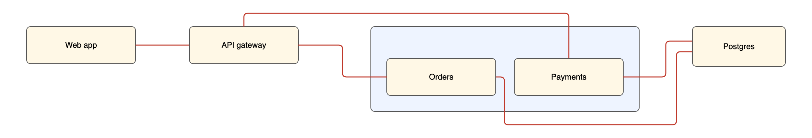
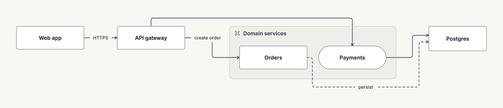
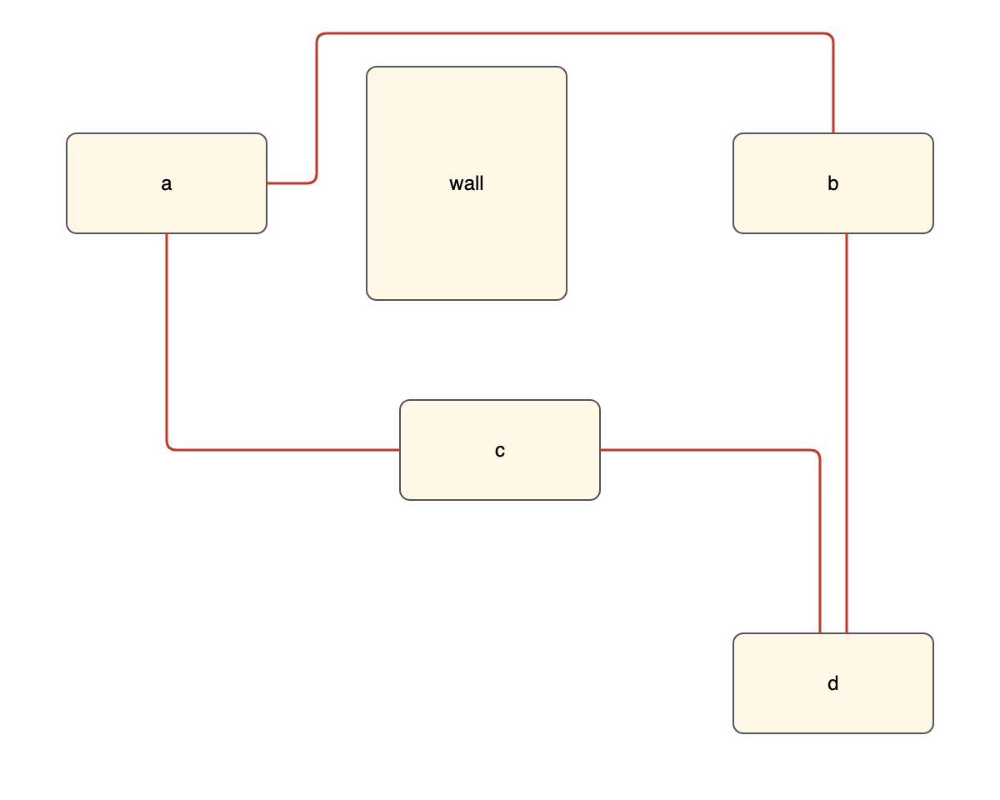
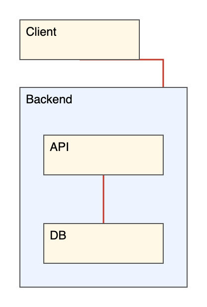

# Spike: draftably layout and routing as a graph API

Status: built in the stack #506, #507, #509 and #510 (2026-11-09). This report is the spike
that chose the design; the sections below record the decisions and what is still open.

## Goal

Let other tools use draftably's layout and router on their own graphs, as ElkJS allows. The API
takes plain data, not `.draft` text. It also takes the props of other diagram systems directly, so
a React Flow or elkjs app can switch with very little code.

## What exists

| Part                            | Where                        | Input                          | Notes                                                                                                                          |
| ------------------------------- | ---------------------------- | ------------------------------ | ------------------------------------------------------------------------------------------------------------------------------ |
| Router (`RouteLab.compute`)     | `src/engines/routing-engine` | Placed boxes, groups, edges    | Pure. Already ElkJS-shaped. Gives points and sides only.                                                                       |
| Route drawing (`computeRoutes`) | `src/model/routes.ts`        | A `Diagram`                    | Adds shape ports, label boxes, label room, halos, cell ends and lanes. This is most of the visible routing quality.            |
| Layout engines (`LayoutLab`)    | `src/engines/layout-engine`  | A `Diagram`                    | Stress, force, layered and similar. Used by `engine=` layouts.                                                                 |
| File compiler (`compile`)       | `src/dsl/compile.ts`         | `.draft` text or a `SourceDoc` | The `flow`, `row`, `lanes`, `sequence` and `cells` recipes, folds, channels, label room and refinements. The "draftably look". |

`parseModel` accepts a `SourceDoc` (a list of statements) as well as text. This is the seam the
prototype uses. The API builds statements, never text, so labels need no escaping. The statements
go through the file parser, so validation and defaults are the file's own.

## Decision 1: what to expose

Scale: 10 is best for the decision.

| Approach                                                     | Draftably look delivered | Caller geometry accepted | Output same as the `.draft` file | Main tradeoff                                                               |
| ------------------------------------------------------------ | -----------------------: | -----------------------: | -------------------------------: | --------------------------------------------------------------------------- |
| A. Router only, on placed boxes (`route`)                    |                        4 |                       10 |                                7 | Lines only. Lanes and channels come from the compiler, so they are missing. |
| B. Graph to statements to the compiler (`layout`)            |                       10 |                        6 |                               10 | Sizes are accepted; positions are not, except as `pin`.                     |
| C. A new direct call into `layoutModel` with a built `Model` |                        9 |                        7 |                                4 | Skips validation and defaults. A second path to keep the same as files.     |
| D. Status quo: caller writes `.draft`, runtime returns SVG   |                       10 |                        0 |                               10 | No geometry comes back. A host cannot draw its own nodes.                   |

- **Choice:** B plus A. `layout()` for unplaced graphs and `route()` for placed boxes.
- **Why:** B gives the full look with no second code path. Every result also returns `draft`, the
  file it equals, so a bug report is one paste. A covers apps that place nodes themselves.
- **Watch:** router cost on dense graphs (see Findings).

## Decision 2: the input shape for other systems

| Approach                                                           | Lines to convert a React Flow or elkjs app | Result in the host's own shape | Input read as the wrong format | Types narrow per system | Main tradeoff                                                                   |
| ------------------------------------------------------------------ | -----------------------------------------: | -----------------------------: | -----------------------------: | ----------------------: | ------------------------------------------------------------------------------- |
| A. One canonical shape only                                        |                                          3 |                              2 |                             10 |                       8 | Every user writes and maintains a mapping.                                      |
| B. Detect the format from the input                                |                                         10 |                              9 |                              3 |                       3 | React Flow and Cytoscape both use `data`, `id`, `source`. A guess can be wrong. |
| C. One call, keyed by system: `layout({ reactFlow })`              |                                          9 |                              9 |                             10 |                       9 | One function to learn. The key names the format.                                |
| D. A drop-in per system (`new DraftablyELK()`, a Cytoscape layout) |                                         10 |                             10 |                             10 |                       9 | Each one needs the host's plug-in seam.                                         |

- **Choice:** C as the core, plus D only where the host has a plug-in seam. D is a thin wrapper
  over C: the prototype's `DraftablyELK` is 8 lines.
- **Why:** C keeps one function with typed keys. The key always gives back the same shape it took.
  D is the switch with the fewest changes for elkjs, Cytoscape and dagre users.
- **Watch:** each adapter is a contract with an outside format. Keep each one to the fields that
  matter for layout, and report the options it ignores in `warnings`.

## The API

```ts
import { layout, route, DraftablyELK } from '@draftably/runtime/graph';

// Draftably's own shape. Names follow React Flow: id, label, parent, source, target.
const out = await layout({
  nodes: [
    { id: '1', label: 'Web app' },
    { id: '3', label: 'Orders', parent: 'svc' },
    { id: '5', label: 'Postgres', width: 140, height: 60 }, // A fixed size; else it fits its label.
  ],
  groups: [{ id: 'svc', label: 'Domain services', arrange: 'row' }],
  edges: [{ source: '1', target: '3', label: 'create order', dashed: true }],
  arrange: 'flow', // flow | row | column | lanes | sequence | engine:stress …
  direction: 'right',
  fit: 'slide',
  routing: { edgeGap: 24 },
});
out.nodes['1']; // { x, y, width, height, parent? }
out.edges.e1; //   { points, path, label: Box | null, sourceSide, targetSide, blocked }
out.draft; //      the equal .draft file: paste it into the viewer, or pass it to renderSvg

// Each system's own props in, the same shape out.
const { reactFlow } = await layout({ reactFlow: { nodes, edges }, direction: 'down' });
const { elk } = await layout({ elk: elkGraph });
const placed = await new DraftablyELK().layout(elkGraph); // a drop-in for elkjs

// Lines only, between boxes the app placed. Nothing moves.
const lines = route({ nodes: placedBoxes, edges });
```

Rules the prototype follows:

- **Any IDs.** IDs such as `1` or `a b` get safe aliases in the file and come back unchanged.
- **Results keyed by ID.** A host writes `out.nodes[n.id]`, with no search.
- **Errors use the file's messages**, such as `Expected width from 40 to 1200; got 5000.` and
  `Unknown id "nope".`
- **Labels.** The host draws a backing behind each label box. Draftably's own renderer breaks
  the line there.
- **Arrowheads.** Points end on the box outline. The host draws the mark.

## Adapters by system

| System                  | In                                                                                                                       | Out                                                                                                                 | Seam for a drop-in                                                                            | Status     |
| ----------------------- | ------------------------------------------------------------------------------------------------------------------------ | ------------------------------------------------------------------------------------------------------------------- | --------------------------------------------------------------------------------------------- | ---------- |
| React Flow, Svelte Flow | `nodes` (`parentId`/`parentNode`, `measured`, `type: 'group'`), `edges` (`sourceHandle` as a side, `animated` as dashed) | `position` relative to the parent, `width`/`height`, `edge.data.draftably.path` for a custom edge                   | A `DraftablyEdge` component and `useDraftablyLayout` hook in `@draftably/react` and `/svelte` | Prototyped |
| elkjs                   | `ElkNode` tree, `layoutOptions` (`direction`, `spacing.nodeNode`, `algorithm`), ports with `port.side`, hyperedges       | The same tree with `x`/`y` relative to the parent, `sections` relative to the node that lists the edge, label boxes | `new DraftablyELK().layout()`                                                                 | Prototyped |
| dagre / graphlib        | `g.nodes()`, `g.node(v)` with `width`/`height`/`label`, `g.setParent`                                                    | Writes `x`/`y` (centres) and `points` back, as `dagre.layout(g)` does                                               | `draftably.layout(g)`, mutating as dagre does                                                 | Next       |
| Cytoscape.js            | `elements` with `data.id`, `data.parent`, `data.source`/`target`                                                         | Node positions (centres). Edges as `segments` with weights and distances from the points.                           | `cytoscape.use(draftably)`, then `cy.layout({ name: 'draftably' })`                           | Next       |
| Mermaid, DOT, D2 text   | Source text                                                                                                              | Draftably geometry                                                                                                  | `layout({ mermaid: text })` over the existing importers                                       | Later      |
| vis-network             | `nodes`/`edges` with `from`/`to`                                                                                         | Positions only. vis-network cannot draw a polyline.                                                                 | None                                                                                          | Later      |
| Excalidraw, tldraw      | Elements with boxes and arrows                                                                                           | Box positions and arrow points. A "tidy my whiteboard" feature.                                                     | None                                                                                          | Later      |

## Packaging

Ship it as a subpath of the runtime: `@draftably/runtime/graph`. The prototype adds a `graph`
entry to `scripts/build-runtime.ts`. The runtime's boundary check passes, so the entry needs no
editor or app state.

- `graph.js` is 11.7 kB. It shares the compiler chunk with `renderSvg`: 288 kB, 93 kB gzipped,
  with no font files.
- One version and one set of font metrics with the renderer, so `layout()` and `renderSvg()`
  always agree.
- Later, publish a thin `@draftably/layout` package that re-exports it, as `@draftably/mermaid`
  depends on the runtime. That name is easier to find on npm for "layout".

## Evidence

`tests/graph-api.test.ts` has 4 tests: the native shape with numeric IDs, `route()` around a
blocking box, React Flow sub-flows, and an ELK graph with a cluster, a port and an edge label.

A host SVG drawn only from `layout()` output (top) matches draftably's render of the returned
`draft` (bottom):




`route()` on boxes the caller placed. The a→b line goes round `wall`:



`DraftablyELK` output, drawn as an elkjs app draws it (parent offsets added while walking the
tree). The Client→API line is blocked; see Findings.



## Findings

1. **Router cost is the main risk.** On a binary tree, routing takes 0.6 s at 20 nodes, 4.5 s at
   40 and 18 s at 60. Compile takes 2 to 12 ms. A 60-node chain routes in 0.3 s. `quick: true`
   cuts the 60-node tree to 2 s, with 182 crossings. ElkJS lays out hundreds of nodes in under a
   second, so an "ElkJS-class" claim needs router work first. The tree also folds into a tall
   1224 × 2968 drawing, which causes many of those crossings.
2. **A blocked route under `flow direction=down`.** Flow leaves 28 px between a node and a group
   below it. The group's title band then blocks a line that must leave from the node's bottom
   (`from=bottom`, or an ELK `SOUTH` port). The router marks it `blocked`. With `from=auto` it
   goes round the left side. The `.draft` file draws the same, so this is a compiler gap that the
   API exposed, not an adapter bug.
3. **Fonts.** Without a size, a box fits its label in draftably's fonts. A host that draws labels
   in another font must load `@draftably/runtime/fonts.css` or pass sizes. React Flow apps already
   measure nodes and then lay out, so the adapter reads `measured`.
4. **Ports.** Draftably chooses a side, not a point on the side. React Flow handles and ELK ports
   with fixed positions map only to a side. Fixed port offsets need a router change
   (`fromOffset`/`toOffset` exist inside the router).
5. **`route()` labels** are sized in draftably's fonts. Add `labelSize` to the edge input.
6. **Threads.** `route()` runs on the caller's thread. Large graphs need the runtime's worker,
   which `renderSvg` already uses.
7. **Unsupported ELK options.** `LEFT` and `UP` directions are drawn as `RIGHT`, with a warning.
   The adapter ignores other `elk.*` options. It should list them in `warnings`.

## Decision 3: what to build next

The project budget is 1 s for a document load ([CHECKS.md](../../CHECKS.md#performance)). The
bench goes up to 28 boxes only. Outside users bring larger graphs.

| Next piece                                | 60-node graph within the 1 s load budget | Switch path for a React Flow or elkjs app | Blocked or crossing lines on a first try | API shape tested by a real host before npm fixes it | Main tradeoff                                           |
| ----------------------------------------- | ---------------------------------------: | ----------------------------------------: | ---------------------------------------: | --------------------------------------------------: | ------------------------------------------------------- |
| A. Ship core `layout`/`route` subpath now |                                        0 |                                         4 |                                        3 |                                                   3 | Publishes an 18 s router behind an API no host has used |
| B. Router scaling first                   |                                        8 |                                         0 |                                        7 |                                                  10 | Nothing ships                                           |
| C. React Flow adapter and demo page first |                                        0 |                                         9 |                                        2 |                                                   7 | The best showcase, but a 60-node demo stops for seconds |
| D. Fix the flow-down group gap first      |                                        0 |                                         0 |                                        5 |                                                  10 | One blocked case                                        |

- **Choice:** B, with C built against the unpublished API so a real host tests its shape. Publish
  the core and the adapters together when a 60 to 100 node graph meets the budget.
- **Why:** the budget is a hard gate. ElkJS users run layout on each graph change.

## Decision 4: how to bring routing into budget

A CPU profile of the 60-node tree puts 80% of the time in pair checks
(`conflicts`, `parallelConflicts`, `cost`, `intersection`, `segments`). Each check compares a
candidate path with every segment of every placed line, with no bounding-box reject, and builds
the segment arrays again in the inner loop. `findIn` searches each candidate side pair and scores
it against all placed lines, and the repair passes do this again.

| Approach                                                            | tree60 time to a usable drawing | Routes equal to the reference corpus | tree60 crossings | Lines that move after the first drawing | Main tradeoff                                         |
| ------------------------------------------------------------------- | ------------------------------: | -----------------------------------: | ---------------: | --------------------------------------: | ----------------------------------------------------- |
| A. Exact pruning: bounding-box reject, cached segments              |           2 (8.1 s, was 18.5 s) |           10 (same hash on 3 inputs) |         10 (150) |                                      10 | Free, but 8 times over budget                         |
| B. A, plus quick routing above an edge-count limit                  |                      9 (0.87 s) |    9 (the corpus is below the limit) |    6 (182, +21%) |                                      10 | Dense graphs get the cheaper pass                     |
| C. A, plus a quick drawing first and the full one later in a worker |                9 (0.87 s first) |                                   10 |   10 (150, ~8 s) |                                       2 | Lines move under the user; the host takes two results |
| D. A new candidate search                                           |                      unmeasured |                    3 (breaks parity) |       unmeasured |                                      10 | Needs a full quality audit                            |

Other measured times with A: chain of 100 nodes 0.39 s (was 1.14 s); tree of 40 nodes 2.2 s
(was 4.5 s), 0.29 s quick.

- **Choice:** A now, as its own change: it helps the viewer and the CLI too. Then B in the graph
  API, as `routing.quality: 'auto' | 'full' | 'quick'`, with `auto` quick above about 40 edges.
  D stays research for the quality audit loop.
- **Watch:** B gives 21% more crossings on dense graphs. Say so in the API docs.

## What was built

1. #506: the router, 2 to 7 times faster with the same routes (Decision 4, A).
2. #507: `@draftably/runtime/graph` with `layout()`, `route()` and `routing.quality`
   (Decision 4, B, with `auto` quick above a predicted cost), the `pnpm bench:graph` harness and
   the Layout API docs page. The harness found and #507 fixed four bugs: router stub IDs on edges
   into groups, colliding aliases, sizes outside the file's range, and the 28px root gap that
   blocked a line into a group (Finding 2).
3. #509: React Flow and Svelte Flow keys, `DraftablyEdge` in `@draftably/react/flow`, and a React
   Flow example with a browser proof. A hook was not needed: the example uses `layout` and
   `route` directly.
4. #510: `DraftablyELK`, `dagreLayout`, the Cytoscape layout, `layoutSync` and `fold`.

5. The performance layer on top of the stack: `flow` places each object level with what it links
   to and gives each gap a lane per turning line, and the router skips work that cannot change
   its result. See [Performance follow-up](#performance-follow-up).

## Performance follow-up

Measured against real elkjs 0.12.1 (layered, orthogonal) on the harness graphs as ELK JSON:

- Node placement caused most of the cost. `flow` stacked each rank from the top, so a tree's
  children sat far from their parents, and gaps between ranks were 48px however many lines
  turned in them. The router then routed round other boxes: a 63-node tree drew 199 crossings
  and took 5 s. Placing each object at its median neighbour (a least-move fit that keeps order
  and gaps), and widening each gap to fit its lanes, is what a layered layout does. That tree
  now has no crossings, fewer bends than elkjs, and routes in 0.05 s.
- Exact router work, checked against every draft file and the harness: a typed-array A* heap
  and inlined pair tests, doglegs skipped for side pairs that cannot win, fan-out priced once
  per side pair, and flat route boxes per `findIn`. Crossing repairs run only on drawings of 32
  edges or fewer; above that none was accepted.
- Audit: corpus DI −0.1, held-out −0.7, examples −0.4.

## Still open

- The ELK stand-in is still about 13 times slower than elkjs over the harness (2.3 s against
  0.17 s), and denser: a 100-node DAG draws 149 crossings against elkjs's 85, as DAG rank
  ordering (`byBarycenter`) is weaker than ELK's crossing minimisation. Full routing of that
  DAG takes 3 s, mostly improvement passes that reroute crossing lines against all the others.
- A fan of many children from one side gives each line its own port and lane. A shared trunk
  (FEEL.md: "a horizontal stub may join a vertical trunk") would draw it as elkjs does.
- Fixed port positions (Finding 4) and caller label sizes for `route()` (Finding 5).
- Cytoscape edges: map routes to `segments` offsets.
- The DSL default gap: a `layout` line without `gap=` spaces a root flow 28px apart, against 48px
  with no layout line.
