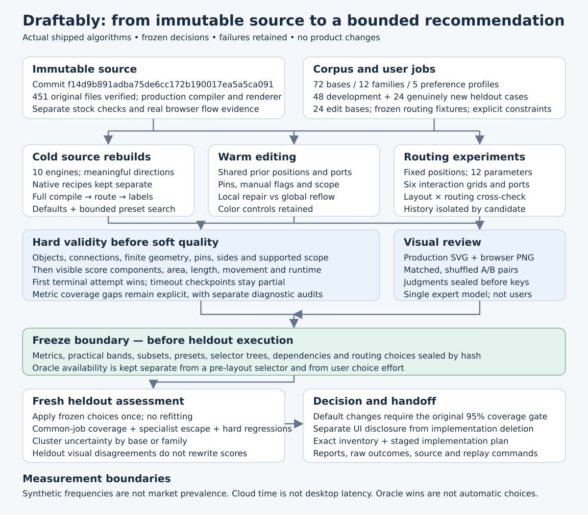
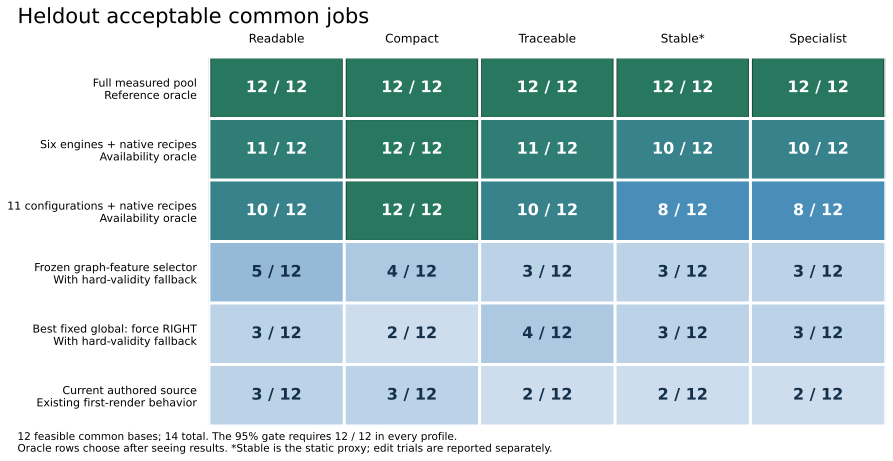

# Draftably layout, routing, and editing evaluation

**Baseline:** `f14d9b891adba75de6cc172b190017ea5a5ca091`  
**Experiment dates:** 1–2 November 2026, UTC  
**Scope:** executed evaluation and design handoff. Product sources were not modified, committed, pushed, or deployed.

## 1. Firm recommendation

**Simplify the editing surface while retaining the existing implementations and current source-rendering defaults. Do not ship the tested reduced portfolio or feature selector as a new automatic default.** The frozen six-engine portfolio failed the heldout quality-coverage requirement even when an oracle could choose its best output after rendering. The actual pre-layout selector performed substantially worse.

Keep all **ten source rebuild engines**, the **Separate warm repair action**, and all **six native recipes**. Put uncommon engine IDs and numeric solver settings behind Advanced or in source. Keep explicit ports, pins, scope, ordering, and structural recipes as meaningful authored capabilities. The smallest defensible release portfolio from this experiment is therefore the existing implementation portfolio with a smaller visible interface. A smaller implementation portfolio has not been validated.

The best development reduction is useful as an **experimental comparison pack**, with these six engines:

`boundary-align`, `tidy`, `force`, `layered`, `tree`, `grid`.

It must retain native recipes and dependency-safe authored source. Its development result was **25/26 feasible common bases, or 96.2%, in each of five profiles**. On heldout data its weakest profiles fell to **10/12, or 83.3%**. Its eleven-configuration restriction fell further, to **8/12, or 66.7%**. Neither is a release-qualified replacement for the full available pool.

### Exact before/after recommendation

| Surface or capability | Baseline | Recommended release treatment |
| --- | --- | --- |
| Internal algorithm implementations | 11 | Retain 11: ten rebuild engines plus Separate |
| Native source recipes | 6 | Retain all 6, including sequence, lanes, and cells |
| Basic layout fields | 4 | 3: Scope, Reading direction, Format |
| Main numeric routing sliders | 9 | 0; use current-default Balanced plus inspectable alternatives |
| Default comparison presentation | 6 generated alternatives | Current drawing plus at most 3 displayed alternatives, with More/Advanced access |
| Source routing parameters | 12 | Retain 12; corner radius belongs in Appearance |
| Public layout/source parameters | 15 `ENGINE_PARAMS`, plus other attributes | Retain meaningful source/API support; disclose only applicable controls |
| Ineffective file-source comparison checkbox | Release fixed port sides | Remove that checkbox in this context; retain the working raw operation and explicit per-edge source edit |

The interface counts are design specifications, supported by source inventory and scripted effort proxies. They are **not observed usability improvements**. The reduced comparison pack is an Explore item. Showing three cards does not establish that three computations, or three hidden algorithm choices, preserve the full pool's quality. The current drawing and the complete advanced/source escape remain available.

**The most consequential loss:** the frozen six-engine set loses acceptable common-job results on `architecture-05` and `cycles-06`; its weakest profiles miss two of twelve feasible common bases. It also loses a niche compact result on `routing-06`. Deleting the omitted engines would remove useful output availability. Hiding them behind a discoverable override is a different decision.

**Evidence strength:** actual shipped implementations, a frozen 72-base corpus, fresh heldout evaluation, repeated timing/determinism checks, protected edit trials, production rendering, and blinded expert-model review. This is a synthetic benchmark and one model reviewer, not a customer-frequency estimate or an independent human study.

**Execution:** all **8,203 registered trials** reached a recorded terminal outcome: **7,731 completed, 452 timed out and 20 failed**. There are **6,714 development and 1,489 heldout trials**, with no unstarted registered IDs. Completed means the pipeline returned an output; hard validity and practical acceptance are separate results. The last registered trial finished at 00:29:04 UTC on 2 November, approximately 99 minutes after the assignment began. Additional checks and artifact preparation are separately accounted for below.

## 2. Access and execution status

The attached source packet was used instead of a moving repository branch. Its SHA-256 is `34c38648ff539731e53f719e8865faee6ae62ce1b1a92567fb069c8b1caa5dff`. All **451 original files** match the immutable source manifest. The original ZIP is included in `baseline-packet/` and can be extracted by the replay helper.

The environment executed the actual JavaScript layout, routing, Explorer and sculpt implementations, the TypeScript DSL compiler/projector, production labels, SVG export, CLI audit, and real browser proof scripts. Python performed corpus construction, statistics, and reporting; it did not substitute a layout implementation.

| Runtime component | Actual environment |
| --- | --- |
| Node | 24.22.1 |
| pnpm | 11.25.0; packet declares 11.9.0 |
| Python | 3.12.14 |
| Vite / TypeScript | 6.4.3 / 5.8.3 |
| NumPy / Matplotlib | 2.3.5 / 3.10.8 |
| Browser | Chromium 153.0.8010.0, from temporary `@sparticuz/chromium@153.0.0` |
| Platform | Linux x86_64; shared cloud hardware |

Dependencies were installed from the unchanged pnpm lockfile. Normal browser downloads failed; a temporary packaged Chromium fallback was extracted and used with the repository's unchanged screenshot tool. Local browser and child-process restrictions required execution outside the restricted process sandbox. These were environment workarounds, not product modifications.

### Checks actually run

| Check | Measured result | Interpretation |
| --- | --- | --- |
| `tests/engine-layout.mjs` | 195 assertions passed; 100 top-level candidate scenarios | Assertions are not engine-run counts; 99 LayoutLab and 57 RouteLab calls are identifiable in the script |
| Sculpt engine suite | 54 assertions passed; 126 journey/dab invocations | Actual warm editing implementation; not 126 independent graphs |
| Historical stock audit | 45/45 source configurations rendered; stock hard-defect total 0 | 15 historical bases × 3 versions; 135 CLI compilations; mean stock DI 8.109, median 5.4 |
| Broad unit run | 62 files passed, 10 failed, 1 skipped; 392 tests passed, 5 failed, 8 skipped, 3 errors | Not a wholly passing repository suite |
| `pnpm check:fast` | Blocked at type checking | Packet omissions include site/release-related material; detailed failures are retained |
| Browser layout proof | 15/15 checks passed | Actual compare/apply, Improve/save, timeline, brush, external changes, restart and CLI/browser agreement |
| Browser file-session proof | 22/23 checks passed | Actual drag, resize, pin, undo/redo, invalid source, stale-save refusal, switching, restart and reconnect |

The browser failure was the assertion that back navigation actually restored a cached page. The fallback headless browser does not validate the expected stock-browser back/forward-cache lifecycle. Reconnect and catch-up passed; this result alone does not establish a product defect.

Read coverage is documented in `evaluation/inventory-source-read-manifest.json`, `evaluation/metrics-source-read-manifest.json`, and `corpus/source-read-manifest.json`. It includes the required repository guidance; FEEL, RUBRIC, CORPUS and NEXT; model/document/DSL compilation and writeback; all four engines and declarations; LayoutLab, menus, preview/comparison and file-session paths; variants and audit/screenshot/benchmark tools; tests, examples, samples and historical fixtures. The ledgers distinguish complete reads from targeted symbol reads. The absent `docs/research/` directory was not treated as missing capability.

Evidence: [environment](data/environment.json), [runtime notes](evaluation/runtime-notes.md), [final independent accounting audit](evaluation/final-accounting-audit.md), and [historical audit](data/historical-audit/summary.md). The final audit independently verifies every one of the 7,731 canonical successful geometry signatures, with zero missing or mismatching artifacts, and reproduces the gate arithmetic for fifty saved policies.

## 3. What the experiment measured

The corpus contains **72 independent bases in twelve families**, split within family into **48 development and 24 genuinely new heldout cases**. There are 24 exact existing bases and 48 generated bases; 29 small, 22 medium and 21 large cases. Historical heldout material is development evidence. All edits and variants remain with their base.

The twelve families cover pipelines, DAGs, hierarchies, architecture, cycles, networks, disconnected drawings, routing congestion, containers, presentation constraints, authored placement and structural recipes. Each base has a job card, reading intent, constraints, format, acceptable ambiguity, provenance and invariants. Common/niche labels were declared before outcomes: 42 common and 30 niche bases, including 14 common heldout bases. These labels are benchmark assumptions, not market prevalence.

Cold rebuilds use the shipped compiler's settled path, including its 640-iteration maximum, early stopping, nested layout, fit behavior and refinements. Root sequence and lane cases are preserved through their native path instead of being forced through unrelated graph engines. Nested cells and explicit nested engine declarations remain intact. Separate is a warm action, not a source rebuild engine.

The fixed-position routing study uses 24 separate fixtures. The edit study uses 24 bases across all twelve families, with four independent edits per base plus color-only controls. Empty/single-node sanity cases and 180/220-node scale cases sit outside the main quality-weighted corpus.

### Hard gates, scores, and the acceptance rule

Hard gates precede every soft score. They check the measured subset of identity/connection preservation, finite geometry, complete routes, blocked routes, terminal attachment, explicit sides, object/route penetration, source pins, warm pins/manual protection/scope and supported required intent. Layout and routing failures remain separate. A crossing is not automatically a hard failure.

The custom DI is a documented subset of the repository's defect categories. It is not numerically interchangeable with the stock historical audit. Raw counts and per-ten-edge values are retained, with an explicit zero-edge convention. Balanced, traceable and direct weightings stay separate from the router's optimization penalties.

| Preference | Frozen objective |
| --- | --- |
| Readable flow | Direct DI plus target-aspect error |
| Compact presentation | Balanced DI plus area and target-aspect penalties |
| Traceable connections | Traceable DI |
| Stable edits | Balanced DI plus adjusted movement and side churn; static screening uses a stated proxy |
| Specialist structure | Balanced DI after supported structural/intent gates |

An acceptable result must be hard valid, within **one profile-score unit** of the profile oracle, within **10% of its area**, and within **10% of its route length**. A candidate cannot exchange a lost connection for fewer bends. These are borrowed operational bands, not experimentally established human-perception constants. Thirty-six blinded development pairs informed the decision to retain the bands and record disagreements rather than silently revise them.

The policy was sealed at **2026-11-01 23:58:46.719982 UTC**, before any heldout execution. Freeze SHA-256: `9e03b185e72525bcd3bd0bf3b27c9aadc42f09551853005afc349e35ba915649`. The runner checked the seal, baseline, corpus and metric hashes. Heldout runs applied the stored subsets, presets and trees once, without fitting new choices.

The release gate is **at least 95% of the full pool's feasible common-job coverage in every profile**, no new current-valid hard-defect case, and no supported specialist loss without an escape hatch. Absolute coverage over all common cases is reported separately. On these heldout data, twelve common bases are feasible and fourteen exist. Therefore **12/12 is required**; 11/12 is only 91.7% and fails.

Method details and departures: [evaluation-method.md](evaluation-method.md), [policy freeze](data/policy-freeze.json), [protocol addenda](data/protocol-addenda.jsonl).

## 4. Portfolio results: availability is much better than automatic selection

The full measured pool has a hard-valid outcome for **19/24 heldout bases**, including **12/14 common bases**. Current authored source is hard valid on **16/24**, including **11/14 common bases**. The full pool cannot serve `architecture-06`, `dags-06`, `containers-05`, `containers-06`, or `networks-06` under the measured gates and resource limits. Those failures remain in absolute denominators.

The table reports accepted common-base counts. Every entry uses denominator **12** for the contract and **14** for absolute coverage. “Stable” here is the static proxy; actual edit behavior is reported later.

| Frozen policy | Readable | Compact | Traceable | Stable | Specialist | Weakest relative rate |
| --- | ---: | ---: | ---: | ---: | ---: | ---: |
| Current authored source | 3 | 3 | 2 | 2 | 2 | 16.7% |
| Documented default | 4 | 5 | 3 | 3 | 3 | 25.0% |
| Best fixed global: force RIGHT, guarded | 3 | 2 | 4 | 3 | 3 | 16.7% |
| Preferred five-engine feature selector, guarded | 5 | 4 | 3 | 3 | 3 | 25.0% |
| Preferred five-engine goal selector, guarded | 3 | 3 | 3 | 3 | 3 | 25.0% |
| Five-engine configuration oracle | 8 | 8 | 10 | 8 | 8 | 66.7% |
| Six engines plus recipes, availability oracle | 11 | 12 | 11 | 10 | 10 | 83.3% |
| Eleven configurations plus recipes, availability oracle | 10 | 12 | 10 | 8 | 8 | 66.7% |

These displayed policies add **zero current-valid hard failures**. The guarded selector and dependency-aware oracles preserve the two currently valid protected specialist cases. Those are necessary conditions, but they do not compensate for missing the quality-coverage gate.

The existing default is not especially close to the retrospective full-pool oracle. Retaining it is a decision against an unvalidated automatic replacement and unrequested source migration, not a claim that its quality is optimal. For example, fixed force RIGHT produces a hard-valid outcome on 19 heldout bases, but it still misses most of the stringent profile-specific practical bands.

### Required sizes 1–5

These are the frozen default-configuration subsets, selected on development. They are a different availability scenario from the six-engine mixed-default/preset/recipe portfolio above. A jump between those tables must not be attributed to adding a single engine.

| Size | Development-selected engine set | Heldout oracle counts by five profiles | Guarded selector counts |
| --- | --- | --- | --- |
| 1 | stress | 3, 4, 4, 4, 4 | 2, 3, 4, 3, 3 |
| 2 | stress, layered | 5, 7, 5, 5, 5 | 4, 5, 3, 3, 3 |
| 3 | stress, force, layered | 7, 7, 7, 6, 6 | 5, 4, 3, 3, 3 |
| 4 | boundary-align, stress, force, layered | 8, 8, 8, 7, 7 | 5, 4, 3, 3, 3 |
| 5 | compound-flow, boundary-align, stress, force, layered | 8, 8, 10, 8, 8 | 5, 4, 3, 3, 3 |

The order is readable, compact, traceable, stable and specialist; each denominator is twelve feasible common bases. Adding options improves retrospective availability, but the simple selector does not realize most of that gain. The selector uses only pre-layout features, a depth-three tree and a minimum four development bases per leaf. It does not see family labels, case IDs, output geometry or post-layout scores.

### The exact development minimum and its limits

The dependency-aware search evaluated all 1,023 nonempty engine subsets, plus a zero-engine native baseline, across three configuration modes, three availability scenarios and four weighting assumptions. The preferred six-engine set meets the development contract with **25/26 common bases per profile**, **25/28 absolute**, no new current-valid hard failure, and a worst feasible-family coverage of 75%.

The minimum is **not unique**. Replacing tree with compound-spring gives another qualifying six-engine set under equal-family weighting. The chosen set follows the declared objective; the result does not establish that every chosen member is uniquely indispensable.

With unrestricted current-source fallback, a five-engine visible portfolio can qualify in development, but that fallback can still call hidden engines. It supports UI hiding, not implementation deletion. `authored-01`, for example, contains three nested `engine=grid` declarations. Removing grid while continuing to count that source as available would be an invalid deletion claim.

The minimum additional global-configuration cover, conditional on the chosen six engines and native/authored baselines, has **eleven configurations**:

| Engine | Exact global configurations in the conditional cover |
| --- | --- |
| boundary-align | RIGHT defaults; DOWN defaults |
| force | RIGHT defaults; RIGHT with `compactness=90 aspect=1` |
| layered | RIGHT defaults; DOWN defaults; RIGHT with `rank-gap=24 node-gap=12` |
| tidy | RIGHT defaults; RIGHT with `compactness=90 node-gap=12` |
| tree | RIGHT defaults; RIGHT with `rank-gap=24 node-gap=12` |
| grid | Retained for authored/nested dependency support; no additional global preset in this cover |

The search examined 230,964 configuration subsets without executing additional geometry. This is a conditional configuration minimum, not a joint proof over every possible engine/configuration combination. Defaults alone, or one selected preset alone, failed to cover the shared mixed reference pool sufficiently even with ten engine IDs.

### Decisive heldout witnesses

- **`architecture-05`:** the six-engine set loses readable, stable and specialist acceptance. A full-pool witness is compound-spring preset 3, with `boundary-pull=100 hierarchy-sweeps=4`.
- **`cycles-06`:** the set loses traceable, stable and specialist acceptance. A full-pool witness is compound-flow RIGHT.
- **`routing-06`:** it loses the niche compact job. A full-pool witness is flow preset 1, with `edge-length=48 flow-strength=100`.
- **`pipelines-05`:** the eleven-configuration restriction adds losses in four profiles. Force RIGHT ties the traceable oracle score but uses **31.5% more area and 42.7% more route length**, correctly failing the other bands.
- **`cycles-05`:** restricting configurations adds stable/specialist losses.

These witnesses identify real losses from the frozen retained set. They do not assert that each named excluded configuration is the only acceptable replacement.

### Uncertainty and weighting sensitivity

Paired intervals resample families and then bases, retaining each base's correlated profiles. They describe the benchmark, not a market population. The following differences are across **all oracle-feasible families**, not the common-job gate alone:

| Policy versus current authored source | Acceptable-coverage difference | Paired 95% interval |
| --- | ---: | ---: |
| Fixed global with guard | +7.4 percentage points | −5.0 to +22.5 |
| Preferred feature selector with guard | +11.6 points | −5.6 to +33.7 |
| Preferred goal selector with guard | +7.4 points | −4.0 to +18.1 |
| Six-engine recipe oracle | +73.7 points | +50.0 to +94.4 |
| Eleven-configuration recipe oracle | +65.3 points | +41.7 to +87.1 |

The frozen bootstrap metadata uses “common full-pool oracle feasibility” to mean feasibility shared by the compared policies; its code includes all twelve families. The reporting memo makes this scope explicit. It must not be read as a common-job-only interval.

Equal-family, common-heavy 80/20, niche-heavy 50/50 and worst-family analyses do not repair the exact failed common-profile counts. The preferred selector has a feasible family with zero acceptable jobs. Doubling all practical bands raises its weakest common profile only to **4/12, or 33.3%**. Even a five-engine oracle with current-source fallback reaches only **11/12** on its weakest profile under doubled bands.

Evidence: [heldout portfolio memo](reports/heldout-portfolio-evidence.md), [policy acceptance](data/analysis/heldout/frozen-policy-acceptance.json), [failure witnesses](data/analysis/heldout/portfolio-failure-witnesses.csv), [configuration cover](data/analysis/heldout/minimum-configuration-frozen-policy.json), and [family tails](data/analysis/family-tails-heldout.md).

## 5. Engine and recipe dispositions

The following leave-one-out counts come from development and use the final shared mixed reference pool. “Retuned” means the equal-budget selected global preset for each remaining engine, not an unrestricted continuous search. Counts are practical-loss **base cases**, not tiny numeric wins or independent users.

| Engine/action | Fixed-default removal losses | Selected-preset removal losses | Release treatment and decisive reason |
| --- | ---: | ---: | --- |
| compound-flow | 2 | 1 | Retain; native warm traceability witness and heldout cycle witness; optional Advanced/experimental comparison |
| boundary-align | 3 | 2 | Retain; nested structure and native warm value; part of experimental six-engine pack |
| compound-spring | 1 | 0 | Retain Advanced/source; alternative development minimum and heldout architecture witness |
| tidy | 1 | 2 | Retain; compact cold configurations and distinct bounded repair role |
| stress | 2 | 2 | Retain Advanced/source; relationship-layout alternatives, despite weak selector results |
| force | 7 | 6 | Retain; strongest fixed global candidate in development and many practical witnesses |
| flow engine | 0 | 0 | Hide from basic UI; retain implementation/source because zero development marginal loss is not universal inertness and heldout has a useful configuration witness |
| layered | 8 | 4 | Retain; strongest fixed-default marginal coverage and useful directional alternatives |
| tree | 1 | 4 | Retain; hierarchy/root intent and low timing tail on the measured sample |
| grid | 1 | 1 | Retain; packing and explicit nested source dependencies |
| separate | Not a cold engine | Not a cold engine | Keep as a local overlap-repair action; it cannot replace a requested global rebuild |

All six recipes remain: flow, row, column, lanes, sequence and cells. Recipe flow and engine flow are separate implementations. Sequence order, lane ownership and cell structure are semantic requirements that a general graph solver does not automatically replace.

The native warm screen ran all eleven actions on twelve existing, unperturbed drawings: **132 trials within the warm-settings stage**. Retain-current plus force covers 47/60 profile jobs; adding boundary-align covers 56/60; adding compound-flow covers 60/60. Removing those three respectively loses eight, six and one practical profile jobs from that warm pack. This is an oracle on native drawings, not the protected edit-sequence result.

The compound-flow warm witness is `containers-01`: traceable score 12.5 versus 16.5 for the best remaining native warm pass, with retained current also available. The additional blinded pair judged it **visually the same**. It is a measured operational niche with limited perceptual evidence, supporting cheap internal retention rather than a prominent control.

The complete [inventory.csv](inventory.csv) supplies 175 stable recommendation IDs, surfaces, defaults/ranges, effective conditions, decisions, replacements, implementation retention, witnesses, gains/losses, runtime implications, uncertainty and source symbols. It contains **74 Keep, 61 Hide, 21 Automate, 18 Merge and one Remove** disposition. All 175 IDs are unique; required columns, decisions and display defaults pass the read-only CSV audit. Its labels describe the stated UI or API scope; they must not be interpreted as deleting every implementation attached to a hidden control.

## 6. Configuration and routing findings

### Numerical controls have distinct conditions

The source screen attempted default plus meaningful alternatives for all fifteen `ENGINE_PARAMS` on twelve relevant development cases each, across multiple families. It also covered direction, fit, recipe gap, root minimum sizes and conditional warm controls. There were 756 source-setting trials, 96 layout interactions, and 336 bounded replacement-ablation trials.

Fixing a parameter and retuning another does not always recover its per-case coverage. Examples include node gap dropping from ten acceptable cases to three in its bounded replacement comparison, flow strength from nine to four, aspect from seven to four, and root choice from six to four. Aggregate gain on other cases must not conceal these losses. Root, order, fold and format also carry intent that a recovered scalar score cannot replace.

Cold `ordering=stable` and `ordering=crossings` produced no greater-than-1-px change on eleven comparable cases; warm ordering changed four of twelve. Hide the ineffective distinction in that cold path, while retaining warm ordering. Root minimum width/height were quiet on eleven comparable cases, but content size and root behavior can mask a lower bound. The evidence does not justify deleting them.

The boundary-pull × hierarchy-sweeps grid contains a conditional quality witness. Clearance × standoff, edge-gap × parallel penalty, and port-stability × crossing penalty also reveal conditional effects. A default-only no-op is therefore insufficient evidence for removal.

### All twelve routing parameters were exercised

There are 600 scalar fixed-position trials, 144 shared-history/edit trials and 240 explicit-side trials, plus 432 routing-interaction trials. Each scalar has one shared default baseline and two levels. Port history is shared across candidates, not passed from one candidate to the next.

| Parameter | Default | Tested alternatives | Fixtures with a >1-px change /24 |
| --- | ---: | --- | ---: |
| clearance | 10 | 4, 22 | 22 |
| portGap | 16 | 6, 28 | 16 |
| edgeGap | 16 | 8, 32 | 18 |
| bendPenalty | 32 | 0, 80 | 18 |
| crossingPenalty | 360 | 0, 900 | 9 |
| sharedPenalty | 8 | 0, 16 | 0 |
| parallelPenalty | 18 | 0, 48 | 6 |
| portStability | 20 | 0, 100 | 1 |
| fanoutPenalty | 50 | 0, 120 | 1 |
| passes | 3 | 1, 5 | 4 |
| cornerRadius | 6 | 0, 12 | 0 polyline; 23 rendered-path changes |
| standoff | 20 | 0, 40 | 21 |

Sensitivity is not improvement. Clearance 4 increases valid fixed fixtures from **22/24 to 23/24**; clearance 22 reduces that to **15/24**. Shared penalty changes no scalar fixture and no tested shared-penalty/pass interaction fixture, but this finite sample does not establish universal dead code. Corner radius belongs in Appearance because it changes the production rounded path without changing polyline metrics.

Port stability has an effect even with empty external history because later passes use current route sides as history. The edited empty-history stratum changes two of twenty-four cases; shared history changes three. The Explorer's omission of standoff was bypassed through the actual public router API, not interpreted as absence of the parameter.

### Exact routing portfolio and cross-check

The development search over 25 fully observed configurations selected three alternatives: **clearance 4**, **clearance 22**, and **port gap 28**, with the other eleven settings at current defaults. Their oracle union covers **63/72 fixture-weighting jobs**, compared with **69/72** for the full pool, and 23/24 hard-valid fixtures. This does not establish a universally better default or an automatic policy that can choose the right alternative.

On twelve development source cases, three selected layouts crossed with those three routes produce 108 trials. The fixed global `boundary-align RIGHT + clearance 4` covers **21/55 feasible profile jobs**. The frozen three-combination set covers **36/55**; all nine combinations cover 54/55; adding three matched default-route references supplies the 55/55 comparison universe. High clearance creates seven matched hard losses across 36 layout/base combinations. It remains an inspectable tradeoff.

These routing overrides occur after source compilation. They isolate routing on the selected layout, and do not test every effect of writing a routing statement before compiler channel spacing. Heldout route-only runs retain that distinction; their serial compile-plus-route estimates are not new full-pipeline latency measurements.

Heldout routing contributes **72 current-position reroutes and 216 layout-by-route combinations**. Of these, 243 complete and 45 time out. Every successful reroute preserves its matched document exactly except routing settings; 318 canonical geometry/reference signatures pass verification. Fifty-four trials use explicitly partial layout references. A rescued reroute never retroactively changes the original source timeout.

The frozen three-route union reaches **12/12 feasible common bases in every profile** against its **narrow four-configuration current-position reference pool**. This is useful evidence for a comparison feature, but it is not the full cold-layout pool and does not establish a deployable selector. Clearance 4 alone reaches only **10, 9, 9, 9, 9** acceptable common bases. Clearance 22 creates **six new hard-invalid bases where current routing was valid**, including five common bases. Keep it an inspected alternative, not an automatic default.

| Frozen joint policy | Readable | Compact | Traceable | Stable | Specialist |
| --- | ---: | ---: | ---: | ---: | ---: |
| Global boundary-align RIGHT + clearance 4 | 5/12 | 6/12 | 9/12 | 9/12 | 9/12 |
| Three selected layout/route combinations | 12/12 | 11/12 | 10/12 | 12/12 | 12/12 |
| All nine tested layout/route alternatives | 12/12 | 12/12 | 11/12 | 12/12 | 12/12 |

This joint table uses its own twelve-configuration scoped oracle: three default-route layout references plus nine alternatives. The selected triple is boundary-align RIGHT + clearance 4, force RIGHT + clearance 22, and compound-flow RIGHT preset 1 + clearance 4. Its pooled common count is **57/60, exactly 95%**, but it **fails** the required per-profile test. Even all nine alternatives miss traceable acceptance on one feasible common base. Neither pooled averaging nor checkpoint rescue supplies a reason to change the source-rendering default.

The global joint choice is hard valid on 19/24 bases versus current source's 16/24, with three rescues and no new current-valid hard failure. That is a narrower composition result, not a fresh complete cold-default comparison. All 288 derived serial timing estimates are available; none of the hard-valid reroutes exceeds 15 seconds in that estimate. Cached positions and source preparation still prevent an end-to-end latency claim. Full tables, conditional score intervals, adverse cases and per-family results are in [heldout-routing-findings.md](heldout-routing-findings.md).

### Explicit ports and the one public removal

An explicit top/top pair on `route-12` improves balanced DI by ten over the best tested automatic numeric result. Compatible interaction settings do not erase this benefit. Other explicit overrides, including adverse `route-03` and `route-19` examples, invalidate otherwise valid automatic results. Explicit sides are valuable authored constraints, not a universally better automatic setting.

The file-source Release fixed port sides checkbox is a narrower issue. A targeted post-seal implementation-applicability probe executes the exact AST-extracted `candidateSource` and `sourceWithRouting` functions with the real parser, serializer, settings and routing-write helpers. False/true settings produce **byte-identical source**, retaining authored top/left sides; a scalar clearance change is active. A positive raw Explorer pair releases the sides when enabled. All twelve assertions pass; the positive control makes exactly two router calls, with no layout or source compilation.

Remove the ineffective checkbox **only in file-source comparison**. Keep the working raw operation and provide an explicit per-edge Use auto ports source action. This probe does not retune any frozen policy. Evidence is in `data/analysis/file-auto-ports-probe/` and `evaluation/probe-file-auto-ports.mjs`.

Source facts: `src/state/comparison.ts::candidateSource/generate`, `src/state/file-session.ts::sourceWithRouting`, `src/dsl/layout-edits.ts::setRouting`, and `src/engines/explorer-engine.js::candidate`. Broader control results: [config-findings.md](config-findings.md), [context-findings.md](context-findings.md), and [layout-control ablations](layout-control-ablation.md).

## 7. Incremental editing and intent

Each split executes **372 trials**: 60 current-source edits, twelve shared warm input states, 180 warm actions and 120 frozen cold-policy edits. Development completes all 372. Heldout completes 370 with two warm timeouts. Each split also has 120 **derived** guarded observations, giving 480 analysis rows; those are not 480 new geometry executions.

| Heldout policy | Hard-valid ordinary edits /48 | Applicable local warm edits /37 | Role |
| --- | ---: | ---: | --- |
| Current authored source | 42 | — | Cold baseline |
| Fixed force RIGHT, raw | 43 | — | Frozen cold alternative |
| Fixed force RIGHT, guarded | 44 | — | Hard-only fallback to current |
| Feature selector, raw | 43 | — | Frozen pre-layout alternative |
| Feature selector, guarded | 44 | — | Hard-only fallback to current |
| Protected tidy | 33 | 27 | Current warm repair comparison |
| Group-aware repair | 33 | 27 | Boundary-align for groups, tidy otherwise |
| Separate only | 37 | 29 | Local overlap repair |

The warm denominator excludes eleven requested global direction/format changes. Those executions remain diagnostic rows in the 48 ordinary edits; a bounded repair cannot claim successful global intent merely by keeping the old drawing. Cold policies use each policy's own pre-edit source result. Warm actions share current-source positions, prior sides, manual protection, pins, scope and collapse state. Their validity and movement rates therefore answer different questions.

Both cold guards activate once, on `routing-05 / add`, replacing a hard-invalid candidate with valid current output. The guard uses no soft-score selection and keeps the candidate policy's own pre-edit reference. Derived serial costs include the failed candidate and fallback. There are no new current-valid hard losses after guarding, but that result does not fix the failed main portfolio quality gate.

All twelve heldout color controls preserve full geometry exactly for every policy/view. Geometry equality is separate from correctness: current source and the warm actions have **10/12 hard-valid color controls**, while the two cold alternative policies have 11/12. An unchanged invalid drawing remains invalid.

Separate reduces mean translation-adjusted movement to **3.27 px**, versus tidy's **18.91 px**, on completed non-color, non-global edits. These descriptive movement means include invalid diagnostic geometry; they are not successful-task rates. Among paired valid outputs, the stable-score difference for Separate versus tidy is −5.07, with a base-cluster 95% interval of −8.27 to −2.12. Two of the four raw hard-validity rescues are applicable local jobs; the others cannot justify using Separate for global direction changes.

An independent review reproduced 744 paired-summary/bootstrap fields without discrepancy and verified 398 distinct successful geometry signatures. All 478 available effective/reference checks pass; two timeouts stay unavailable. Full per-case movement, churn, local/distant effects, runtime, guard derivations, applicability and uncertainty are in [edit-findings-development.md](edit-findings-development.md) and [edit-findings-heldout.md](edit-findings-heldout.md).

The source direction/fit witness is consequential: `presentation-03` requests down direction with `fit=wide` and returns the exact earlier node arrangement. The compiler's fit search tries both directions and fold choices. Projected `doc.settings.direction` is not a reliable direction-compliance indicator for ordinary recipes, because projection copies direct engine settings differently. This behavior is reported as a separate intent diagnostic; the frozen hard checker does not silently acquire a new direction rule after heldout results.

A bounded Separate pass that keeps the old orientation must not be credited with fulfilling a global direction change. Proposed dispatch is therefore: **Improve for local repair; source rebuild for direction/format requests; retain positions for appearance-only changes.** That dispatch is a design correction, not a newly measured hybrid success rate. Cold policy bases and warm bases with manual/scope/collapse state differ, so their best rates cannot be pooled into an unexecuted workflow.

The original warm-setting failures remain: fourteen unsupported cross-parent selection jobs and six unavailable routed inputs. Fifty supplementary supported-scope/checkpoint probes produce 44 completions and six architecture timeouts, with no pin/scope violations among completed outputs. Those probes explain applicability; they do not replace original failures in coverage.

Real drag/save/undo behavior was executed through the existing browser proofs. The proposed simplified UI itself has not been built or usability-tested.

## 8. Visual review and metric disagreements

The reviewer inspected **63 shuffled matched production-render pairs**: ten routing and twenty-six other development pairs before policy freeze, three additional archived-development witnesses after freeze, and twenty-four fresh heldout pairs. The last two groups did not tune policies or thresholds. Every pair image was opened; the heldout review also inspected 32 production detail rasters. The final heldout judgments were frozen at 00:39:59 UTC on 2 November, before separate unblinding.

| Review phase | Pairs | A preferred | B preferred | Same |
| --- | ---: | ---: | ---: | ---: |
| Pre-freeze routing | 10 | 3 | 1 | 6 |
| Pre-freeze development | 26 | 8 | 12 | 6 |
| Post-freeze development witnesses | 3 | 1 | 1 | 1 |
| Fresh heldout | 24 | 12 | 4 | 8 |
| **Total** | **63** | **24** | **18** | **21** |

The hard-gated three-way rule using balanced or traceable DI agrees with the visual verdict on **39/63** pairs; the direct-DI version agrees on **41/63**. This rule prefers the hard-valid output when validity differs, then uses a one-DI-unit tie band; it is not the complete profile-oracle acceptance test. The balanced version has nine opposite preferences, nine numerical preferences with visual ties, and six numerical ties with visual preferences. These selected and sometimes repeated pairs cannot estimate population-level metric accuracy. Ten pairs fall inside the separate symmetric DI/area/length band, with one visual preference (`P017`). The symmetric pair comparison is also distinct from profile-oracle acceptance.

The most consequential heldout observations are:

- **P045, `containers-06`:** stress DOWN conceals connectors behind a row of component boxes. Tree RIGHT is preferred, but both outputs remain numerically hard invalid. Visual preference does not rescue either as an acceptable result.
- **P048, `recipes-06`:** layered RIGHT routes a connector through the packet's bit-number row. Flow DOWN preserves those annotations and is preferred despite much greater area and route length. Both pass the frozen hard checker; this is a concrete missed visual defect, not an excuse to rescore heldout data.
- **P046 and P058, `presentation-06`:** the long Stage 36 title visibly overflows its box in both candidates. The defect remains recorded even when the pair verdict is a tie. Node-text ink and presentation legibility need stronger coverage than the available metric boxes provide.
- **P063, the supplementary development cycle:** the direction-agnostic compound-spring drawing has a better numerical score but a feedback line crosses its retry label. The blinded reviewer prefers the directional version. The apparent score gain does not establish that dropping reading direction is visually preferable.

The heldout selection contains twelve seeded family comparisons and twelve targeted comparisons for regressions, omitted methods and metric disagreement. One authored family produced identical alternatives and was retained as a negative control; thirty attempted pair selections lacked complete renderable alternatives and remain in the selection log. Those are comparison attempts, not thirty additional missing base graphs.

Development pair P004 illustrates why crossing counts alone are insufficient. Raising crossing cost changes seventeen crossings to one, but route length rises from 4,476 to 5,826. Balanced DI improves only from 28.89 to 27.78, while the direct weighting worsens from 42.78 to 59.44. The blinded review prefers the more direct drawing with honest crossings. This agrees with the repository's `FEEL.md` intent without changing the frozen evaluation numbers.

Other recorded disagreements include a no-edge grid versus a long strip; visually clearer cell ownership despite worse DI; feedback connections whose central routing aids comprehension; and relationships that become harder to read after a very large route-length increase. P019's qualitative area impression conflicts with the measured bounding-box area and remains in the ledger with that qualification. Independently fitted sheet panels are not direct physical-area measurements.

All reviewed graph pairs use production SVGs rendered through the unchanged screenshot tool. Statistical charts and proposed UI/workflow diagrams are separately authored explanatory figures. Complete routes are never fabricated from timeout checkpoints. The reviewer saw shuffled A/B identities and job cards, not method names or metrics. Detail crops are retained. Frozen judgments, keys, selection rules, per-pair defects and numerical disagreements are in [visual-review.md](visual-review.md) and `renders/blinded/`.

## 9. Runtime, determinism, equivalence, and failure tails

The isolated timing sample contains twelve predeclared cases, one per family, with 8–48 nodes. Each engine gets one warmup and five measured full-pipeline samples: **720 invocations, 600 measured samples**. One engine worker ran, with routing cache disabled. These are shared-cloud measurements, not proof of the desktop's 200-ms target.

| Engine | Full-pipeline median ms | Full-pipeline p95 ms |
| --- | ---: | ---: |
| compound-flow | 181 | 5,572 |
| boundary-align | 533 | 1,949 |
| compound-spring | 350 | 5,610 |
| tidy | 156 | 5,650 |
| stress | 176 | 5,704 |
| force | 174 | 1,834 |
| flow | 206 | 5,880 |
| layered | 144 | 4,354 |
| tree | 214 | 808 |
| grid | 444 | 6,646 |

Compiler/layout, routing, labels and full-pipeline times are separately retained. The table is conditional on this fixed sample, which completed; large-case screen timeouts provide separate tail evidence. Screening cache hits are not used as solver-speed wins.

All **120 case-engine repeat groups** reproduce exactly across their six invocations. ID renaming reproduces geometry exactly on **120/120** comparisons after semantic IDs are mapped back. Declaration reordering is different: **17/120 exact**, **18/120 within 1 px**, with no hard-validity change. File order can be an intentional tie-breaker, so this is not automatically a defect.

Among 1,094 completed development screen outputs, 13,497 within-case comparisons give **850 exact matches (6.30%)** and **864 within 1 px (6.40%)**. Complete-link equivalence requires pairwise tolerance, not transitive rounded bins. Different geometry is not automatically useful geometry, but these results do not support treating most engine names as interchangeable aliases.

All six optional scale runs time out after layout: current/force/layered on a 180-node network and a 220-node DAG. The recorded compile components are respectively 205/2,576/390 ms and 71/4,599/261 ms. No completed route-quality result is claimed. Routing/label completion, rather than only cold layout computation, is a high-priority performance investigation.

Per-family medians, p90/max values, hard-valid and completed-only subsets, missing-data denominators and worst cases are published in the family-tail tables. Development examples include 64 crossings and route length 31,780 on hard-valid `disconnected-04`, and DI 145 on invalid `containers-03`. Hard validity is a minimum correctness gate, not a promise of readability.

Evidence: [timing](data/analysis/validation/timing.json), [determinism](data/analysis/validation/determinism.json), [identity](data/analysis/validation/identity.json), [equivalence](data/analysis/validation/equivalence.json), and family-tail reports for [development](data/analysis/family-tails-development.md) and [heldout](data/analysis/family-tails-heldout.md).

## 10. Editing UI and measured choice burden

The main panel should ask for **Scope**, **Reading direction**, and **Format**, each with an As authored/current-preserving default where applicable. Keep **Improve**, **Preview arrangement**, **Compare alternatives**, and Undo immediate. Show pins, sizes, group membership, explicit From/To sides and Use auto ports beside the object or connection they constrain.

Advanced retains named engines, roots, separate between-shape/stage/group gaps, wrapping, manual protection, neighbourhood scope, exact router values, brush/timeline and source-only specialists. Corner shape belongs in Appearance. Solver effort and numerical search budgets can be internal. A single generic Spacing slider cannot truthfully replace every gap dimension.

Current source rendering remains automatic. Compare must show the current drawing, reject hard-invalid alternatives before soft ranking, state tradeoffs in actual measurements, and deduplicate truly equivalent results. Source preview must show the exact replacement and any removed soft refinements. Keep/Discard and source Undo remain single deliberate actions.

Ten source-grounded scripts cover architecture, long pipelines, direction, crossing removal, fan-out spacing, preserving a hand-tuned region, slide fit, hierarchy root, undirected networks and sequence structure. Under the declared first-attempt strategy:

| Interface policy | Scripted steps | Required decisions | Manual configuration attempts |
| --- | ---: | ---: | ---: |
| Existing expert controls | 45 | 18 | 10 |
| Goal-based presets | 40 | 20 | 3 |
| Current automatic rendering + Compare/override | 36 | 17 | 3 |

These are cognitive-load proxies, not measured completion times, satisfaction or success rates. Goal labels can add a decision. A proposed preview can add a step to an already direct action. First render receives no fictitious savings because it is already automatic. The scripts expose those counterexamples instead of assuming fewer controls always wins.

The recommended main-field reduction is 4→3, or 25%; main numeric routing sliders are 9→0. These are different denominators and are not combined into a single configuration-reduction percentage. At most three displayed alternatives is a presentation limit, with full access preserved, not an experimentally established selection budget.

Full mapping and walkthroughs: [ui-recommendation.md](ui-recommendation.md), [scripted effort data](data/ui-task-proxies.json), and [inventory.csv](inventory.csv).

## 11. Implementation order

| Class | Work | Reason and acceptance evidence |
| --- | --- | --- |
| **Build** | Correct conditional controls and source preview/writeback in comparison, file-session and layout-edits | A visible setting must affect the selected run path; exact AST probe and source round-trip witnesses identify the misleading controls |
| **Build** | Scope/direction/format disclosure, current-result comparison card, Keep/Discard/Undo, explicit constraint inspector | Reduces routine mechanism choice while preserving authored capability and current automatic rendering |
| **Build** | Local/global edit dispatch and supported-scope checks | Warm bounded movement is not proof of global intent; disable known unsupported selections before executing |
| **Build** | Defect-ledger fixes and route-completion diagnostics | Blocked routes, label ownership, cell-access audit gaps and timeout tails are concrete issues |
| **Explore** | Six-engine/eleven-configuration comparison pack and better pre-layout/post-render selection | Useful development compression, but failed fresh heldout coverage; retain full escape |
| **Explore** | Exact routing alternatives with favorable and adverse witnesses | Presets have conditional value and can create hard losses |
| **Defer** | Deleting engines, exact source controls, or changing automatic defaults | No frozen reduced policy passes the agreed gate |
| **Avoid** | Replacing sequence/lanes/cells, clearing authored sides generically, or inventing compatibility machinery | Removes meaning or adds migration cost without demonstrated need |

Concrete modules include `src/components/LayoutLab.tsx`, `Menus.tsx`, comparison and preview components; `src/state/comparison.ts`, `layout.ts`, `file-session.ts`, `commands.ts`, `sculpt.ts`; `src/dsl/layout-edits.ts`, `compile.ts`, `project.ts`; and `src/model/routes.ts`. The implementation plan gives acceptance tests, exact examples, docs and risks for each milestone. Existing source syntax remains supported; no compatibility shim or automatic document migration is proposed.

The first integration gate is source/preview truthfulness and real save/undo/reopen behavior. The next automatic-policy gate requires a newly developed candidate and new unseen cases. This heldout set must not be reused as fresh validation after fixing its failures.

See [implementation-plan.md](implementation-plan.md).

## 12. Execution accounting, departures, and remaining limits

| Registered stage group | Planned / executed | Completed | Timed out | Failed | Not started |
| --- | ---: | ---: | ---: | ---: | ---: |
| Routing-position preparation | 24 / 24 | 24 | 0 | 0 | 0 |
| Development engine/recipe screen and documented default | 1,244 / 1,244 | 1,137 | 107 | 0 | 0 |
| Equal-budget preset search and supplementation | 786 / 786 | 758 | 28 | 0 | 0 |
| Source controls, interactions and replacement ablation | 1,188 / 1,188 | 1,094 | 94 | 0 | 0 |
| Routing controls, explicit ports, history and interactions | 1,416 / 1,416 | 1,416 | 0 | 0 | 0 |
| Warm settings, network objective and supported-scope probes | 590 / 590 | 556 | 14 | 20 | 0 |
| Development edits and shared states | 372 / 372 | 372 | 0 | 0 | 0 |
| Development layout × routing | 108 / 108 | 108 | 0 | 0 | 0 |
| ID and declaration-order transformations | 240 / 240 | 240 | 0 | 0 | 0 |
| Isolated timing and repeat determinism | 720 / 720 | 720 | 0 | 0 | 0 |
| Empty and single-node sanity | 20 / 20 | 20 | 0 | 0 | 0 |
| Optional 180/220-node scale | 6 / 6 | 0 | 6 | 0 | 0 |
| Heldout source and frozen presets | 829 / 829 | 673 | 156 | 0 | 0 |
| Heldout edits and shared states | 372 / 372 | 370 | 2 | 0 | 0 |
| Heldout current-position routing and joint choices | 288 / 288 | 243 | 45 | 0 | 0 |
| **Total** | **8,203 / 8,203** | **7,731** | **452** | **20** | **0** |

There are zero skipped or unplanned registered trials. Inapplicable engine/recipe combinations were excluded by declared rules before registration: the three native root sequence/lane cases are not forced through generic graph engines. They remain in quality coverage through the specialist path. The 8,210 raw terminal rows include seven duplicate attempts that are retained but not counted as distinct canonical trials. Main trial registration is below the 11,500 internal cap and the requested 12,000 ceiling. The full stage-level CSV, hashes, split totals, recorded nested-call counters and timing phases are in [execution-summary.json](data/execution-summary.json) and [execution-summary.csv](data/execution-summary.csv). Of 452 timeouts, 433 have a saved completed-layout checkpoint and a subsequent routing/label-phase timeout; nineteen lack that phase record. The stage totals must not be read as 452 layout-solver failures.

The counting unit is a registered input/settings/edit invocation, including timing repetitions and preparation. One invocation can make several nested engine calls. Known ancillary evidence includes 100 layout scenarios, 126 sculpt journey/dab invocations, 45 historical audit configurations, three clean calibration router calls, four saved production sanity examples, and two positive-control router calls in the file-port probe. These are **280 known top-level scenario invocations**, not a complete deduplicated ancillary total. Browser event-driven calls, general unit-test activity and exploratory calibration were not exhaustively metered. The report certifies main-trial registration and status accounting, not an invented exact all-session API-call total or a verified bound on every ancillary call.

The initial 90-second timeout was reduced to a recorded uniform 15-second cap before subsequent trials. Earlier 90-second failures also exceed the later cap, and successful earlier trials were below it. Partial completed layouts are saved separately. Two early overlapping batches caused seven duplicate terminal attempts; the first terminal outcome remains canonical. Nine missing summary rows were recovered from eight complete existing artifacts and one logged timeout/checkpoint; unrecoverable timing/cache fields remain null. A later missing row was restored exactly from its immutable attempt record. No algorithm was rerun to improve a result.

The original protocol, addenda, intermediate failures, original/recovered summaries and immutable attempts remain in the package. All 61 pre-heldout code/report snapshots are preserved by exact hash. Final reporting/replay integration changes are documented; frozen metric, intent, policy, adapter, worker and source-transform code are unchanged. The post-seal port checkbox probe is an implementation-applicability check, not heldout policy tuning.

The E analyzer's broad reference-catalog read also opened completed routing rows and a partial joint snapshot after the seal. A separate audit established that all 480 E analysis records use only forty C/E reference IDs and **zero H-joint/H-routing-current references**. No routing choice or E output depended on that extra read. Its original input manifest and the access-scope deviation remain visible.

### Measurement limits that affect interpretation

- **Validity is the measured subset.** Production label boxes are available; exact glyph ink, every stock audit category and export clipping are not fully measured. Group-title envelopes are conservative.
- **Direction/fit fulfillment is not a complete hard gate.** The source-precedence diagnostic is explicit. A projected settings field cannot substitute for visible compiled direction.
- **Cell-access obstacle checking has a known frozen exception.** A supplementary raw-router-body audit avoids intentional cell-terminal extensions and reports unrelated obstacles separately, without silently rewriting heldout scores.
- **Static profile scores do not prove edit stability.** Actual cold and warm edit states are reported separately, with pins, manual flags, scope and collapse state preserved.
- **Oracle and selector answer different questions.** Oracle coverage is availability after seeing outputs; the deployable selector must decide before layout. User selection adds effort and candidate-generation cost.
- **Only two heldout bases per family.** Intervals are descriptive. Correlated edits, repetitions and candidate settings never become independent users.
- **No new heldout lane case.** Native lane preservation has development/source evidence, but this corpus does not establish unseen-lane generalization.
- **UI simplification remains proposed product work.** Source inventories and scripts establish surface counts and burden proxies; actual proposed-UI performance and preference remain unmeasured.

The final supplementary cell-access census inspects **6,446 saved development artifacts with 76,263 routes**, and **1,286 heldout artifacts with 34,912 routes**. It finds zero flagged cell-access routes, zero additional unrelated-obstacle findings and zero canonical geometry-hash mismatches. The actual exception path is therefore **unexercised**, not proven safe. Three analytical fixtures and thirteen assertions establish that the supplementary audit catches the intended counterexample. The development census includes one saved noncanonical artifact whose canonical trial timed out; its 7,732 combined inspected artifacts must not be mistaken for 7,732 successful main trials. All 1,489 heldout terminal records and 1,286 successful artifacts reconcile, with no missing records, missing artifacts or task-hash mismatches. Details are in `data/analysis/cell-access-audit-final-integrity.json`.

### What to investigate next

Prioritize routing/label completion on dense cases, the source direction/fit contract, hard invalidity in container cases, and a selector that can realize available candidate quality. Use the concrete heldout failures as development witnesses for that next iteration, then construct a genuinely new validation set. Before any deletion, also verify saved-document/API compatibility and shared-code dependencies; the outcome-availability search is not a code-removal build test.

## 13. Decision-relevant primary research

External research motivates the measurements and limits; it does not determine which Draftably implementation wins.

- Purchase's graph-reading experiments support measuring crossings explicitly, while the task/size dependence of graph-drawing studies argues against treating a single aesthetic score as truth. [Purchase, 1997](https://eprints.gla.ac.uk/35804/); [Kobourov, Pupyrev and Saket, author-hosted paper](https://www2.cs.arizona.edu/~kobourov/crossings.pdf).
- Mental-map studies distinguish minimal movement from successful orientation and task performance. That supports separating requested global reflow, local preservation and color-only controls. [Archambault and Purchase review](https://eprints.gla.ac.uk/108356/); [orientation experiment](https://eprints.gla.ac.uk/78675/).
- Orthogonal routing separates obstacle visibility, search and later segment placement. Its objective-specific guarantees do not transfer to Draftably's original local router. [Wybrow, Marriott and Stuckey, *Orthogonal Connector Routing*](https://users.monash.edu/~mwybrow/papers/wybrow-gd-2009.pdf).
- Algorithm selection is a separate problem from possessing a portfolio. [Rice, *The Algorithm Selection Problem*](https://docs.lib.purdue.edu/cstech/99/); [Xu et al., SATzilla](https://new.aaai.org/Papers/JAIR/Vol32/JAIR-3214.pdf).
- Explicit port constraints encode side/order/position semantics, not merely costs. [Official ELK port constraints](https://eclipse.dev/elk/reference/options/org-eclipse-elk-portConstraints.html).
- Progressive disclosure supports a simple primary surface with a clear advanced route; the actual split still requires task evidence. [Nielsen, *Progressive Disclosure*](https://www.nngroup.com/articles/progressive-disclosure/).

Sources were accessed on 1 November 2026. The access ledger distinguishes full papers from author-hosted abstracts/metadata. Detailed source facts, implications and qualifications are in [research-notes.md](research-notes.md).

## 14. Deliverable map and replay

- **Decision:** this report; `inventory.csv`; `ui-recommendation.md`; `implementation-plan.md`.
- **Methods:** `evaluation-method.md`, supplied contract/prompt, freezes, addenda and source-read ledgers.
- **Corpus:** runnable `.draft` files, immutable original fixtures, generated sources, job cards, edit sequences, routing fixtures, manifests and generators under `corpus/`.
- **Raw evidence:** canonical JSONL plus duplicate attempts, gzip geometry, partial checkpoints, routing cache, exact task definitions, failures, timing samples, policy outputs, ablations and witness CSVs under `data/`.
- **Inspection:** `visual-review.md`, phase narratives, frozen judgments and A/B keys, production PNG/SVG pairs, detail crops, charts, workflow diagram and proposed UI wireframe.
- **Replay:** `evaluation/README.md`, in-process adapter/runner/workers, all analysis scripts, `unpack-baseline.py`, `prepare-replay.py` and `replay-all.sh`. Original source ZIP included; dependencies and browser binaries excluded.

Resume skips every existing terminal ID, including failures/timeouts. A fresh reproduction gets a new directory and clock, preserves the original measurements, and applies the same frozen policy. Original visual judgments are historical evidence; recreating images does not recreate an independent review. The ZIP preserves relative paths and includes a file checksum manifest.

Fresh replay preparation was checked in a new empty directory: all 8,203 unique task definitions and their source inputs are present, the immutable baseline extractor verifies 451 original files, and the 288-task heldout routing design validates without opening outcomes. The first check exposed an omitted policy checksum sidecar; it was added to replay preparation and the check passed in a second empty directory. This verifies preparation and dependencies, not a second complete 8,203-trial execution. See `data/analysis/replay-preparation-validation.json`.
