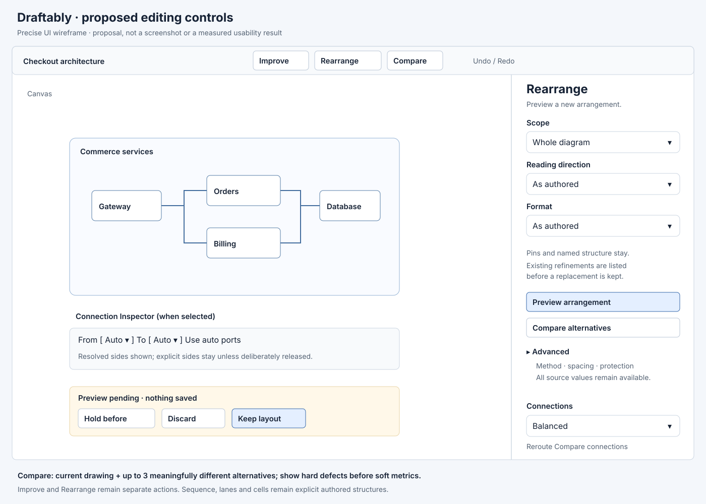
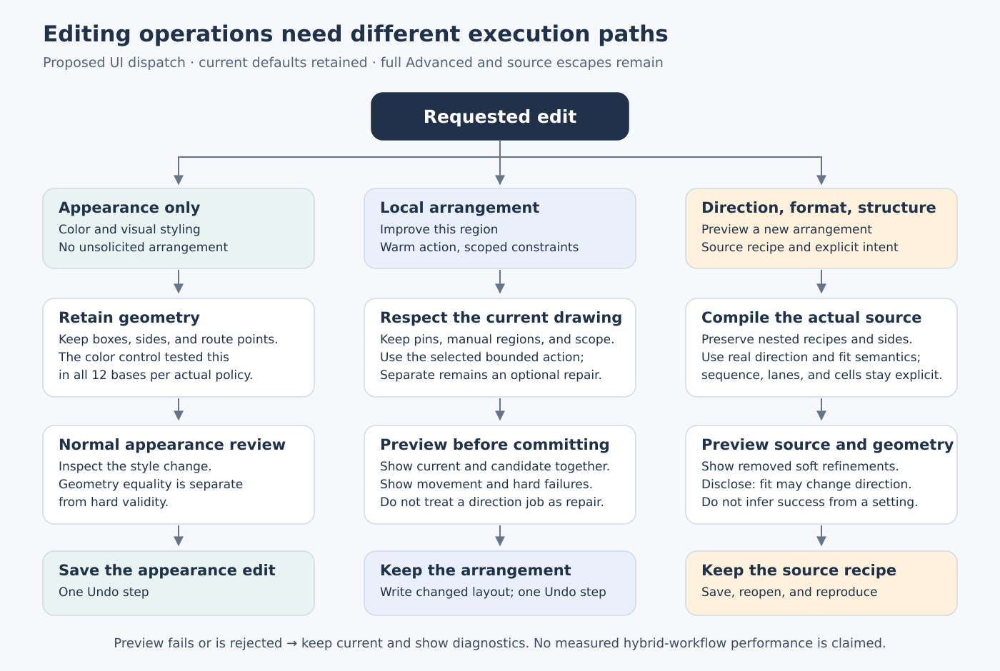

# Editing UI recommendation

Baseline: `f14d9b891adba75de6cc172b190017ea5a5ca091`. Source trace and scripted task model completed 2026-11-01. **Design proposals below are not observations of users.** Measured algorithm and policy acceptance, including the heldout gate, are reported in `report.md` and the data package. This document specifies a smaller UI that preserves current defaults and exposes measured alternatives without deleting specialist machinery.

## 1. Recommended interaction

**Keep automatic rendering of the current source recipe, add a small comparison surface, keep Improve separate from Rearrange, and put authored constraints next to the object they constrain.** Keep an advanced method override and the complete source language. Remove numerical solver costs from the main routing menu. Do not replace saved recipes merely because a file is opened or a label is edited.

This is policy C below. **The completed heldout result does not authorize a new automatic selector or implementation reduction. Keep the current first-render source behavior and existing router defaults.** All frozen reduced cold-layout candidates failed the 95% common-job requirement in at least one preference profile. Build the disclosure and source-round-trip fixes now; offer the frozen six-engine set as an experimental Compare pack, with the complete advanced method pool and all six authored recipes retained. This is a firm recommendation from the completed experiment, not a pending study decision.

The basic Arrange panel has **three configurable fields**:

1. **Scope** — Whole diagram, Selection, This group. Show only applicable choices. Selection is valid for Improve; a source rebuild needs root or one group. One-hop neighbourhood belongs in Advanced.
2. **Reading direction** — As authored, Left to right, Top to bottom. “As authored” leaves existing explicit/nested rules intact. Do not turn a relabel into a new direction decision.
3. **Format** — As authored, Wide, Slide, Square, Page, Tall. A chosen format writes the existing `fit=` intent, including its actual compiler values (`2`, `1.78`, `1`, `0.77`, `0.6`). This does not silently rewrite `aspect=` or pretend an 8:5 ratio is the same as the existing slide fit policy.

Offer three actions: **Improve**, **Preview arrangement**, and **Compare alternatives**. Show the active source recipe read-only beneath Advanced, and show the actual replacement line during preview. Display how many soft refinements a rebuild will remove. Pins, sizes, nested structure, explicit sides, sequence order, and cells are requirements to preserve.

For connections, show **Balanced** plus only the routing alternatives that the development evaluation supports. “Fewer crossings” must be presented as a tradeoff, because routing may spend extra length and bends. “More room” is a proposed label for a validated spacing preset, not a promise that a tight drawing can always accommodate more clearance. Keep **Reroute** and **Compare connections**. Move corner shape to Appearance; keep exact routing values available under Advanced/source.

**Balanced means the existing router default.** Keep it as the production default; the separately frozen routing alternatives are inspectable experiments. The development candidates are exact settings—clearance 4, clearance 22, and port gap 28 with other values at default—not demonstrated universal goal labels. Clearance 22 introduces hard failures on 7 of 24 fixed routing fixtures and on 7 of the 36 layout/base combinations in the joint study. It belongs in an inspectable alternative, never an unchecked “more room is better” default.

**Do not equate a goal with an engine name.** `flow` the recipe, `flow` the engine, `tidy` a selectable engine, Tidy positions the selected-engine bounded action, and the brush's tidy mode are five different paths. The proposed labels separate intent from mechanism.

`renders/ui-wireframe.svg` is a static original design drawing with precise labels. It is not a product screenshot. The miniature diagram is illustrative, and its geometry is not a trial result.

## Completed heldout decision

The common heldout stratum contains **14 bases**, of which the full tested pool is hard-valid on **12**. The frozen 95% relative gate therefore requires 12/12 acceptable bases in every profile; 11/12 is below the threshold. Current authored source is hard-valid on 11 common bases. All bases, including the two with no valid pool result, remain in the absolute denominator.

| Frozen policy | Readable | Compact | Traceable | Stable proxy | Specialist proxy |
|---|---:|---:|---:|---:|---:|
| Preferred five-engine selector with hard-validity guard | 5/12 | 4/12 | 3/12 | 3/12 | 3/12 |
| Six-engine plus authored-recipe oracle | 11/12 | 12/12 | 11/12 | 10/12 | 10/12 |
| Eleven-configuration plus recipe oracle | 10/12 | 12/12 | 10/12 | 8/12 | 8/12 |

These are acceptable-quality counts against the full measured pool, not mere execution success. The guarded selector and the six-engine oracle add zero hard-invalid common cases relative to valid current source, but their quality coverage is inadequate. The oracle is an optimistic comparison pool, not an implemented chooser.

The six-engine experimental pack is **boundary-align, tidy, force, layered, tree, grid**. Its excluded-method witnesses matter: heldout `architecture-05` has an acceptable selected compound-spring preset; `cycles-06` has an acceptable compound-flow RIGHT output; and niche `routing-06` has an acceptable selected flow preset. This is evidence to preserve advanced escapes, not to tune a new pack on heldout. The warm compound-flow `containers-01` witness independently supports retaining that implementation.

Source: `reports/heldout-portfolio-evidence.md`, `data/analysis/heldout/frozen-policy-acceptance.json`, `retuned-policy-summaries.json`, and `portfolio-failure-witnesses.csv` in the same directory. Numerical values and exact frozen methods remain in the evidence package; no new selector was fitted after inspection.

### Routing and joint heldout confirmation

The frozen routing trio has a useful, narrower result: on the current source positions it covers every feasible common job in all five static profiles and all three routing weightings. This supports **Compare connections** with the current result plus clearance 4, clearance 22, and port gap 28. Show the exact changed values and the complete replacement routing line; do not invent a universally good goal label. A custom authored routing line remains Custom until the user deliberately accepts a replacement.

| Frozen choice | Common accepted bases: readable, compact, traceable, stable, specialist | Every profile ≥95% of scoped feasible pool? |
|---|---|---|
| Clearance 4 on current positions | 10, 9, 9, 9, 9 / 12 | No |
| Three-route union on current positions | 12, 12, 12, 12, 12 / 12 | Yes, oracle comparison pool |
| Fixed boundary-align RIGHT + clearance 4 | 5, 6, 9, 9, 9 / 12 | No |
| Frozen three joint combinations | 12, 11, 10, 12, 12 / 12 | No |
| All nine frozen joint combinations | 12, 12, 11, 12, 12 / 12 | No |

Each scope has 14 absolute common bases and 12 feasible ones. The current-position oracle contains the default plus three routes; the joint oracle contains three default-routing layouts plus nine alternatives. These are distinct from the full cold-layout pool. The joint triple's pooled 57/60 is exactly 95%, yet its compact and traceable profiles fail. The nine-combination pool's 59/60 also fails traceable. A pooled percentage must not overrule the separate-profile gate.

Clearance 22 loses six of the 16 currently valid all-base drawings, including five of the 11 valid common drawings, while rescuing two source-checkpoint cases. Clearance 4 and port gap 28 introduce no hard loss on those current positions. Port gap 28 nevertheless introduces one hard loss after force layout; clearance 22 loses seven of 56 valid matched layout/base outputs across the three layouts. Keep these alternatives behind preview. Preset safety depends on the positions it receives.

The route trio reaches 18/18 feasible all-base outcomes in every profile, or 18/24 absolutely. The fixed joint choice is hard-valid on 19/24 versus current source 16/24, with no new current-valid hard failure, but fails practical quality coverage. These are route-only results on completed positions or marked checkpoints. All 243 successful reroutes preserve the document outside routing settings, and all 318 canonical output/reference geometry signatures verify. The 205 hard-valid route outputs have a derived compile-plus-route-worker sum within 15 seconds; that component sum is not a measured cold end-to-end render. Keep the production router default and preserve the original cold timeout outcomes.

Evidence: `heldout-routing-findings.md`, `heldout-routing-decision.md`, and their `data/analysis/*heldout*` tables. Routing uses empty external history here; the static stable profile is the frozen balanced-defect proxy. The genuine shared-history and incremental-edit tests remain separate.

The final independent arithmetic review reproduces all 2,112 policy/job records, all 330 main summaries, all 39 direct-pair summaries, and 96 representative uncertainty fields from canonical raw results, with no discrepancies. It independently repeats the 318 geometry-signature checks and 243 document-preservation comparisons. See `data/analysis/heldout-routing-review.json`; the earlier design-only review remains separately available.

## 2. Exact current surfaces and proposed changes

These counts are inventories, not a sum of independent choices. Most registries overlap. “Hidden” means a control moves behind disclosure or to source; it does not mean its implementation is deleted.

| Surface | Current source fact | Proposed policy C |
|---|---|---|
| Basic Layout lab fields | 4: Diagram type, Scope, Direction, Target aspect | 3: Scope, Reading direction, Format |
| Basic Diagram type options | 3 aliases: Flow→compound-flow, Nested architecture→boundary-align, Compact grid→grid; Custom appears conditionally | No algorithm alias picker; active recipe remains visible read-only |
| Basic scope options | 5: auto, all, selection, neighbourhood, container | Up to 3 contextual choices; neighbourhood in Advanced |
| Basic direction options | 2 | 3 including As authored |
| Basic aspect/format options | 6 ratios including canvas | 6 purpose labels including As authored; raw ratios remain Advanced/source |
| Underlying LayoutSettings keys | 24 including algorithm and invocation mode | Retain implementation keys; source-safe applicable controls disclosed |
| Unique Layout lab setting inputs | 23; mode chosen through actions | No claim of implementation deletion; advanced inputs conditional on actual run path |
| Engine IDs | 11 in model; 10 source rebuild engines | Retain all 11; six-engine experimental Compare pack; all methods Advanced/source where applicable; separate stays a repair action |
| Default Compare candidates | 6 generated alternatives, no dedicated current-result card | Current result plus up to 3 materially different generated alternatives |
| Main routing sliders | 9 | 0 numerical costs; one preset selector |
| Advanced routing sliders | 2 | All meaningful exact source values accessible in one advanced section, not just the former two |
| Source routing parameters | 12 | Retain all 12; `standoff` remains available and radius moves to Appearance |
| Explorer routing axes | 11, excluding standoff | Advanced experiment registry should match the 12 public source keys, with appearance-only radius labelled |
| Brush controls | 5 visible, plus internal step | Keep advanced local tool; radius/mode immediate inside tool; strength/softness disclosed |
| Source recipes | 6 named, plus implicit defaults | Preserve all 6; explicit specialist structure remains accessible in source |

**Arithmetic:** basic layout input fields fall from 4 to 3 (25%); main numerical routing sliders fall from 9 to 0. Generated default alternatives fall from 6 to at most 3, while a new current-result card makes at most 4 cards visible. These are different denominators and must not be collapsed into a single “configuration reduced by X%” claim.

The basic panel's enumerated option values change from 16 (3+5+2+6; excluding conditional Custom) to at most 12 (3+3+6). Some choices are contextual or unavailable, so this is an upper-bound menu inventory rather than a required decision count. The reduced terms do not prove faster or more satisfying use.

Source: `src/components/LayoutLab.tsx` (`DIAGRAM_APPROACHES`, `APPROACH_CONTROLS`, `LayoutLab`); `src/components/Menus.tsx` (`ROUTING_FIELDS`, `ADVANCED_ROUTING`, `RoutingMenu`); `src/state/comparison.ts` (`DEFAULT_ALGORITHMS`, `defaultConfig`); `src/engines/explorer-engine.js` (`LAYOUT_PARAMS`, `ROUTE_PARAMS`); `src/model/types.ts` (`LayoutSettings`, `RoutingSettings`); `src/dsl/syntax.ts` (`ENGINES`, `ENGINE_PARAMS`, `ROUTING_PARAMS`).

### Main, advanced, source, internal

| Destination | Controls/actions | Why |
|---|---|---|
| Main editing | Improve; Preview arrangement; Compare; scope; direction; format; Undo | User intent and reversible commitment are immediate tasks |
| Context inspector | Pin; exact size; group membership; explicit From/To sides; Use auto ports; reorder cells; collapse | Constraint is visible where it applies |
| Advanced arrangement | Named engine, root, long-run wrapping, separate within-rank/between-rank/group spacing, manual protection, local scope, presets | Specialist intent has a concrete escape hatch |
| Advanced connections | Exact clearance, standoff, port/edge spacing, penalties, passes, and history policy only where it is actually active | Preserve diagnostic and niche value without requiring routine numerical optimization |
| Appearance | Square/Rounded corners with exact radius if needed | `cornerRadius` changes the SVG path rounding, not routing topology |
| Source | All six recipes, nested recipe selection, order/near/align/pin/stay/size, feedback constraints, exact engine/router values | Source owns deterministic meaning and reviewable changes |
| Internal implementation | Automatic iteration budgets, hierarchy passes in presets, route history capture, candidate deduplication, local-search flags, cache keys | Numerical mechanism does not need a main control |
| Advanced local tools | Timeline, brush modes, restore reference, session holds, scratch checkpoint | Warm editing is a distinct useful job; cold portfolio dominance cannot justify deleting these |

One generalized Spacing slider is insufficient to replace every gap: `nodeGap`, `rankGap`, and `groupGap` operate along different dimensions; `portGap` and `edgeGap` also interact but are not identical. Main UI can use a preset, while Advanced retains dimensions with plain labels: **Between shapes**, **Between stages**, **Between groups**, **At endpoints**, **Between lines**.

## 3. Three viable policies

| Policy | Operation | Benefit and cost |
|---|---|---|
| A. Current disclosed expert controls | Existing 4-field basic panel, algorithm list, conditional sliders, six-candidate Compare, 9 main routing sliders | Broad direct access and no migration; several visible values do not affect file mode as presented |
| B. Goal presets | Readable flow, Compact overview, Relationships; direction, format, scope; Advanced methods | Three plain goals group intent; adds a goal decision even when the default works, and some users' tasks span goals |
| C. Automatic plus Compare | Current recipe/default, three basic fields, up to three alternatives, advanced override | Lowest routine mechanism choice; requires an honest fallback when the pre-layout selector misses an acceptable result |

Policy B is viable and should remain the alternate proposal. It is not automatically superior merely because its labels are friendlier. On the declared scripts, its extra goal/preset and preview acceptance decisions outnumber those of the existing UI. Policy C offers the strongest reduction in mechanism selection while retaining specialist controls.

### What measured behavior already changes in the design

| Measured development evidence | Design consequence | Evidence artifact |
|---|---|---|
| Cold `ordering` alternatives produce no >1 px change on 11 comparable bases; warm alternatives change 4 of 12 | Hide the ineffective cold choice; keep the warm control and its source distinction | `data/analysis/control-layout-summary.json`, `control-warm-summary.json` |
| Corner radius changes rendered paths on 23/24 fixtures and changes no polyline geometry | Move it to Appearance; never call it dead from route-score equality | `data/analysis/control-routing-summary.json` |
| Fixed routing presets cover 63/69 feasible fixture×weighting jobs in hindsight; joint nine-combination pool covers 54/55 feasible profile jobs, but the fixed three combinations cover only 36/55 | Separate a comparison pool from a deployable pre-layout choice; three cards are a disclosure limit, not evidence that three computations suffice | `routing-policy-proposal.json`, `joint-policy-proposal.json` in `data/analysis/` |
| The 132 native warm passes include a compound-flow traceability witness on `containers-01` that the remaining ten engines and retained current miss within the practical bands | Preserve the warm implementation even if cold selection omits it | `data/analysis/control-warm-engines.json` |
| On applicable E warm jobs, tidy, group-aware, and separate are all 33/37 valid on ordinary local edits, plus 12/12 unchanged color controls; separate's apparent extra raw success is a global-direction diagnostic that keeps the old orientation | Do not replace a direction/fit rebuild with a bounded repair or market Separate as completing that direction task | `data/analysis/edits-development-applicable-summary.json` |
| All 12 color controls per policy keep exact geometry; the current source still has one unchanged invalid drawing | Retain positions on appearance-only changes, but do not confuse no movement with validity | `data/analysis/edits-development-color-controls.json` |
| Fourteen original scope attempts are explicitly unsupported cross-parent jobs; 44 later supported-scope outputs have zero pin/scope violations | Disable unsupported selections before execution; keep supported scope as a meaningful constraint | `data/analysis/control-warm-failure-partition.json`, `control-warm-targeted.json` |

These are measured algorithm/API properties. They do not establish user completion time, preference, or the usability of the proposed labels. The full current source pool and the specialist escapes remain available. The completed compact-selector evaluation failed the replacement gate.

### Why not one universal engine?

A graph method does not encode sequence timing, lane ownership, field spans, or explicit endpoint sides. Those remain authored structure. A warm tidy operation also depends on the arrangement that currently exists. A small cold portfolio can serve automatic comparison without replacing these paths. The exact retained methods must follow the measured portfolio selection, not the interface's number of cards.

### A failed candidate is still a result

- Keep the current drawing visible when candidate generation fails or times out.
- Show hard defects before crossings/area: missing objects, blocked routes, violated pins/sides/scope, or invalid structure cannot be “best” because of a soft metric.
- Give each alternative a difference sentence: “fewer crossings; longer routes”, “smaller area; more bends”, or “keeps more positions”. Use actual data, not a stock badge.
- Deduplicate genuinely equivalent results (documented geometry tolerance and identical constraints), but retain the underlying method in Advanced if it has a witness elsewhere.
- Show fewer than three alternatives when only one is materially different. Do not fabricate a full grid by relabelling identical geometry.
- Keep the baseline as an explicit candidate. A selector may recommend keeping it.

## 4. Scripted job effort

These are **source-grounded, declared scripts**, not executed user journeys or user completion measurements. Each step is one logical activation or field assignment, including opening a menu or disclosure. Selecting a dropdown value counts once; pointer travel, render time, reading time, keystrokes within a text edit, and satisfaction are not estimated. Required decisions count the task-specific choice plus accepting a preview when present. Manual configuration attempts count explicit algorithm/low-level numeric/source assignments under the stated strategy; zero does not mean zero thought.

Strategy: start with an open valid drawing, no pending preview, and no unnecessary menu open. Accept the first proposed change only if it meets the task; otherwise keep/discard it and report a retry. The table describes only the first prescribed attempt. The experiment has not established actual retry counts, so **success is not implied**. A sensible route escalation would stop after two unsuccessful preset attempts and offer Compare or a local authored edit; that is a proposed policy, not a measured tuning result.

| Job | Current steps / decisions | Goal steps / decisions | Automatic+Compare steps / decisions |
|---|---:|---:|---:|
| J01 First architecture render | 0 / 0 | 0 / 0 | 0 / 0 |
| J02 Shorten a long pipeline | 8 / 3 | 5 / 3 | 4 / 2 |
| J03 Change reading direction | 5 / 2 | 4 / 2 | 4 / 2 |
| J04 Remove a crossing, positions fixed | 3 / 1 | 4 / 2 | 4 / 2 |
| J05 Space crowded fan-out | 5 / 3 | 4 / 2 | 4 / 2 |
| J06 Preserve a hand-tuned region | 4 / 2 | 4 / 2 | 4 / 2 |
| J07 Fit a slide with existing `fit=` semantics | 3 / 1 | 4 / 2 | 4 / 2 |
| J08 Choose a hierarchy root | 8 / 3 | 6 / 3 | 6 / 3 |
| J09 Arrange an undirected network | 6 / 2 | 4 / 2 | 3 / 1 |
| J10 Obtain a sequence arrangement | 3 / 1 | 5 / 2 | 3 / 1 |
| Total for these ten equally weighted scripts | **45 / 18** | **40 / 20** | **36 / 17** |

The manual configuration attempt totals are 10, 3, and 3 respectively. The counts are reproducible from `data/ui-task-proxies.json` and `evaluation/build-ui-artifacts.py`; each row includes its full action path and starting-state assumptions. Totals describe this task list, not user frequency.

J01 explicitly gives no credit for simplifying an already automatic first render. J04 adds a preview in the proposed flows and therefore takes one more step than the current immediately applied preset. J07's current shortest path edits source because the present aspect picker does not expose `fit=slide`. J10 stays source-driven in policy C: a new sequence chooser is optional future scope, while the current source escape hatch preserves the specialist task. These counterexamples are included to avoid defining “less UI” as an automatic win.

### Technical terms proxy

A reproducible vocabulary inventory is a better claim than a fabricated cognitive score:

- Current basic panel has two mechanism-oriented labels, **Scope** and **Target aspect**; proposed C keeps Scope and replaces the latter with Format.
- Current routing menu requires encountering **crossing cost**, **bend cost**, **lane separation cost**, **port spacing**, **fan-out**, and **previous-side stability** when its expanded fields are scanned. Advanced additionally exposes shared-path cost and passes.
- Policy C's routine route choices are outcome descriptions. The technical terms remain available in Advanced/source because an expert needs exact explanations.

This is an inventory of labels, not a validated measurement of comprehension. Domain words such as “hierarchy”, “sequence”, or “crossing” can be meaningful to the target user and should not be deleted solely to reduce a term count.

## 5. Task walkthroughs and required behavior

This precise workflow diagram is a proposal, rendered by `evaluation/render-editing-workflow.py`. Its source, SVG, and PNG are included. The color-control annotation refers to the executed per-split 12-base negative controls; the combined workflow has not been measured as an integrated policy.

### First architecture render

Compile source with its existing recipe/default. The user can view and edit immediately. Rearrange may show an automatic candidate from the frozen portfolio, but it must not rewrite the file on open. The default source path and the selected-engine JSON pass are different baselines; preserve that distinction in telemetry and tests.

### Shorten a long pipeline or fit a slide

Choose Format: Slide, preview, inspect the wrapped reading order and route labels, then Keep. The compiler's `fit=` search considers directions and fold choices. If the user explicitly fixed reading direction, explain whether fit is allowed to try the other direction; avoid silently overriding a constraint-looking control. The minimal implementation can retain current fit semantics and label the field “Best fit, may change direction”; a stronger direction-preserving fit mode is separate product work.

This is a demonstrated issue, not just a possible conflict: the `presentation-03` development edit requests `direction=down fit=wide` and returns the exact earlier node arrangement. The source fit search tries both directions. The projected layout-tool setting is not a reliable substitute for geometry: ordinary recipe layouts keep its default even when the compiler draws downward (`project.ts` copies direction only for a root engine). Show the actual preview and the fit tradeoff. A future direction lock must have a defined source contract and replay tests before the UI promises it.

For a nested long group, keep `group fold=never` available. A large group that must remain in one column is a legitimate niche, not a defective attempt to game compactness.

### Change reading direction

Choose Top to bottom and preview. This is an intentional global movement, so the preview should not badge large displacement as a failure. Preserve local nested recipe directions and all pins; if those constraints conflict, show diagnostics. Explicit direction can affect endpoint side choices as well as node positions because `project.ts` writes per-edge flow guidance.

Dispatch this request to a source rebuild. Do not run bounded Improve/Separate as its implementation: a tidy pass can be limited by its movement cap, while Separate has no directional arrangement objective. The E experiments retain those raw diagnostic outputs, but the proposed workflow excludes them from claimed direction-task success. Likewise, do not substitute zero side churn for evidence that the requested reorientation occurred.

### Remove one crossing

Try the evaluated Fewer crossings route preset only when positions should remain fixed. Show route length/detour and bends alongside the crossing change. If the best route is a large hook or outside loop, let the user keep the honest crossing or reorder/move one node. Source `order`, `near`, and explicit sides remain first-class remedies.

### Space crowded fan-out

Use the measured More room preset if it offers a real improvement. If it only moves congestion or cannot fit the requested gap, report the deficit. Advanced separates endpoint spacing from parallel-line spacing. Local scope movement may be the real fix; do not have the router conceal insufficient layout room with a disproportionate detour.

### Preserve hand-tuned work

Pin the region that must remain exact, select movable neighbours, and Improve. Soft manual markers and hard pins have different semantics. A Pin control must say what it protects. The selection/scope summary must identify when a pinned descendant anchors a whole group. Save a warm result as an arrangement, with `stay` writeback and surrounding anchors, not an engine recipe that cannot replay the warm result.

### Obtain specialist hierarchy, network, sequence, lanes, or cells

A selected root remains available for Tree. An undirected relationship graph can use the accepted network candidate. Sequence, lanes, and cells remain explicit source structures with specialized rendering; never infer them solely from degree or node count. Lanes require owner groups; sequence uses message order; cells use spans and touching geometry. Removing their source syntax would be a semantic capability loss even if an ordinary engine had a lower area score.

## 6. Source round-trip, undo, preview, and scope

**Keep the two current writeback paths.** Cold source rebuilds save a `layout` recipe. Warm passes, brush strokes, and kept timeline steps save arrangements. `writeArrangement` fits frames first, skips pinned objects, writes changed parent-local stays, and the file session anchors surroundings. The proposed UI should explain this through the result and source diff, without requiring a lesson in solver state.

- Preview: no persisted source change until Keep; Discard restores prior geometry. Hold before and keyboard access remain.
- Undo: one source edit per kept candidate; route changes should have the same preview/commit semantics as layout changes. Layout preferences currently save without an undo step; do not confuse changing a preference with applying a layout.
- Scope: file rebuilding can store only root or one container. Selection-only repair uses arrangement writeback. The interface should disable the unsupported choice before a compute action instead of offering it and failing later.
- Compare: freeze one baseline, one prior route state, and one candidate source context. Application must reject stale baseline identity, as it does now.
- Source: preserve unrelated lines and comments. Preserving an existing `fit=` attribute is a concrete requirement: current `setLayoutRecipe` preserves only min-width/min-height among common attributes and drops fit.
- Manual recovery: show the count and kinds of soft refinements to be removed. Do not remove pins, required alignments, sizes, nested recipe lines, or explicit sides as a side effect of a generic goal.

Source: `src/dsl/layout-edits.ts` (`engineAttrs`, `setLayoutRecipe`, `writeArrangement`); `src/state/file-session.ts` (`arrangementEdit`, `sourceScope`, `sourceWithRecipe`, `commitSource`); `src/state/layout.ts` (`runRecipe`, `acceptPreview`, `discardPreview`, `updateLayoutSettings`); `src/state/comparison.ts` (`candidateSource`, `applyCandidate`).

## 7. Controls whose present presentation is misleading

These are **source facts**, not conclusions inferred from quiet parameter sweeps. The final implementation plan includes tests that make each claim concrete.

1. **Cold `ordering=`:** `layeredTarget` enters the ten barycentric sweeps whenever mode is rebuild, regardless of stable/crossings. The warm-pass code path still distinguishes the values. Remove or relabel the inactive source/cold presentation only after targeted equality tests; do not remove the warm behavior.
2. **Raw fold versus compiler fold:** `respectDirection=true` forces the raw engine's local fold to never. The full compiler folds `layered` and packed `compound-flow` later. A single generic “fold works/does not work” result is misleading.
3. **File rebuild settings that do not round-trip:** `engineAttrs` serializes algorithm.controls plus nodeGap/aspect, and direction when DOWN. It does not serialize respectDirection, manual protection, growContainers, pass effort, or canvas aspect. Current file rebuilds are source variants, so those controls cannot mean what a raw warm engine run means.
4. **Fit loss:** changing a recipe through the editor preserves min-width/min-height, but not fit. This must be fixed before promoting Format as a central UI control.
5. **Release fixed port sides in file Compare:** the post-seal applicability probe executed the exact AST-extracted `candidateSource` and `sourceWithRouting` functions with the real parser, settings normalizer, and `setRouting`. False/true emit byte-identical source and retain authored top/left sides, while a scalar clearance change is written. The positive raw Explorer pair makes exactly two router calls and releases those sides when true. All 12 assertions pass with zero layout/compile calls. Remove only this ineffective file-source checkbox; retain the explicit Use auto ports command and the active raw capability. This probe supports a UI applicability correction, not a new quality policy. See `data/analysis/file-auto-ports-probe/result.json` and `evaluation/probe-file-auto-ports.mjs`.
6. **History in file Compare:** the source worker route path does not receive the shared `priorRoutes`. That loses external edit history, but `portStability` can still affect improvement passes because the router passes each current route back as its prior. A zero effect in one cold source sweep would not justify deleting history-aware routing in warm sessions.
7. **Maximum effort and drawing intent in file Compare:** source candidates use the compiler's fixed effort and source semantics. Sidebar values are not serialized into the source candidate. Disable unsupported controls in that path rather than silently accepting them.
8. **Corner radius:** changes rounded SVG paths, not selected sides or polyline points. Treat it as appearance even if all path metrics tie.
9. **Standoff:** has live router consumers but no editor slider or Explorer axis. Its absence is a surface gap, not dead code.
10. **Tidy positions:** calls the currently selected engine in pass mode. A user selecting a specialist engine and then pressing L may get that specialist's bounded action. If the new Improve command always chooses tidy, that is a behavior change requiring paired warm trials, not just a label change.

## 8. Warm tools: what was actually checked

`node baseline/tests/engine-sculpt.mjs` completed successfully in this assignment: **54 assertions passed, zero failed**, plus one timing summary row. `data/sculpt-geometry-results.json` preserves every assertion and recorded detail; `data/logs/engine-sculpt.log` is the execution log. The executed test source makes 15 journey calls and 111 dab calls, including repeats and the timing sample. These are not 126 independent corpus cases.

The suite checks all eleven methods in recorded warm journeys, exact first/final frames, finite bounded checkpoint history, source immutability, deterministic repeated flow history, pinned and held descendants, invocation-only constraints staying out of persisted settings, four moving brush modes, fixed outside-brush geometry, weighted movement caps, no worsened rectangle collisions, missing restore IDs, pinned container protection, and 80 successive dabs. Twenty branch-fixture dabs measured 0.18 ms median and 0.47 ms highest sample in this environment. That does not establish a desktop frame-rate or UI interaction budget.

This supports retaining the warm tools while simplifying their discovery. It does **not** validate pointer events, keyboard focus, dragging, source saves, undo, or route stability for every proposed UI. Those require the product browser proofs and the incremental stage in the main report.

The separate, unchanged baseline browser proofs did run in this assignment. `scripts/prove-layout-tools.mjs` passed **15/15** checks, including real Compare application, Improve/save, timeline/save, brush/save, an external addition, distant-region preservation, and restart/CLI geometry agreement. `scripts/prove-file-session.mjs` passed **22/23** checks, including drag, resize, pin, source undo/redo, invalid-source handling, and stale-save refusal. Its failed check was that back navigation actually restored a cached page; the later reconnect/catch-up checks passed. The fallback headless Chromium environment leaves that cache-lifecycle assertion unresolved. These results support the existing editing contract; they do not test the proposed disclosure design or establish human task completion. See `data/logs/prove-layout-tools.log`, `data/logs/prove-file-session.log`, and `evaluation/runtime-notes.md` for the exact execution and environment limits.

### Heldout edit evidence and the proposed dispatch rule

The heldout edit experiment completes 358 of 360 actual edited-output trials, plus all 12 state-preparation trials. The two timeouts are warm tidy and group-aware attempts; they remain failed outcomes. The 480 analysis records additionally include raw and guarded views of the same 120 cold proposal executions. They are not 480 independent experiments.

| Comparable question | Development ordinary validity | Heldout ordinary validity | Heldout color controls |
|---|---:|---:|---|
| Current source, four edits per base | 44/48 | 42/48 | 10/12 valid; 12/12 exact geometry |
| Fixed force source, hard-only guard | 44/48 | 44/48 | 11/12 valid; 12/12 exact geometry |
| Frozen feature source selector, hard-only guard | 44/48 | 44/48 | 11/12 valid; 12/12 exact geometry |
| Warm tidy, applicable local edits | 33/37 | 27/37 | 10/12 valid; 12/12 exact geometry |
| Warm group-aware, applicable local edits | 33/37 | 27/37 | 10/12 valid; 12/12 exact geometry |
| Warm Separate, applicable local edits | 33/37 | 29/37 | 10/12 valid; 12/12 exact geometry |

Each cold proposal uses one measured hard-only fallback on heldout. Raw proposals are 43/48 valid; the fallback restores the one current-valid loss. Movement is recomputed against that policy's own pre-edit output. This local-edit benefit does not override the failed static common-job replacement gate. Warm applicable denominators exclude 11 requested global direction/format diagnostics and include four specialist compiler escapes; they must not be described as 37 raw-engine invocations. Completed outputs preserve the stated pin/scope constraints, yet routing and other hard failures remain.

Separate's raw heldout total is 47/60 valid versus 43/60 for tidy. Only two of those four apparent rescues are applicable local jobs: ordinary local validity is 29/37 versus 27/37. A bounded pass keeping the previous orientation does not complete a global direction request. The proposed UI dispatches local changes to a reviewable repair, direction/format to actual source rearrangement, and color to retained geometry. This combined workflow is a design proposal; the separate cold and warm experiments are not pooled into a fictitious measured hybrid policy.

All 12 color outcomes per actual policy preserve exact boxes, selected sides, and route points. An unchanged invalid baseline remains invalid. Movement differences are descriptive on completed geometry; quality comparisons require both outputs valid. Whole-base bootstrap intervals preserve the five-edit bundles. Heldout feature-selector versus current stable-score change is −4.246 with 95% base interval [−12.079, 1.296]; the interval does not establish a population-wide improvement. The applicable warm Separate comparison has its own denominator and paired table.

Evidence: `edit-findings-development.md`, `edit-findings-heldout.md`, `data/analysis/edits-heldout-applicable-summary.json`, `edits-heldout-applicable-paired.json`, and `edits-heldout-verification.json` (478/478 available effective and reference geometry derivations verified). The frozen E analyzer incidentally indexed the partially complete routing stage in its broad reference catalog; none of its 480 records uses those routing IDs. The disclosed read-scope deviation is recorded in `edits-heldout-reference-read-scope-deviation.json`; it changed no policy, metric, or E reference.

The independent heldout E review reproduces 744 paired-count, base-mean, and 2,000-draw interval fields exactly; verifies 398 distinct output/reference geometry signatures; and confirms both hard-only fallbacks and every color-control count. See `data/analysis/heldout-edit-review.json`. Review arithmetic is separate from a human usability evaluation.

## 9. Acceptance and shipping boundary

- A new automatic default must retain at least 95% of acceptable common-job heldout coverage, preserve specialist support through an explicit escape hatch, and add no hard-defect case where today's policy was valid. Use the report's exact base counts; do not count trials as people.
- The gate failed. Ship disclosure/round-trip fixes and a smaller Compare front page, retain the current source and router defaults, and keep the six-engine pack experimental. Preserve all 11 internal engines and all six recipes; the heldout evidence does not support deletion.
- Do not delete any implementation solely because it is absent from the default panel, loses an average score, or appears inert without its required warm state.
- No compatibility layer is part of this design. Existing source remains valid. Actual removals require a named loss and a test-backed replacement.
- Document any unsupported control at the interaction point. The user should never have to infer from an unchanged image that a control was ignored.
