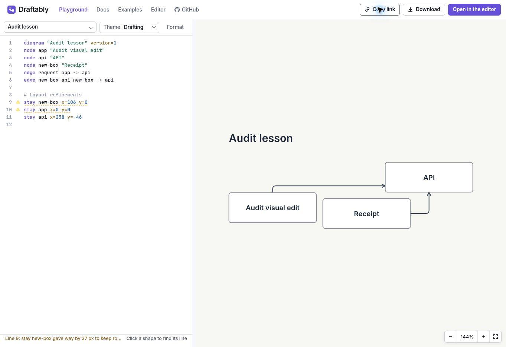

# Draftably — deep usability audit

**Published experience:** https://byronwall.github.io/draftably/  
**Audit date:** 30 October 2026 UTC  
**Source baseline:** [`ca96d3babd05041aaa206509090d023b02b61b5b`](https://github.com/byronwall/draftably/tree/ca96d3babd05041aaa206509090d023b02b61b5b)  
**Mode:** Review and plan only. No implementation, repository edits, commits, deployment, or publication of diagrams.


**Late access update (~03:15 UTC):** During final verification, reloading the GitHub Pages Playground and landing routes redirected this browser to `draftably.dev`, where an upstream connection timeout prevented further validation. The observations below describe the earlier tested session; the current deployment has not been revalidated. See [E51](evidence/E51-late-redirect-timeout.jpg), [E52](evidence/E52-late-landing-redirect-timeout.jpg), and [session notes](evidence/session-notes.md). This is an access limit, not a claim of permanent outage or proof of the earlier failures' cause.

**Before implementation:** Reproduce the prioritized failures against the active deployment and record any already-resolved IDs. The fixed source baseline and earlier browser receipts remain the basis of this review; a new origin is not assumed to share identical behavior.


## Executive assessment

**Draftably demonstrates a useful product, but its advertised journey is not dependable enough yet. Fix continuity and retention before expanding the interface or rewriting the documentation.** The strongest parts already work: immediate source-to-diagram feedback, expressive diagram families, recoverable inline syntax errors, direct visual editing, layout alternatives with an explicit Apply step, Undo, and an editable SVG round trip. The weakest parts sit at transitions: entering Editor from the landing page, entering Playground from docs, starting a new document from an example, and deciding what an exported image actually contains.

Four **P1 findings** deserve the first repair cycle. These are tested failures, not aesthetic preferences:

1. **F01 — Ordinary Editor links can change the address while leaving the landing page displayed.** The hero continuation failed twice, including a fresh-session repeat; the main CTA also failed. Direct entry or refresh loaded Editor.
2. **F02 — Two Docs → Playground transitions produced a persistent blank surface with failed dynamic-module imports.** Direct navigation/reload recovered. A later landing SVG import successfully reached Playground, so this is a path/session-dependent observation, not a claim that Playground is universally unavailable.
3. **F03 — New from an example promises browser saving but does not establish a durable new document.** A disposable blank draft renamed during the test disappeared on refresh; Checkout returned. The misleading confirmation makes this more serious than ordinary scratch-mode behavior.
4. **F04 — An invalid-source SVG export combines the last valid picture with the current invalid source.** This was verified in the actual downloaded SVG metadata. An image that advertises editability must preserve a coherent revision.

The highest-value P2 work follows these repairs: preserve edited landing source across handoff; contain and restore focus in docs overlays; allow Space to activate Editor buttons; explain storage and file contracts where decisions occur; and provide a complete browser-first lesson. Narrow-layout risks are significant in source, but **390px and 768px behavior remains untested** because the available browser did not expose resizing and security policy blocked the proposed local responsive test page. Those widths have no score and no invented mobile failure.

**Preserve the product's strengths.** A source diagram traveled from a docs example through Playground and Editor, gained a renamed node, a new node, a new connection, and layout refinements, then exported and reopened through the landing page with all three nodes and two edges. Compare layouts generated six candidates, clearly labeled the view as preview-only, applied Spring network, and successfully undid that change. These are concrete reasons to repair the product's transitions rather than replace its core model. See [E23b](evidence/E23b-editor-three-shapes.jpg), [E31](evidence/E31-reopened-svg-source-and-preview.jpg), [E35](evidence/E35-layout-comparison.jpg), and [E38](evidence/E38-layout-undo.jpg).

There is deliberately **no overall numerical average**. A good rendering score does not compensate for a broken primary entry or an incorrect saving promise.

## Reading this report

- **Observed:** visible browser behavior, a directly inspected UI artifact, or content actually read. Repetition and scope are specified; one occurrence is not a frequency estimate.
- **Heuristic:** professional assessment of discoverability, clarity, burden, or likely user effect. No real-user comprehension or completion rate was measured.
- **Inferred:** a source-backed explanation or risk that was not independently established as the deployed cause.
- **Proposed:** recommended future behavior and acceptance checks. None was implemented.

Severity follows the brief: P0 unsafe/total failure; P1 primary journey blocked; P2 recurring friction/exclusion; P3 local friction; P4 refinement. No P0 is assigned. F08 is a **provisional P2 validation item**, not a tested mobile defect. F15 is an **unranked open question** about clipboard feedback.

The companion [prioritized-fixes.md](prioritized-fixes.md) turns findings into Build/Explore/Defer/Avoid decisions. [repair-plan.md](repair-plan.md) sequences independently reviewable changes in the actual modules. The ZIP contains this report, both companions, and the evidence files referenced here. Relative evidence links are intended to work after extracting that bundle.

## Access, method, and preservation

**Observed access.** The public landing page, docs, Playground, and full Editor were operated in a real interactive cloud Chrome browser. Actions included pointer activation, text selection and typing, keyboard navigation, menu/dialog use, example search, layout application, Undo/Redo, downloads, file-picker reopening, refresh, and Back/Forward. This was not an HTML-only or screenshot-only review. The connected browser extension initially timed out; the independently requested public-site interaction continued in the available interactive cloud browser.

The actual desktop viewport was **1363 × 936 CSS pixels, DPR 1**, verified through a read-only browser query. The browser offered no viewport-resize capability. Attempts to use ordinary browser keyboard controls did not establish a different viewport. A local responsive harness was blocked by the browser's URL policy and was not executed. No alternative mechanism was used to evade that block. A browser with authorized resizing, or a separate recorded run at 390px and 768px, is the smallest missing capability for that part of the brief.

**Source access was confirmed separately.** The connected GitHub repository returned the exact requested commit and recursive tree. The review team examined **78 complete files and one partial file, 79 distinct files total**, including all **37 explicitly named files** in the brief. Initial live discovery preceded implementation reading. Source specialists then reviewed the fixed baseline while browser tasks continued. **Equality between the published deployment and the baseline is unverified.** Two failed lazy-load requests contained different hashed Playground filenames; this supports recording a delivery problem but does not by itself prove a stale deployment or cache cause.

**Preservation.** Mutations used disposable source examples and audit diagrams. The plain `/app/` document was inspected and an export was attempted without changing its diagram content. Its visible title, labels, and counts matched the shipped Automatic ports fixture; this did not prove that every stored property was pristine, so it was not replaced. No account, local CLI workspace, existing personal diagram, or deployed content was modified. Audit reports and evidence are the only created deliverables.

**Evidence handling.** Screenshots were paired with accessibility snapshots and, where relevant, console messages or exported bytes. Some early snapshots are diffs, useful for focus/URL changes but not complete transcripts. Some immediate screenshots captured an earlier paint; the index identifies stable replacements such as E18b, E23b, E24b, and E48b. Console errors from the browser extension are excluded from product findings. No timings shown by the application are treated as independently measured task duration or performance benchmarks.

## Audience assumptions and product contract

**Assumption A — developer/documentation author.** The likely core user is comfortable reading short source files and wants diagrams that can be versioned, reviewed, regenerated, and adjusted with a coding agent. The landing copy, `.draft` format, CLI, change marks, and agent skill support this interpretation. It remains an assumption about the intended audience, not a demographic finding.

**Assumption B — occasional visual collaborator.** A second useful audience can read a diagram and make a label, connection, or layout change but may not understand a DSL, layout engine, browser-storage slot, or local file server. The hosted Editor invites this person in. A usable product should explain the few distinctions needed to retain work without requiring repository knowledge.

**Heuristic.** The strongest differentiated promise is readable source plus meaningful visual control: diagrams that live with code, reviewable changes, layout choices, and images that can carry their source. The landing headline communicates automatic layout well. The next step should clarify why Playground and Editor exist: Playground edits source and inspects the result; Editor makes visual changes to the same work. Their current labels do not establish the saving contract.

**Proposed coherent journey.** Start with an editable small example → change a label → introduce and repair an error → continue with the current source in a larger surface → add/connect and choose a layout → explicitly retain an editable copy → reopen the same work. Local CLI and agent workflows should branch from this success, with their own save-to-file contract, rather than be prerequisites to the browser lesson.

## Inventory and coverage

### Population and sample counts

| Population | Inventory | Actual sample and limit |
| --- | --- | --- |
| Product surfaces | Landing, Docs, Playground, Editor: 4 | All 4 operated interactively. Site and Editor are separate builds. |
| Docs topics | 20, in 5 groups | All 20 visited and visible main prose inspected; selected tasks exercised deeply. This does not mean every anchor or live block was edited. |
| Public source examples | 25 plus Blank starter | 7 complete catalog examples opened/rendered in Playground or Editor: Checkout, Sign-in, Order lifecycle, Kubernetes, TCP header, Billing schema, Support triage. Blank and custom audit diagrams additionally edited. |
| Landing sample surfaces | 4 hero tabs, 8 gallery cards, 3 feature demonstrations | Hero Checkout edited twice; gallery inventoried; Restyle/Blueprint operated. Gallery thumbnails are not counted as full example-task executions. |
| Docs live blocks | 13 source blocks, 17 initial theme/diagram variants | Population established from source. One Get started block deeply edited, broken, repaired, copied, expanded and transferred; others inspected as content/rendered examples, not all exercised. |
| Editor layout-test catalog | 13 legacy JSON samples | Catalog inventoried; default Automatic ports inspected live and its source read. Separate from the 25 public `.draft` examples. |
| Repository files | Fixed commit tree | 78 complete + 1 partial; all 37 named paths complete. Full inventory in Appendix A. |
| Example source | 25 public `.draft` files | 9 read completely, selected to span flat flow, groups, sequence, state, dense nesting, bits, cells, emphasis and change marks. |
| Tests/harnesses | 64 top-level files: 61 unit-test files + 3 engine harnesses | 10 distinct unit-test files read. No test suite, local build, dev server, CLI install, or harness executed. |
| Browser/viewport | One interactive Chrome, 1363 × 936 | 390/768, Safari, Firefox, real touch, browser text zoom and screen-reader runs untested. |

### Interaction-family coverage

| Family | Executed | Result / remaining boundary |
| --- | --- | --- |
| Landing first edit | Select label text and type replacement | Visible source and diagram changed; successful no-install first change. |
| Ordinary navigation vs direct entry | Main CTA, hero continuation, Docs/Playground paths, direct app/play, refresh | F01 repeated; F02 twice; direct recovery worked. Not every gallery/nav link independently clicked. |
| Docs retrieval | `export`, `reopen`, `fold=never`; keyboard result activation | 8 export sections; no reopen result; 2 exact-DSL results; keyboard selection reached highlighted Layout engines. |
| Docs structure | Sidebar all topics, previous/next, search deep link and headings | CLI reached via Next; references/anchors inspected. Every individual anchor target not separately clicked. |
| Live docs editing | Valid → invalid unknown node → correction; Copy; Expand | Text error helpful; repair redraws; Copy verified; overlay/stale-context defects found. |
| Playground source | Blank/custom source, invalid recovery, Format, example picker/search | Diagram changes and error recovery work; valid Format preserved current source/diagram. |
| Source navigation/recovery | Example replacement, code Undo, refresh, Docs/Back/Forward | Edited triage survives; Undo restores earlier diagram; picker name briefly disagrees (F14). |
| Diagram navigation | Fit controls on state/dense/cells/triage; docs expanded Fit/Escape | Useful recovery at desktop. Full physical zoom/pan combinations not exhaustively tested. |
| Editor authoring | Double-click label, N box, rename, C connect, selection, Inspector | Three nodes/two connections achieved. Inspector opened with selected-node properties. Group resizing and every property not tested. |
| Layout | Tidy, Undo, Redo; Compare six alternatives, Apply, Undo | Successful. Routing-parameter grid, brush, timeline and every layout engine not comprehensively evaluated. |
| Export/reopen | Source copy; full source-mode SVG export; landing file picker import | Exact copied source and SVG metadata inspected; successful three-node/two-edge reopen. Invalid Playground SVG mismatch verified. |
| Other exports | `.draft` download and plain-browser SVG export attempted | UI/download event reported, but file paths were not readable; no verified byte-level result. Plain SVG reimport inconclusive. PNG not executed. |
| Link sharing | Copy link clicked; source URL update and hash reload tested | URL-based retention works. Clipboard verification remained uncertain; no external sharing or recipient publication. |
| Return/new | Example → New → rename → refresh; plain browser mode inspected | F03 loss reproduced once. Plain browser slot deliberately not overwritten; quota/eviction/multitab races untested. |
| Keyboard/focus | Tab/Shift+Tab, Enter, Space, Escape, source Undo, search Enter | Specific overlay focus and Space failures; no screen-reader or formal conformance verdict. |
| Narrow | Requested 390/768 | Untested due browser capability/policy limit. CSS risks are source-informed only. |

### All 20 docs topics examined

| Group | Topics | Evidence |
| --- | --- | --- |
| Start here (4) | Get started; CLI; Themes; Agent skill | E06/E17–E21; D01–D03 |
| Language (7) | Overview; Rules; Refinements; Themes and colors; Soft groups; Change marks; Emphasis states | D12; D04–D05; D13–D16 |
| Diagram kinds (3) | Swim lanes; Sequence diagrams; Cells | D11; D09; D10 |
| Layout (3) | Layout engines; Routing; Layout tools | E16; D06–D07 |
| Tools (3) | CLI details; Editing in the viewer; Examples | D17; D08; D18 |

## Scorecard — judgments with coverage

Scores are expert judgments from this audit, not survey ratings or statistical measurements. 0 means unusable for the tested purpose, 3 means usable with material friction, 5 means consistently strong in the sampled tasks. Coverage concerns the evidence supporting that judgment.

| Category | Score / 5 | Coverage | Rationale |
| --- | --- | --- | --- |
| Value proposition and first-screen orientation | 4 | Medium | Clear source-to-layout promise and immediate demonstration; audience/mode choice could be clearer. No novice comprehension study. |
| First useful no-install change | 4 | High | Two landing label changes and Playground/doc edits worked immediately. Continuation assessed separately. |
| Cross-surface continuity | 1 | High | Repeated primary Editor entry failure and two blank Playground handoffs. Recovery exists but is not an acceptable ordinary journey. |
| Documentation reference breadth | 4 | High | All 20 topics inspected; precise rules, limitations and useful diagram families. |
| Documentation learning progression | 2 | Medium | Install-first sequence; no complete hosted save/reopen lesson; strong local examples already available. |
| Retrieval and navigation | 3 | Medium | Exact-term results and snippets useful; `reopen` misses; search focus failure impairs keyboard use. |
| Authoring and reversible layout | 4 | High | Rename/add/connect/Tidy/Undo/Redo and comparison Apply/Undo succeeded. Not all advanced tools sampled. |
| Retention and editable-artifact trust | 1 | Medium | False New save promise and mismatched invalid export; valid SVG round trip is a meaningful counterexample. Other storage/format modes incomplete. |
| Keyboard and focus | 2 | Medium | Core paths reachable and focus visible in samples, but overlays leak focus and Space activation is intercepted. |
| Diagram readability and examples | 4 | Medium | Varied families render coherently; dense fit requires zoom tradeoffs; no comprehensive layout-quality or contrast study. |
| Cross-product terminology/modes | 2 | Medium | Editor/viewer, source/browser/local modes, saved/export/download contracts require user inference. |
| 390px / 768px responsive usability | Untested | Low | No actual narrow viewport test. Source risks do not substitute for an observed score. |

## Journey logs

### J1 — First-time visitor: understand value and make a useful change

**Success criterion, defined before the task:** From the landing page, identify the source-to-diagram relationship, change a label without installation, and continue with that same work in a usable editor.

**Starting state:** Fresh landing page, Checkout demo, desktop 1363 × 936. No repository knowledge was used to locate the first edit.

**Actions and observations:** The headline and supporting text describe automatic placement/routing and invite editing. Replacing `Web app` with `Audit portal` changed the diagram. Clicking the hero's Open in the editor changed the URL to `/app/?example=checkout` while Landing remained visible. Back restored the landing URL; the main Open the editor CTA similarly changed to `/app/` without showing Editor. Directly opening the example destination loaded Editor with the stock `Web app`. A later fresh tab repeated the edited hero transition with `Audit second portal`; reload opened stock Checkout and the edit was absent. [E01–E05](#evidence-index), [E40](evidence/E40-fresh-editor-link-still-landing.jpg), [E41](evidence/E41-handoff-refresh-stock-example.jpg).

**Outcome:** First change succeeded; ordinary continuation failed. Recovery to Editor lost continuity with the edited demo. Comprehension was assessed heuristically, not measured with a novice. Findings F01/F05.

### J2 — Learner: retrieve a concept, edit, diagnose, continue

**Success criterion:** Find a concrete reference answer, make and repair a live-example error, copy the current source, and continue the repaired diagram into Playground/Editor without retyping.

**Starting state:** Docs Get started and search, desktop.

**Actions and observations:** Search `export` returned eight sections with snippets; `reopen` returned no result. Exact query `fold=never` returned two sections; arrow/Enter selected Layout engines, with the query in the URL and matching content highlighted. Search Shift+Tab moved focus behind the overlay; Escape then failed until focus returned to Search. The Get started source was replaced with Audit lesson, deliberately referencing missing node `missing`; the line-4 error appeared and the previous drawing remained dimmed. Expand displayed that old drawing without the error context and left keyboard focus under the overlay. Correcting the edge to `api` drew Audit learner → API. Copy returned the edited source. Edit in playground produced a blank page and module-import error. Reloading the encoded URL recovered the correct lesson. Playground's Open in the editor successfully carried it into source-mode Editor. [E13–E22](#evidence-index).

**Outcome:** Retrieval, local editing and correction worked; a primary handoff needed manual recovery. Focus behavior obstructed a keyboard learner. Findings F02/F06/F10/F11/F13.

### J3 — Practitioner: modify, improve, undo, export, reopen

**Success criterion:** Modify an actual diagram, add and connect a shape, improve layout reversibly, inspect/save editable output, and reopen it with the same semantic content.

**Starting state:** Audit lesson in source-mode Editor via the completed handoff; Checkout in a separate disposable example tab for representative nested-layout comparison.

**Actions and observations:** Double-click renamed Audit learner to Audit visual edit. N created a box, renamed Receipt; C connected Receipt to API. Tidy moved a position, Undo and Redo reported the corresponding layout action. Copy Draftably source produced three node declarations, two edge declarations and `stay` refinements. The SVG dialog initially selected only the selected API object; this was visibly indicated and was unchecked for the full export. The downloaded SVG contained current source and all three nodes/two connections. Landing choose a file reopened that SVG into Playground with the labels and edges intact. Layout refinements were present, with notes about yielding constraints; exact pixel preservation was not asserted.

On Checkout, Compare layouts generated six alternatives. The interface said preview-only and kept the original until Apply. Spring network was applied, then Undo restored the prior layout. The six candidates exposed recipes and metrics alongside pictures, a useful expert tool. [E23b](evidence/E23b-editor-three-shapes.jpg), [source](evidence/audit-lesson-copied-source.draft), [SVG](evidence/audit-lesson-export.svg), [E24b](evidence/E24b-source-export-selection.jpg), [E31](evidence/E31-reopened-svg-source-and-preview.jpg), [E35](evidence/E35-layout-comparison.jpg), [E38](evidence/E38-layout-undo.jpg).

**Outcome:** Successful on the tested source/SVG path. The separate invalid-source export test failed revision consistency (F04). PNG, `.draft` downloaded-byte reopening, and plain-browser SVG compatibility are not implied by this success. Findings F04/F09/F12.

### J4 — Return visitor: know what was saved and resume

**Success criterion:** Correctly identify the storage location and recover the promised document after refresh or navigation, without overwriting unrelated work.

**Starting state:** Disposable Checkout example, separately inspected plain `/app/` browser copy, and modified Support triage in Playground.

**Actions and observations:** File → New diagram → Blank diagram displayed a browser-save/Undo confirmation. Acceptance opened a blank diagram while Example Checkout and its URL remained. Renaming it Audit new from example and refreshing returned stock Checkout; Undo was disabled after refresh. No pre-refresh Undo failure is claimed.

The plain browser document displayed Saved. Its matching shipped fixture was left untouched. By contrast, an edited Playground triage label became `Audit ticket`, the URL acquired source content, and reload preserved it. Switching to Sign-in sequence and using Control+Z in the source restored the edited triage source and diagram; the picker still said Sign-in sequence. Navigating to Docs and Back restored triage and a correct picker label. Forward reached Docs; Back again retained the edit. [E26–E29](#evidence-index), [E43](evidence/session-notes.md), [E45](evidence/E45-example-switch-undo-recovery.jpg), [E46](evidence/E46-history-restores-edited-triage.jpg).

**Outcome:** Mode-dependent. Playground URL retention worked; the New-from-example promise failed. Durable plain-browser save, eviction, cross-device recovery and CLI saving were not tested by replacing existing work. Findings F03/F09/F14.

### J5 — Narrow-screen and keyboard user

**Success criterion:** At desktop and requested narrow widths, orient, navigate docs, operate a demo, enter core Editor controls, and maintain visible, meaningful focus with a keyboard.

**Actions and observations at desktop:** Tab reached Editor File and examples with a visible focus ring. Space did not open it; Enter did. Search could be entered and a result opened by keyboard, but Shift+Tab escaped behind its overlay and broke Escape dismissal. Expanded docs content similarly left focus on background controls; its global Escape did close. Example-picker search plus Enter opened Billing and Support triage. Code Undo recovered the prior example. The canvas advertises keyboard commands and exposes named nodes/connections; those accessibility-tree descriptions are not equivalent to a screen-reader test.

**Narrow attempt and boundary:** Actual width stayed 1363; no resize API was exposed. The browser refused the local responsive page by policy. Tests at 390 and 768 were therefore not performed. CSS review identified a possible grid-cascade defect and hidden navigation/status risks, all labeled Inferred. [E15](evidence/E15-search-focus-behind-overlay.jpg), [E18b](evidence/E18b-expanded-preview-hidden-focus.jpg), [E25](evidence/E25-editor-space-does-not-open.jpg).

**Outcome:** Desktop keyboard tasks partially successful with specific barriers. Narrow portion incomplete for a concrete access reason. Findings F06/F07; provisional F08.

## Surface analysis

### Landing: convincing demonstration, unreliable continuation

**Observed.** The first screen combines an explicit promise, short explanation, editable source, rendered Checkout, a main Editor CTA, and a command-copy option. The source is real and responds to label changes. The page later demonstrates change marks, themes and emphasis, offers eight described gallery cards, and explains local-file and agent workflows. Selecting Restyle and Blueprint changed the feature drawing and showed `theme blueprint` beneath it. [E01](evidence/E01-landing-desktop.jpg), [E02](evidence/E02-landing-label-edited.jpg), [E48b](evidence/E48b-landing-blueprint-visible.jpg).

**Heuristic.** This is more credible than a static hero illustration: the visitor can verify cause and effect. The concise point demonstrations and described gallery are worth preserving. The first Checkout example is moderately complex—six nodes, three nested groups and five edges—so it shows power while asking a new reader to infer several language concepts. A clearly signposted first edit would reduce that burden without flattening the examples into trivial diagrams.

The page presents Playground and Editor as peers without explaining their roles at the point of choice. The main CTA leads to plain browser mode, while the demo continuation leads to example mode. That distinction materially changes persistence. A visitor should not need to discover it after making an edit. F01 and F05 are the immediate behavioral repairs; role and saving language should then explain the repaired behavior.

**Proposed.** Keep the first-screen editable demonstration, offer one visible suggested change, and make Continue with this diagram carry the current source. Add a short role explanation beside the two relevant routes. Explain local installation as the choice for files on disk; preserve the copyable commands and Node prerequisite without presenting installation as necessary for the hosted demo. Avoid unsupported claims that this is categorically better than every familiar diagram tool; demonstrate its concrete source, review and editable-export advantages instead.

### Docs: strong reference, incomplete hosted lesson

**Observed.** All 20 topics have a common sidebar, current topic/breadcrumb, and previous/next structure. Search provides section snippets and exact-term matches. Code copy and live examples are real. Get started opens with installation and a local `architecture.draft` exercise; opening the editor is explained through a local server and saving back to that file. The hosted Playground link exists within the example rather than defining the main lesson. CLI details uses repository-style `pnpm draftably` examples while the guide explains `npx`/installed commands. These are different contexts that need explicit labels. [E06](evidence/E06-docs-get-started.jpg), [D01](evidence/D01-cli.txt), [D17](evidence/D17-cli-details.txt).

**Heuristic.** The reference is substantially better than the onboarding sequence. Rules and Refinements are precise, and unsupported capabilities are described honestly. Sequence diagrams progresses from basic messages to groups/phases; Cells shows three meaningfully different applications; the five-theme comparison uses common content. These are effective foundations. Layout engines, Routing, Refinements and Layout tools contain substantial prose/tables but no live source block in the inspected content, so readers must predict geometric consequences from terminology. The answer is a few focused exercises, not a live widget for every internal parameter.

The topic names split related concepts: Themes versus Themes and colors, CLI versus CLI details, and Editor versus Editing in the viewer. Some separation is sensible—choosing a preset differs from configuring one—but the labels should make that difference explicit. The Examples topic explains scratch behavior clearly, yet that crucial information arrives late and cannot repair a contradictory New dialog.

**Proposed.** Add one complete hosted tutorial and one authoritative save/export/reopen guide; link both from the controls that create the question. Keep the exact DSL reference intact. Add a small task vocabulary map so reopen/resume/save leads to retention guidance, while exact syntax search remains strong. Use one controlled Tidy-versus-rebuild example and one soft-stay-versus-pin example to teach consequences. Diátaxis supports practical lessons organized around an achievable activity; this is design guidance, not proof that a new tutorial will improve measured outcomes. [Tutorial guidance](https://diataxis.fr/tutorials/).

### Playground: a useful source workspace with revision and identity gaps

**Observed.** Source and diagram sit beside one another; the splitter, theme chooser, Format, source error footer, example search, Fit and export menu are easy to locate at desktop. The 25 examples have useful descriptions. Search `billing` plus Enter selected Billing schema. Unknown-node errors name a line and missing identifier; retaining the old image helps maintain context. Custom edits update the URL, and an edited triage survived refresh and history navigation. Open in the editor preserved a docs-derived source example. [E08–E12](#evidence-index), [E22](evidence/E22-lesson-editor-handoff.jpg), [E43](evidence/session-notes.md), [E46](evidence/E46-history-restores-edited-triage.jpg).

**Heuristic.** This surface has the right balance for source-oriented work. The strongest improvement is a precise revision/status contract: current source, current render, or last successful render. A dimmed drawing is insufficient when Download can create a contradictory artifact. The interface should make preservation and sharing equally explicit: the URL holds source, but that is different from a saved browser document or a downloaded file.

Example switching preserved its source undo history in the tested sequence. The stale picker label after Undo is a local identity defect, not evidence of unrecoverable replacement. Similarly, a sequence opened at the previous 169% camera scale and was clipped; Fit changed to 104%. That is recoverable local friction and an invitation to make new-example framing predictable, not a failed sequence renderer.

**Proposed.** Pair each successful rendering with its source revision; make invalid/current/last-valid state explicit across preview and export. Keep source download available during errors. Preserve source Undo and synchronize the picker label with restored content. Test the existing URL behavior with actual clipboard handoff before adding a sharing service. No account backend is needed to fix the demonstrated problems.

### Editor: capable manipulation, too many mode assumptions

**Observed.** Direct entry loads the full Editor. The source example banner explicitly says edits remain in the tab; selection and shortcut hints are visible. Rename/add/connect/Tidy/Undo/Redo worked. Inspector showed the selected API label, shape, colors, position, size, pin and layout intent. Comparison produced six previews and offered Apply without mutating the original; Undo worked. Export visibly distinguished selection from full diagram. [E23b](evidence/E23b-editor-three-shapes.jpg), [E24b](evidence/E24b-source-export-selection.jpg), [E35](evidence/E35-layout-comparison.jpg), [E38](evidence/E38-layout-undo.jpg), [E47](evidence/E47-editor-inspector.jpg).

**Heuristic.** The Editor contains serious capability; removing it would sacrifice value. The density problem is progression: Tidy positions, Layout options, Automatic layout, timeline, brush, comparison, reroute and routing options occupy one toolbar alongside basic shape controls. At the sampled width, several are icons. Tooltips and shortcuts help discovery after inspection, but do not establish which action a newcomer should choose. A primary Tidy action plus a clearly explained advanced layout group would make the existing tools easier to approach.

The more urgent problem is mode correctness. Plain browser, source example, shared-source and local-file sessions share much of the interface while making different promises about Save and retention. The Example banner is helpful until the New dialog contradicts it. F03 must be fixed in the session lifecycle, not just the dialog sentence. F09 requires an explicit format/storage matrix and mode-specific labels. Space interception is a small but concrete keyboard barrier, distinct from the broader layout judgment.

## Diagram and example assessment

Counts below describe declarations in the pinned source, not a performance benchmark. The seven full examples were actually opened; images cited are desktop samples, not exhaustive layout validation.

| Example/family | Source population | Browser observation | Assessment and next check |
| --- | --- | --- | --- |
| Checkout architecture — nested groups | 6 nodes, 3 groups, 5 edges | Landing edit; full Editor; six layout candidates; Apply/Undo | Strong representative architecture. Nested containment is legible. Teach parent/child layout before introducing multiple refinements. E01/E35/E38. |
| Sign-in sequence | 4 participants, 7 edges | Opened via picker; previous 169% camera clipped it; Fit reported 104% | Source order and self-message vocabulary are useful. Preserve clear async styling; confirm opening a different example frames it predictably. E32; fit action transcript. |
| Order lifecycle — state machine | 9 nodes, 11 edges | Complete fitted rendering at 69% | Returns and terminal states are visible; small branch labels trade readability for whole-diagram context. Fit plus zoom is appropriate, but do not rely on color alone to explain state meaning. E34. |
| Kubernetes — dense architecture | 13 nodes, 7 groups, 12 edges | Fit at 56%; three containment levels and cross-group connections visible | Demonstrates real capability. Labels become small at full fit; detailed inspection should use zoom/selection. This single case does not prove all dense layouts avoid overlap. E36. |
| TCP header — bits | 18 nodes, 1 group, no edges | 32-column ruler, fixed-width fields, variable Options span rendered at 85% | Clear evidence the language supports structured layouts beyond generic graphs. Technical correctness against the RFC was not audited; diagram usability was. E37. |
| Billing schema — cells | 20 nodes, 3 groups, 2 edges | Three tables and row-to-row references at 103%; keyboard picker search worked | Useful explanation of cell groups and relationships. Caption names the relationship, helping interpret the picture. E39. |
| Support ticket triage — flat decision flow | 10 nodes, no groups, 12 edges | Fit at 71%; edited label, refresh, replacement Undo and history | Best candidate for a beginner task because decision shapes and yes/no labels reveal intent. Keep a still smaller starter available. E42–E46. |

**Additional content coverage.** Docs sequence, cells, swim lanes, soft groups and change marks were read; examples of fading/emphasis and theme differences were inspected as content. Themes provide common-content comparisons. Source review additionally covered Checkout change and Emphasis, but those were not counted as complete public-example browser tasks. The separate Automatic ports browser fixture was inspected without mutation.

**Heuristic accessibility/readability assessment.** Shapes, labels, arrows, dashes and text legends provide cues beyond color in the sampled families. Small text at fit on dense diagrams remains a tradeoff to test with actual users and magnification. No contrast ratio, color-vision simulation, minimum-target measurement, or screen-reader description quality assessment was completed. Avoid labeling a palette universally accessible based only on its name or visual appearance.

## Cross-product coherence

| Concept | Observed/source-informed distinction | User-facing implication |
| --- | --- | --- |
| Playground vs Editor vs viewer | Hosted source editing, visual editing, and local file-viewer language coexist | Explain the next action and saving destination at the transition, not only in late reference prose. |
| Browser copy vs example | Plain `/app/` says Saved; source examples say tab-only/not on disk | A mode banner is valuable, but all New/Save dialogs must derive from the same session state. |
| Shared-source URL | Playground edits update a hash and survive tested reload/history | A URL is a snapshot/carrying mechanism, not evidence of account storage or cross-device autosave. |
| `.draft` vs diagram JSON | Source sessions expose `.draft`; baseline Save diagram uses JSON in browser-oriented paths | Label formats and supported reopen targets. Do not imply raw `.draft` and legacy diagram data are interchangeable. |
| SVG/PNG editability | Valid source-mode SVG includes source; baseline plain mode uses different metadata and PNG policy | “Editable” needs an explicit supported destination/format contract. The actual source-SVG success is preserved; plain-mode reopen remains unverified. |
| Examples | 25 public source examples; 13 separate layout-test samples | Present user-oriented starters separately from engineering test cases without duplicating the apparent product catalog. |
| Layout language | Recipes/engines, Tidy, refinements, stays/pins, route options | A small decision guide can connect existing capability; do not require users to learn every engine before moving a box. |
| Keyboard conventions | Useful local shortcuts and focus hints; native Space intercepted; overlay focus escapes | Scope shortcuts to the intended canvas and preserve standard control behavior. |

These distinctions are real enough to matter, but unification need not mean one new backend or one large rewrite. The plan should establish one truthful document/session contract, clarify supported artifacts, and repair transitions in small slices.

## Detailed ranked findings

Each P1/P2 receipt below distinguishes the tested state from its explanation and proposed behavior. All actual browser receipts use the desktop viewport **1363 × 936 CSS px**. Findings with broader reach do not claim a measured occurrence rate.

### F01 — P1 — Ordinary Editor links leave the wrong surface displayed

- **Classification / confidence:** Observed, high confidence in the symptom; source cause Inferred.
- **Surface / URL / viewport:** Landing `/draftably/` → `/draftably/app/?example=checkout` or `/draftably/app/`; desktop 1363 × 936.
- **Starting state:** Loaded landing with Checkout, including an edited label for the hero continuation.
- **Exact actions:** Change `Web app` to `Audit portal`; click Open in the editor. Inspect address and visible surface. Back; click main Open the editor. Open the example destination directly. Later load a fresh landing tab, change the label to `Audit second portal`, and repeat the hero click; reload the changed address.
- **Observed:** All three tested ordinary CTA activations changed the URL into `/app/` while Landing remained. Direct entry and refresh showed Editor. The fresh repeat rules out this being only one abandoned initial state.
- **Expected:** Activating an Editor CTA loads the Editor document with matching URL and correct diagram identity.
- **Recovery:** Direct navigation or reload reaches Editor; edited-source continuity needs separate F05 repair. A novice is not told to use this recovery.
- **Repeatability:** Two hero activations across fresh landing sessions and one main CTA activation. Other gallery/nav instances were source-reviewed, not individually reproduced.
- **User effect / reach:** The primary advertised route appears inert or misleading; visitors may retry, abandon, or lose the demo edit during recovery.
- **Recommendation — Proposed:** Treat site-to-Editor navigation as a document boundary. Centralize the correct anchor/navigation behavior and verify all callers.
- **Acceptance:** Ordinary click and keyboard Enter on hero, main CTA, nav Editor and representative gallery card show Editor; direct load/reload agree; Back restores the origin. Test the assembled build under `/draftably/`, not just direct `/app/` loads.
- **Direct evidence:** [E03](evidence/E03-editor-link-still-landing.jpg), [E05](evidence/E05-main-editor-cta-still-landing.jpg), [E04](evidence/E04-editor-direct-checkout.jpg), [E40 full state](evidence/E40-fresh-editor-link-still-landing.txt), [E41](evidence/E41-handoff-refresh-stock-example.jpg).

**Implementation inference.** [`site/main.tsx` routes](https://github.com/byronwall/draftably/blob/ca96d3babd05041aaa206509090d023b02b61b5b/site/main.tsx#L10) lazy site routes and wildcard Landing; `package.json` builds Editor separately into `app/`; `SiteNav.tsx`, `Landing.tsx` and `LiveEditor.tsx` use ordinary app anchors. Solid Router's current reference documents native-anchor interception and its `explicitLinks` option. This is a plausible match to the symptom, not proof that the deployed bytes equal the baseline. Verify the installed-version opt-out before choosing the smallest repair. [Primary router reference](https://docs.solidjs.com/solid-router/reference/components/router).

### F02 — P1 — Docs → Playground can become a blank page

- **Classification / confidence:** Observed twice; high confidence in blank/error states, unresolved root cause and population frequency.
- **Surface / URL / viewport:** Docs `/draftably/docs` → `/draftably/play`, and edited docs example → `/draftably/play#s=…`; desktop.
- **Starting state:** A working docs page; second run contained the repaired Audit lesson source.
- **Exact actions:** First use site navigation Playground from Docs. Inspect again in a separate observation. Later edit/repair Get started's example and click Edit in playground. Inspect the blank view and console, then reload the source-carrying destination.
- **Observed:** Two blank destination views persisted beyond the immediate action. Console errors named failed dynamic imports for `Playground-D4RxsDWh.js` and, on the later run, `Playground-BU2uUc6A.js`. The later URL held the lesson source. Reload/direct entry recovered a working Playground.
- **Expected:** Destination source editor and diagram appear, or a useful load-error state preserves the pending source and offers recovery.
- **Recovery:** Direct `/play/` worked on the first run; reload of the source-carrying path recovered Audit lesson on the second.
- **Repeatability:** Two failed Docs-origin transitions. Later fresh landing import successfully reached Playground. This is not evidence that every SPA transition or every file import fails.
- **User effect / reach:** A learner can conclude the product or their edit has vanished at the exact point they ask for more space. No explanation or recovery action is visible.
- **Recommendation — Proposed:** Diagnose the actual assembled assets and route paths; add a bounded lazy-load error view preserving source. Avoid automatic reload loops or silently replacing the edit with a default.
- **Acceptance:** Fresh and already-open Docs sessions both reach Playground with current source. Simulated unavailable lazy assets produce a visible error and Retry/Reload that preserves the lesson. Include successful landing import as a regression control.
- **Direct evidence:** [E07 blank docs navigation](evidence/E07-playground-initial.jpg), [E08 direct recovery](evidence/E08-playground-direct.jpg), [E20 blank transfer](evidence/E20-docs-transfer-blank.jpg), [E20 console](evidence/E20-docs-transfer-console.json), [E21 recovered source](evidence/E21-transfer-refresh-recovery.jpg). [E30](evidence/E30-landing-svg-reopened.jpg) and [E31](evidence/E31-reopened-svg-source-and-preview.jpg) are successful controls, not failures.

**Implementation inference.** `site/main.tsx` uses lazy import; `vite.site.config.ts`, `scripts/site-pages.ts`, build assembly and deployment asset retention are relevant seams. Missing import messages do not distinguish stale HTML, cache behavior, path resolution or another delivery defect. The audit did not inspect the HTTP response body/status for those module requests or prove a deployment change. Treat diagnosis as part of the fix.

### F03 — P1 — New from an example makes a false retention promise

- **Classification / confidence:** Observed once, high confidence in this sequence; broader mode combinations untested.
- **Surface / URL / viewport:** Editor `/draftably/app/?example=checkout`; desktop.
- **Starting state:** Disposable Checkout example, original six nodes/five connections. The independent plain-browser diagram was not replaced for testing.
- **Exact actions:** File and examples → New diagram → Blank diagram. Read and accept New diagram confirmation. Rename the new blank diagram `Audit new from example`, commit the field with Return, then refresh. Check displayed title/content and Undo after refresh.
- **Observed:** Start/confirmation described a browser-saved copy and restoration through Undo. The blank canvas retained Example Checkout identity, the example URL, and an unsaved-example status. Refresh returned original Checkout and removed the new title. Undo was disabled after refresh.
- **Expected:** New should establish the promised new document and persistence policy, with coherent URL/status; or explicitly create an unsaved scratch document without claiming browser saving.
- **Recovery:** No recovery of this disposable title-only draft was found after refresh. Pre-refresh Undo was not tested in this sequence; its failure is not claimed. Explicit export before leaving would be a separate workaround to validate.
- **Repeatability:** One complete safe sequence. No claims about all New entry points or complex drawings lost in practice.
- **User effect / reach:** A common example-led creation path teaches users to trust a saving promise that the tested state does not fulfill. This is a primary retention defect, not simply ambiguous wording.
- **Recommendation — Proposed:** Introduce an explicit new-document transition owning session identity, URL, persistence, history and old async work. Preserve any previous browser copy before replacing a single storage slot. Derive confirmations/status from the actual mode.
- **Acceptance:** Example → New → rename/add shape → refresh reopens the newly created document under the promised mode; URL and banner no longer identify Checkout. Cancel leaves the example intact. Previous browser copy remains recoverable. Undo history is described accurately before and after reload.
- **Direct evidence:** [E26 Start](evidence/E26-example-new-start.jpg), [E27 confirmation](evidence/E27-example-new-misleading-save-prompt.jpg), [E28 blank/example mismatch](evidence/E28-new-remains-example.jpg), [E29 refresh](evidence/E29-new-diagram-refresh-resets.jpg).

**Implementation inference.** [`actions.newDocument()`](https://github.com/byronwall/draftably/blob/ca96d3babd05041aaa206509090d023b02b61b5b/src/state/actions.ts#L561) contains unconditional browser-save copy. `StartScreen.tsx`107–113 calls it in this route; `file-session.ts`629–641 installs a source session and disables browser persistence. `launch.ts`110–134 reopens the URL's example on reload. `closeFileSession()` alone is insufficient because it clears handlers without restoring the disabled persistence lifecycle. Repair the transition, not just the sentence.

### F04 — P1 — Error-state export mixes source and drawing revisions

- **Classification / confidence:** Observed UI plus actual SVG bytes; high confidence for SVG, PNG untested.
- **Surface / URL / viewport:** Playground `/draftably/play/` with disposable Audit checkout source; desktop.
- **Starting state:** Valid two-node Cart → Payment diagram.
- **Exact actions:** Enter the valid source below. Change edge target from `next` to `missing`. Observe error and retained image. Open Download → SVG. Inspect the exported XML metadata and drawing content.

```draft
diagram "Audit checkout" version=1
node start "Cart"
node next "Payment"
edge go start -> next
```

- **Observed:** Line 4 reports unknown node/group `missing`; Format is disabled, while Download remains enabled. The SVG depicts the previous valid Cart → Payment diagram, but `metadata#draftably-source` contains `edge go start -> missing`. Its embedded version attribute is `0.7.0`; that attribute does not prove deployment/commit equality.
- **Expected:** An image and its editable source represent the same successful revision, or the user explicitly chooses a labeled last-valid export. Current invalid text remains retainable separately.
- **Recovery:** Correct the edge before image export, or preserve raw source. Reimport into the already-invalid tab showed the same invalid/error state but was not an isolated fresh-tab round-trip experiment.
- **Repeatability:** One invalid export artifact inspected; the UI error state was also exercised independently in docs. No claim of PNG failure or measured race frequency.
- **User effect / reach:** Someone can trust the visible image, pass it on, then reopen a source that does not generate that image. This undermines the advertised editable-artifact contract.
- **Recommendation — Proposed:** Keep a successful render record containing matching source, image and revision. Export that coherent record; expose current-invalid versus last-valid choices explicitly and retain raw-source download.
- **Acceptance:** After invalid input, no ordinary SVG/PNG export silently mixes revisions. Valid and explicitly last-valid exports reopen to their matching source. Test rapid edit → export while compilation is pending. Raw invalid source can still be saved.
- **Direct evidence:** [E11 error](evidence/E11-playground-invalid.jpg), [E12 enabled export](evidence/E12-invalid-export-menu.jpg), [actual invalid SVG](evidence/invalid-source-export.svg). Positive control: [valid source SVG](evidence/audit-lesson-export.svg) and [E31 reopen](evidence/E31-reopened-svg-source-and-preview.jpg).

**Implementation inference.** [`Playground.tsx`118](https://github.com/byronwall/draftably/blob/ca96d3babd05041aaa206509090d023b02b61b5b/site/play/Playground.tsx#L118) retains the last SVG after a compile failure; Download depends on SVG existence, and export at lines 320/332 combines that SVG with current `source()`. This precisely describes a risk matching the artifact. Do not solve it by discarding useful last-valid previews or blocking raw-source recovery.

### F05 — P2 — Landing handoff omits the edited demo source

- **Classification / confidence:** Observed loss during CTA → reload recovery; source omission strongly supported. A seamless successful ordinary handoff was blocked by F01.
- **Surface / URL / viewport:** Landing hero → `/draftably/app/?example=checkout`; desktop.
- **Starting state:** Checkout label changed in the landing source and visible diagram.
- **Exact actions:** Replace Web app with Audit second portal; click Open in the editor; after F01's wrong-surface state, reload that address.
- **Observed:** The destination is keyed only by `example=checkout`; Editor opens the stock Web app. No current-source hash is present. Earlier direct loading of the same demo destination similarly showed the stock label.
- **Expected:** A continuation adjacent to an editable demo carries that edited source, or explicitly warns that it opens a fresh stock example.
- **Recovery:** Copy/recreate the edited source in a larger surface. Reload recovers the destination but not the edit.
- **Repeatability:** Two edited landing cases support the omission; one same-tab CTA/reload sequence explicitly verified loss.
- **User effect / reach:** The product invites experimentation, then fails to preserve the result at continuation. Fixing F01 alone would not carry source under the baseline implementation.
- **Recommendation — Proposed:** Reuse the current-source encoded handoff already working from Playground, with a clear too-large/error recovery path.
- **Acceptance:** Edit label and add a node on each hero example; continue; confirm exact current source/content. Reload the destination and verify the intended identity. Untouched examples may still use concise example URLs.
- **Direct evidence:** [E02](evidence/E02-landing-label-edited.jpg), [E40](evidence/E40-fresh-editor-link-still-landing.jpg), [E41](evidence/E41-handoff-refresh-stock-example.jpg); successful model [E22](evidence/E22-lesson-editor-handoff.jpg).

**Implementation inference.** [`LiveEditor.tsx`68](https://github.com/byronwall/draftably/blob/ca96d3babd05041aaa206509090d023b02b61b5b/site/live/LiveEditor.tsx#L68) uses `appUrl(id())`, despite tracking edited source. [`Playground.tsx`227](https://github.com/byronwall/draftably/blob/ca96d3babd05041aaa206509090d023b02b61b5b/site/play/Playground.tsx#L227) assigns an encoded current-source URL. Consolidate behavior instead of implementing a second incompatible handoff.

### F06 — P2 — Docs overlays lose keyboard focus context

- **Classification / confidence:** Observed keyboard behavior, high confidence in scoped cases. No screen-reader result claimed.
- **Surface / URL / viewport:** Docs Get started Search and expanded live diagram; desktop.
- **Starting state:** Search open with input focused; separately, live example ready to Expand.
- **Exact actions:** In Search, Shift+Tab from the input; inspect focus; press Escape; Tab back into Search and use arrow/Enter to select a result. Separately open Expand, press Tab, inspect focus, and press Escape.
- **Observed:** Search Shift+Tab focused the dimmed underlay Edit this page on GitHub link. Escape did not close Search there; returning focus to its input restored local keyboard handling. Zoom opened without moving focus into itself; Tab reached hidden Edit in playground. Zoom's global Escape closed it, but focus was not restored to its original trigger after focus moved.
- **Expected:** A visually modal overlay gives initial focus to a visible control, contains Tab/Shift+Tab, makes background controls inactive, reliably dismisses, and restores the trigger when still present.
- **Recovery:** Return focus to Search or use pointer dismissal; Zoom Escape works. These are focus/context barriers, not evidence of an inescapable keyboard trap.
- **Repeatability:** One detailed Search keyboard sequence and two Zoom openings; underlay focus directly captured.
- **User effect / reach:** Keyboard users can act on controls they cannot see and lose orientation or reliable Escape behavior.
- **Recommendation — Proposed:** Use a small shared modal primitive, coherent result-list semantics, and explicit trigger restoration. The Editor already demonstrates a native-dialog lifecycle to reuse conceptually without importing its entire bundle.
- **Acceptance:** Tab and Shift+Tab stay on visible overlay controls; underlay cannot receive focus; Escape works at each focus position; close restores the trigger. Check empty/results/no-results Search and both Zoom opening controls. Screen-reader naming/results require a separate run.
- **Direct evidence:** [E15 focus behind Search](evidence/E15-search-focus-behind-overlay.jpg) and [focus transcript](evidence/E15-search-focus-behind-overlay.txt); [E18b Zoom](evidence/E18b-expanded-preview-hidden-focus.jpg) and [hidden-link focus](evidence/E18b-expanded-preview-hidden-focus.txt).

**Implementation inference.** [`Search.tsx`](https://github.com/byronwall/draftably/blob/ca96d3babd05041aaa206509090d023b02b61b5b/site/docs/Search.tsx#L20) focuses its input but lacks modal containment; Escape is scoped to its own subtree. [`Zoom.tsx`](https://github.com/byronwall/draftably/blob/ca96d3babd05041aaa206509090d023b02b61b5b/site/docs/Zoom.tsx#L24) has window Escape handling without initial focus/containment. `src/components/Dialogs.tsx`57–90 provides an existing native-dialog pattern. W3C's APG modal pattern supports initial focus, contained tab order and return focus; this audit is not a conformance certification. [Primary dialog guidance](https://www.w3.org/WAI/ARIA/apg/patterns/dialog-modal/).

### F07 — P2 — Global Space pan prevents native Editor button activation

- **Classification / confidence:** Observed once with successful Enter control; baseline source supports the mechanism.
- **Surface / URL / viewport:** Editor `/draftably/app/?example=checkout`; desktop.
- **Starting state:** Fresh Checkout Editor, focus initially on page body.
- **Exact actions:** Tab to File and examples; observe visible focus; press Space; inspect closed menu; press Enter.
- **Observed:** Space left File closed. Enter opened it. A later attempted repeat after Escape was not counted because focus had moved to the canvas.
- **Expected:** A focused native button responds to its standard activation keys; Space pans when focus/gesture context is actually on the canvas.
- **Recovery:** Enter worked for this control. Escape returned focus to canvas, which is a separate focus-restoration issue to validate.
- **Repeatability:** One valid Space/Enter sequence; not represented as a multi-control keyboard survey.
- **User effect / reach:** Core controls behave differently from ordinary keyboard expectations. Other buttons may share the global handler, but that broader effect is source-inferred.
- **Recommendation — Proposed:** Scope Space-pan before preventing default; respect interactive control targets and handled events.
- **Acceptance:** File, export and representative toolbar buttons activate with both Space and Enter; no pan state begins. Canvas Space-drag continues to pan and keyup releases it. Text inputs, menus and dialogs retain intended keys.
- **Direct evidence:** [E25 focused File/closed menu](evidence/E25-editor-space-does-not-open.jpg), [focus transcript](evidence/E25-editor-space-does-not-open.txt), recorded Enter recovery in J5.

**Implementation inference.** [`keyboard.ts`105–110](https://github.com/byronwall/draftably/blob/ca96d3babd05041aaa206509090d023b02b61b5b/src/state/keyboard.ts#L105) prevents Space before the canvas-scope calculation at 132; native-button handling is later and Enter-specific. The repair is localized. Keyboard availability and discoverability are distinct concerns; this finding does not claim a complete WCAG assessment. [W3C keyboard explanation](https://www.w3.org/WAI/WCAG22/Understanding/keyboard.html).

### F08 — Provisional P2 — Narrow Playground grid cascade needs real validation

- **Classification / confidence:** Inferred from pinned CSS. **No observed mobile failure.** Confidence is high in the conflicting declarations, lower in the exact deployed visible result.
- **Surface / URL / viewport:** Playground and site navigation; requested 390/768 widths **Untested**. Only 1363 × 936 was operated.
- **Starting state / exact attempted actions:** Inspect available browser sizing capabilities; try ordinary browser key controls; attempt the proposed local responsive page. No resize API appeared, viewport stayed unchanged, and local-file URL policy blocked the harness.
- **Observed versus predicted:** Observed only the access limit. Source predicts that a later unconditional three-column `.play-body` rule may override the earlier narrow single-column rule, alongside hidden splitter/order changes. Do not label a 9px source pane as observed.
- **Expected:** At real 390/768 widths, source and drawing remain usable in a deliberate stacked or switched layout; primary navigation and save status remain discoverable.
- **Recovery / repeatability:** No mobile recovery or repetition possible in this environment. Required next input is a browser that permits actual viewport resizing or a recorded external run.
- **User effect / reach:** Potential exclusion of narrow-screen users; magnitude and affected widths require confirmation.
- **Recommendation — Proposed:** Validate the cascade first, then consolidate responsive rules and test actual authoring/navigation rather than a screenshot alone. Inspect hidden nav labels and Editor save status at the same breakpoints.
- **Acceptance:** At 390 and 768, reach Docs/Playground/Editor, edit source, view the result, select an example, access error/export and saving status, and operate with keyboard/touch as applicable. Add 320 CSS px reflow assessment for applicable UI if pursuing conformance; diagrams' two-dimensional nature does not automatically exempt surrounding text/navigation.
- **Evidence:** [`site/site.css` narrow rules](https://github.com/byronwall/draftably/blob/ca96d3babd05041aaa206509090d023b02b61b5b/site/site.css#L1383), later `.play-body` at 1822–1824, site-nav narrow rules around 3000; `src/components/toolbar.css`165–198. There is intentionally no fabricated narrow screenshot.

[W3C Reflow](https://www.w3.org/WAI/WCAG22/Understanding/reflow.html) specifies a 320 CSS-pixel-equivalent criterion with exceptions for content requiring two-dimensional layout. The brief's 390/768 checks are useful product samples, not by themselves a conformance test.

### F09 — P2 — Save, storage and editable formats have different contracts

- **Classification / confidence:** Observed UI distinctions and successful source SVG; Heuristic coherence problem; Inferred compatibility risks from source. Plain-browser artifact reopening remains inconclusive.
- **Surface / URL / viewport:** Plain `/app/`, source example `?example=checkout`, shared-source Editor `#s=…`, Playground and landing reopen; desktop.
- **Starting state:** Untouched plain-browser fixture and disposable source-mode Audit lesson.
- **Exact actions:** Inspect Saved and Save and export in plain mode. Compare the source-example banner and export choices. Copy current `.draft`, export source-mode full SVG, reopen through landing. Attempt `.draft` download and plain-browser SVG export/reimport without replacing browser content.
- **Observed:** Plain mode says Saved and offers Save diagram; source example says edits stay in this tab, offers Download .draft, and source-aware image export. The source SVG successfully reopens with three nodes/two edges. The other two downloads reported an event/path (plain SVG also a created toast), but bytes could not be read. Plain SVG import attempts remained on Landing and raised file-access NotFoundError; this is inconclusive, not a demonstrated format rejection.
- **Expected:** At each control, users can predict where work is retained, which format is created, and where it reopens. Honest mode distinctions may remain.
- **Recovery:** Verified source SVG round trip is one working path. The audit did not establish plain-mode recovery or local CLI interoperability through execution.
- **Repeatability:** Several visible mode comparisons; one successful source SVG round trip; unavailable-file attempts not counted as interoperability trials.
- **User effect / reach:** A single word such as Saved or editable can be overgeneralized across materially different sessions. F03 is the concrete damaging case; F09 addresses the wider contract.
- **Recommendation — Proposed:** Establish a canonical mode/format matrix, mode-derived labels, and supported reopen routes. Preserve legacy documents while making conversions explicit. Do not claim one universal format until every route supports it.
- **Acceptance:** For browser copy, source example/shared source and local file, state the save destination, format and reopening action before leaving/exporting. Run a real format matrix for `.draft`, JSON, SVG and PNG; preserve supported legacy imports and provide actionable unsupported-file feedback. Check source/image revisions and selection scope.
- **Direct evidence:** [E24b source export](evidence/E24b-source-export-selection.jpg), [E31 valid reopen](evidence/E31-reopened-svg-source-and-preview.jpg), [E50 plain Save menu](evidence/E50-browser-mode-save-menu.jpg), [D18 scratch-mode docs](evidence/D18-examples.txt), [D08 file-mode prose](evidence/D08-visual-editing.txt). E44/E44b document inconclusive file-access attempts, not product defects.

**Implementation evidence / inference.** [`launch.ts`110–134](https://github.com/byronwall/draftably/blob/ca96d3babd05041aaa206509090d023b02b61b5b/src/state/launch.ts#L110) distinguishes modes. `document.ts`239–321 manages one browser slot; `file-session.ts` disables it for source sessions. `commands.ts`339–346 uses JSON Save diagram; `files.ts` has different source/browser import/export branches and legacy SVG metadata; `site/reopen.ts` reads source-bearing images. Source predicts incompatibilities that require the missing executable matrix. The verified source SVG actually contains both `draftably-source` and `diagram-studio-data` metadata; do not simplify this to all Editor SVGs being incompatible.

### F10 — P2 — Get started does not complete the hosted learning journey

- **Classification / confidence:** Observed content, Heuristic learning assessment. No measured novice failure or time-to-learn result.
- **Surface / URL / viewport:** Docs Get started and related CLI/Examples topics; desktop.
- **Starting state:** New visitor follows Docs to Get started without intending to install locally.
- **Exact actions:** Read the page in order; operate its live example; use Next to CLI; inspect export/reopen and visual-editing topics/search.
- **Observed:** The ordered page begins with Node/package commands, then a local file, then a local server whose edits save to disk. Browser editing is embedded, but there is no complete hosted exercise ending in a retained/reopened diagram. Storage instructions are spread across modes/topics; `reopen` search finds nothing.
- **Expected:** A visitor can finish one useful no-install task and understand how to keep it, while local CLI/agent workflows remain clearly available.
- **Recovery:** Assemble a path through the live block, Playground, Editor and export controls; this audit did so with route recovery. That is more inference than a beginner should need.
- **Repeatability:** Content inspected across all 20 topics; this is a stable content judgment, not an observed frequency of user abandonment.
- **User effect / reach:** Prospective browser users may infer installation is required, or carry local saving assumptions into hosted examples.
- **Recommendation — Proposed:** Add one browser-first lesson with visible outcomes, deliberate invalid input, correction, continuation, editable export and reopen. Put local-file and agent workflows behind clearly named branches.
- **Acceptance:** A fresh session can complete the exact documented task using only shown controls; diagram/source match at each step and the final retained artifact reopens. Then test comprehension and mode choice with actual newcomers.
- **Direct evidence:** [E06](evidence/E06-docs-get-started.jpg), [E19](evidence/E19-docs-repaired-example.jpg), [D01 CLI](evidence/D01-cli.txt), [D08 viewer](evidence/D08-visual-editing.txt), [D18 examples](evidence/D18-examples.txt).

**Implementation seam.** `site/docs/pages/get-started.md`, `cli.md`, `agent-skill.md`, `site/docs/content.ts` and targeted DSL sections already support the needed material. Preserve the exact reference; change progression and scope language before undertaking a broad rewrite.

### F11 — P3 — “Reopen” has no useful search result

**Observed:** Search `export` returned eight sections and `fold=never` returned two, while `reopen` showed no matches and suggested unrelated syntax queries. [E13](evidence/E13-docs-export-search.jpg), [E14](evidence/E14-docs-reopen-no-results.jpg), [E16](evidence/E16-search-keyboard-layout-result.jpg). One query sequence; not a general search-quality benchmark.

**Heuristic effect:** A returning user uses a task word that aligns with a major product promise but does not discover its instructions. **Proposed:** Add the missing authoritative retention page and a small curated synonym map (reopen/resume/save/download/share), preserving exact DSL retrieval. **Acceptance:** Each task query reaches a relevant scoped answer, exact syntax still works, and empty states offer related actions. `site/docs/find.ts`26–62 currently performs all-term substring matching with a result cap; prefer a small content/index repair over an AI search service.

### F12 — P2 heuristic — Layout discovery needs progression, not capability removal

- **Classification / confidence:** Observed toolbar/comparison behavior; Heuristic novice burden; no measured task failure.
- **Surface / URL / viewport:** Checkout Editor and Layout tools docs; desktop.
- **Starting state:** Original Checkout example with no selection.
- **Exact actions:** Inspect toolbar names/tooltips; open Compare layouts and routing parameters; wait through visible candidate computation; inspect six previews/recipes/metrics; Apply Spring network; Undo. Separately use Tidy/Undo/Redo in Audit lesson and read Layout tools.
- **Observed:** Many adjacent layout controls coexist with basic authoring. Compare has six candidates, explicit preview-only status, concrete recipe/metrics and successful Apply/Undo. Tidy also works reversibly. No comparison failure was found in this sample.
- **Expected:** The interface explains which action to start with, its scope, whether it previews or mutates, and how to reverse it.
- **Recovery:** Tooltips, docs and the comparison preview clarify meaning after exploration. The audit's tasks succeeded.
- **Repeatability:** One six-candidate comparison/Apply/Undo run and one Tidy/Undo/Redo run. Broader layout quality untested.
- **User effect / reach:** Occasional users may choose an unnecessarily powerful action or avoid layout tools because similar names do not establish a hierarchy. This is a judgment to validate, not evidence that the tools are unusable.
- **Recommendation — Proposed:** Retain a visible primary Tidy action; explain Tidy versus rebuild; organize advanced layout/route tools progressively. Preserve comparison pictures, metrics, scope and preview/Apply contract.
- **Acceptance:** Existing expert tasks remain possible, shortcut behavior remains, and sampled newcomers can select an appropriate action and explain its undo/apply effect. Implement local explanations independently; prototype larger regrouping before committing.
- **Direct evidence:** [E35 comparison](evidence/E35-layout-comparison.jpg), [E38 successful Undo](evidence/E38-layout-undo.jpg), [E47 Inspector](evidence/E47-editor-inspector.jpg), [D07 Layout tools](evidence/D07-layout-tools.txt).

**Implementation seam.** `src/components/Toolbar.tsx`55–178 exposes the controls; responsive label rules are in `toolbar.css`. `site/docs` content can connect existing controls without rewriting the layout engine. Disposition is Explore the broader grouping, Build small explanations.

### F13 — P3 — Expanded docs preview hides stale/error context

**Observed:** After a docs source error, inline output was dimmed and a line error was visible. Expand showed the old Architecture drawing at full opacity with Fit/Close but without identifying it as the last successful render. [E17](evidence/E17-docs-invalid-source.jpg), [E18b](evidence/E18b-expanded-preview-hidden-focus.jpg). Two expansion interactions; one stable screenshot is cited.

**Heuristic effect:** Enlarging a picture removes the context needed to trust it. **Proposed:** Pass render status/revision into Zoom and retain a concise last-valid/error indicator; keep the current source recoverable. **Acceptance:** Invalid → Expand clearly identifies old output; correction → Expand clears the stale state. `site/docs/Example.tsx` and `Zoom.tsx` are the seams. F06 owns focus repair; F04 owns export consistency.

### F14 — P3 — Undo restores the diagram but leaves the example picker name stale

**Observed once:** Edit Support triage to Audit ticket; reload preserves it. Choose Sign-in sequence, focus source, and press Control+Z. The triage source and drawing return, and the URL updates to the correct source hash, but the picker still says Sign-in sequence. [E45](evidence/E45-example-switch-undo-recovery.jpg). Navigate Docs → Back and the picker agrees again; Forward → Back also preserves the edit. [E46](evidence/E46-history-restores-edited-triage.jpg).

**Heuristic effect:** Users cannot trust the picker as current-document identity after a successful recovery. **Proposed:** Synchronize example/custom identity with restored source history or label it Modified diagram. Preserve the working undo transaction. **Acceptance:** Edit → example change → Undo/Redo keeps source, render, picker and URL coherent; refresh/Back/Forward still retain the expected content. This is not a lost-work finding.

### F15 — Unranked — Copy-link clipboard feedback remains uncertain

**Observed boundary:** Copy link was activated twice and source URLs were present, but the browser clipboard read returned earlier copied `.draft` text rather than a verified URL. No reliable product success/failure attribution was established. URL retention itself worked in refresh/history tests.

**Proposed next check:** In a normal browser session, activate Copy link, paste into a visible destination, verify a clear success/error message, and reopen that exact URL in a fresh tab. Do not infer that sharing works from the URL alone, and do not call the product clipboard broken solely from this tooling result. No share was sent to another person.

## Strengths to preserve explicitly

1. **The demonstration is real.** Source edits changed the picture without installation on landing, docs and Playground. Keep the short feedback loop and editable starter rather than replacing it with a video or screenshot.
2. **The language serves several useful diagram families.** Nested architecture, state/sequence, tables and bits all rendered in the browser sample. Keep representative complex cases in the regression set; do not optimize the experience only for two-node flows.
3. **Inline errors identify the offending reference.** Line number and missing identifier made the audit error repair straightforward. Retain the last-good preview, but attach its revision/context consistently.
4. **The docs are a substantial reference.** Exact rules, refinement strength, unsupported capabilities, and visual-edit-to-source mappings are useful practitioner material. A new beginner path should connect this work rather than replace it.
5. **Visual editing can preserve readable source.** The copied Audit lesson source records nodes, edges and layout refinements, and its valid source SVG reopens. Keep that tested path intact while repairing other modes.
6. **Advanced layout is inspectable and reversible.** Comparison pictures, recipes, metrics, preview-only wording and Apply/Undo form a strong contract. Improve discovery and scope language without reducing expert capability.
7. **Working persistence mechanisms already exist.** Edited Playground source survived reload and Back/Forward, and example replacement was recoverable through source Undo. Fix the identity mismatch and explain these mechanisms accurately.
8. **Selection scope is visible in export.** The source SVG dialog showed that only one selected object would be exported. The audit could deliberately choose the full diagram. Preserve this explicit scope and add accessible confirmation if future changes make it less visible.



## Repair decision and coherent future experience

**Build first:** F01/F02 reliable destinations, F03 truthful durable New behavior, F04 coherent export revisions. F05 edited-source handoff and F06/F07 focused keyboard repairs can be independently reviewed alongside these. The detailed plan places retention early and does not make a toolbar redesign a dependency for safety of work.

**Build next:** A visible save/export/reopen contract, browser-first tutorial, task-search vocabulary, and stale-preview context. Small identity fixes such as F14 should remain small. Every new explanation should describe behavior that has already passed the corresponding journey test.

**Explore before broad change:** F08 real responsive validation; F12 novice layout-choice tasks and a lightweight grouping prototype; F15 actual clipboard paste/reopen. Exploration means answer a concrete uncertainty, not delay obvious route/focus fixes.

**Defer:** Cloud accounts, synchronization, collaborative editing, a full design-system rewrite, broad layout-engine changes, and exhaustive new examples until the existing journey is dependable. None is necessary to repair the observed failures.

**Avoid:** Disabling all export on errors (would remove raw-source recovery), clearing stored work to simplify modes, automatically reloading in a loop on missing modules, replacing advanced controls with hidden undocumented shortcuts, inventing mobile success, or reporting source tests as executed browser journeys. These choices would erase useful capability or mask evidence rather than fix the contract.

### Proposed validation tasks with real users

These questions require people, not further expert speculation:

| Question | Small concrete task | Evidence to collect |
| --- | --- | --- |
| Do visitors understand the product and two editing surfaces? | Explain the product after the first screen; choose a route to change a label versus work on a local file | Their own words, chosen route, reasons; avoid leading with the intended distinction |
| Does the starter teach enough without overwhelming? | Change a label and add a connection in a simple starter, then inspect nested Checkout | Hesitation, mistaken syntax assumptions, need for prompts; compare tasks rather than visual taste alone |
| Can users predict saving correctly? | Before refresh/close, ask where the current work exists and how to recover it | Correctness by actual mode; confidence and surprises, not just stated preference |
| Is layout grouping helpful? | Improve a crowded diagram, preview alternatives, undo a result | Tool choice, understanding of scope/rebuild versus Tidy, ability to reverse |
| Is editable SVG understood? | Export a full diagram, send to a fresh browser session, reopen | Selection/source expectations and successful recovery; no external publication needed |
| Are errors and stale previews interpreted correctly? | Break a reference, inspect/expand, then export or repair | Whether the participant recognizes old output and retains current source |
| Is narrow/keyboard work practical? | Perform the same short edit/reopen task at 390/768 and with keyboard/assistive technology | Actual reachability, focus order, text/target readability and task success |

Recruit a small mix of source-oriented developers and occasional visual collaborators, including keyboard and assistive-technology users for their relevant tasks. The audit does not prescribe an unsupported sample-size claim or treat a few sessions as statistical proof. Use these sessions to refine wording/progression after the known functional blockers are repaired.

## Evidence index

Evidence is dated to the audit session. Screenshot filenames describe capture intent; the notes below identify authoritative stable states. Early `.txt` files may contain accessibility diffs and focus/URL only. Full later snapshots and exported bytes provide complementary evidence. The E20 console companion is a focused record of the application error; extension metadata errors are not product evidence. Supplemental notes preserve E43/E44 outcomes whose files were unavailable.

### Browser evidence

| ID | Direct file | What it supports / caution |
| --- | --- | --- |
| E01 | [Landing desktop](evidence/E01-landing-desktop.jpg) | First screen, promise, demo and CTA hierarchy |
| E02 | [Landing label edited](evidence/E02-landing-label-edited.jpg) | Audit portal source/render change |
| E03 | [Editor link still Landing](evidence/E03-editor-link-still-landing.jpg), [state](evidence/E03-editor-link-still-landing.txt) | First ordinary-link mismatch; URL in state |
| E04 | [Direct Checkout Editor](evidence/E04-editor-direct-checkout.jpg) | Direct destination works with stock example |
| E05 | [Main CTA still Landing](evidence/E05-main-editor-cta-still-landing.jpg), [state](evidence/E05-main-editor-cta-still-landing.txt) | Second entry failure |
| E06 | [Get started](evidence/E06-docs-get-started.jpg) | Install-first topic and live block |
| E07 | [Blank Playground transition](evidence/E07-playground-initial.jpg), [state](evidence/E07-playground-initial.txt) | First Docs-nav failure; not initial successful Playground |
| E08 | [Direct Playground](evidence/E08-playground-direct.jpg) | Working direct recovery |
| E09 | [Example catalog](evidence/E09-playground-example-catalog.jpg), [state](evidence/E09-playground-example-catalog.txt) | Public example inventory |
| E10 | [Audit source created](evidence/E10-playground-audit-created.jpg) | Custom simple diagram task |
| E11 | [Invalid source](evidence/E11-playground-invalid.jpg) | Unknown-node error and last valid diagram |
| E12 | [Invalid export menu](evidence/E12-invalid-export-menu.jpg) | Download available during invalid source |
| E13 | [Export search](evidence/E13-docs-export-search.jpg) | Eight sections with useful snippets |
| E14 | [Reopen no results](evidence/E14-docs-reopen-no-results.jpg) | Task vocabulary miss |
| E15 | [Focus behind Search](evidence/E15-search-focus-behind-overlay.jpg), [focus](evidence/E15-search-focus-behind-overlay.txt) | Underlay focus while overlay displayed |
| E16 | [Keyboard search result](evidence/E16-search-keyboard-layout-result.jpg), [state](evidence/E16-search-keyboard-layout-result.txt) | Layout engines result/query path |
| E17 | [Invalid docs source](evidence/E17-docs-invalid-source.jpg) | Inline error and dimmed old preview |
| E18b | [Expanded stale drawing](evidence/E18b-expanded-preview-hidden-focus.jpg), [focus](evidence/E18b-expanded-preview-hidden-focus.txt) | Stable full overlay without stale context; hidden-link focus. Supersedes E18's transient image. |
| E19 | [Repaired docs example](evidence/E19-docs-repaired-example.jpg) | Audit lesson valid source/render |
| E20 | [Blank edited handoff](evidence/E20-docs-transfer-blank.jpg), [state](evidence/E20-docs-transfer-blank.txt), [console](evidence/E20-docs-transfer-console.json) | Second failed Docs→Playground import |
| E21 | [Refresh recovery](evidence/E21-transfer-refresh-recovery.jpg) | Source-carrying URL recovered correct lesson |
| E22 | [Editor handoff](evidence/E22-lesson-editor-handoff.jpg) | Playground→Editor with current lesson |
| E23b | [Three shapes](evidence/E23b-editor-three-shapes.jpg) | Stable final authoring state; supersedes immediate E23 paint |
| E24b | [Source export selection](evidence/E24b-source-export-selection.jpg) | Selection/source controls; full export used after deselection. Supersedes E24 menu paint. |
| E25 | [Space does not open File](evidence/E25-editor-space-does-not-open.jpg), [focus](evidence/E25-editor-space-does-not-open.txt) | One valid keyboard activation receipt |
| E26 | [New Start screen](evidence/E26-example-new-start.jpg) | Browser-copy claim within example-origin flow |
| E27 | [New confirmation](evidence/E27-example-new-misleading-save-prompt.jpg) | False saving/Undo promise |
| E28 | [New still example](evidence/E28-new-remains-example.jpg), [state](evidence/E28-new-remains-example.txt) | Blank/new title versus old mode; unsaved-count paint can lag |
| E29 | [Refresh restores Checkout](evidence/E29-new-diagram-refresh-resets.jpg) | Disposable new draft not retained |
| E30 | [SVG reopened](evidence/E30-landing-svg-reopened.jpg), [state](evidence/E30-landing-svg-reopened.txt) | Successful import. An earlier misleading filename is excluded from the bundle. |
| E31 | [Reopened SVG source and preview](evidence/E31-reopened-svg-source-and-preview.jpg) | Stable successful three-node/two-edge round trip |
| E32 | [Sequence initial camera](evidence/E32-sequence-example.jpg) | Sequence opened at inherited 169%; Fit was subsequently used. Not a fit screenshot. |
| E34 | [State diagram fitted](evidence/E34-state-example-fitted.jpg), [full state](evidence/E34-state-example-fitted.txt) | Order lifecycle at 69% |
| E35 | [Six layout comparisons](evidence/E35-layout-comparison.jpg), [full state](evidence/E35-layout-comparison.txt) | Preview/Apply contract and alternatives |
| E36 | [Kubernetes fitted](evidence/E36-kubernetes-fitted.jpg) | Dense nested architecture at 56% |
| E37 | [TCP header fitted](evidence/E37-tcp-cells-fitted.jpg) | Bit ruler and variable field |
| E38 | [Comparison Undo](evidence/E38-layout-undo.jpg), [state](evidence/E38-layout-undo.txt) | Successful reversal and status |
| E39 | [Billing schema fitted](evidence/E39-billing-schema-fitted.jpg) | Table/cell relationships |
| E40 | [Fresh link failure](evidence/E40-fresh-editor-link-still-landing.jpg), [full state](evidence/E40-fresh-editor-link-still-landing.txt) | Third ordinary CTA failure and current edit |
| E41 | [Reload stock example](evidence/E41-handoff-refresh-stock-example.jpg), [full state](evidence/E41-handoff-refresh-stock-example.txt) | Bounded source loss during recovery |
| E42 | [Triage fitted](evidence/E42-triage-fitted.jpg) | Flat decision-flow sample |
| E43 | [Recorded refresh observation](evidence/session-notes.md) | Earlier successful URL retention; displayed screenshot was not available as a file. E45/E46 independently show the edited work. |
| E44b | [Inconclusive file reopen](evidence/E44b-browser-svg-reopen-feedback.jpg), [file-access console](evidence/session-notes.md) | Landing unchanged; inaccessible download path. Not a format-failure finding. |
| E45 | [Undo with stale picker name](evidence/E45-example-switch-undo-recovery.jpg), [full state](evidence/E45-example-switch-undo-recovery.txt) | Restored source/render, wrong picker caption |
| E46 | [History restores edited triage](evidence/E46-history-restores-edited-triage.jpg), [full state](evidence/E46-history-restores-edited-triage.txt) | Back/Forward return with content and correct identity |
| E47 | [Editor Inspector](evidence/E47-editor-inspector.jpg) | Selected shape properties and layout-intent explanation |
| E48b | [Landing Blueprint feature](evidence/E48b-landing-blueprint-visible.jpg) | Stable visible theme demonstration. E48's gallery capture is not used as theme proof. |
| E49 | [Format state](evidence/E49-format-source-state.txt) | Valid Format activation preserved edited source/diagram; no screenshot needed |
| E51–E52 | [Playground redirect timeout](evidence/E51-late-redirect-timeout.jpg), [Landing redirect timeout](evidence/E52-late-landing-redirect-timeout.jpg) | Late access condition; no current deployment revalidation |
| E50 | [Browser-mode Save menu](evidence/E50-browser-mode-save-menu.jpg), [full state](evidence/E50-browser-mode-save-menu.txt) | Saved status, Save diagram, editable-SVG wording |

### Docs content snapshots

These are browser accessibility/main-text captures, not repository substitutes. D02–D18 include the visible main prose. E06 covers Get started; E16 covers the searched Layout engines state. All 20 topics were visited; deep mutation coverage remains limited to the recorded tasks.

| File | Topic | File | Topic |
| --- | --- | --- | --- |
| [D01](evidence/D01-cli.txt) | CLI | [D10](evidence/D10-cells.txt) | Cells |
| [D02](evidence/D02-themes.txt) | Themes | [D11](evidence/D11-swim-lanes.txt) | Swim lanes |
| [D03](evidence/D03-agent-skill.txt) | Agent skill | [D12](evidence/D12-overview.txt) | Overview |
| [D04](evidence/D04-rules.txt) | Rules | [D13](evidence/D13-themes-colors.txt) | Themes and colors |
| [D05](evidence/D05-refinements.txt) | Refinements | [D14](evidence/D14-soft-groups.txt) | Soft groups |
| [D06](evidence/D06-routing.txt) | Routing | [D15](evidence/D15-change-marks.txt) | Change marks |
| [D07](evidence/D07-layout-tools.txt) | Layout tools | [D16](evidence/D16-emphasis.txt) | Emphasis states |
| [D08](evidence/D08-visual-editing.txt) | Editing in the viewer | [D17](evidence/D17-cli-details.txt) | CLI details |
| [D09](evidence/D09-sequence.txt) | Sequence diagrams | [D18](evidence/D18-examples.txt) | Examples |

### Verified editable artifacts

| Artifact | Verification | Scope |
| --- | --- | --- |
| [audit-lesson-copied-source.draft](evidence/audit-lesson-copied-source.draft) | Copy Draftably source returned current source; 239 bytes | Three nodes, two edges and stay refinements; clipboard copy, not proof of the separate Download .draft action |
| [audit-lesson-export.svg](evidence/audit-lesson-export.svg) | Actual file, 82,430 bytes; XML metadata inspected; reopened through landing | `draftably-source` and `diagram-studio-data` metadata; three labels/two edges restored. Exact pixel layout not asserted. |
| [invalid-source-export.svg](evidence/invalid-source-export.svg) | Actual file, 66,969 bytes; XML metadata inspected | Last-valid Cart/Payment picture paired with invalid `missing` target; F04 evidence. |

The separately attempted `.draft` download and plain-browser SVG export did not yield readable artifact bytes. They are not included as verified files. No PNG export or externally processed image round trip was completed.

## Limits and unresolved questions

### Access and execution limits

- **Late access change:** Final reloads redirected the supplied GitHub Pages routes to `draftably.dev` and timed out in this browser. Earlier task outcomes are retained; current behavior and deployment identity remain unverified.
- **Actual narrow widths:** 390px and 768px untested. Source CSS risks are included so the missing test is actionable, but no score or observed mobile failure is invented.
- **Published/source identity:** Baseline access is confirmed; deployed equality is not. Root-cause statements stay Inferred even where the code closely matches a symptom.
- **Browser population:** One cloud Chrome environment only. No Safari/Firefox, touch device, screen reader, speech control, system high-contrast mode, color-vision simulation or systematic browser zoom run.
- **File access:** Some browser download events returned paths that were not readable. The `.draft` action and plain-browser SVG/reimport are inconclusive. Success toasts are not treated as successful artifacts.
- **Clipboard:** Docs/source copy was verified, but Copy link remained uncertain. No link was sent to another person or published.
- **Storage:** Existing plain-browser content was preserved. No forced quota/eviction/private-session or multi-tab race testing, storage clearing, cross-device test or local filesystem save was performed.
- **CLI/build/test execution:** Commands, package requirements and file-mode behavior were read in docs/source, not installed or executed. Existing test files and screenshot scripts are not claimed as newly run checks.
- **Sampling:** Seven complete public examples were rendered; only selected examples were edited. Catalog inventory, thumbnail viewing, source reading and actual manipulation are counted separately. Layout engines were not ranked for general quality.
- **Research design:** This is an expert interaction audit, not a user study, performance benchmark, accessibility certification or statistically representative failure-rate estimate. Product-displayed millisecond values are not audit timing measurements.

### Open product decisions

1. Should a new hosted document become a browser-retained draft by default, or an explicitly unsaved source session? Either can be coherent; the chosen promise must survive refresh and protect the previous browser copy.
2. Which editable artifact should be recommended across hosted/source/local modes, and what legacy compatibility must be retained? The successful source SVG is a valuable reference path.
3. Should a changed landing demo be explicitly named Modified example, or keep its original name with an edited state? Current source must travel in either case.
4. What is the intended mobile scope: viewing, source editing, or full visual authoring? The audit cannot infer a narrower scope to excuse untested controls; the product needs to state and support its intended tasks.
5. Can a first-time user distinguish Tidy, rebuild, comparison and routing without specialist knowledge? Validate this with tasks before a broad toolbar change.
6. What deployment condition produced the two missing lazy modules? Inspect the actual failing asset requests/artifact lifecycle; do not settle on a cache explanation solely from the console string.

### Completion statement

The real-browser audit covered all four requested surfaces, all 20 docs topics, seven complete public examples plus custom starters, five journey attempts, repeated primary navigation failures, actual editable-artifact inspection, and a successful source SVG round trip. Connected GitHub review covered the fixed baseline separately. The incomplete portions are identified above, especially real narrow-width testing and inaccessible download artifacts. The requested reports are complete as an evidence-based audit and plan; none of their proposed fixes has been implemented.

## Appendix A — exact source files examined

The inventory below is copied from the review team's deduplicated coverage record. All paths refer to the fixed baseline, not an assumed live deployment. All 37 files explicitly named in the brief were read completely. `site/site.css` was the one partial reading; its complete retrieved bytes do not count as a complete reading. Nine public `.draft` examples, one legacy JSON sample, and ten unit-test files were fully read. No repository file was modified.


### Project intent, build, and validation configuration (14)

- `.github/workflows/ci.yml`
- `.github/workflows/deploy.yml`
- `AGENTS.md`
- `README.md`
- `docs/ARCHITECTURE.md`
- `docs/CHECKS.md`
- `docs/DSL.md`
- `docs/intent/diagram-quality/FEEL.md`
- `docs/intent/public-site/implementation-plan.md`
- `package.json`
- `scripts/shoot.mjs`
- `scripts/site-pages.ts`
- `vite.config.ts`
- `vite.site.config.ts`

### Public site implementation and four native guides (23)

- `site/Shell.tsx`
- `site/SiteNav.tsx`
- `site/docs/Docs.tsx`
- `site/docs/Example.tsx`
- `site/docs/Search.tsx`
- `site/docs/Zoom.tsx`
- `site/docs/content.ts`
- `site/docs/find.ts`
- `site/docs/pages/agent-skill.md`
- `site/docs/pages/cli.md`
- `site/docs/pages/get-started.md`
- `site/docs/pages/themes.md`
- `site/docs/play-link.ts`
- `site/draw.ts`
- `site/landing/Landing.tsx`
- `site/landing/Points.tsx`
- `site/live/CodeEditor.tsx`
- `site/live/DiagramView.tsx`
- `site/live/LiveEditor.tsx`
- `site/main.tsx`
- `site/play/ExamplePicker.tsx`
- `site/play/Playground.tsx`
- `site/reopen.ts`

### Editor implementation and model helpers (21)

- `src/components/Dialogs.tsx`
- `src/components/ExampleBar.tsx`
- `src/components/FilesPanel.tsx`
- `src/components/Inspector.tsx`
- `src/components/Menus.tsx`
- `src/components/StartScreen.tsx`
- `src/components/Toolbar.tsx`
- `src/components/controls.tsx`
- `src/components/menus.css`
- `src/components/toolbar.css`
- `src/lib/source-hash.ts`
- `src/model/samples.ts`
- `src/samples/automatic-ports.json`
- `src/state/actions.ts`
- `src/model/examples.ts`
- `src/state/commands.ts`
- `src/state/document.ts`
- `src/state/file-session.ts`
- `src/state/files.ts`
- `src/state/keyboard.ts`
- `src/state/launch.ts`

### Agent skill (1)

- `skills/draftably/SKILL.md`

### Example source sample (9)

- `examples/billing-schema.draft`
- `examples/checkout-change.draft`
- `examples/checkout.draft`
- `examples/emphasis.draft`
- `examples/kubernetes-cluster.draft`
- `examples/login-sequence.draft`
- `examples/order-lifecycle.draft`
- `examples/support-triage.draft`
- `examples/tcp-header.draft`

### Test source sample (10)

- `tests/embed.test.ts`
- `tests/file-session.test.ts`
- `tests/layout-edits.test.ts`
- `tests/links.test.ts`
- `tests/site-css.test.ts`
- `tests/site-docs.test.ts`
- `tests/site-highlight.test.ts`
- `tests/stale-stays.test.ts`
- `tests/translate.test.ts`
- `tests/workspace-files.test.ts`


**Partially inspected:** `site/site.css` — responsive, layout, navigation, focus and stale-preview sections.
