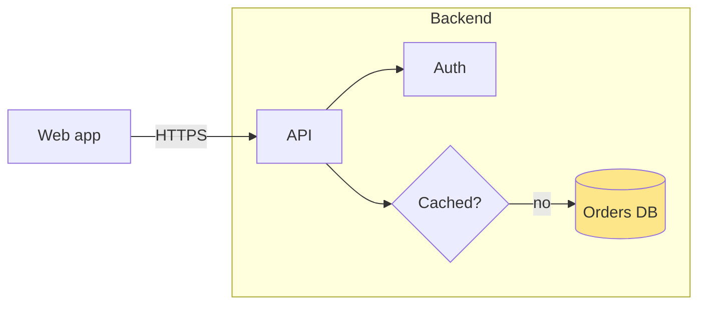
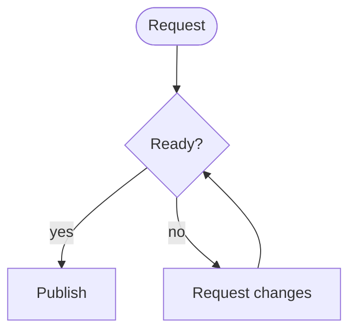
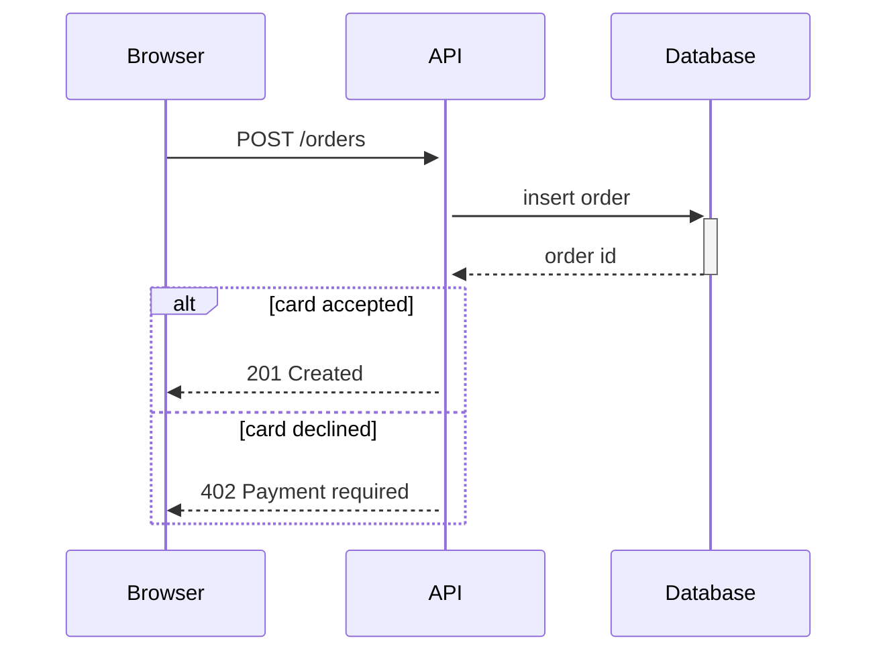

# Import diagrams

Turn a Graphviz DOT, Mermaid or D2 file into an editable `.draft` file. The importer keeps the
supported boxes, groups, labels and connections, then lays the diagram out again. It leaves the
input file unchanged.

```sh
cat <<'MERMAID' > checkout.mmd
flowchart LR
  A[Cart] -->|submit| B[API]
  B --> C[Database]
MERMAID
draftably import checkout.mmd --output checkout.draft
draftably check checkout.draft
draftably open checkout.draft
```

The import writes a new file, then `check` reports source errors and drawing conflicts. `open`
lets you inspect and refine the result. If the output file already exists, choose another name;
import never overwrites it.

In the editor, choose **File › Import text diagram…**, or **Paste Mermaid or DOT** on an empty
canvas. Paste the text or choose a file. As you paste, the dialog draws the result and lists what
the import changes. Choose **Open as new draft** to open it. You can also paste Mermaid or DOT
text straight onto the canvas; the editor shows the changes before it opens the draft. Choose
**Source** in the toolbar to see the draft text beside the canvas.

You can also paste Mermaid or DOT text into the Playground's source pane. It converts at once.
**Compare** shows Mermaid's own drawing next to the result and lists what the import changed, and
**Undo convert** brings the original text back. Typed Mermaid or DOT shows a preview of its
import until you choose **Convert to draftably**.

| Format            | Imports                              | Refuses                                          |
| ----------------- | ------------------------------------ | ------------------------------------------------ |
| Graphviz DOT      | Graphs, clusters, labels, arrowheads | Record fields, named ports, crow's feet          |
| Mermaid flowchart | Nodes, subgraphs, labels, line ends  | Unsupported arrow types, a node in two subgraphs |
| Mermaid sequence  | Participants, boxes, messages, notes | Half arrows, central connections                 |
| D2                | Ordinary graphs, containers, labels  | Sequence, class, table and multi-board diagrams  |

PlantUML, DBML, nomnoml and other Mermaid chart types are not supported yet. To move many Mermaid
fences in Markdown at once, use [`draftably migrate`](#convert-the-source).

## Mermaid next to the import

Each block shows the Mermaid source and Mermaid's own drawing on the left. The right side shows
the `.draft` file that the import writes and the drawing draftably makes from it. The import runs
in your browser when the page opens, so the right side is the real result. The list under each
block shows what the import changed.

A flowchart with a subgraph, a database shape and a `classDef` style:



A loop with a decision. The import keeps each label and the line back to the start:



A sequence with activations and an `alt` block. Each branch becomes a labeled phase band:



## Options

| Option           | Effect                                                                         |
| ---------------- | ------------------------------------------------------------------------------ |
| `--output FILE`  | Writes the result. The file must not exist yet. Without it, the source prints. |
| `--from FORMAT`  | Names the format (`dot`, `mermaid`, `d2`) when the file name does not.         |
| `--accept-lossy` | Writes the result although it has warnings. Errors always stop the import.     |

Diagnostics print to standard error. A warning means some appearance or layout detail changes. By
default, an import with warnings does not write the output file. Read the warnings, then pass
`--accept-lossy` only if the converted result is useful to you:

```sh
draftably import systems.dot --output systems.draft --accept-lossy
```

Line ends map to `head=` and `tail=`, including two-ended arrows and Mermaid circle and cross ends.
D2 variables and rules become plain values in the native file.

## Mermaid sequence diagrams

A Mermaid sequence becomes a native [sequence diagram](#sequence-diagrams):

| Mermaid                                | Draftably                                                                                                              |
| -------------------------------------- | ---------------------------------------------------------------------------------------------------------------------- |
| `participant`                          | `node`                                                                                                                 |
| `box`                                  | `group`                                                                                                                |
| `->>`                                  | `message=call`                                                                                                         |
| `-)`                                   | `message=send`                                                                                                         |
| `-->>`, `--)`                          | A reply: `answers=id` when an earlier call or send runs the other way and has no answer yet; otherwise `message=reply` |
| `-x`                                   | `head=cross`, with no kind                                                                                             |
| `->`                                   | `head=none`, with no kind                                                                                              |
| `<<->>`                                | `tail=arrow`, with no kind                                                                                             |
| `--x`, `-->`, `<<-->>`                 | A reply with the plain arrowhead; the import warns                                                                     |
| `activate`, `deactivate`, `+`, `-`     | `activations=on`, when each bar runs from a call to its reply                                                          |
| `Note over A,B` after a message A to B | A note anchored to that message; otherwise to the participant                                                          |
| Top-level `alt`, `opt`, `par`, `loop`… | A phase band per branch, labeled such as `alt: ok`                                                                     |

Branch logic stays only in the band label, so the import warns. A nested block has no band of its
own. A native activation bar runs from a call to the reply that answers it. The import turns
bars on only when that gives the bars the source draws. Otherwise it leaves them off and the
warning counts both sets. The import also warns about `autonumber`, `rect`, `create`, `destroy`,
participant symbols, participant links and a dotted line whose end is not an arrowhead.

## Limits

The CLI runs Mermaid and D2 in a worker with a 30-second deadline. It includes the D2 compiler,
which adds to its install size.

In the browser, D2 loads only when you import a D2 file and runs in a worker. Mermaid parses on
the page, with a 100 KB input limit, so a very complex input can make the page slow for a moment.
